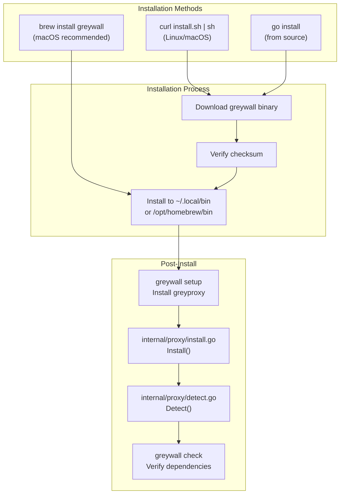

<!-- source: DeepWiki mcp.deepwiki.com · repo GreyhavenHQ/greywall · page 2 Getting Started · fetched 2026-10-26 -->

# Getting Started

<details>
<summary>Relevant source files</summary>

The following files were used as context for generating this wiki page:

- [README.md](README.md)
- [docs/quickstart.md](docs/quickstart.md)
- [install.sh](install.sh)
- [internal/proxy/detect.go](internal/proxy/detect.go)
- [internal/proxy/install.go](internal/proxy/install.go)
- [internal/proxy/start.go](internal/proxy/start.go)
- [internal/sandbox/color.go](internal/sandbox/color.go)
- [internal/sandbox/linux_features_stub.go](internal/sandbox/linux_features_stub.go)

</details>


This page provides an overview of installing greywall, verifying the installation, and running your first sandboxed commands. For detailed installation instructions, see [Installation](#2.1). For comprehensive command examples and patterns, see [Quick Start Guide](#2.2).

## Prerequisites and Dependencies

Greywall requires platform-specific dependencies:

| Platform | Required Dependencies | Optional |
|----------|----------------------|----------|
| **macOS** | None (uses built-in `sandbox-exec`) | - |
| **Linux** | `bubblewrap`, `socat` | `xdg-dbus-proxy`, `libsecret-tools`, `bpftrace` |

On macOS, greywall uses the system's `sandbox-exec` command with Seatbelt profiles [internal/sandbox/linux_features_stub.go:66-71](). On Linux, it uses `bubblewrap` for process isolation and `socat` for network bridge setup [README.md:84-87]().

**Sources:** [README.md:84-91](), [internal/sandbox/linux_features_stub.go:63-76](), [docs/quickstart.md:51-67]()

## Installation Overview

### Installation Flow



**Diagram: Installation and Setup Process**

Greywall provides several installation methods:

1. **Homebrew (macOS)**: Installs both greywall and greyproxy automatically [README.md:43-50]().
2. **install.sh script**: Handles platform detection [install.sh:12-19](), architecture mapping [install.sh:21-25](), version resolution [install.sh:28-37](), and checksum verification [install.sh:89-106](). It automatically invokes `greywall setup` [install.sh:119]().
3. **Go install**: Places the binary on your `$PATH`. Requires manual `greywall setup` afterwards [docs/quickstart.md:27-34]().

**Sources:** [README.md:41-82](), [install.sh:1-145](), [docs/quickstart.md:9-50]()

### Quick Install Commands

```bash
# Homebrew (macOS)
brew tap greyhavenhq/tap
brew install greywall

# Linux or macOS - uses install.sh script
curl -fsSL https://raw.githubusercontent.com/GreyhavenHQ/greywall/main/install.sh | sh

# Using Go install
go install github.com/GreyhavenHQ/greywall/cmd/greywall@latest
greywall setup
```

**Sources:** [README.md:41-65](), [docs/quickstart.md:9-32]()

## Verifying Installation

### System Check

After installation, verify that all components are working:

```bash
greywall check
```

This command verifies binary versions, platform-specific dependencies, and the status of `greyproxy` [README.md:122-123](). On macOS, it checks for `sandbox-exec` [internal/sandbox/linux_features_stub.go:66-71]().

**Sources:** [README.md:91](), [README.md:123](), [internal/sandbox/linux_features_stub.go:61-76]()

### greyproxy Service

Greywall requires the `greyproxy` service for network filtering. The `greywall setup` command handles installation and service startup [internal/proxy/install.go:87-153]().

- **Detection**: `internal/proxy/detect.go` checks if `greyproxy` is on the `PATH` [internal/proxy/detect.go:66-72]() and hits the health endpoint at `http://localhost:43080/api/health` [internal/proxy/detect.go:16]().
- **Startup**: `internal/proxy/start.go` runs `greyproxy service start` [internal/proxy/start.go:22]().

**Sources:** [internal/proxy/detect.go:1-127](), [internal/proxy/install.go:87-153](), [internal/proxy/start.go:1-31]()

## Your First Sandboxed Command

### Deny-by-Default Model

Greywall uses a deny-by-default model for both network and filesystem access [README.md:9]().

```bash
# Network access blocked (default behavior)
greywall -- curl https://example.com

# Filesystem access limited (default deny)
greywall -- cat ~/.ssh/id_rsa # → Permission denied
```

**Sources:** [README.md:9-11](), [README.md:98-99](), [docs/quickstart.md:104-115]()

### Basic Usage Examples

```bash
# Run with shell expansion
greywall -c "echo hello && ls"

# Route through a specific SOCKS5 proxy
greywall --proxy socks5://localhost:1080 -- npm install

# Expose a port for inbound connections
greywall -p 3000 -c "npm run dev"

# Monitor sandbox violations (e.g. blocked files/network)
greywall -m -- npm install
```

**Sources:** [README.md:97-115](), [docs/quickstart.md:119-174]()

## Working with Profiles

### Built-in Agent Profiles

Greywall ships with built-in profiles for agents like Claude Code, Cursor, and Aider [README.md:131-132](). On first run, it prompts to apply recommended rules [README.md:133-148]().

```bash
# Combine agent and toolchain profiles
greywall --profile claude,python -- claude

# List all available profiles
greywall profiles list
```

**Sources:** [README.md:129-161]()

### Learning Mode

Learning mode traces a command's filesystem access to generate a least-privilege profile automatically [README.md:23]().

```bash
# Trace file access via strace (Linux) or eslogger (macOS)
greywall --learning -- opencode

# Show the generated profile
greywall profiles show opencode
```

**Sources:** [README.md:163-179]()

## Configuration

Greywall reads from `~/.config/greywall/greywall.json` (Linux) or `~/Library/Application Support/greywall/greywall.json` (macOS) [README.md:183-184]().

```jsonc
{
  "network": {
    "proxyUrl": "socks5://localhost:43052"
  },
  "filesystem": {
    "allowRead": ["~/.config/myapp"],
    "allowWrite": ["."]
  }
}
```

**Sources:** [README.md:181-206]()

## Next Steps

- **[Installation](#2.1)** — Detailed setup instructions for all platforms.
- **[Quick Start Guide](#2.2)** — Common usage patterns and agent examples.
- **[CLI Reference](#2.3)** — Full list of commands and flags.

---

