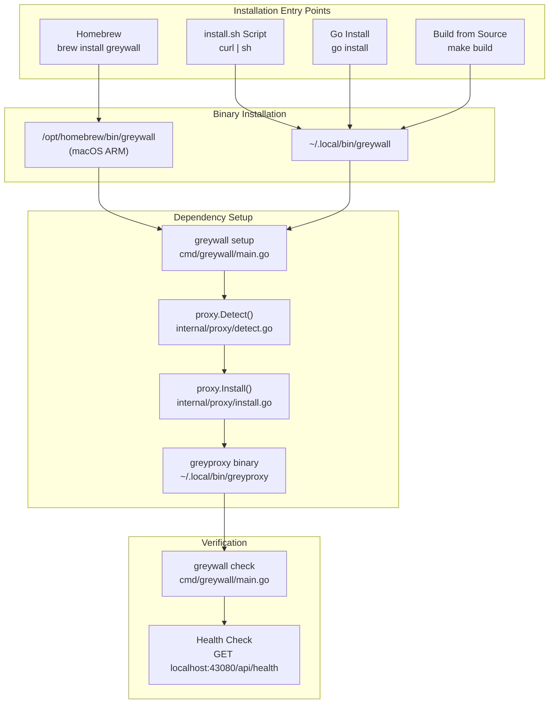
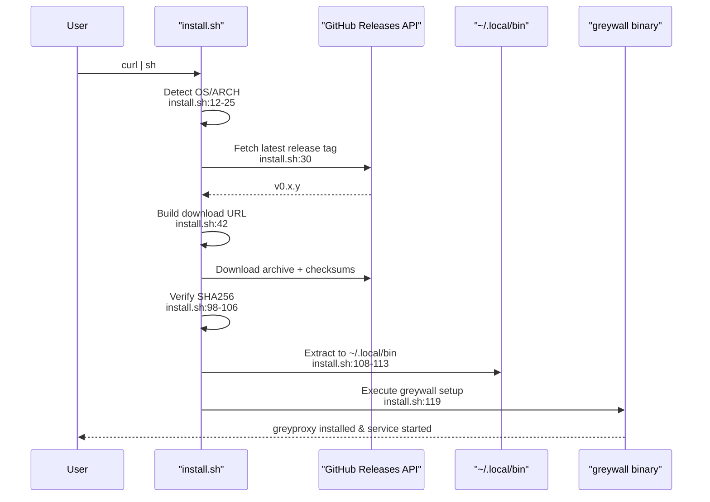
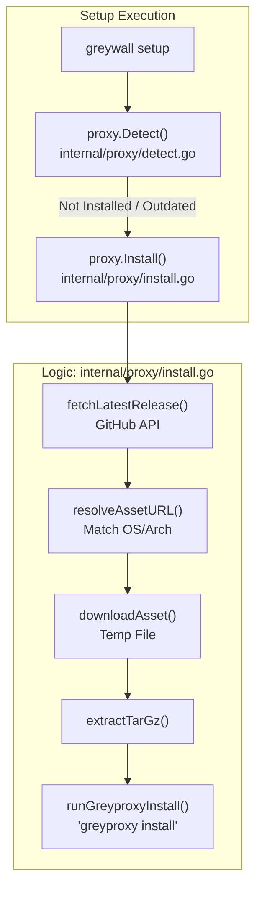

<!-- source: DeepWiki mcp.deepwiki.com · repo GreyhavenHQ/greywall · page 2.1 Installation · fetched 2026-10-26 -->

# Installation

<details>
<summary>Relevant source files</summary>

The following files were used as context for generating this wiki page:

- [.github/workflows/release.yml](.github/workflows/release.yml)
- [.goreleaser.yaml](.goreleaser.yaml)
- [README.md](README.md)
- [install.sh](install.sh)
- [internal/proxy/brew.go](internal/proxy/brew.go)
- [internal/proxy/detect.go](internal/proxy/detect.go)
- [internal/proxy/install.go](internal/proxy/install.go)
- [internal/proxy/start.go](internal/proxy/start.go)
- [internal/sandbox/color.go](internal/sandbox/color.go)
- [internal/sandbox/linux_features_stub.go](internal/sandbox/linux_features_stub.go)

</details>


This page provides detailed instructions for installing greywall on Linux and macOS systems. Installation involves two components: the `greywall` binary itself and the `greyproxy` network filtering service.

---

## Installation Methods Overview

Greywall supports multiple installation methods depending on your platform and preferences. All methods ultimately install the `greywall` binary and then set up `greyproxy` as a dependency.



**Sources:** [README.md:41-82](), [install.sh:1-145](), [internal/proxy/install.go:87-153](), [internal/proxy/detect.go:43-63]()

---

## Platform Requirements

### Linux Requirements

| Component | Purpose | Detection |
|-----------|---------|-----------|
| `bubblewrap` | Container-free sandboxing, namespace isolation | `exec.LookPath("bwrap")` |
| `socat` | Network bridge relay between sandbox and greyproxy | `exec.LookPath("socat")` |
| `tun2socks` | Transparent proxying (optional/Linux) | `internal/sandbox/linux_features_stub.go:26` |
| Kernel ≥ 5.13 | Landlock LSM support (ABI v1) | `internal/sandbox/linux_features_stub.go:18-19` |

**Linux Distribution Installation:**

```bash
# Debian/Ubuntu
sudo apt install bubblewrap socat

# Fedora/RHEL
sudo dnf install bubblewrap socat
```

### macOS Requirements

macOS uses the built-in `sandbox-exec` (Seatbelt) facility.

| Component | Availability |
|-----------|--------------|
| `sandbox-exec` | Built-in on all macOS versions [internal/sandbox/linux_features_stub.go:66]() |
| `eslogger` (learning mode) | Requires `sudo` for system event monitoring |

**Sources:** [README.md:84-91](), [internal/sandbox/linux_features_stub.go:11-76]()

---

## Homebrew Installation (macOS)

The recommended installation method for macOS. This automatically handles `greyproxy` as a dependency.

```bash
brew tap greyhavenhq/tap
brew install greywall
```

The Homebrew formula ([.goreleaser.yaml:87-109]()) performs the following:
- Installs the `greywall` binary.
- Removes the macOS quarantine attribute (`com.apple.quarantine`) from the binary [.goreleaser.yaml:102]().
- Declares a dependency on the `greyproxy` cask [.goreleaser.yaml:105]().

**Sources:** [README.md:43-50](), [.goreleaser.yaml:87-109]()

---

## install.sh Script Installation

The `install.sh` script provides a cross-platform way to download pre-built binaries.

### Script Workflow



### Script Behavior

1. **Platform Detection** ([install.sh:12-25]()): Detects OS (`uname -s`) and Architecture (`uname -m`). Supports `Linux` and `Darwin` (macOS).
2. **Version Resolution** ([install.sh:28-33]()): Defaults to the latest GitHub release unless `GREYWALL_VERSION` is provided.
3. **Checksum Verification** ([install.sh:89-106]()): Downloads `checksums.txt` from the release and verifies the archive using `sha256sum` or `shasum`.
4. **Post-Install Setup** ([install.sh:119]()): Automatically executes `greywall setup` to ensure `greyproxy` is available.

**Sources:** [install.sh:1-145](), [README.md:52-56]()

---

## Alternative Installation Methods

### Go Install
```bash
go install github.com/GreyhavenHQ/greywall/cmd/greywall@latest
```
*Note: You must run `greywall setup` manually after this.*

### Build from Source
```bash
git clone https://github.com/GreyhavenHQ/greywall
cd greywall
make setup && make build
```
This uses the build configuration defined in [.goreleaser.yaml:7-22](), setting `CGO_ENABLED=0` and embedding version information via `ldflags`.

**Sources:** [README.md:61-80](), [.goreleaser.yaml:7-22]()

---

## greyproxy Setup

The `greywall setup` command (implemented via `internal/proxy/install.go`) manages the lifecycle of the `greyproxy` dependency.

### Setup Workflow



### Key Implementation Details

- **Detection**: `proxy.Detect()` [internal/proxy/detect.go:43-63]() checks if `greyproxy` is on the PATH and queries `http://localhost:43080/api/health` to see if it is already running.
- **Version Comparison**: `proxy.IsOlderVersion()` [internal/proxy/install.go:56-83]() compares semver strings to determine if an update is required.
- **Asset Matching**: `resolveAssetURL()` [internal/proxy/install.go:189-202]() constructs the expected filename based on `runtime.GOOS` and `runtime.GOARCH` (e.g., `greyproxy_0.1.0_linux_amd64.tar.gz`).
- **Service Management**: After extraction, `runGreyproxyInstall()` [internal/proxy/install.go:299-304]() executes the binary's own install command to register it as a system service (systemd/launchd).

**Sources:** [internal/proxy/install.go:1-305](), [internal/proxy/detect.go:1-127](), [internal/proxy/start.go:1-31]()

---

## Verification

Run `greywall check` [README.md:123]() to verify the installation status.

### Dependency Status Logic
On macOS, it checks for `sandbox-exec` [internal/sandbox/linux_features_stub.go:66](). On Linux, it checks for `bubblewrap`, `socat`, and kernel capabilities like Landlock [internal/sandbox/linux_features_stub.go:11-29]().

### Colorized Output
The CLI uses `internal/sandbox/color.go` to provide visual feedback:
- `CheckOK()`: Green checkmark for satisfied requirements [internal/sandbox/color.go:23-29]().
- `CheckFail()`: Red cross for missing dependencies [internal/sandbox/color.go:31-36]().

**Sources:** [README.md:91](), [internal/sandbox/linux_features_stub.go:62-76](), [internal/sandbox/color.go:1-37]()

---

