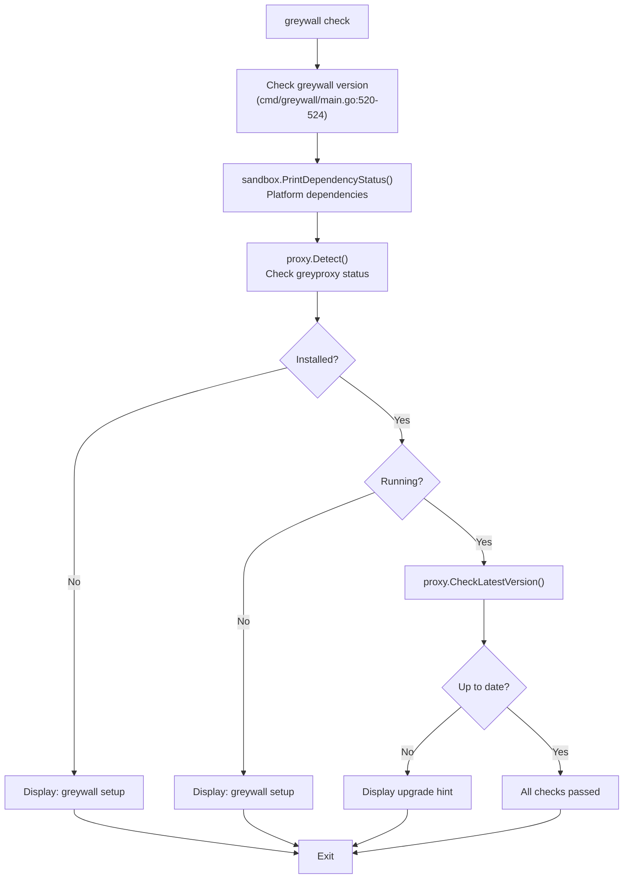
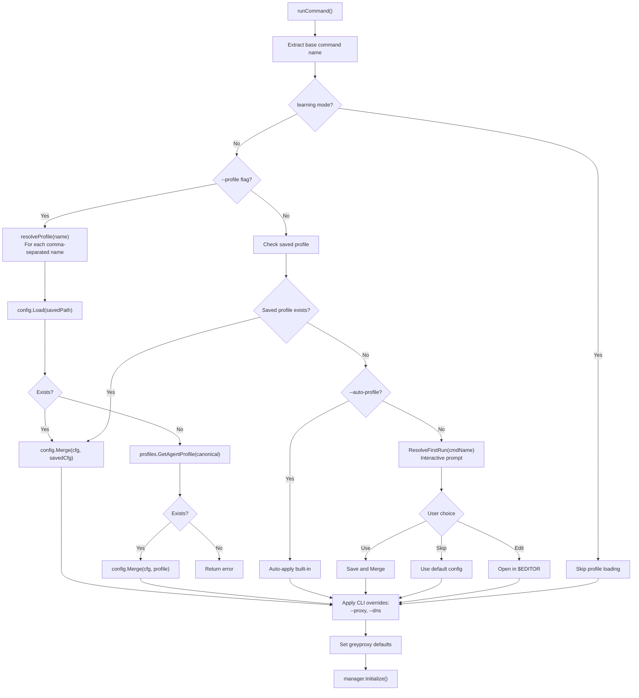
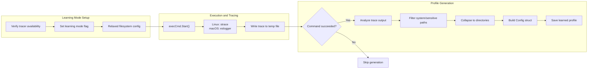

<!-- source: DeepWiki mcp.deepwiki.com · repo GreyhavenHQ/greywall · page 2.2 Quick Start Guide · fetched 2026-10-26 -->

# Quick Start Guide

<details>
<summary>Relevant source files</summary>

The following files were used as context for generating this wiki page:

- [README.md](README.md)
- [cmd/greywall/main.go](cmd/greywall/main.go)
- [docs/quickstart.md](docs/quickstart.md)
- [install.sh](install.sh)

</details>


This guide provides hands-on examples to get you started with greywall. You'll learn how to run sandboxed commands, work with profiles, and use learning mode to automatically generate security policies. For detailed CLI flag documentation, see [CLI Reference](#2.3). For configuration file format, see [Configuration Files](#6.1).

## Prerequisites and Verification

Before running sandboxed commands, verify your installation and dependencies:

```bash
greywall check
```

This command checks:
- greywall installation and version [cmd/greywall/main.go:149]()
- Platform-specific dependencies (bubblewrap and socat on Linux) [README.md:84-91]()
- Security feature availability (Landlock, seccomp, eBPF) [README.md:116-118]()
- greyproxy installation and running status [README.md:122-123]()

If greyproxy is not installed, run:

```bash
greywall setup
```

The setup command downloads and installs greyproxy, which provides the network proxy and domain filtering infrastructure [README.md:125-127](). After installation, greyproxy runs as a persistent background service.

**Verification Flow:**



Sources: [cmd/greywall/main.go:520-585](), [cmd/greywall/main.go:149]()

## Your First Sandboxed Command

### Default Behavior: Network Blocked

By default, greywall denies all network access and restricts filesystem access to the current directory [README.md:19-20]():

```bash
greywall -- curl https://example.com
```

This command will fail because network access is blocked by default unless routed through a proxy [README.md:98-99](). Open the greyproxy dashboard to allow the domain:

```bash
# Dashboard URL (shown by greywall check)
http://localhost:43080
```

In the dashboard, add `example.com` to the allowlist, then retry the command.

### Using Shell Expansion

The `-c` flag runs commands with shell expansion, similar to `sh -c` [cmd/greywall/main.go:123]():

```bash
greywall -c "echo hello && ls"
```

This is useful for pipelines, variable substitution, and other shell features [README.md:101-102]().

**Command Execution Modes:**

| Syntax | Usage | Example | Shell Expansion |
|--------|-------|---------|-----------------|
| `greywall -- <args>` | Direct execution | `greywall -- curl https://example.com` | No |
| `greywall -c "<command>"` | Shell execution | `greywall -c "echo $HOME"` | Yes |

Sources: [cmd/greywall/main.go:123](), [README.md:98-102]()

### Enabling Debug Output

Enable debug logging to see sandbox configuration and execution details [cmd/greywall/main.go:117]():

```bash
greywall -d -- curl https://example.com
```

Debug output shows:
- Loaded configuration and profile resolution
- Sandbox implementation details (bubblewrap args, Seatbelt profile)
- Network proxy configuration
- Stripped environment variables

Sources: [cmd/greywall/main.go:117](), [README.md:110-111]()

## Basic Usage Patterns

### Port Exposure for Development Servers

Expose ports for inbound connections (e.g., running a web server inside the sandbox) [cmd/greywall/main.go:124]():

```bash
greywall -p 3000 -c "npm run dev"
```

Multiple ports can be exposed [cmd/greywall/main.go:124]():

```bash
greywall -p 3000 -p 5173 -- vite
```

On Linux, this creates a reverse SOCKS5 bridge that forwards connections from the host to the sandboxed network namespace. On macOS, it configures the Seatbelt profile to allow binding to the specified ports [cmd/greywall/main.go:81-90]().

Sources: [cmd/greywall/main.go:124](), [README.md:107-108]()

### Monitoring Sandbox Violations

The `-m` flag enables real-time monitoring of sandbox violations [cmd/greywall/main.go:118]():

```bash
greywall -m -- npm install
```

On Linux, this starts an eBPF monitor that traces blocked filesystem operations and syscalls. On macOS, it monitors the unified log for Seatbelt denial messages [README.md:24](). Violations are printed to stderr as they occur.

Sources: [cmd/greywall/main.go:118](), [README.md:113-114]()

### Custom Configuration Files

Override the default configuration file location [cmd/greywall/main.go:119]():

```bash
greywall --settings ./myconfig.json -- <command>
```

The configuration file supports:
- Network proxy settings (`network.proxyUrl`, `network.dnsAddr`)
- Filesystem access rules (`filesystem.allowRead`, `filesystem.denyWrite`)
- Command deny patterns (`command.deny`)

Sources: [cmd/greywall/main.go:119](), [README.md:185-204]()

## Working with Profiles

### Auto-Detection and First-Run Experience

When running a known command without a profile, greywall offers to apply its built-in profile [README.md:131-136]():

```bash
greywall -- claude
```

This triggers the first-run UX, showing what the profile allows and offering options [README.md:138-148]():
- **[Y]** Use profile (saves for future runs)
- **[e]** Edit first
- **[s]** Skip (use restrictive defaults)
- **[n]** Don't ask again

The profile is saved to the local configuration directory.

**Profile Resolution Flow:**



Sources: [cmd/greywall/main.go:129](), [README.md:131-161]()

### Explicit Profile Loading

Load specific profiles by name [cmd/greywall/main.go:129]():

```bash
greywall --profile claude -- claude
```

Combine multiple profiles (agent + toolchains) [README.md:150-158]():

```bash
greywall --profile claude,python,node -- claude
```

Profiles are merged in order. Built-in profiles include AI Agents (claude, cursor, aider, etc.) and Toolchains (python, node, go, etc.) [README.md:131]().

Sources: [cmd/greywall/main.go:129](), [README.md:131-161]()

### Listing and Inspecting Profiles

List all available profiles (saved and built-in) [cmd/greywall/main.go:148]():

```bash
greywall profiles list
```

Show the contents of a specific profile [README.md:175]():

```bash
greywall profiles show opencode
```

Sources: [cmd/greywall/main.go:148](), [README.md:160-176]()

## Learning Mode Workflow

Learning mode traces a command's filesystem access and auto-generates a profile [cmd/greywall/main.go:128]():

### Step 1: Run in Learning Mode

```bash
greywall --learning -- opencode
```

**What happens:**
1. Command runs with relaxed filesystem sandbox [README.md:168-169]()
2. On Linux: `strace` traces system calls [README.md:168]()
3. On macOS: `eslogger` traces filesystem events [README.md:23]()
4. Trace data collected for analysis

**Warning:** Learning mode relaxes filesystem restrictions. Only use with trusted commands.

### Step 2: Profile Generation

After the command completes, greywall analyzes the trace and generates `allowRead` and `allowWrite` lists, saving the result as a learned profile [README.md:171-173]().

### Step 3: Auto-Loading on Next Run

```bash
greywall -- opencode
```

The learned profile is automatically loaded without prompting [README.md:177-179]().

**Learning Mode Architecture:**



Sources: [cmd/greywall/main.go:128](), [README.md:163-180]()

## Common Use Cases

### Running AI Coding Agents

```bash
# Use a built-in profile
greywall --profile claude -- claude
```

### Development Server with Port Exposure

```bash
greywall -p 3000 -c "npm run dev"
```

### Custom Network Routing

Route through an external SOCKS5 proxy [cmd/greywall/main.go:120]():

```bash
greywall --proxy socks5://localhost:1080 -- curl https://api.example.com
```

### Command Deny Rules

Block dangerous commands by configuring `command.deny` [README.md:201-203]():

```bash
greywall -c "rm -rf /"  # Blocked by command deny rules
```

Sources: [README.md:38](), [README.md:201-203]()

## Quick Reference

### Essential Commands

| Command | Purpose |
|---------|---------|
| `greywall check` | Verify installation and dependencies [README.md:123]() |
| `greywall setup` | Install/start greyproxy [README.md:126]() |
| `greywall -- <cmd>` | Run sandboxed command [README.md:29]() |
| `greywall -c "<cmd>"` | Run with shell expansion [README.md:102]() |
| `greywall --learning -- <cmd>` | Generate profile from trace [README.md:169]() |

### Common Flags

| Flag | Short | Purpose |
|------|-------|---------|
| `--debug` | `-d` | Enable debug output [cmd/greywall/main.go:117]() |
| `--monitor` | `-m` | Monitor violations [cmd/greywall/main.go:118]() |
| `--port <n>` | `-p` | Expose port [cmd/greywall/main.go:124]() |
| `--profile <name>` | | Load profile(s) [cmd/greywall/main.go:129]() |
| `--proxy <url>` | | Override SOCKS5 proxy [cmd/greywall/main.go:120]() |

Sources: [cmd/greywall/main.go:117-139](), [README.md:93-127]()

---

