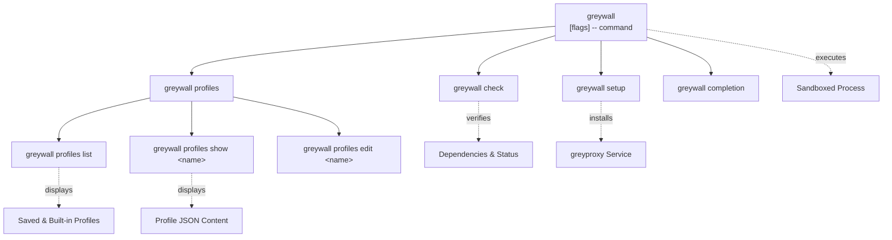
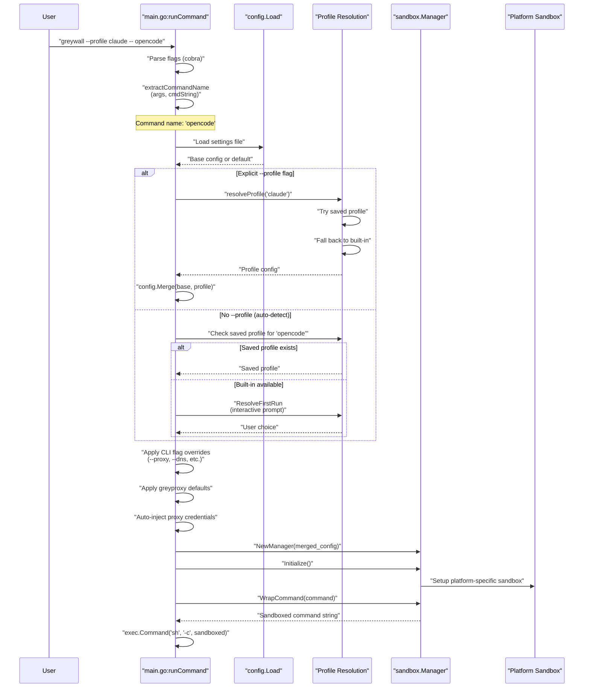
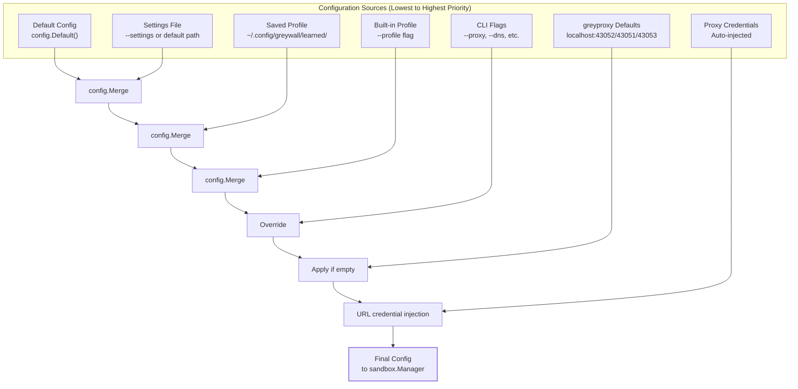

<!-- source: DeepWiki mcp.deepwiki.com · repo GreyhavenHQ/greywall · page 2.3 CLI Reference · fetched 2026-10-26 -->

# CLI Reference

<details>
<summary>Relevant source files</summary>

The following files were used as context for generating this wiki page:

- [cmd/greywall/main.go](cmd/greywall/main.go)
- [docs/agents.md](docs/agents.md)
- [docs/cli-reference.md](docs/cli-reference.md)
- [docs/templates.md](docs/templates.md)

</details>


This page provides a complete reference for all `greywall` command-line interface commands, flags, and options. For general usage patterns and examples, see [Quick Start Guide](#2.2). For configuration file formats, see [Configuration System](#6).

---

## Command Overview

The `greywall` CLI provides a root command for sandboxing processes and several subcommands for system management, profile inspection, and shell completion.



**Sources:** [cmd/greywall/main.go:67-150](), [cmd/greywall/main.go:704-711]()

---

## Root Command: `greywall`

### Syntax

```bash
greywall [flags] [--] <command> [args...]
greywall -c "<shell string>"
```

The root command executes a command inside a sandboxed environment with network and filesystem restrictions. Use `--` to separate greywall flags from the command being sandboxed.

### Global Flags

| Flag | Shorthand | Type | Default | Description |
|------|-----------|------|---------|-------------|
| `--debug` | `-d` | bool | `false` | Enable debug logging to stderr |
| `--monitor` | `-m` | bool | `false` | Monitor and log sandbox violations (eBPF on Linux, unified log on macOS) |
| `--settings` | `-s` | string | OS config dir | Path to configuration file (see [Configuration Files](#6.1)) |
| `--proxy` | | string | `socks5://localhost:43052` | External SOCKS5 proxy URL for network traffic |
| `--http-proxy` | | string | `http://localhost:43051` | HTTP CONNECT proxy URL for network traffic |
| `--dns` | | string | `localhost:43053` | DNS server address for name resolution |
| `-c` | `-c` | string | | Run command string with shell expansion (like `sh -c`) |
| `--port` | `-p` | []string | | Expose port for inbound connections (repeatable) |
| `--forward` | `-f` | []string | | Forward host localhost port into sandbox (Linux only, repeatable) |
| `--version` | `-v` | bool | `false` | Show version, build time, and commit information |
| `--linux-features` | | bool | `false` | Display available Linux security features and exit |
| `--learning` | | bool | `false` | Trace filesystem access and generate profile (see [Learning Mode](#6.3)) |
| `--profile` | | string | | Load profiles by name, comma-separated (e.g., `claude,python`) |
| `--auto-profile` | | bool | `false` | Automatically apply saved or built-in profile without user prompt |
| `--no-network-rules` | | bool | `false` | Skip applying profile network rules to greyproxy |
| `--no-credential-protection` | | bool | `false` | Disable credential substitution (real values visible in sandbox) |
| `--inject` | | []string | | Inject a global credential by label from proxy dashboard |
| `--secret` | | []string | | Protect an additional env var not in the default list |
| `--ignore-secret` | | []string | | Exclude an env var from credential detection |
| `--allow` | | []string | | Allow a network destination for this session (e.g. `api.example.com:443`) |
| `--blank` | | bool | `false` | With `--learning`, skip default profile network rules |

**Sources:** [cmd/greywall/main.go:117-145](), [docs/cli-reference.md:18-39]()

### Command Specification Methods

The CLI accepts commands in two forms:

1. **Positional arguments** (recommended):
   ```bash
   greywall -- curl https://example.com
   greywall --profile python -- python script.py
   ```
   Use `--` to prevent flag parsing confusion when the sandboxed command has its own flags. [cmd/greywall/main.go:85-87]()

2. **Shell string** with `-c`:
   ```bash
   greywall -c "echo hello && ls"
   greywall -c "npm install && npm run dev"
   ```
   Allows shell operators (`&&`, `||`, pipes, etc.). [cmd/greywall/main.go:88-90]()

---

## Command Execution Flow

This diagram shows how CLI flags are processed and how configuration is merged before sandbox execution:



**Sources:** [cmd/greywall/main.go:136-447]()

---

## Subcommands

### `greywall check`

Runs diagnostics to verify greywall installation, dependencies, security features, and greyproxy status.

**Syntax:**
```bash
greywall check
```

**Verifies:**
- Required binaries (`bwrap`, `socat` on Linux). [docs/cli-reference.md:88]()
- Linux kernel security features (Landlock, seccomp, eBPF). [docs/cli-reference.md:89]()
- Greyproxy installation and service status. [docs/cli-reference.md:90]()

**Sources:** [cmd/greywall/main.go:149](), [docs/cli-reference.md:79-91]()

---

### `greywall setup`

Downloads, installs, and starts the greyproxy service.

**Syntax:**
```bash
greywall setup
```

**Behavior:**
- Installs greyproxy to `~/.local/bin/greyproxy`. [docs/cli-reference.md:100]()
- Registers it as a systemd user service (Linux) or launchd agent (macOS). [docs/cli-reference.md:100]()

**Sources:** [cmd/greywall/main.go:150](), [docs/cli-reference.md:92-101]()

---

### `greywall profiles`

Manages sandbox configuration profiles. Alias: `templates`. [docs/cli-reference.md:130]()

#### `greywall profiles list`

Lists all available profiles, including saved learned profiles and built-in profiles.

**Syntax:**
```bash
greywall profiles list
```

**Sources:** [docs/cli-reference.md:128-134]()

#### `greywall profiles show <name>`

Displays the full JSON content of a profile.

**Syntax:**
```bash
greywall profiles show <name>
```

**Sources:** [docs/cli-reference.md:136-142]()

#### `greywall profiles edit <name>`

Open a saved profile in `$EDITOR` for direct editing.

**Syntax:**
```bash
greywall profiles edit <name>
```

**Sources:** [docs/cli-reference.md:144-150]()

---

## Flag Processing and Configuration Merging

This diagram shows the precedence order for configuration resolution:



**Sources:** [cmd/greywall/main.go:178-314]()

---

## Environment Variables

The following environment variables are used or set by greywall:

| Variable | Description |
|----------|-------------|
| `GREYWALL_SANDBOX` | Set to `1` inside sandboxed processes. [docs/cli-reference.md:156]() |
| `HTTP_PROXY` / `HTTPS_PROXY` | Set to point to the local HTTP proxy. [docs/cli-reference.md:158]() |
| `ALL_PROXY` | Set to point to the SOCKS5 proxy. [docs/cli-reference.md:159]() |
| `GIT_SSH_COMMAND` | Set on macOS to route SSH through the proxy. [docs/cli-reference.md:160]() |

**Sources:** [docs/cli-reference.md:152-161]()

---

## Exit Codes

| Code | Meaning |
|------|---------|
| `0` | Success |
| `1` | Greywall error (config invalid, dependency missing, command blocked by policy) |
| Other | The exit code of the sandboxed command itself |

**Sources:** [docs/cli-reference.md:163-169]()

---

## Command-to-Code Entity Mapping

This table maps CLI elements to their implementation in the codebase:

| CLI Element | Implementation | File Reference |
|-------------|----------------|----------------|
| `greywall` root command | `runCommand()` | [cmd/greywall/main.go:136-447]() |
| `--debug` flag | `debug` variable | [cmd/greywall/main.go:34]() |
| `--monitor` flag | `monitor` variable | [cmd/greywall/main.go:35]() |
| `--settings` flag | `settingsPath` variable | [cmd/greywall/main.go:36]() |
| `--proxy` flag | `proxyURL` variable | [cmd/greywall/main.go:120]() |
| `--learning` flag | `learning` variable | [cmd/greywall/main.go:128]() |
| `--profile` flag | `profileName` variable | [cmd/greywall/main.go:129]() |
| `greywall check` | `newCheckCmd()` | [cmd/greywall/main.go:149]() |
| `greywall setup` | `newSetupCmd()` | [cmd/greywall/main.go:150]() |
| `greywall profiles` | `newProfilesCmd()` | [cmd/greywall/main.go:148]() |
| `--landlock-apply` | `runLandlockWrapper()` | [cmd/greywall/main.go:63]() |

**Sources:** [cmd/greywall/main.go:1-868]()

---

