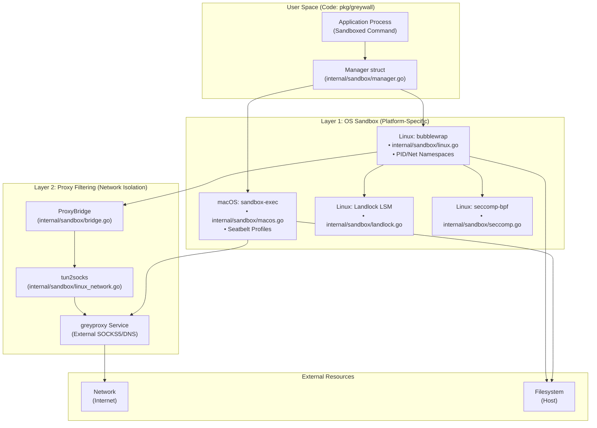
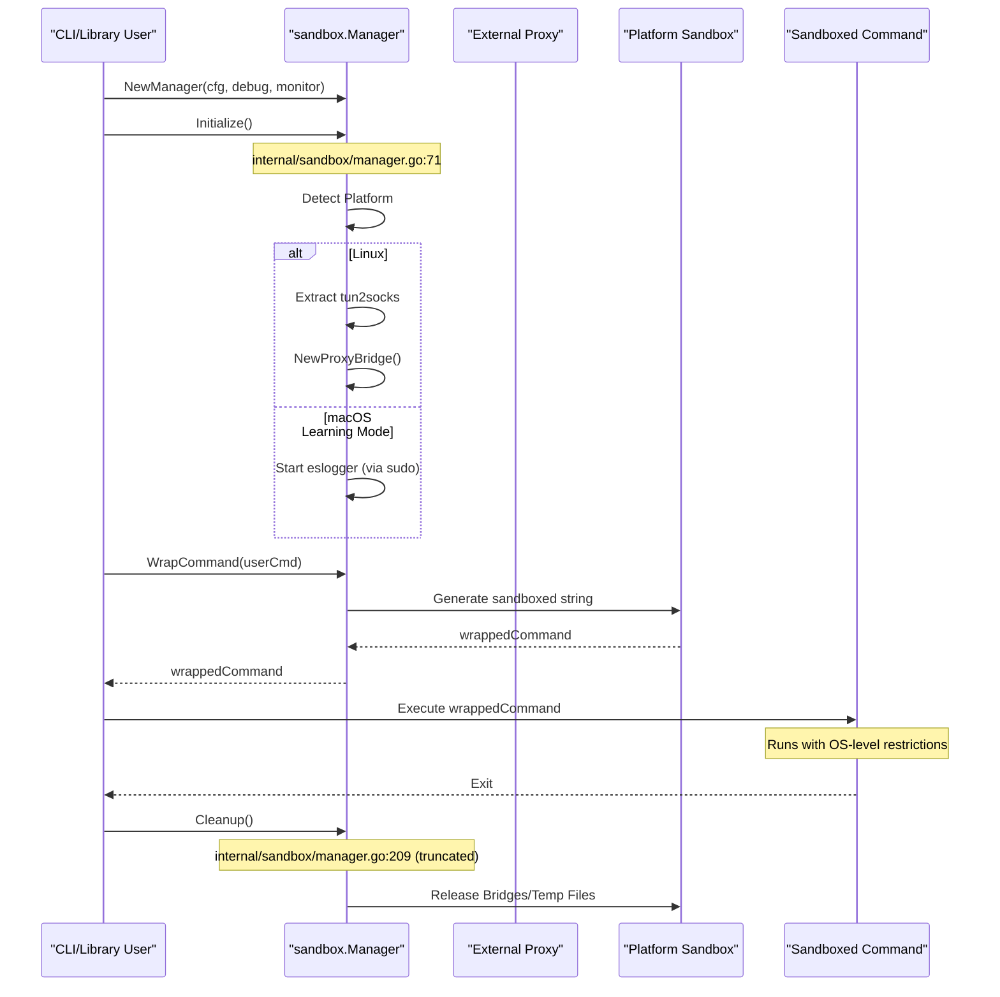

<!-- source: DeepWiki mcp.deepwiki.com · repo GreyhavenHQ/greywall · page 3 Core Concepts · fetched 2026-10-26 -->

# Core Concepts

<details>
<summary>Relevant source files</summary>

The following files were used as context for generating this wiki page:

- [docs/benchmarking.md](docs/benchmarking.md)
- [docs/concepts.md](docs/concepts.md)
- [docs/library.md](docs/library.md)
- [docs/security-model.md](docs/security-model.md)
- [internal/sandbox/manager.go](internal/sandbox/manager.go)

</details>


This page explains the fundamental architecture and security model of greywall. It covers the deny-by-default security principle, the two-layer isolation architecture (OS sandbox + proxy filtering), and the sandbox lifecycle from initialization to cleanup.

For details on network isolation mechanisms, see [Network Isolation](#3.1). For filesystem access control details, see [Filesystem Isolation](#3.2). For the threat model and security guarantees, see [Security Model](#3.3).

---

## Deny-by-Default Security Model

Greywall implements a deny-by-default security model for both network and filesystem access. This means that **all operations are blocked unless explicitly allowed** in the configuration.

| Resource Type | Default Behavior | Allow Mechanism |
|---------------|------------------|-----------------|
| **Network** | All outbound traffic blocked | `Network.AllowedDomains` list in config |
| **Filesystem Reads** | Blocked except system paths + CWD | `Filesystem.AllowRead` list in config |
| **Filesystem Writes** | Blocked entirely | `Filesystem.AllowWrite` list in config |
| **Commands** | Allowed unless matched | `Command.Deny` patterns in config |

The default configuration creates a highly restrictive sandbox:

```go
// Default config blocks all network and enables deny-by-default reads
cfg := greywall.DefaultConfig()
// Equivalent to:
// - Network.AllowedDomains: [] (blocks all traffic)
// - Filesystem.DefaultDenyRead: true (when nil/unset)
// - Filesystem.AllowWrite: [] (must opt-in)
```

**Sources:** [docs/security-model.md:23-49](), [docs/library.md:77-84](), [docs/concepts.md:61-72]()

---

## Two-Layer Isolation Architecture

Greywall uses a **two-layer defense-in-depth architecture** to enforce isolation:

1.  **OS Sandbox Layer**: Process isolation via platform-specific sandboxing mechanisms (bubblewrap on Linux, sandbox-exec on macOS).
2.  **Proxy Filtering Layer**: Network filtering via an external SOCKS5 proxy (typically `greyproxy`), which provides domain-based allow/deny controls.

### Architecture Diagram: Natural Language to Code Entities



**Layer 1 (OS Sandbox)** provides process and resource isolation:
*   **Linux**: Uses `bubblewrap` for namespace isolation, `Landlock` for filesystem ACLs, and `seccomp-bpf` for syscall filtering [docs/concepts.md:86-89]().
*   **macOS**: Uses `sandbox-exec` with Seatbelt profiles for combined process/filesystem/network restrictions [docs/concepts.md:85-86]().

**Layer 2 (Proxy Filtering)** provides network access control:
*   All network traffic routes through a SOCKS5 proxy (defaulting to `greyproxy`) [docs/concepts.md:13-17]().
*   On Linux, transparent proxying via a TUN device and `tun2socks` captures all traffic [internal/sandbox/manager.go:139-148]().
*   On macOS, proxy environment variables route traffic for applications that honor them; others are blocked by the sandbox [docs/concepts.md:21-24]().

**Sources:** [docs/concepts.md:8-24](), [docs/security-model.md:31-38](), [internal/sandbox/manager.go:13-34]()

---

## Sandbox Lifecycle

The sandbox follows a well-defined lifecycle managed by the `Manager` type [internal/sandbox/manager.go:14]().

### Lifecycle Phases Diagram



### Phase 1: Manager Initialization

The `Manager` is created and initialized via `NewManager` [internal/sandbox/manager.go:37-43](). During `Initialize()` [internal/sandbox/manager.go:71-137]():
*   **Platform Support Check**: Validates the OS is supported [internal/sandbox/manager.go:76-78]().
*   **Linux Setup**: Extracts `tun2socks` and initializes the `ProxyBridge` (socat) to connect the isolated network namespace to the external proxy [internal/sandbox/manager.go:139-158]().
*   **macOS Learning**: If learning mode is enabled, starts `eslogger` via sudo to trace filesystem access [internal/sandbox/manager.go:83-113]().

### Phase 2: Command Wrapping

The user command is wrapped with sandbox restrictions via `WrapCommand`.
*   **Linux**: Generates a `bubblewrap` invocation with namespace flags, bind mounts, and Landlock/Seccomp enforcement.
*   **macOS**: Generates a `sandbox-exec` invocation using a Seatbelt profile and sets proxy environment variables (`HTTP_PROXY`, `HTTPS_PROXY`, `ALL_PROXY`) [docs/security-model.md:37]().

### Phase 3: Execution and Monitoring

The wrapped command runs as a subprocess.
*   **Environment Sanitization**: Dangerous variables like `LD_PRELOAD` (Linux) or `DYLD_INSERT_LIBRARIES` (macOS) are stripped [docs/security-model.md:59-67]().
*   **Monitoring**: If `-m/--monitor` is passed, violations are logged [docs/security-model.md:68-71]().
*   **Learning Mode**: If enabled, `strace` (Linux) or `eslogger` (macOS) records path access to generate a profile template [internal/sandbox/manager.go:26-32]().

### Phase 4: Cleanup

The `Cleanup()` method releases resources [docs/library.md:153-155]():
*   Stops proxy bridges and DNS bridges.
*   Removes extracted binaries and temporary log files.
*   **Note**: The external `greyproxy` service remains running as it is managed independently.

**Sources:** [internal/sandbox/manager.go:71-208](), [docs/security-model.md:59-71](), [docs/library.md:116-136]()

---

## Configuration System

Greywall uses a profile-based configuration system that supports inheritance via the `Extends` field [docs/library.md:166-174]().

### Configuration Components

| Component | Code Entity | Purpose |
|-----------|------------|---------|
| **Network** | `NetworkConfig` | Domain allowlists, local binding, and proxy ports [docs/library.md:178-188](). |
| **Filesystem** | `FilesystemConfig` | Read/Write allow/deny rules and Git config access [docs/library.md:193-202](). |
| **Command** | `CommandConfig` | Pattern-based command blocking [docs/library.md:206-211](). |
| **SSH** | `SSHConfig` | Restrictions for commands run over SSH [docs/library.md:215-224](). |

**Sources:** [docs/library.md:162-225](), [docs/concepts.md:61-72]()

---

## Summary

Greywall's core architecture consists of:

1.  **Deny-by-default security**: All resources (Network, Filesystem) are blocked unless explicitly opted-in.
2.  **Two-layer isolation**: Combines OS-level sandboxing (bubblewrap/Seatbelt) with application-level network filtering (greyproxy).
3.  **Unified Lifecycle**: Managed through the `Manager` struct which handles platform-specific initialization and command wrapping.
4.  **Defense-in-Depth**: Includes environment sanitization, credential protection, and D-Bus isolation to prevent common sandbox escapes [docs/security-model.md:51-67]().

For network isolation details, see [Network Isolation](#3.1).  
For filesystem isolation details, see [Filesystem Isolation](#3.2).  
For security guarantees and threat model, see [Security Model](#3.3).

---

