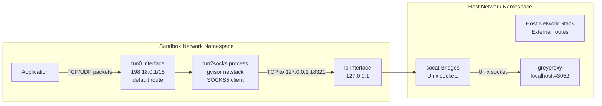
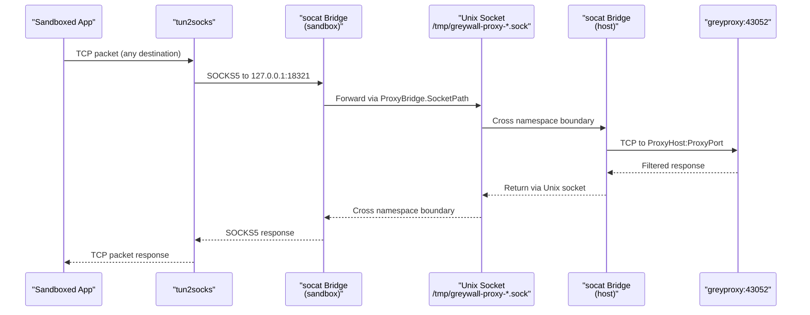
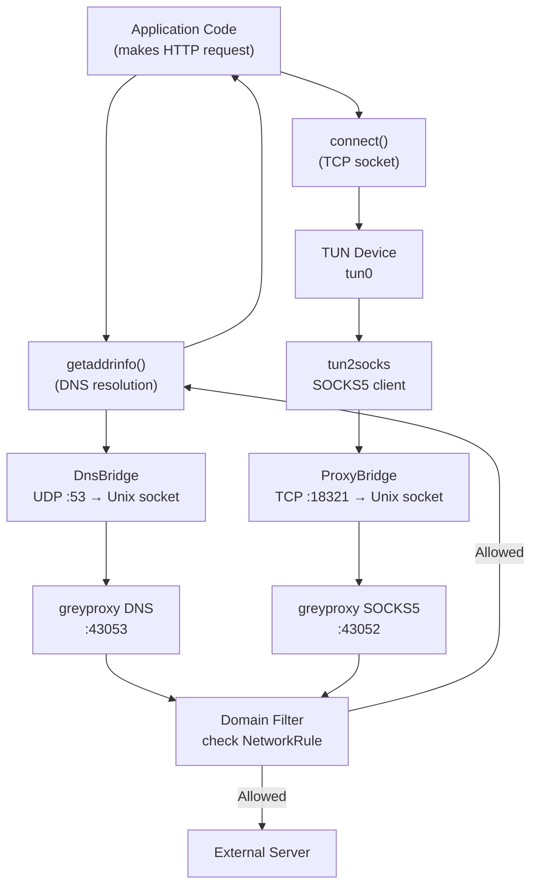

<!-- source: DeepWiki mcp.deepwiki.com · repo GreyhavenHQ/greywall · page 3.1 Network Isolation · fetched 2026-10-26 -->

# Network Isolation

<details>
<summary>Relevant source files</summary>

The following files were used as context for generating this wiki page:

- [internal/config/config.go](internal/config/config.go)
- [internal/sandbox/integration_macos_test.go](internal/sandbox/integration_macos_test.go)
- [internal/sandbox/linux.go](internal/sandbox/linux.go)
- [internal/sandbox/macos.go](internal/sandbox/macos.go)
- [internal/sandbox/macos_test.go](internal/sandbox/macos_test.go)

</details>


## Purpose and Scope

This page explains how greywall controls network access for sandboxed processes. It covers the two-layer isolation model (OS-level sandbox + proxy-based filtering), platform-specific implementations (Linux transparent proxying vs macOS proxy environment variables), and the greyproxy service architecture.

For filesystem access control, see [Filesystem Isolation](#3.2). For the overall security model and threat coverage, see [Security Model](#3.3). For greyproxy installation, management, and dashboard usage, see [greyproxy Service](#5.1).

## Two-Layer Isolation Model

Greywall enforces network isolation through two independent layers:

1. **OS-level network blocking** — Prevents direct network access at the kernel level.
2. **Proxy-based domain filtering** — Allows selective outbound traffic through greyproxy.

The OS sandbox ensures processes cannot bypass the proxy, while greyproxy enforces domain-based allow/deny lists. This defense-in-depth approach prevents both direct network access and unauthorized domains from being reached through the proxy.

```mermaid
graph TB
    subgraph "Sandboxed Process"
        APP["Application<br/>(curl, npm, etc)"]
    end
    
    subgraph "OS Sandbox Layer"
        LINUX["Linux: Network Namespace<br/>--unshare-net<br/>No external routes"]
        MACOS["macOS: Seatbelt Profile<br/>network-outbound rules<br/>Only proxy allowed"]
    end
    
    subgraph "Proxy Filter Layer"
        GREYPROXY["greyproxy Service<br/>localhost:43052 (SOCKS5)<br/>localhost:43051 (HTTP)<br/>localhost:43053 (DNS)"]
        RULES["Domain Filter<br/>NetworkRule<br/>Action: allow/deny"]
    end
    
    subgraph "External Network"
        INTERNET["Internet"]
    end
    
    APP --> LINUX
    APP --> MACOS
    
    LINUX -->|"Only proxy reachable"| GREYPROXY
    MACOS -->|"Only proxy reachable"| GREYPROXY
    
    GREYPROXY --> RULES
    RULES -->|"Allowed domains"| INTERNET
    RULES -.X.-|"Denied/unlisted domains"| APP
```

**Sources:** [internal/config/config.go:51-58](), [internal/sandbox/macos.go:32-39](), [internal/sandbox/linux.go:638-643]()

## Platform-Specific Implementations

| Aspect | Linux | macOS |
|--------|-------|-------|
| **OS Mechanism** | Network namespace isolation (`--unshare-net`) | Seatbelt profile network rules |
| **Proxy Method** | Transparent proxying via TUN device | Environment variables (`HTTP_PROXY`, `HTTPS_PROXY`, `ALL_PROXY`) |
| **Network Stack** | Isolated network namespace with loopback only | Full host network stack with filtered outbound |
| **TUN Device** | `tun0` (198.18.0.1/15) via `tun2socks` | Not used |
| **Bridge Component** | `socat` Unix socket bridges | Not needed (direct TCP to proxy) |
| **DNS Override** | Custom `/etc/resolv.conf` (127.0.0.1 or TCP-based) | Proxy environment variables |
| **Requirements** | `bwrap`, `socat`, `tun2socks` | `sandbox-exec` (built-in) |

**Sources:** [internal/sandbox/linux.go:638-643](), [internal/sandbox/macos.go:576-619]()

## Linux: Transparent Proxying Architecture

### Network Namespace Isolation

Linux sandboxes use `bubblewrap --unshare-net` to create an isolated network namespace with no external connectivity. The namespace contains only a loopback interface and a TUN device.



The namespace setup is performed by `bwrap` with these flags:
- `--unshare-net` — Create isolated network namespace [internal/sandbox/linux.go:638-643]()
- `--cap-add CAP_NET_ADMIN` — Allow TUN device creation and network configuration [internal/sandbox/linux.go:905-916]()

**Sources:** [internal/sandbox/linux.go:638-643](), [internal/sandbox/linux.go:905-916]()

### TUN Device and tun2socks

The TUN device (`tun0`) is set up as the default route inside the sandbox network namespace. All network traffic from sandboxed processes is routed to `tun0`, where `tun2socks` intercepts it.

**Network setup script** (generated by [internal/sandbox/linux.go:1005-1025]()):

```bash
# Bring up loopback (needed for socat binding)
ip link set lo up

# Create and configure TUN device
ip tuntap add dev tun0 mode tun
ip addr add 198.18.0.1/15 dev tun0
ip link set dev tun0 up
ip route add default via 198.18.0.1 dev tun0

# Start tun2socks (gvisor netstack)
/tmp/greywall-tun2socks -device tun0 -proxy socks5://127.0.0.1:18321 &
```

`tun2socks` converts raw IP packets from the TUN device into SOCKS5 connections to `127.0.0.1:18321`, which is bridged via `socat` to the host's greyproxy service.

**Sources:** [internal/sandbox/linux.go:1005-1025](), [internal/sandbox/linux.go:905-916]()

### Unix Socket Bridges

Three types of bridges connect the isolated network namespace to the host:

#### ProxyBridge

Bridges SOCKS5 traffic from sandbox to greyproxy.

**Component:** `ProxyBridge` [internal/sandbox/linux.go:21-31]()

**Flow:**
1. Host side: `socat UNIX-LISTEN:/tmp/greywall-proxy-*.sock TCP:localhost:43052` [internal/sandbox/linux.go:175-179]()
2. Sandbox side: `socat TCP-LISTEN:18321 UNIX-CONNECT:/tmp/greywall-proxy-*.sock`
3. Application → tun2socks → 127.0.0.1:18321 → Unix socket → greyproxy:43052



**Sources:** [internal/sandbox/linux.go:131-192](), [internal/sandbox/linux.go:1016-1020]()

#### DnsBridge

Bridges DNS queries from sandbox to greyproxy's DNS server.

**Component:** `DnsBridge` [internal/sandbox/linux.go:33-41]()

**Flow:**
1. Host side: `socat UNIX-LISTEN:/tmp/greywall-dns-*.sock UDP:localhost:43053` [internal/sandbox/linux.go:65-68]()
2. Sandbox side: `socat UDP4-RECVFROM:53 UNIX-CONNECT:/tmp/greywall-dns-*.sock`
3. Application DNS query → UDP :53 → Unix socket → greyproxy:43053

When `DnsBridge` is active, `/etc/resolv.conf` inside the sandbox is overridden to point to `127.0.0.1`.

**Sources:** [internal/sandbox/linux.go:43-90](), [internal/sandbox/linux.go:926-949]()

#### ReverseBridge

Bridges inbound connections from host to sandboxed dev servers.

**Component:** `ReverseBridge` [internal/sandbox/linux.go:105-111]()

**Flow (for exposed port 3000):**
1. Host side: `socat TCP-LISTEN:3000 UNIX-CONNECT:/tmp/greywall-rev-3000-*.sock`
2. Sandbox side: `socat UNIX-LISTEN:/tmp/greywall-rev-3000-*.sock TCP:127.0.0.1:3000`
3. External client → Host port 3000 → Unix socket → Sandbox 127.0.0.1:3000

This enables inbound access to sandboxed dev servers (started with `forwardPorts` config or CLI flag) while maintaining network isolation for outbound traffic.

**Sources:** [internal/sandbox/linux.go:222-272](), [internal/sandbox/linux.go:1055-1064](), [internal/config/config.go:69]()

### DNS Resolution

Linux sandboxes override `/etc/resolv.conf` to control DNS resolution:

**With DnsBridge** [internal/sandbox/linux.go:929-932]():
```
nameserver 127.0.0.1
```
Points to local socat relay (UDP :53 → Unix socket → greyproxy:43053).

**Without DnsBridge (tun2socks only)** [internal/sandbox/linux.go:933-938]():
```
nameserver 1.1.1.1
nameserver 8.8.8.8
options use-vc
```
Forces TCP-based DNS (RFC 1035 §4.2.2 "use-vc" flag), which `tun2socks` handles natively via SOCKS5 tunnel.

**Sources:** [internal/sandbox/linux.go:926-949]()

## macOS: Seatbelt Profile Network Rules

macOS sandboxes use Seatbelt profiles to enforce network restrictions. The profile allows outbound connections only to greyproxy's local ports and denies everything else.

### Profile Generation

Network rules are generated by `GenerateSandboxProfile()` [internal/sandbox/macos.go:422-644]() based on `MacOSSandboxParams.NeedsNetworkRestriction`.

**When network restriction is enabled** [internal/sandbox/macos.go:577-619]():

```scheme
; Always allow localhost binding (dev servers, OAuth callbacks)
(allow network-bind (local ip "localhost:*"))
(allow network-inbound (local ip "localhost:*"))

; Allow outbound to SOCKS5 proxy
(allow network-outbound (remote tcp "localhost:43052"))

; Allow outbound to HTTP CONNECT proxy
(allow network-outbound (remote tcp "localhost:43051"))

; Allow outbound to DNS proxy (TCP + UDP)
(allow network-outbound (remote tcp "localhost:43053"))
(allow network-outbound (remote udp "localhost:43053"))
```

**Sources:** [internal/sandbox/macos.go:576-619](), [internal/sandbox/macos_test.go:63-68]()

### Proxy Environment Variables

macOS sandboxes rely on applications respecting proxy environment variables:

**Generated by `GenerateProxyEnvVars()`** (referenced in [internal/sandbox/macos.go:738]()):

```bash
HTTP_PROXY=http://localhost:43051
HTTPS_PROXY=http://localhost:43051
ALL_PROXY=socks5://localhost:43052
NO_PROXY=localhost,127.0.0.1
```

These variables are set in the sandbox command wrapper.

**Limitation:** Applications that don't respect proxy environment variables (e.g., raw socket programming) cannot be network-isolated on macOS without additional kernel-level restrictions.

**Sources:** [internal/sandbox/macos.go:738-746]()

## greyproxy Service

The `greyproxy` service is the central filtering component that runs on the host system. It provides three network services:

| Service | Default Port | Protocol | Purpose |
|---------|--------------|----------|---------|
| **SOCKS5 Proxy** | 43052 | SOCKS5 | General-purpose proxy (supports TCP + UDP via SOCKS5) |
| **HTTP CONNECT Proxy** | 43051 | HTTP CONNECT | HTTP/HTTPS proxying for tools that don't support SOCKS5 |
| **DNS Server** | 43053 | DNS (UDP/TCP) | DNS resolution with domain filtering |
| **Dashboard** | 43080 | HTTP | Web UI for monitoring and configuration |

**Filtering logic:**
1. Extract destination domain from SOCKS5/HTTP CONNECT/DNS request.
2. Check against `NetworkRule` objects sent during session creation [internal/config/config.go:51-58]().
3. Reject if not explicitly allowed (deny-by-default).

**Sources:** [internal/config/config.go:70](), [internal/sandbox/macos.go:33-39]()

## Domain-Based Filtering

Domains are filtered at the proxy layer by matching against configured allow/deny lists.

### Configuration

**Network configuration structure** [internal/config/config.go:60-71]():

```go
type NetworkConfig struct {
    ProxyURL            string        `json:"proxyUrl,omitempty"`
    HTTPProxyURL        string        `json:"httpProxyUrl,omitempty"`
    DnsAddr             string        `json:"dnsAddr,omitempty"`
    AllowUnixSockets    []string      `json:"allowUnixSockets,omitempty"`
    AllowAllUnixSockets bool          `json:"allowAllUnixSockets,omitempty"`
    AllowLocalBinding   bool          `json:"allowLocalBinding,omitempty"`
    AllowLocalOutbound  *bool         `json:"allowLocalOutbound,omitempty"`
    ForwardPorts        []int         `json:"forwardPorts,omitempty"`
    Rules               []NetworkRule `json:"rules,omitempty"`
}
```

### Wildcard Matching

Allowed domain patterns in `NetworkRule.Destination` [internal/config/config.go:54]():
- Exact match: `api.openai.com`
- Wildcard subdomain: `**.openai.com`
- IP Range: `192.168.0.0/24`

**Sources:** [internal/config/config.go:51-58]()

## Localhost Controls

Greywall provides fine-grained control over localhost access, separating inbound (binding) from outbound (connecting):

### AllowLocalBinding

**Purpose:** Allows sandboxed processes to bind to localhost ports (e.g., dev servers, OAuth callbacks).

**macOS implementation** [internal/sandbox/macos.go:585-587]():
```scheme
(allow network-bind (local ip "localhost:*"))
(allow network-inbound (local ip "localhost:*"))
```

**Sources:** [internal/sandbox/macos.go:585-587](), [internal/config/config.go:67]()

### AllowLocalOutbound

**Purpose:** Allows sandboxed processes to connect to services running on localhost (e.g., Redis, PostgreSQL, Docker containers).

**Default behavior:** If `nil`, it defaults to the value of `AllowLocalBinding` [internal/config/config.go:68]().

**macOS implementation** [internal/sandbox/macos.go:589-592]():
```scheme
(allow network-outbound (local ip "localhost:*"))
```

**Sources:** [internal/sandbox/macos.go:589-592](), [internal/config/config.go:68]()

### Exposed Ports (ForwardPorts)

**Purpose:** Makes sandboxed dev servers accessible from outside the sandbox.

**Linux implementation:** `ReverseBridge` creates `socat` bridges for each port in `ForwardPorts` [internal/sandbox/linux.go:105-111]().

**Sources:** [internal/sandbox/linux.go:222-272](), [internal/config/config.go:69]()

## Network Isolation Flow Comparison

### Linux Transparent Proxy Flow



**Sources:** [internal/sandbox/linux.go:993-1054](), [internal/sandbox/linux.go:21-41]()

### macOS Environment Variable Flow

```mermaid
graph TB
    APP["Application Code<br/>(checks HTTP_PROXY env)"]
    ENV["HTTP_PROXY=localhost:43051<br/>ALL_PROXY=socks5://localhost:43052"]
    SEATBELT["Seatbelt Profile<br/>network-outbound filter"]
    GREYPROXY["greyproxy<br/>SOCKS5/HTTP/DNS"]
    DOMAIN_FILTER["Domain Filter<br/>check NetworkRule"]
    INTERNET["External Server"]
    
    APP --> ENV
    ENV -->|"Proxy-aware app"| GREYPROXY
    APP -.->|"Non-proxy-aware app"| SEATBELT
    SEATBELT -.X.-|"Blocked by Seatbelt"| APP
    
    GREYPROXY --> DOMAIN_FILTER
    DOMAIN_FILTER -->|"Allowed"| INTERNET
    DOMAIN_FILTER -.X.-|"Denied"| GREYPROXY
```

**Sources:** [internal/sandbox/macos.go:738-748](), [internal/sandbox/macos.go:576-619]()

---

