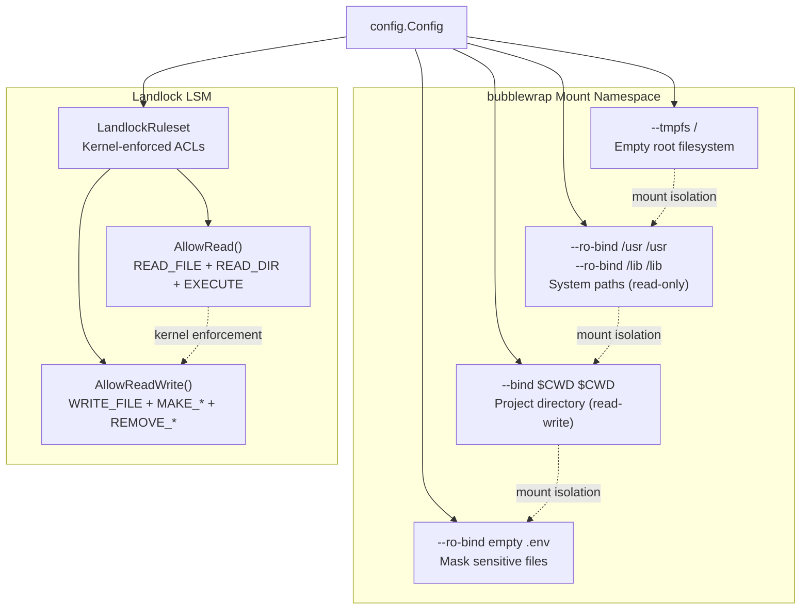
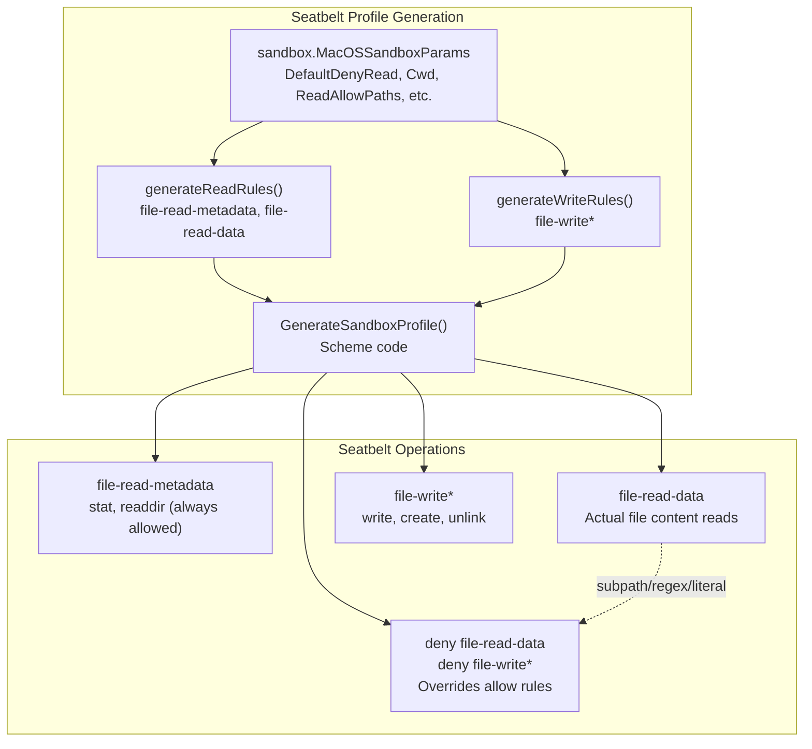

<!-- source: DeepWiki mcp.deepwiki.com · repo GreyhavenHQ/greywall · page 3.2 Filesystem Isolation · fetched 2026-10-26 -->

# Filesystem Isolation

<details>
<summary>Relevant source files</summary>

The following files were used as context for generating this wiki page:

- [internal/config/config.go](internal/config/config.go)
- [internal/sandbox/dangerous.go](internal/sandbox/dangerous.go)
- [internal/sandbox/integration_linux_test.go](internal/sandbox/integration_linux_test.go)
- [internal/sandbox/integration_macos_test.go](internal/sandbox/integration_macos_test.go)
- [internal/sandbox/integration_test.go](internal/sandbox/integration_test.go)
- [internal/sandbox/linux_landlock.go](internal/sandbox/linux_landlock.go)
- [internal/sandbox/macos.go](internal/sandbox/macos.go)
- [internal/sandbox/macos_test.go](internal/sandbox/macos_test.go)

</details>


This page explains how greywall controls filesystem access through deny-by-default isolation, mount-based restrictions, and path-level access rules. For network access control, see [Network Isolation](). For the overall security architecture, see [Security Model](). Platform-specific implementation details are covered in [Linux Sandboxing]() and [macOS Sandboxing]().

## Deny-by-Default Security Model

Greywall implements deny-by-default filesystem isolation, where the sandbox starts with minimal filesystem access and selectively grants permissions. This inverts the traditional security model and reduces the attack surface for AI-generated commands.

When `DefaultDenyRead` mode is enabled (the default behavior), the sandbox:

1.  **Blocks all filesystem reads by default** (except metadata operations like `stat`, `readdir`) [internal/sandbox/macos.go:159-166]().
2.  **Allows only essential system paths** (`/usr`, `/lib`, `/etc`, etc.) for program execution [internal/sandbox/dangerous.go:95-134]().
3.  **Allows the current working directory** (project directory) for read/write [internal/sandbox/linux_landlock.go:84-89]().
4.  **Requires explicit allowlisting** for any additional paths via `allowRead` or `allowWrite` [internal/config/config.go:73-81]().

This prevents sandboxed processes from accessing sensitive files like SSH keys, browser credentials, or API tokens unless explicitly permitted.

**Configuration Example:**
```json
{
  "filesystem": {
    "defaultDenyRead": true,
    "allowRead": ["/home/user/.config/myapp"],
    "denyRead": ["/home/user/.ssh"],
    "allowWrite": ["/tmp/cache"],
    "denyWrite": [".git/hooks"]
  }
}
```

Sources: [internal/config/config.go:73-81](), [internal/sandbox/macos.go:156-213](), [internal/sandbox/linux_landlock.go:96-134]()

## Platform-Specific Implementations

### Linux: bubblewrap + Landlock

Linux filesystem isolation uses two complementary mechanisms: namespace isolation via bubblewrap and kernel-level access control via Landlock.

Title: Linux Filesystem Isolation Architecture


**bubblewrap Mount Strategy:**
The sandbox constructs a private mount namespace using `bwrap`. In `DefaultDenyRead` mode, it starts with an empty root (`--tmpfs /`) and bind-mounts only required paths. It specifically masks sensitive files in the CWD (like `.env`) by bind-mounting an empty file over them [internal/sandbox/dangerous.go:33-40]().

**Landlock Kernel Enforcement:**
The `ApplyLandlockFromConfig` function provides kernel-level access control that survives process privileges [internal/sandbox/linux_landlock.go:18-21]().
- **ABI version detection**: Supports Landlock v1-v5 with graceful fallback [internal/sandbox/linux_landlock.go:22-29]().
- **Path-based rules**: Each path gets an `AllowRead()` or `AllowReadWrite()` rule [internal/sandbox/linux_landlock.go:156-191]().
- **Descendant coverage**: Landlock's `PATH_BENEATH` semantics automatically cover all descendants.

Sources: [internal/sandbox/linux_landlock.go:18-206](), [internal/sandbox/dangerous.go:33-53]()

### macOS: Seatbelt Profiles

macOS uses declarative Seatbelt profiles compiled by `sandbox-exec`.

Title: macOS Seatbelt Generation Flow


**Seatbelt Rule Hierarchy:**
In deny-by-default mode, `generateReadRules` creates a tiered access model:
1.  **Global metadata allow**: `(allow file-read-metadata)` enables directory traversal and `stat()` [internal/sandbox/macos.go:166]().
2.  **System path allows**: Essential paths like `/usr` and `/System` are granted `file-read-data` [internal/sandbox/macos.go:170-175]().
3.  **CWD allow**: The project directory gets full recursive read access [internal/sandbox/macos.go:178-182]().
4.  **Deny overrides**: Sensitive files are explicitly blocked via `(deny file-read-data)` [internal/sandbox/macos_test.go:185-189]().

**Important Seatbelt Quirk:**
Deny rules MUST use specific operations (`file-read-data`) rather than wildcards (`file-read*`). Seatbelt ignores wildcard denies when a specific allow covers the same path [internal/sandbox/macos_test.go:172-174]().

Sources: [internal/sandbox/macos.go:156-282](), [internal/sandbox/macos_test.go:170-195]()

## Path Rule Processing

Both platforms support glob patterns in path rules:

| Pattern | Meaning | Example |
| :--- | :--- | :--- |
| `*` | Matches any characters except `/` | `*.log` matches `app.log` |
| `**` | Matches any characters including `/` | `**/*.env` matches `.env` at any depth |
| `dir/**` | Matches directory and all descendants | `node_modules/**` |
| Absolute path | Literal path | `/etc/hosts` |

**Glob Expansion and Conversion:**
- **Linux**: `ExpandGlobPatterns` optimizes for Landlock's `PATH_BENEATH` semantics. For example, `dir/**` is simplified to just `dir` because Landlock rules are recursive by default [internal/sandbox/linux_landlock.go:157-172]().
- **macOS**: Globs are converted to regex patterns via `GlobToRegex` for use in the Seatbelt profile [internal/sandbox/macos.go:57-72]().

Sources: [internal/sandbox/linux_landlock.go:156-191](), [internal/sandbox/macos.go:56-72]()

## Default Readable and Writable Paths

Greywall provides sensible defaults via `GetDefaultReadablePaths` and `GetDefaultWritePaths` to ensure common development tools function correctly.

**Default Readable Paths (Read-Only):**
Essential for runtime execution, including core system paths (`/usr`, `/bin`), system config (`/etc`), and user-installed tooling like `.nvm`, `.pyenv`, and `.cargo/bin` [internal/sandbox/dangerous.go:95-188]().

**Default Writable Paths:**
Includes standard locations like `/tmp`, `/dev/stdout`, and `/dev/null` [internal/sandbox/dangerous.go:63-85]().

Sources: [internal/sandbox/dangerous.go:63-189]()

## Sensitive File Protection

Certain files are **always protected** regardless of project directory writability to prevent credential leakage or sandbox escape.

-   **SensitiveProjectFiles**: Masked in CWD (e.g., `.env`, `.env.local`) [internal/sandbox/dangerous.go:33-40]().
-   **DangerousFiles**: Protected from writes (e.g., `.gitconfig`, `.bashrc`, `.zshrc`) [internal/sandbox/dangerous.go:10-20]().
-   **DangerousDirectories**: Protected from writes (e.g., `.vscode`, `.claude/commands`, `.git/hooks`) [internal/sandbox/dangerous.go:24-29](), [internal/sandbox/dangerous.go:207-210]().

On Linux, `TestLinux_LandlockProtectsGitHooks` verifies that `.git/hooks` cannot be modified even if the workspace is writable [internal/sandbox/integration_linux_test.go:88-104](). On macOS, `TestMacOS_SeatbeltBlocksEnvFileRead` ensures `.env` files remain unreadable even if the workspace has broad read access [internal/sandbox/integration_macos_test.go:175-195]().

Sources: [internal/sandbox/dangerous.go:8-53](), [internal/sandbox/dangerous.go:192-218](), [internal/sandbox/integration_linux_test.go:88-104](), [internal/sandbox/integration_macos_test.go:175-195]()

## macOS-Specific Symlink Handling

On macOS, `/tmp` is a symlink to `/private/tmp`. If Seatbelt rules only mention one variant, resolution can fail if the path hasn't been created yet. The `expandMacOSTmpPaths` function automatically mirrors any `/tmp` or `/private/tmp` rules to both variants to ensure consistent kernel matching [internal/sandbox/macos.go:97-127]().

Sources: [internal/sandbox/macos.go:97-127]()

---

