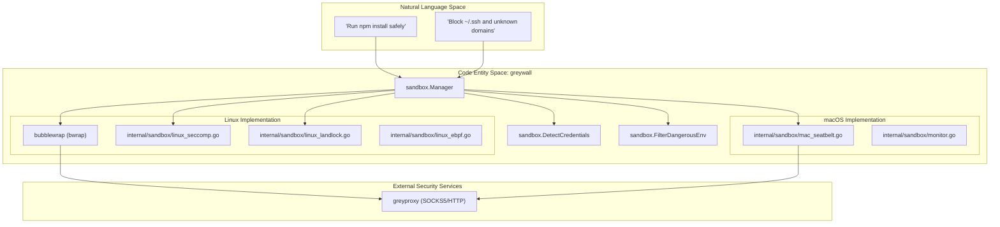
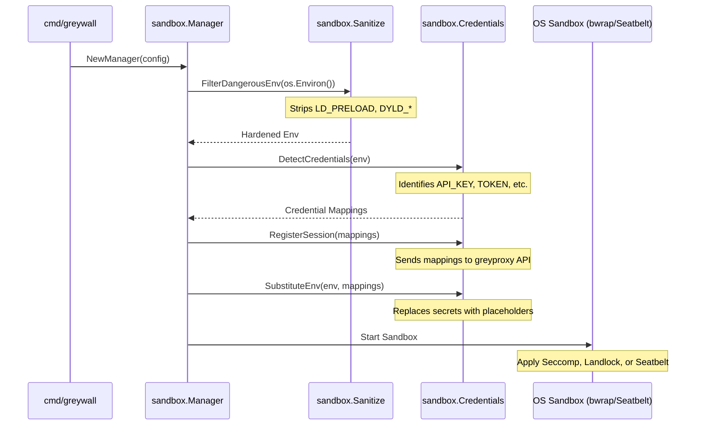

<!-- source: DeepWiki mcp.deepwiki.com · repo GreyhavenHQ/greywall · page 3.3 Security Model · fetched 2026-10-26 -->

# Security Model

Relevant source files

The following files were used as context for generating this wiki page:

- [docs/credential-protection.md](docs/credential-protection.md)
- [docs/security-model.md](docs/security-model.md)
- [internal/sandbox/credentials.go](internal/sandbox/credentials.go)
- [internal/sandbox/credentials_test.go](internal/sandbox/credentials_test.go)
- [internal/sandbox/sanitize.go](internal/sandbox/sanitize.go)

Greywall is intended as a defense-in-depth tool for running semi-trusted commands with reduced side effects (e.g., package installs, build scripts, CI jobs, or exploring unfamiliar repositories) [docs/security-model.md:8-11](). It is not designed to be a strong isolation boundary against actively malicious code specifically engineered to escape OS sandboxes [docs/security-model.md:84-86]().

## Defense-in-Depth Architecture

Greywall implements security by combining multiple independent layers. If one layer is bypassed, other layers continue to provide protection.

### System Components and Enforcement Points

**Sources:** [internal/sandbox/credentials.go:136-179](), [internal/sandbox/sanitize.go:52-60](), [docs/security-model.md:31-38]()

## Threat Model

### Protected Threats
Greywall reduces risk from the following vectors [docs/security-model.md:14-20]():
*   **Supply-chain attacks:** Scripts that unexpectedly call out to the network or exfiltrate data.
*   **Filesystem sprawling:** Tools that write broadly across the filesystem or modify sensitive configs.
*   **Secret leakage:** Accidental "phone home" behavior that leaks environment variables.
*   **Persistence:** Unfamiliar repos running surprising commands to install backdoors or git hooks.

### Non-Protected Threats
Greywall does **not** solve for [docs/security-model.md:73-86]():
*   **Hostile code containment:** Assume determined attackers may escape via kernel vulnerabilities.
*   **Resource limits:** CPU, memory, disk space, or fork bombs are out of scope.
*   **Content-based controls:** It does not block data exfiltration to *allowed* destinations.
*   **Non-Proxy-Aware Tools (macOS):** On macOS, tools that ignore proxy environment variables may bypass network isolation if transparent proxying isn't available.

## Security Mechanisms

### 1. Network Isolation (Default Deny)
Outbound network access is blocked by default. Traffic must be routed through a proxy [docs/security-model.md:25-27]().
*   **Transparent Proxying (Linux):** Uses a TUN device inside the sandbox to route all traffic through `tun2socks`, forwarding to an external SOCKS5 proxy via a Unix socket bridge [docs/security-model.md:31-38]().
*   **Environment Fallback:** If TUN is unavailable, greywall sets `HTTP_PROXY`, `HTTPS_PROXY`, and `ALL_PROXY` [docs/security-model.md:37-38]().
*   **Localhost Control:** Inbound binding and outbound connections to `127.0.0.1` are controlled via `allowLocalOutbound` [docs/security-model.md:39-42]().

### 2. Filesystem Isolation
*   **Deny-by-Default:** Reads and writes are denied unless explicitly allowed [docs/security-model.md:43-46]().
*   **Protected Targets:** Internal lists protect sensitive paths like shell configs, git hooks, and `.env` files [docs/security-model.md:49-50]().
*   **Linux Landlock:** Kernel-enforced filesystem ACLs using Landlock LSM [docs/security-model.md:51-53]().

### 3. Credential Protection
Greywall prevents sandboxed processes from seeing real secrets by using a "placeholder substitution" system [docs/credential-protection.md:6-10]().

| Stage | Action | Code Entity |
| :--- | :--- | :--- |
| **Detection** | Scans env for well-known keys (e.g., `AWS_SECRET_ACCESS_KEY`) or suffixes (e.g., `_TOKEN`). | `sandbox.DetectCredentials` [internal/sandbox/credentials.go:136-179]() |
| **Placeholder** | Generates a unique string: `greyproxy:credential:v1:gw-<id>:<digest>`. | `sandbox.generatePlaceholder` [internal/sandbox/credentials.go:192-199]() |
| **Registration** | Registers the mapping with `greyproxy` via its API. | `sandbox.RegisterSession` [internal/sandbox/credentials.go:275-300]() |
| **Substitution** | Rewrites the sandbox environment with placeholders. | `sandbox.SubstituteEnv` [internal/sandbox/credentials.go:214-245]() |
| **Proxy Swap** | `greyproxy` detects placeholders in HTTP headers/params and swaps them for real values. | External (greyproxy) |

**Sources:** [internal/sandbox/credentials.go:32-96](), [docs/credential-protection.md:12-21]()

### 4. Environment Sanitization
Greywall strips dangerous environment variables that could be used for library injection attacks [internal/sandbox/sanitize.go:43-49]().
*   **Linux:** Strips `LD_PRELOAD`, `LD_LIBRARY_PATH`, and other `LD_*` variables [internal/sandbox/sanitize.go:14-17]().
*   **macOS:** Strips `DYLD_INSERT_LIBRARIES`, `DYLD_LIBRARY_PATH`, and other `DYLD_*` variables [internal/sandbox/sanitize.go:14-17]().

**Sources:** [internal/sandbox/sanitize.go:19-41](), [docs/security-model.md:59-67]()

### 5. D-Bus and Socket Isolation (Linux)
The D-Bus session bus is blocked to prevent the sandbox from using host services like `gnome-keyring` or launching processes via Flatpak portals [docs/security-model.md:51-53](). Greywall overlays `/run/user` with a `tmpfs` to hide:
*   Wayland/X11 sockets
*   PipeWire/PulseAudio
*   SSH and GPG agent sockets (can be re-added selectively) [docs/security-model.md:53]().

## Implementation Flow

The following diagram maps the security initialization flow to specific code functions.

**Sources:** [internal/sandbox/sanitize.go:52-60](), [internal/sandbox/credentials.go:136-179](), [internal/sandbox/credentials.go:214-245](), [docs/security-model.md:59-67]()

## Visibility and Auditing
Greywall provides tools to inspect what a sandboxed process is attempting to do without compromising the security boundary:
*   **`--monitor` (`-m`):** Real-time monitoring of blocked access attempts via eBPF (Linux) or Unified Log (macOS) [docs/security-model.md:70]().
*   **`--debug` (`-d`):** Detailed logs explaining why specific paths or network requests were blocked [docs/security-model.md:71]().

**Sources:** [docs/security-model.md:68-72]()

---

