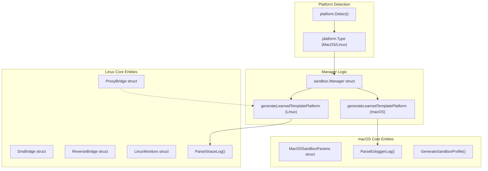

<!-- source: DeepWiki mcp.deepwiki.com · repo GreyhavenHQ/greywall · page 4 Platform Implementations · fetched 2026-10-26 -->

# Platform Implementations

Relevant source files

The following files were used as context for generating this wiki page:

- [docs/platform-support.md](docs/platform-support.md)
- [internal/platform/platform.go](internal/platform/platform.go)
- [internal/sandbox/manager_darwin.go](internal/sandbox/manager_darwin.go)
- [internal/sandbox/manager_linux.go](internal/sandbox/manager_linux.go)

This page provides an overview of how greywall implements sandboxing on Linux versus macOS. The two platforms require fundamentally different approaches due to differences in their kernel architectures and available security primitives. For detailed technical documentation on each platform's implementation, see [Linux Sandboxing](#4.1) and [macOS Sandboxing](#4.2).

## Platform Architecture Differences

Linux and macOS provide different sets of security mechanisms, requiring platform-specific implementations that share common goals but use different techniques.

### High-Level Comparison

**Linux Implementation Strategy:**
- **Defense-in-depth:** Multiple independent security layers including namespaces, Landlock LSM, and seccomp syscall filtering [docs/platform-support.md:33-36]().
- **Transparent network proxying:** Full traffic capture using a network namespace, TUN device, and `tun2socks` [docs/platform-support.md:39]().
- **Kernel-level enforcement:** Landlock (Linux 5.13+) restricts filesystem operations independently of mount rules [docs/platform-support.md:36]().
- **Runtime monitoring:** eBPF allows real-time violation monitoring for blocked syscalls and file access [docs/platform-support.md:38]().

**macOS Implementation Strategy:**
- **Unified policy:** Uses `sandbox-exec` with dynamically generated Seatbelt profiles to control files, network, and IPC [docs/platform-support.md:48]().
- **Environment-based proxying:** Routes traffic via `ALL_PROXY` / `HTTP_PROXY` environment variables; no transparent capture [docs/platform-support.md:50]().
- **Application cooperation:** Only applications that honor standard proxy environment variables are redirected [docs/platform-support.md:50]().
- **Log-based monitoring:** Violation monitoring is achieved through macOS unified logging via `eslogger` [docs/platform-support.md:18](), [docs/platform-support.md:52]().

### Platform Comparison Table

| Feature | Linux | macOS |
|---------|-------|-------|
| **Sandbox Engine** | bubblewrap [docs/platform-support.md:14]() | sandbox-exec (Seatbelt) [docs/platform-support.md:14]() |
| **Filesystem Control** | Landlock + bubblewrap [docs/platform-support.md:17]() | Seatbelt rules [docs/platform-support.md:17]() |
| **Syscall Filtering** | seccomp [docs/platform-support.md:16]() | Seatbelt [docs/platform-support.md:16]() |
| **Network Isolation** | Network namespace [docs/platform-support.md:22]() | N/A (Env vars only) [docs/platform-support.md:22]() |
| **Transparent Proxy** | ✅ (tun2socks + TUN) [docs/platform-support.md:19]() | ❌ [docs/platform-support.md:19]() |
| **Violation Monitoring** | eBPF [docs/platform-support.md:18]() | Seatbelt denial logs [docs/platform-support.md:18]() |
| **Learning Mode** | strace [docs/platform-support.md:27]() | eslogger (requires sudo) [docs/platform-support.md:27]() |
| **External Deps** | bwrap, socat, xdg-dbus-proxy [docs/platform-support.md:29]() | None (native tools) [docs/platform-support.md:29]() |

Sources: [docs/platform-support.md:10-29](), [internal/platform/platform.go:9-28]()

## Command Wrapping Flow

The following diagram shows how each platform wraps a user command with sandbox restrictions. The `Manager` entity coordinates this by detecting the platform and calling the respective implementation.

```mermaid
flowchart TB
    subgraph "Linux Implementation"
        L1["Detect Features<br/>(LinuxFeatures)"]
        L2["Build bwrap args<br/>(--unshare-net, --unshare-pid)"]
        L3["Generate seccomp filter"]
        L4["Build mounts<br/>(buildDenyByDefaultMounts)"]
        L5["Setup ProxyBridge<br/>(NewProxyBridge)"]
        L6["Setup DnsBridge<br/>(NewDnsBridge)"]
        L7["Apply Landlock"]
    end
    
    subgraph "macOS Implementation"
        M1["Build MacOSSandboxParams"]
        M2["Generate Seatbelt profile<br/>(GenerateSandboxProfile)"]
        M3["Generate read rules<br/>(file-read-data)"]
        M4["Generate write rules<br/>(file-write*)"]
        M5["Generate network rules<br/>(network-outbound)"]
        M6["Set proxy env vars<br/>(HTTP_PROXY)"]
        M7["Invoke sandbox-exec"]
    end
    
    L1 --> L2 --> L3 --> L4 --> L5 --> L6 --> L7
    M1 --> M2 --> M3 --> M4 --> M5 --> M6 --> M7
```

**Linux Path:** The implementation builds a shell command that starts `bubblewrap` with namespace isolation, applies `seccomp` filtering, mounts filesystems, starts `socat` bridges for proxy connectivity, and applies `Landlock` [docs/platform-support.md:33-40]().

**macOS Path:** The implementation generates a Seatbelt profile string, configures proxy environment variables, and invokes `sandbox-exec -p` [docs/platform-support.md:48-50]().

Sources: [docs/platform-support.md:31-65](), [internal/platform/platform.go:17-28]()

## Code Entity Mapping

This diagram maps high-level platform concepts to the specific code entities used in the `greywall` implementation.

**Key Implementation Details:**
- **Platform Detection:** The `platform.Detect()` function uses `runtime.GOOS` to identify the operating system [internal/platform/platform.go:17-28]().
- **Learning Mode:** On Linux, learning mode parses logs from `strace` [internal/sandbox/manager_linux.go:11-21](). On macOS, it uses `eslogger` and requires PID-based process tree filtering [internal/sandbox/manager_darwin.go:13-29]().
- **Bridges:** Linux uses `ProxyBridge`, `DnsBridge`, and `ReverseBridge` to facilitate communication across namespace boundaries [docs/platform-support.md:40-44]().

Sources: [internal/platform/platform.go:1-35](), [internal/sandbox/manager_linux.go:11-31](), [internal/sandbox/manager_darwin.go:13-41]()

## Filesystem Isolation

### Linux: Mount Namespaces + Landlock
Linux uses `bubblewrap` to create a new mount namespace. It whitelists system paths and the current working directory while masking sensitive files like `.env` using `--ro-bind` to mount rewritten files containing placeholders [docs/platform-support.md:33-36](), [docs/platform-support.md:58]().

### macOS: Seatbelt Profiles
macOS uses `sandbox-exec` with Seatbelt rules. Unlike Linux, macOS cannot perform bind-mount redirection. Consequently, when credential substitution is active, `.env` files are **denied entirely** in the sandbox profile, resulting in a permission-denied error if the process attempts to read them [docs/platform-support.md:56-62]().

Sources: [docs/platform-support.md:33-38](), [docs/platform-support.md:56-65]()

## Network Isolation

### Linux: Transparent Proxying
Linux creates a full network namespace (`unshare-net`). All traffic is captured via a `TUN` device and routed through `tun2socks` into the SOCKS5 proxy. A `socat` relay (DNS bridge) captures DNS queries and forwards them to the configured DNS server [docs/platform-support.md:39-40]().

### macOS: Environment Variables
macOS lacks network namespaces. Isolation is achieved by setting `ALL_PROXY` and `HTTP_PROXY` environment variables. The Seatbelt profile then restricts network access to only the proxy address [docs/platform-support.md:50]().

Sources: [docs/platform-support.md:39-40](), [docs/platform-support.md:48-50]()

## Next Steps

For detailed implementation information:

- **Linux Implementation:** See [Linux Sandboxing](#4.1) for details on bubblewrap, Landlock, seccomp, and eBPF.
- **macOS Implementation:** See [macOS Sandboxing](#4.2) for details on Seatbelt profiles and `eslogger`.
- **Network Architecture:** See [Network Architecture](#5) for deep dives into `greyproxy` and proxy bridges.
- **Learning Mode:** See [Learning Mode](#6.3) for how `strace` and `eslogger` are used to generate profiles.

---

