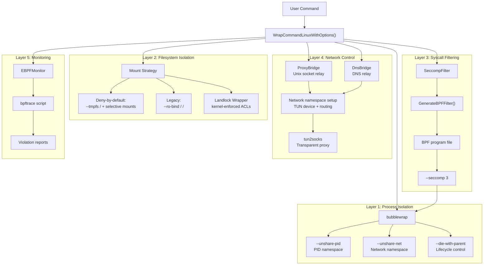
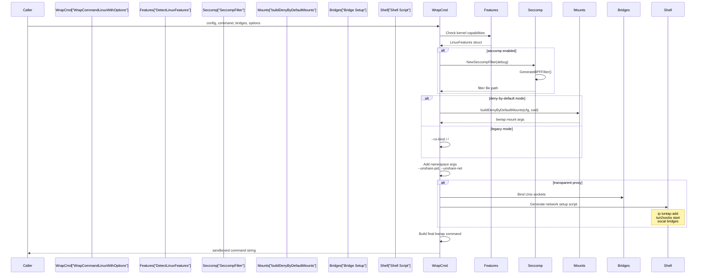
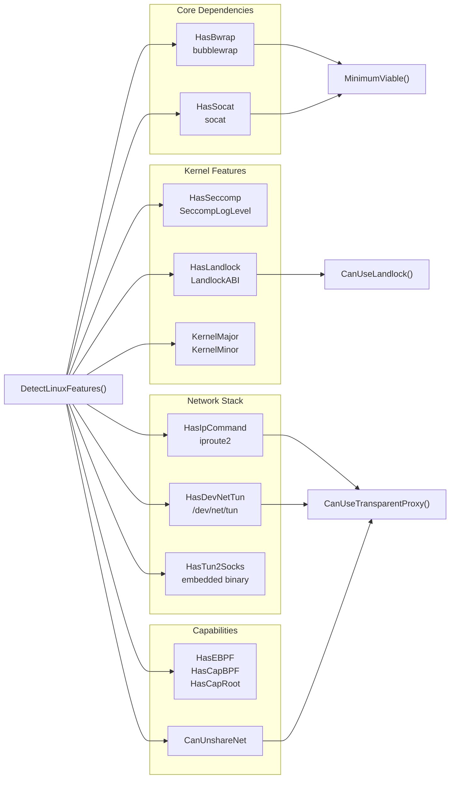

<!-- source: DeepWiki mcp.deepwiki.com · repo GreyhavenHQ/greywall · page 4.1 Linux Sandboxing · fetched 2026-10-26 -->

# Linux Sandboxing

<details>
<summary>Relevant source files</summary>

The following files were used as context for generating this wiki page:

- [docs/linux-security-features.md](docs/linux-security-features.md)
- [internal/sandbox/linux.go](internal/sandbox/linux.go)
- [internal/sandbox/linux_features.go](internal/sandbox/linux_features.go)

</details>


This document provides an overview of greywall's Linux sandbox implementation, explaining how multiple security technologies are integrated into a cohesive defense-in-depth architecture. For platform comparison and feature differences, see [Platform Implementations](#4).

The Linux implementation combines several kernel security features:
- **Process isolation** via bubblewrap namespaces (see [bubblewrap and Namespaces](#4.1.1))
- **Filesystem access control** via Landlock LSM (see [Landlock Filesystem Control](#4.1.2))
- **Syscall filtering** via seccomp-bpf (see [Seccomp Syscall Filtering](#4.1.3))
- **Real-time monitoring** via eBPF tracing (see [eBPF Violation Monitoring](#4.1.4))
- **Network isolation** via transparent proxying with tun2socks (see [Transparent Network Proxying](#4.1.5))

Each layer provides independent security controls with graceful fallback when features are unavailable [docs/linux-security-features.md:56-102]().

## Multi-Layer Security Architecture

The Linux sandbox applies multiple independent security layers to defend against different attack vectors. This diagram shows how the layers interact during command execution:



**Sources:** [internal/sandbox/linux.go:595-1193](), [docs/linux-security-features.md:10-18]()

## Command Wrapping Flow

The `WrapCommandLinux` function orchestrates the multi-layer sandbox construction. This sequence shows how configuration is transformed into a sandboxed command:



**Sources:** [internal/sandbox/linux.go:595-1193]()

## Core Data Structures

### LinuxSandboxOptions

The `LinuxSandboxOptions` struct controls which security features are enabled:

```go
type LinuxSandboxOptions struct {
	UseLandlock bool
	UseSeccomp bool
	UseEBPF bool
	Monitor bool
	Debug bool
	Learning bool
	StraceLogPath string
	RewrittenEnvFiles map[string]string
	AllowAudio bool
}
```

**Sources:** [internal/sandbox/linux.go:114-137]()

### Bridge Components

Three bridge types facilitate communication between the isolated sandbox and the host:

| Bridge Type | Purpose | Implementation |
|------------|---------|----------------|
| `ProxyBridge` | SOCKS5 proxy access | socat relay: Unix socket ↔ TCP proxy [internal/sandbox/linux.go:21-31]() |
| `DnsBridge` | DNS resolution | socat relay: UDP :53 ↔ Unix socket ↔ host DNS [internal/sandbox/linux.go:36-41]() |
| `ReverseBridge` | Inbound connections | socat relay: host TCP port ↔ Unix socket [internal/sandbox/linux.go:106-111]() |

Each bridge uses a randomly-generated Unix socket path in `/tmp` to prevent collisions [internal/sandbox/linux.go:53-56](), [internal/sandbox/linux.go:155-158]().

**Sources:** [internal/sandbox/linux.go:21-291]()

## Feature Detection System

The `LinuxFeatures` struct captures system capabilities with graceful fallback:



**Sources:** [internal/sandbox/linux_features.go:17-46](), [docs/linux-security-features.md:20-44]()

### Detection Methods

Feature detection uses multiple techniques:

**Kernel Version:** Parse kernel release string via `unix.Uname()` [internal/sandbox/linux_features.go:90-104]().

**Seccomp:** Test with `unix.Syscall(unix.SYS_PRCTL, unix.PR_GET_SECCOMP, ...)` [internal/sandbox/linux_features.go:106-124]().

**Landlock:** Query ABI version via `unix.Syscall(unix.SYS_LANDLOCK_CREATE_RULESET, 0, 0, LANDLOCK_CREATE_RULESET_VERSION)` [internal/sandbox/linux_features.go:126-165]().

**Network Namespaces:** Probe with test command: `bwrap --unshare-net --ro-bind / / -- /bin/true` [internal/sandbox/linux_features.go:207-218]().

**eBPF:** Check effective capabilities for `CAP_BPF` (bit 39) in `/proc/self/status` [internal/sandbox/linux_features.go:167-202]().

**Sources:** [internal/sandbox/linux_features.go:63-218]()

## Filesystem Isolation Models

Linux supports two filesystem isolation modes that are selected based on configuration:

### Deny-by-Default Mode

When `DefaultDenyRead: true` is set in the configuration, the sandbox starts with an empty root filesystem and selectively mounts only necessary paths:

```mermaid
graph TB
    Root["--tmpfs /<br/>Empty root"]
    
    subgraph "System Mounts"
        Usr["/usr - RO"]
        Etc["/etc - RO"]
        Lib["/lib* - RO"]
        Sys["/sys - RO"]
        Symlinks["Symlinks<br/>/bin → usr/bin<br/>/lib64 → usr/lib"]
    end
    
    subgraph "Special Filesystems"
        Dev["--dev-bind /dev /dev"]
        Proc["--proc /proc"]
        Tmp["--tmpfs /tmp"]
    end
    
    subgraph "User Paths"
        CWD["CWD - RW<br/>Project directory"]
        Tools["Tool paths - RO<br/>~/.cargo, ~/.npm, etc"]
        AllowRead["AllowRead paths - RO<br/>User-specified"]
    end
    
    subgraph "Protected"
        Masked["Sensitive files masked<br/>.env → empty file"]
        Mandatory["Mandatory deny<br/>.bashrc, .ssh/config - RO"]
    end
    
    Root --> Usr
    Root --> Etc
    Root --> Lib
    Root --> Sys
    Root --> Symlinks
    Root --> Dev
    Root --> Proc
    Root --> Tmp
    Root --> CWD
    Root --> Tools
    Root --> AllowRead
    Root --> Masked
    Root --> Mandatory
```



The mount order matters: later mounts can override earlier ones. This is used to protect sensitive files by binding an empty file over them [internal/sandbox/linux.go:559-575]().

**Sources:** [internal/sandbox/linux.go:398-578](), [docs/linux-security-features.md:100-118]()

### Legacy Mode

When `DefaultDenyRead: false`, the entire root filesystem is bound read-only, then specific paths are made writable [internal/sandbox/linux.go:704-707]().

## Deny-by-Default Mount Construction

The `buildDenyByDefaultMounts` function implements the sophisticated mount logic [internal/sandbox/linux.go:398-578]().

**Key Implementation Details:**

**Symlink Handling:** System directories like `/bin → usr/bin` must be recreated as symlinks inside the sandbox [internal/sandbox/linux.go:440-452]().

**Intermediary Directories:** The function ensures parent directories exist before binding deep paths [internal/sandbox/linux.go:478-485]().

**Device Separation Check:** `sameDevice()` detects cross-filesystem mounts and handles them specially to ensure correct path visibility [internal/sandbox/linux.go:723-774]().

**Sources:** [internal/sandbox/linux.go:398-578]()

## Network Isolation Architecture

Network isolation on Linux uses a combination of network namespaces and transparent proxying [docs/linux-security-features.md:79-88]().

**Network Namespace Setup:**

Inside the sandbox, a shell script configures the isolated network [internal/sandbox/linux.go:989-1050]():
- `ip tuntap add dev tun0 mode tun`
- `ip addr add 198.18.0.1/15 dev tun0`
- `ip route add default via 198.18.0.1 dev tun0`
- Starts `tun2socks` and `socat` bridges to route traffic to the host-side `greyproxy`.

**Sources:** [internal/sandbox/linux.go:989-1050]()

## Security Layer Details

### Seccomp Syscall Filter

The `SeccompFilter` generates a BPF program that blocks dangerous syscalls like `ptrace`, `bpf`, and `mount` [docs/linux-security-features.md:152-169](). It also specifically blocks `TIOCSTI` to prevent terminal injection [internal/sandbox/linux_seccomp.go:28-216]().

### eBPF Monitoring

The `EBPFMonitor` uses bpftrace to trace syscall failures in real-time, filtering by PID to track the sandbox process tree [docs/linux-security-features.md:70-77]().

### Landlock Integration

When available (kernel 5.13+), greywall applies Landlock filesystem restrictions via an embedded wrapper approach [docs/linux-security-features.md:46-54]().

## Learning Mode

Learning mode runs a permissive sandbox with `strace` tracing to discover filesystem access patterns [internal/sandbox/linux.go:666-691]().

**Sources:** [internal/sandbox/linux.go:666-691](), [docs/experience.md:15-26]()

## Error Handling and Fallback

The sandbox implements graceful degradation when features like `Landlock` or `eBPF` are unavailable [docs/linux-security-features.md:56-88]().

**Sources:** [internal/sandbox/linux_features.go:274-277](), [docs/linux-security-features.md:56-102]()

---

