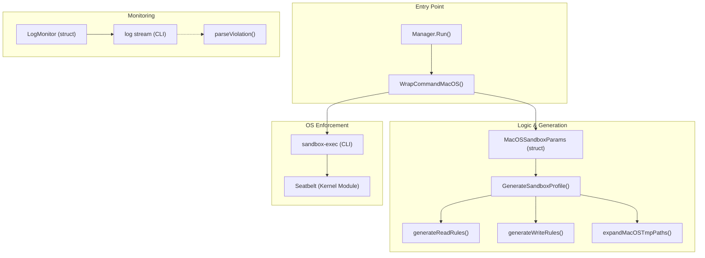
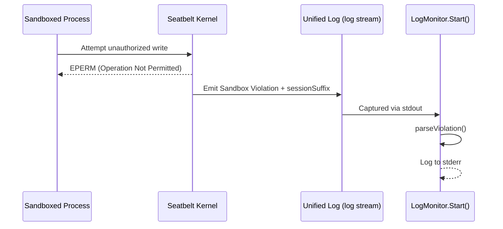

<!-- source: DeepWiki mcp.deepwiki.com · repo GreyhavenHQ/greywall · page 4.2 macOS Sandboxing · fetched 2026-10-26 -->

# macOS Sandboxing

Relevant source files

The following files were used as context for generating this wiki page:

- [internal/sandbox/integration_macos_test.go](internal/sandbox/integration_macos_test.go)
- [internal/sandbox/macos.go](internal/sandbox/macos.go)
- [internal/sandbox/macos_test.go](internal/sandbox/macos_test.go)
- [internal/sandbox/manager_darwin.go](internal/sandbox/manager_darwin.go)
- [internal/sandbox/manager_linux.go](internal/sandbox/manager_linux.go)

This page describes greywall's macOS sandbox implementation using Apple's `sandbox-exec` tool and Seatbelt profile language. This implementation provides process isolation and access control on macOS systems, with a fundamentally different architecture than the Linux implementation due to platform constraints.

For detailed information about Seatbelt profile generation, see [Seatbelt Profile Generation](#4.2.1). For monitoring sandbox violations, see [Unified Log Monitoring](#4.2.2). For comparison with the Linux implementation, see [Linux Sandboxing](#4.1).

## Architecture Overview

The macOS implementation uses a simpler architecture compared to Linux's multi-layer approach. All security enforcement happens through a single Seatbelt profile passed to `sandbox-exec`, which applies kernel-enforced restrictions to the sandboxed process and its children.

### Command Execution Flow
The `WrapCommandMacOS` function [internal/sandbox/macos.go:647-748]() acts as the primary orchestrator. It collects configuration into a `MacOSSandboxParams` struct [internal/sandbox/macos.go:29-54](), generates a Seatbelt profile via `GenerateSandboxProfile` [internal/sandbox/macos.go:422-645](), and constructs an `exec.Command` that invokes `sandbox-exec`.

### System Entity Mapping

The following diagram bridges the high-level components to the specific code entities that implement them.

**Diagram: macOS Sandbox Code Architecture**

**Sources:** [internal/sandbox/macos.go:29-54](), [internal/sandbox/macos.go:422-645](), [internal/sandbox/macos.go:647-748](), [internal/sandbox/monitor.go:24-60]()

## Core Components

### MacOSSandboxParams
The `MacOSSandboxParams` struct [internal/sandbox/macos.go:29-54]() encapsulates the sandbox policy, including filesystem paths, network proxy details, and process capabilities like PTY support.

### Profile Generation Logic
Greywall dynamically builds S-expression based profiles.
- **Filesystem**: Handled by `generateReadRules` [internal/sandbox/macos.go:156-282]() and `generateWriteRules` [internal/sandbox/macos.go:284-361]().
- **Network**: The profile explicitly allows outbound connections to the proxy defined in `ProxyHost` and `ProxyPort` [internal/sandbox/macos.go:593-605]().
- **Path Handling**: Since `/tmp` is a symlink to `/private/tmp` on macOS, `expandMacOSTmpPaths` [internal/sandbox/macos.go:100-127]() ensures both paths are included in rules to prevent kernel resolution bypasses.

**Sources:** [internal/sandbox/macos.go:29-54](), [internal/sandbox/macos.go:100-127](), [internal/sandbox/macos.go:156-361](), [internal/sandbox/macos.go:593-605]()

## Network Isolation Strategy

Unlike Linux, macOS does not support network namespaces for unprivileged processes. Greywall employs a two-pronged approach:

1.  **Seatbelt Rules**: The profile denies all network access by default but explicitly allows `network-outbound` to the local `greyproxy` instance [internal/sandbox/macos.go:593-605]().
2.  **Environment Variables**: `WrapCommandMacOS` injects `HTTP_PROXY`, `HTTPS_PROXY`, and `ALL_PROXY` into the process environment [internal/sandbox/macos.go:738-745]().

For details, see [Seatbelt Profile Generation](#4.2.1).

**Sources:** [internal/sandbox/macos.go:593-605](), [internal/sandbox/macos.go:738-745]()

## Filesystem Access Control

Greywall implements a "Deny-by-Default" read model on macOS. 
- **Metadata**: `file-read-metadata` is allowed globally so tools can perform `stat` or `ls` [internal/sandbox/macos.go:166]().
- **Data**: `file-read-data` is restricted to system paths, the current working directory, and user-defined allow-lists [internal/sandbox/macos.go:170-190]().

### Security Nuance: Operation Specificity
Seatbelt requires that `deny` rules match the specificity of `allow` rules. For example, if `file-read-data` is allowed for a directory, a `deny file-read*` for a sub-file will be ignored by the kernel. Greywall ensures consistency by using specific operation types in its generated rules [internal/sandbox/macos.go:233-242]().

**Sources:** [internal/sandbox/macos.go:159-190](), [internal/sandbox/macos.go:233-242]()

## Violation Monitoring

Monitoring on macOS relies on the Unified Logging System.

**Diagram: macOS Violation Monitoring Flow**

**Sources:** [internal/sandbox/monitor.go:35-60](), [internal/sandbox/monitor.go:104-144]()

Each session is assigned a unique `sessionSuffix` [internal/sandbox/macos.go:19-27]() which is included in the Seatbelt profile's `with message` clause [internal/sandbox/macos.go:424-431](). The `LogMonitor` uses a predicate to filter for this suffix [internal/sandbox/monitor.go:44-50]().

For details, see [Unified Log Monitoring](#4.2.2).

## Learning Mode
On macOS, greywall uses `eslogger` to record process activity and generate suggested profiles. The `generateLearnedTemplatePlatform` function [internal/sandbox/manager_darwin.go:13-41]() handles stopping the logger and invoking `ParseEsloggerLog` to analyze the results.

**Sources:** [internal/sandbox/manager_darwin.go:13-41]()

---

