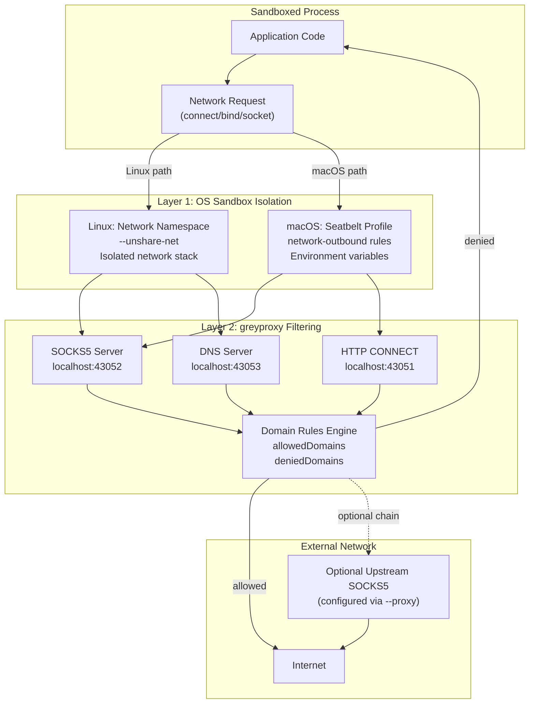
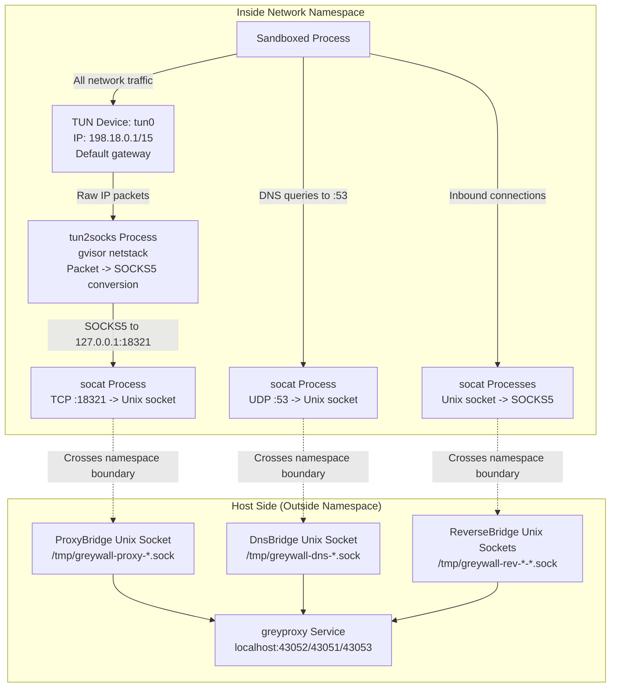
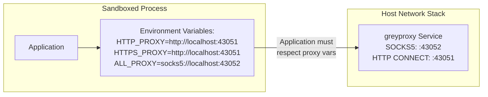
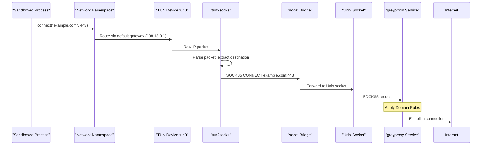
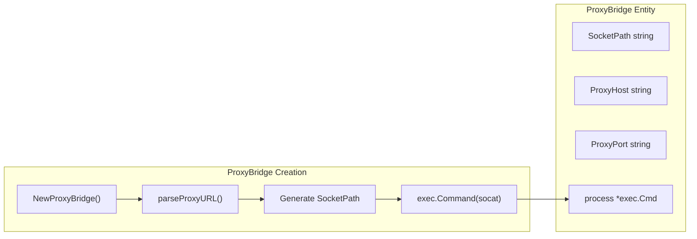

<!-- source: DeepWiki mcp.deepwiki.com · repo GreyhavenHQ/greywall · page 5 Network Architecture · fetched 2026-10-26 -->

# Network Architecture

Relevant source files

The following files were used as context for generating this wiki page:

- [internal/proxy/detect.go](internal/proxy/detect.go)
- [internal/proxy/install.go](internal/proxy/install.go)
- [internal/proxy/start.go](internal/proxy/start.go)
- [internal/sandbox/color.go](internal/sandbox/color.go)
- [internal/sandbox/linux.go](internal/sandbox/linux.go)
- [internal/sandbox/linux_features_stub.go](internal/sandbox/linux_features_stub.go)

This document provides a comprehensive overview of greywall's network isolation architecture. It explains how sandboxed processes are prevented from making unauthorized network connections, how traffic is routed through the greyproxy filtering proxy, and the platform-specific implementations on Linux and macOS.

For details on the greyproxy service itself (installation, configuration, dashboard), see [greyproxy Service](#5.1). For implementation details of Unix socket bridges on Linux, see [Proxy Bridges and Unix Sockets](#5.2). For domain-based filtering rules and allow/deny lists, see [Domain-Based Filtering](#5.3).

For the complete Linux sandboxing implementation including filesystem and syscall controls, see [Linux Sandboxing](#4.1). For macOS sandboxing details, see [macOS Sandboxing](#4.2).

## Overview

Greywall implements network isolation through a two-layer architecture:

1. **Sandbox Layer**: Platform-specific mechanisms (network namespaces on Linux, Seatbelt profiles on macOS) that isolate the sandboxed process from the host network stack.
2. **Proxy Layer**: The greyproxy service that provides centralized traffic filtering, domain-based allow/deny rules, and an optional upstream SOCKS5 proxy chain.

All network traffic from sandboxed processes is routed through greyproxy, which listens on localhost ports 43052 (SOCKS5), 43051 (HTTP CONNECT), and 43053 (DNS). The dashboard runs on port 43080.

**Key Design Principles:**

- **Deny-by-default**: Network access is blocked unless explicitly allowed via greyproxy's domain filtering rules.
- **Transparent on Linux**: Network redirection happens at the kernel level using TUN devices and network namespaces, requiring no application awareness.
- **Environment-based on macOS**: Applications must respect `HTTP_PROXY`, `HTTPS_PROXY`, and `ALL_PROXY` environment variables.
- **Centralized filtering**: All traffic converges at greyproxy regardless of platform, enabling consistent policy enforcement.

Sources: [internal/sandbox/linux.go:21-41](), [internal/proxy/detect.go:15-18]()

## Two-Layer Network Isolation

**Layer 1** isolates the sandboxed process from the host network using platform-specific OS mechanisms. On Linux, this creates a completely separate network namespace with no connectivity except through controlled bridges. On macOS, Seatbelt profiles restrict network operations and environment variables point applications to the proxy.

**Layer 2** provides application-layer filtering through greyproxy. All traffic that escapes Layer 1 must pass through greyproxy's domain-based filtering, which maintains allow/deny lists and provides real-time traffic inspection via the dashboard.

Sources: [internal/sandbox/linux.go:21-41](), [internal/proxy/detect.go:30-36]()

## Platform-Specific Implementations

### Linux: Transparent Network Proxying

Linux achieves transparent network proxying through a sophisticated multi-component system that requires no application cooperation:

**Component Breakdown:**

| Component | Purpose | Configuration |
|-----------|---------|---------------|
| **Network Namespace** | Complete network isolation via `--unshare-net` | Created by bubblewrap, loopback-only by default |
| **TUN Device (tun0)** | Virtual network interface as default route | 198.18.0.1/15 address, created inside namespace |
| **tun2socks** | Converts raw IP packets to SOCKS5 proxy requests | Uses gvisor netstack, binds to SOCKS5 at 127.0.0.1:18321 |
| **ProxyBridge** | Bridges SOCKS5 traffic across namespace boundary | `socat` relay: TCP :18321 -> Unix socket -> greyproxy |
| **DnsBridge** | Bridges DNS queries across namespace boundary | `socat` relay: UDP :53 -> Unix socket -> greyproxy DNS |
| **ReverseBridge** | Enables inbound connections for dev servers | `socat` relay: Unix socket -> SOCKS5 for exposed ports |

Sources: [internal/sandbox/linux.go:22-31](), [internal/sandbox/linux.go:36-41](), [internal/sandbox/linux.go:105-111](), [internal/sandbox/linux_features_stub.go:13-29]()

### macOS: Environment Variable Proxy Configuration

macOS uses a simpler approach based on proxy environment variables, as macOS `sandbox-exec` does not support network namespace isolation:

**Key Differences from Linux:**

- No transparent proxying capability (applications must respect proxy environment variables).
- DNS queries cannot be reliably intercepted (no DNS bridge).
- No network namespace isolation (relies on Seatbelt `network-outbound` rules).

Sources: [internal/sandbox/linux_features_stub.go:63-71]()

## Network Traffic Flow

The following sequence diagram shows the complete flow of a network request from a sandboxed process to the external network on Linux:

Sources: [internal/sandbox/linux.go:65-69](), [internal/sandbox/linux.go:175-179]()

## Component Architecture

### ProxyBridge (Linux)

The `ProxyBridge` struct manages the Unix socket bridge between the network namespace and the host-side greyproxy service.

**Key Methods:**

- `NewProxyBridge()` - Creates bridge, starts `socat`, waits for socket file [internal/sandbox/linux.go:141-200]().
- `Cleanup()` - Kills `socat` process, removes socket file [internal/sandbox/linux.go:203-213]().
- `parseProxyURL()` - Validates and parses SOCKS5 URL [internal/sandbox/linux.go:216-224]().

Sources: [internal/sandbox/linux.go:22-31](), [internal/sandbox/linux.go:141-213]()

### DnsBridge (Linux)

The `DnsBridge` provides DNS resolution inside the network namespace by bridging UDP DNS queries to the host-side greyproxy DNS server.

**Key Methods:**

- `NewDnsBridge()` - Creates a Unix socket bridge to a host-side DNS server [internal/sandbox/linux.go:44-90]().
- `Cleanup()` - Stops the DNS bridge and removes the socket file [internal/sandbox/linux.go:93-103]().

Sources: [internal/sandbox/linux.go:36-41](), [internal/sandbox/linux.go:44-103]()

### greyproxy Service Integration

The greyproxy service is a separate binary that greywall depends on. It is automatically installed and managed by greywall.

| Operation | Code Path | Description |
|-----------|-----------|-------------|
| **Detection** | `proxy.Detect()` | Checks if greyproxy is installed and running via health endpoint [internal/proxy/detect.go:43-63](). |
| **Installation** | `proxy.Install()` | Downloads latest release from GitHub, extracts, and installs [internal/proxy/install.go:87-153](). |
| **Starting** | `proxy.Start()` | Runs `greyproxy service start` [internal/proxy/start.go:11-30](). |
| **Health Check** | `proxy.checkRunning()` | Hits `http://localhost:43080/api/health` [internal/proxy/detect.go:95-126](). |

The greyproxy health endpoint returns a `healthResponse` struct [internal/proxy/detect.go:31-36]().

Sources: [internal/proxy/detect.go:1-127](), [internal/proxy/install.go:1-153](), [internal/proxy/start.go:1-30]()

## Network Configuration

### Default Ports and URLs

Greywall uses the following defaults for network monitoring and proxying:

- **Health URL**: `http://localhost:43080/api/health` [internal/proxy/detect.go:16]().
- **GitHub Repository**: `greyhavenhq/greyproxy` [internal/proxy/install.go:21-22]().

### Proxy URL Configuration

The `ProxyBridge` captures credentials from the proxy URL if provided:
- `ProxyUser`: Username from ProxyURL [internal/sandbox/linux.go:26]().
- `ProxyPass`: Password from ProxyURL [internal/sandbox/linux.go:27]().
- `HasAuth`: Boolean indicating if credentials were provided [internal/sandbox/linux.go:28]().

Sources: [internal/sandbox/linux.go:22-31](), [internal/sandbox/linux.go:168-172]()

---

