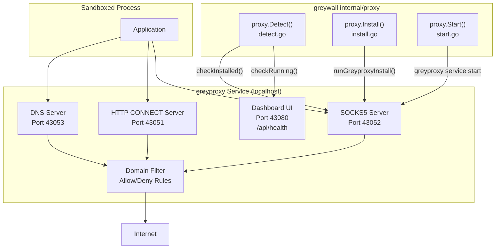
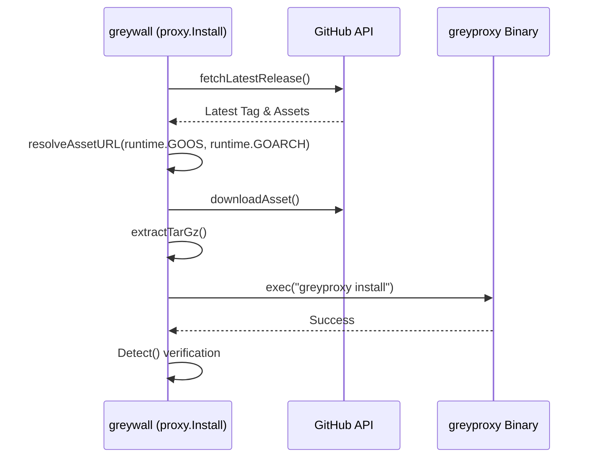

<!-- source: DeepWiki mcp.deepwiki.com · repo GreyhavenHQ/greywall · page 5.1 greyproxy Service · fetched 2026-10-26 -->

# greyproxy Service

Relevant source files

The following files were used as context for generating this wiki page:

- [.github/workflows/release.yml](.github/workflows/release.yml)
- [.goreleaser.yaml](.goreleaser.yaml)
- [internal/proxy/brew.go](internal/proxy/brew.go)
- [internal/proxy/detect.go](internal/proxy/detect.go)
- [internal/proxy/install.go](internal/proxy/install.go)
- [internal/proxy/start.go](internal/proxy/start.go)
- [internal/sandbox/color.go](internal/sandbox/color.go)
- [internal/sandbox/linux_features_stub.go](internal/sandbox/linux_features_stub.go)

This page documents the `greyproxy` service component, which provides network isolation and domain-based filtering for `greywall`. For information about how `greywall` creates proxy bridges to connect to `greyproxy`, see [Proxy Bridges and Unix Sockets](#5.2). For details on domain filtering rules, see [Domain-Based Filtering](#5.3).

## Overview

`greyproxy` is a standalone service that implements deny-by-default network filtering for sandboxed processes. It is a separate binary developed in the `GreyhavenHQ/greyproxy` repository and is managed as a dependency of `greywall`.

`greyproxy` provides four network services on localhost:
- **SOCKS5 server** (port 43052) - Primary proxy endpoint
- **HTTP CONNECT proxy** (port 43051) - HTTP/HTTPS proxy endpoint
- **DNS server** (port 43053) - DNS resolution with domain filtering
- **Dashboard UI** (port 43080) - Web interface for monitoring and control

All network traffic from sandboxed processes is routed through `greyproxy`, which enforces domain-based allow/deny rules and provides visibility into network activity.

**Sources:** [internal/proxy/detect.go:16](), [.goreleaser.yaml:105-108]()

## Service Architecture

The following diagram illustrates how the `internal/proxy` package in `greywall` interacts with the `greyproxy` binary and its network services.

**Sources:** [internal/proxy/detect.go:1-127](), [internal/proxy/start.go:1-31](), [internal/proxy/install.go:1-153]()

## Installation and Management

### Automatic Installation via Homebrew

When `greywall` is installed via Homebrew, `greyproxy` is listed as a mandatory dependency [ .goreleaser.yaml:104-105 ](). The Homebrew formula includes caveats pointing users to the dashboard at `http://localhost:43080` [ .goreleaser.yaml:106-108 ]().

### Manual Installation Logic

The `proxy.Install()` function [ internal/proxy/install.go:87-153 ]() handles the lifecycle of fetching and setting up the binary:

1.  **Environment Check**: Installation can be skipped by setting `GREYWALL_NO_GREYPROXY_INSTALL=1` [ internal/proxy/install.go:88-90 ]().
2.  **Release Discovery**: `fetchLatestRelease()` queries the GitHub API [ internal/proxy/install.go:156-186 ]().
3.  **Asset Resolution**: `resolveAssetURL()` matches the current `runtime.GOOS` and `runtime.GOARCH` to the correct `.tar.gz` asset [ internal/proxy/install.go:188-202 ]().
4.  **Execution**: After downloading and extracting, it executes `greyproxy install` to place the binary in the system path (typically `~/.local/bin`) [ internal/proxy/install.go:135-137 ]().

**Sources:** [internal/proxy/install.go:87-153](), [internal/proxy/install.go:188-202]()

## Service Detection and Health

### Detection Logic

The `Detect()` function in `internal/proxy/detect.go` provides a comprehensive status of the proxy service without returning errors, instead capturing failures in the `GreyproxyStatus` struct [ internal/proxy/detect.go:43-63 ]().

| Field | Description | Implementation |
| :--- | :--- | :--- |
| `Installed` | Binary exists on PATH | `exec.LookPath("greyproxy")` [ internal/proxy/detect.go:66-72 ]() |
| `Path` | Location of binary | Result of `LookPath` |
| `Version` | Semantic version string | Parsed from `greyproxy -V` [ internal/proxy/detect.go:76-90 ]() or health API |
| `Running` | Service is active | `GET /api/health` check [ internal/proxy/detect.go:95-126 ]() |

### Health Check Protocol

`greywall` verifies the service is actually `greyproxy` (and not another process occupying the port) by checking the `service` field in the JSON response from `http://localhost:43080/api/health` [ internal/proxy/detect.go:116-123 ]().

**Sources:** [internal/proxy/detect.go:21-36](), [internal/proxy/detect.go:95-126]()

## Version Management

`greywall` includes utilities to ensure the proxy dependency is up to date.

*   **`CheckLatestVersion()`**: Fetches the latest tag from GitHub and trims the "v" prefix [ internal/proxy/install.go:45-51 ]().
*   **`IsOlderVersion(current, latest)`**: Implements a semantic version comparison. It splits strings by `.` and compares major, minor, and patch integers [ internal/proxy/install.go:56-83 ](). If the current version is not a valid semver (e.g., "dev"), it is treated as older [ internal/proxy/install.go:63-65 ]().

**Sources:** [internal/proxy/install.go:43-83]()

## Platform Specifics

### Homebrew Management
The `IsBrewManaged()` function checks if the `greyproxy` binary resides within the Homebrew prefix (retrieved via `brew --prefix`) [ internal/proxy/brew.go:10-30 ](). This helps `greywall` decide whether to attempt an internal update or defer to the package manager.

### Linux vs macOS Capabilities
While `greyproxy` provides the network filtering layer, the ability to route traffic to it depends on platform-specific features described in `LinuxFeatures` [ internal/sandbox/linux_features_stub.go:13-29 ]():
*   **Linux**: Requires `HasSocat` for proxy bridges or `HasTun2Socks` for transparent proxying [ internal/sandbox/linux_features_stub.go:15-26 ]().
*   **macOS**: Relies on `sandbox-exec` (Seatbelt) which is verified during dependency checks [ internal/sandbox/linux_features_stub.go:66-71 ]().

**Sources:** [internal/proxy/brew.go:1-31](), [internal/sandbox/linux_features_stub.go:1-77]()

## Starting the Service

The `proxy.Start()` function [ internal/proxy/start.go:11-30 ]() triggers the service:
1.  Locates the binary using `checkInstalled()`.
2.  Runs `greyproxy service start`.
3.  Redirects `Stdout` and `Stderr` to the system standard streams to allow the user to see initialization logs.

**Sources:** [internal/proxy/start.go:11-30]()

---

