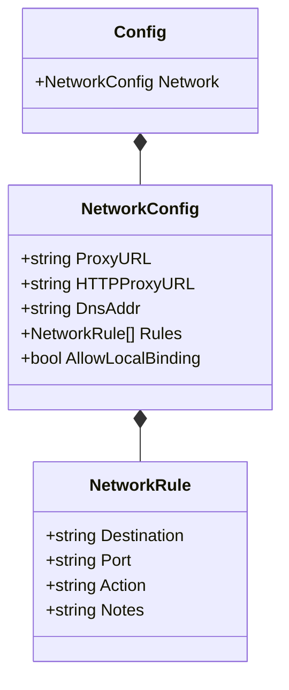
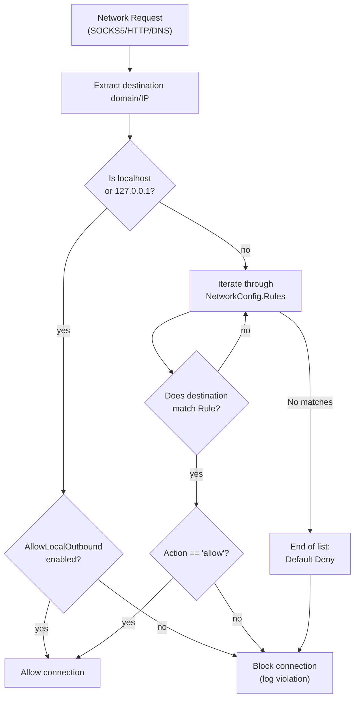
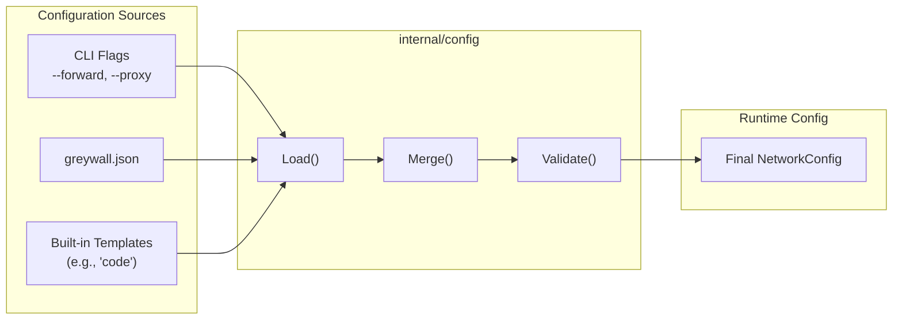

<!-- source: DeepWiki mcp.deepwiki.com · repo GreyhavenHQ/greywall · page 5.3 Domain-Based Filtering · fetched 2026-10-26 -->

# Domain-Based Filtering

<details>
<summary>Relevant source files</summary>

The following files were used as context for generating this wiki page:

- [docs/configuration.md](docs/configuration.md)
- [internal/config/config.go](internal/config/config.go)
- [internal/config/config_test.go](internal/config/config_test.go)

</details>


Domain-based filtering is greywall's mechanism for controlling network access through the `greyproxy` service. All network traffic from sandboxed processes is routed through `greyproxy`, which enforces a deny-by-default policy: connections are blocked unless the destination domain appears in the allow list. This page explains how domain filtering is implemented, how patterns are matched, and how to use the configuration system for runtime control.

For information about the `greyproxy` service architecture, see [greyproxy Service](#5.1). For details on how Linux bridges connect to `greyproxy`, see [Proxy Bridges and Unix Sockets](#5.2).

## Overview

Greyproxy implements a deny-by-default network filtering model where:

1.  **All outbound connections are blocked by default** — no network access is permitted unless explicitly allowed.
2.  **Domain-based filtering** — connections are allowed or denied based on the destination domain name.
3.  **Multiple protocol support** — filtering applies to SOCKS5, HTTP CONNECT, and DNS requests.
4.  **Wildcard patterns** — domain rules support wildcards like `**.openai.com`.
5.  **Session-Scoped Rules** — Rules can be defined per sandbox session and are automatically cleaned up.

The filtering occurs at the `greyproxy` service layer. On Linux, traffic is captured transparently via `tun2socks` and routed through Unix socket bridges to `greyproxy`. On macOS, applications use proxy environment variables to route traffic.

Sources: [internal/config/config.go:51-58](), [docs/configuration.md:93-96]()

## Configuration Model

Domain filtering is configured through the `NetworkConfig` structure [internal/config/config.go:61-71](), which specifies the proxy endpoints and the specific `NetworkRule` set for the session.

### Code Entity Mapping: Network Configuration

The following diagram bridges the configuration structure defined in Go to the logical filtering components.



**Sources:** [internal/config/config.go:23-25](), [internal/config/config.go:53-58](), [internal/config/config.go:61-71]()

### Configuration Examples

**Allow specific domains with wildcards:**

```jsonc
{
  "network": {
    "rules": [
      {
        "destination": "api.openai.com",
        "port": "443",
        "action": "allow"
      },
      {
        "destination": "**.github.com",
        "port": "*",
        "action": "allow"
      }
    ]
  }
}
```

**Explicitly Deny specific subdomains:**

```jsonc
{
  "network": {
    "rules": [
      {
        "destination": "telemetry.example.com",
        "action": "deny"
      },
      {
        "destination": "**.example.com",
        "action": "allow"
      }
    ]
  }
}
```

Rules are processed in order; a "deny" rule for a specific subdomain should typically precede a wildcard "allow" rule for the parent domain.

**Sources:** [internal/config/config.go:53-58](), [docs/configuration.md:13-17]()

## Domain Matching Logic

### Filtering Decision Flow

When a network request enters `greyproxy`, it evaluates the `NetworkRule` slice provided during session initialization.



**Sources:** [internal/config/config.go:51-58](), [internal/config/config.go:61-71](), [docs/configuration.md:104-104]()

### Pattern Support

The `Destination` field in `NetworkRule` [internal/config/config.go:54-54]() supports the following patterns:

| Pattern | Type | Matches |
|---------|------|---------|
| `api.openai.com` | Exact | Only that specific domain |
| `**.openai.com` | Wildcard | `api.openai.com`, `v1.api.openai.com`, etc. |
| `192.168.0.0/24` | CIDR | Any IP in the subnet |
| `*` | Catch-all | All destinations (if used in an allow rule) |

**Sources:** [internal/config/config.go:54-54]()

## DNS Filtering

Greyproxy provides a DNS server (default `localhost:43053`) [docs/configuration.md:100-100]() that enforces domain filtering before a connection is even attempted:

1.  **DNS queries are intercepted** — the sandboxed process queries the `DnsAddr` defined in `NetworkConfig` [internal/config/config.go:64-64]().
2.  **Domain validation** — `greyproxy` checks the queried domain against the active `Rules`.
3.  **Conditional resolution** — if allowed, `greyproxy` resolves the domain; if denied, it returns an error or empty response, preventing the process from obtaining the IP.

On Linux, this is enforced transparently via the `DnsBridge`.

**Sources:** [internal/config/config.go:64-64](), [docs/configuration.md:100-100]()

## Integration with Sandbox Configuration

### Configuration Precedence

The final `NetworkConfig` used by a sandbox is determined by merging multiple sources.



**Merge Behavior:**
- **Slice fields** (like `Rules` or `ForwardPorts`) are appended and deduplicated [docs/configuration.md:83-83]().
- **Boolean fields** use OR logic (true if either base or override enables it) [docs/configuration.md:84-84]().
- **String fields** (like `ProxyURL`) use override-wins semantics [docs/configuration.md:85-85]().

**Sources:** [internal/config/config.go:259-277](), [docs/configuration.md:81-85]()

## Platform-Specific Enforcement

### Linux: Transparent Interception
On Linux, the sandbox uses a network namespace and a TUN device. All traffic is forced through `tun2socks`, which converts packets into SOCKS5 requests sent to `greyproxy` via a Unix socket bridge. This prevents applications from bypassing filtering via `/etc/hosts` or hardcoded IPs.

### macOS: Environment Variables
On macOS, `greywall` sets standard environment variables (`HTTP_PROXY`, `HTTPS_PROXY`, `ALL_PROXY`) pointing to `greyproxy`.
- `HTTPProxyURL` (default `http://localhost:43051`) [docs/configuration.md:106-106]().
- `ProxyURL` (default `socks5://localhost:43052`) [docs/configuration.md:99-99]().

**Note:** Applications on macOS that do not respect environment variables or use low-level socket APIs may bypass these filters unless restricted by Seatbelt profiles.

**Sources:** [docs/configuration.md:99-106](), [internal/config/config.go:62-63]()

## Localhost and Local Binding

Access to the host machine is strictly controlled:

-   **`AllowLocalBinding`**: If true, allows the sandboxed process to listen on ports within the sandbox [internal/config/config.go:67-67]().
-   **`AllowLocalOutbound`**: Controls if the process can connect to services running on the host's `localhost`. On Linux, this is typically handled via `ForwardPorts` [internal/config/config.go:69-69](), which maps specific host ports into the sandbox. On macOS, this field directly enables/disables outbound localhost access [docs/configuration.md:104-104]().

**Sources:** [internal/config/config.go:67-69](), [docs/configuration.md:103-105]()

---

