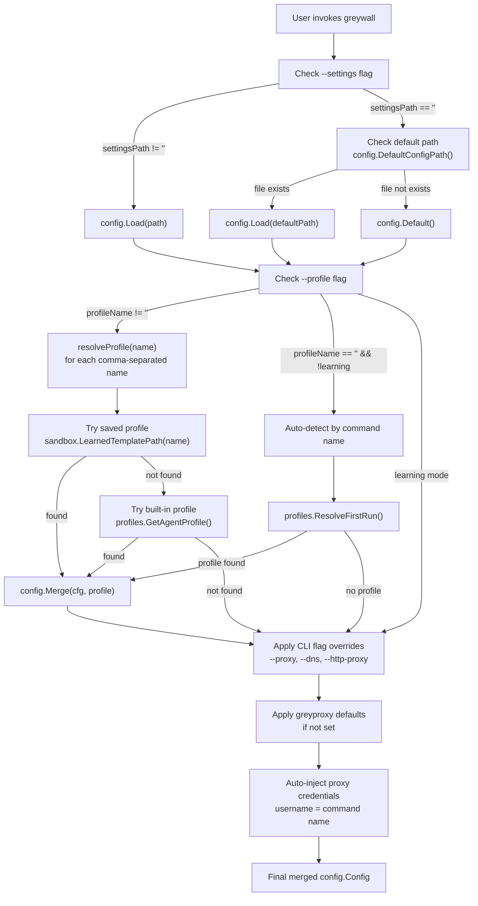
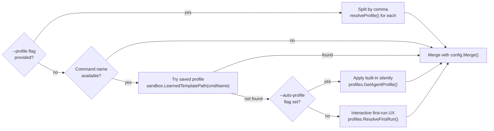
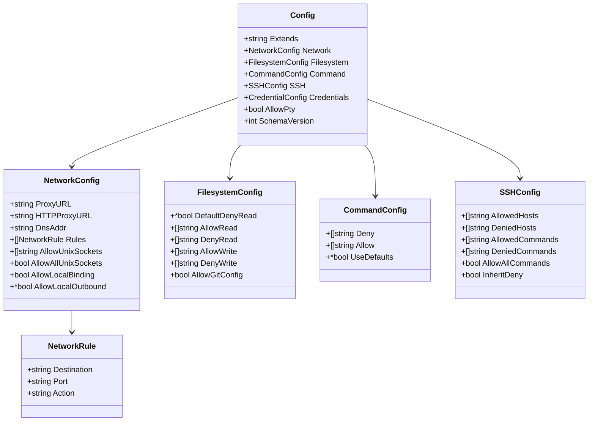
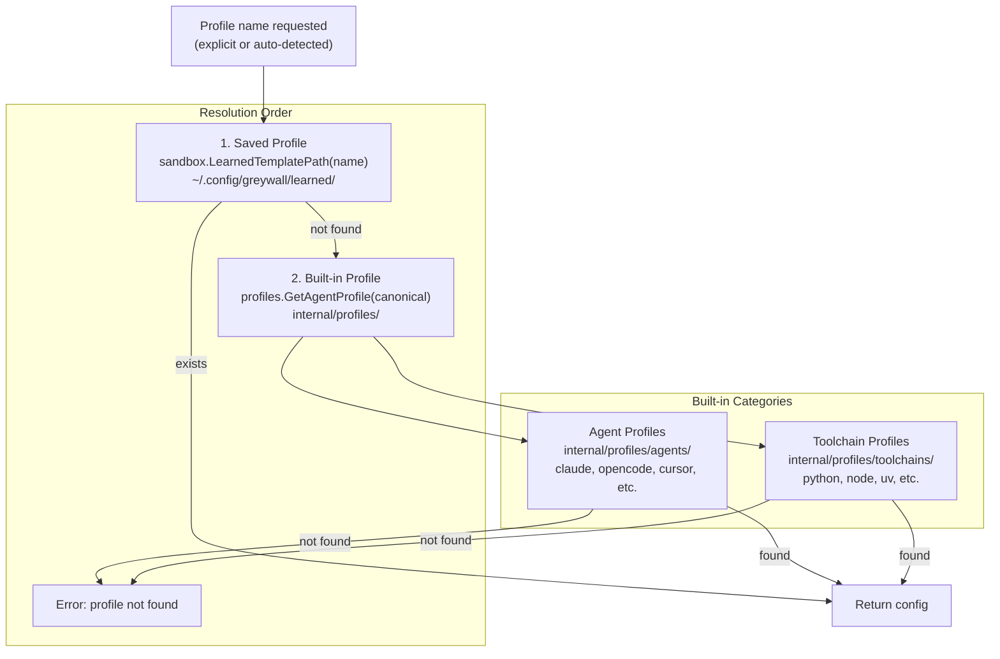

<!-- source: DeepWiki mcp.deepwiki.com · repo GreyhavenHQ/greywall · page 6 Configuration System · fetched 2026-10-26 -->

# Configuration System

<details>
<summary>Relevant source files</summary>

The following files were used as context for generating this wiki page:

- [docs/configuration.md](docs/configuration.md)
- [internal/config/config.go](internal/config/config.go)
- [internal/config/config_test.go](internal/config/config_test.go)

</details>


The Configuration System manages sandbox behavior through a layered approach that combines configuration files, profiles, and CLI flags. It handles loading, merging, and applying settings that control network access, filesystem restrictions, command filtering, and SSH policies.

For details on specific configuration file formats and options, see [Configuration Files](#6.1). For information about the profile system and template inheritance, see [Profile System](#6.2). For automatic profile generation via filesystem tracing, see [Learning Mode](#6.3).

---

## Configuration Loading Flow

The configuration system follows a strict precedence order, with later sources overriding earlier ones.

Title: Configuration Resolution Pipeline


**Sources:** [cmd/greywall/main.go:178-314](), [internal/config/config.go:176-180]()

---

## Configuration Loading Implementation

The configuration loading process is implemented in `main.go` with distinct stages:

### Stage 1: Base Configuration

The system first loads the base configuration from either an explicit path or the default location:

| Source | Code Path | Behavior |
|--------|-----------|----------|
| Explicit path (`--settings`) | [cmd/greywall/main.go:183-187]() | Load from specified file, error if missing |
| Default path | [cmd/greywall/main.go:189-199]() | Load from `config.DefaultConfigPath()`, use default if missing |
| Default config | [cmd/greywall/main.go:198]() | Created via `config.Default()` when no file exists |

### Stage 2: Profile Resolution

Profile resolution happens only when NOT in learning mode ([cmd/greywall/main.go:206-262]()):

Title: Profile Selection Logic


The `resolveProfile` function ([cmd/greywall/main.go:449-481]()) tries saved profiles first, then built-in profiles, returning an error if neither exists.

### Stage 3: CLI Flag Overrides

CLI flags always take precedence over configuration files ([cmd/greywall/main.go:264-273]()):

```go
// Overrides in order:
cfg.Network.ProxyURL      // --proxy flag
cfg.Network.HTTPProxyURL  // --http-proxy flag
cfg.Network.DnsAddr       // --dns flag
```

### Stage 4: Default Value Application

If proxy or DNS settings remain unset, greyproxy defaults are applied ([cmd/greywall/main.go:277-294]()):

| Field | Default Value | Port |
|-------|---------------|------|
| `ProxyURL` | `socks5://localhost:43052` | 43052 |
| `HTTPProxyURL` | `http://localhost:43051` | 43051 |
| `DnsAddr` | `localhost:43053` | 43053 |

### Stage 5: Proxy Credential Injection

The system automatically injects proxy credentials for identification ([cmd/greywall/main.go:296-314]()):

- Username: command name (e.g., `opencode`) or `"proxy"` if unavailable
- Password: always `"proxy"`
- Applied to both `ProxyURL` and `HTTPProxyURL` fields

**Sources:** [cmd/greywall/main.go:178-314](), [cmd/greywall/main.go:449-481]()

---

## Configuration Structure

The configuration is defined by the `Config` type in `internal/config/config.go`.

### Core Configuration Type

Title: Configuration Data Model


### Field Semantics

| Field Type | Nil Behavior | Default When Nil |
|------------|--------------|------------------|
| `*bool` fields | `nil` = use default | `DefaultDenyRead`: `true`, `UseDefaults`: `true` |
| `[]string` fields | `nil` or `[]` | Empty list (no restrictions) |
| `string` fields | `""` | Greyproxy defaults applied after merge |

**Sources:** [internal/config/config.go:23-105](), [internal/config/config.go:151-171]()

---

## Profile Resolution System

Profiles provide reusable configuration bundles. The system recognizes three profile types with a clear resolution order:

Title: Profile Source Resolution


### Resolution Implementation

The `resolveProfile` function implements this logic ([cmd/greywall/main.go:449-481]()):

1. **Saved profile lookup:** Uses `sandbox.LearnedTemplatePath(name)` to construct path.
2. **Config loading:** Calls `config.Load(savedPath)` to attempt load.
3. **Built-in fallback:** 
   - Calls `profiles.IsKnownAgent(name)` to get canonical name.
   - Retrieves via `profiles.GetAgentProfile(canonical)`.
4. **Error on miss:** Returns error if neither source has the profile.

**Sources:** [cmd/greywall/main.go:449-481](), [cmd/greywall/main.go:19-20]()

---

## Configuration Merging

The `config.Merge` function combines configurations with well-defined override semantics.

### Merge Semantics by Field Type

| Field Type | Merge Behavior |
|------------|----------------|
| String fields | Override: profile value replaces base if non-empty |
| `[]string` fields | Append: profile values added to base list and deduplicated |
| `*bool` fields | Override: profile value replaces base if non-nil |
| Boolean fields | OR logic: true if either base or override enables it |

### Multiple Profile Merging

The `--profile` flag accepts comma-separated names ([cmd/greywall/main.go:208-222]()):

```go
// Example: --profile claude,python
names := strings.Split(profileName, ",")
for _, name := range names {
    name = strings.TrimSpace(name)
    resolved, err := resolveProfile(name, debug)
    if resolved != nil {
        cfg = config.Merge(cfg, resolved)
    }
}
```

**Sources:** [internal/config/config.go:259-300](), [cmd/greywall/main.go:208-222]()

---

## Auto-Detection and First-Run UX

When no explicit profile is specified, the system attempts auto-detection based on command name.

### Command Name Extraction

The `extractCommandName` function ([cmd/greywall/main.go:483-504]()) extracts the base command:

- From args: `["opencode", "--flag"]` → `"opencode"`
- From `-c`: `"opencode --flag"` → `"opencode"` (first token)
- Strips path: `/usr/bin/opencode` → `"opencode"`

### Auto-Profile Mode

The `--auto-profile` flag ([cmd/greywall/main.go:237-250]()) silently applies built-in profiles without prompting. If not set, `profiles.ResolveFirstRun()` may prompt the user to adopt a built-in profile for a detected agent.

**Sources:** [cmd/greywall/main.go:223-262](), [cmd/greywall/main.go:483-504]()

---

## Default Values and Initialization

### Nil vs. Empty Semantics

Pointer fields (`*bool`) distinguish between "not set" and "explicitly false":

| Field | Nil Value | Meaning | Effective Value |
|-------|-----------|---------|-----------------|
| `DefaultDenyRead` | `nil` | Use secure default | `true` (deny by default) |
| `DefaultDenyRead` | `*false` | Explicitly allow all reads | `false` |
| `UseDefaults` | `nil` | Use default deny list | `true` |
| `AllowLocalOutbound` | `nil` | Inherit from `AllowLocalBinding` | Same as `AllowLocalBinding` |

### Default Denied Commands

When `CommandConfig.UseDefaults` is true, greywall blocks dangerous system commands like `shutdown`, `reboot`, `mkfs`, and `chroot` by default.

**Sources:** [internal/config/config.go:109-148](), [internal/config/config.go:85-87]()

---

## Configuration Precedence Summary

The complete precedence order from lowest to highest:

1. **Built-in Defaults:** `config.Default()` with deny-by-default filesystem.
2. **Configuration File:** Loaded via `--settings` or from default path.
3. **Extended Profile:** via `extends` field in the loaded config file.
4. **Saved Profiles:** Auto-detected by command name if no `--profile` flag.
5. **Explicit Profiles:** `--profile` flag (left to right merging).
6. **CLI Flags:** `--proxy`, `--dns`, `--http-proxy` direct overrides.
7. **Greyproxy Defaults:** Applied if fields are still empty.

**Sources:** [cmd/greywall/main.go:178-314](), [docs/configuration.md:33-91]()

---

