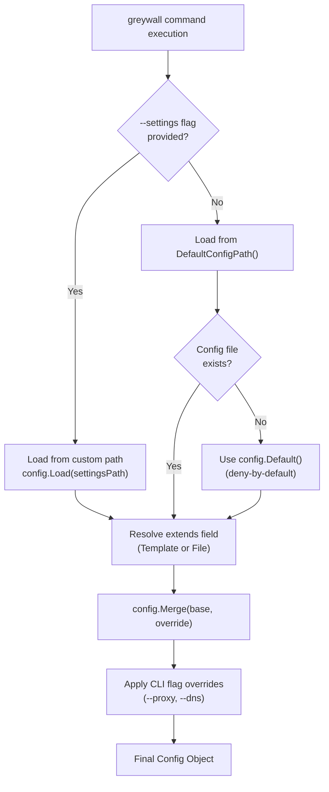
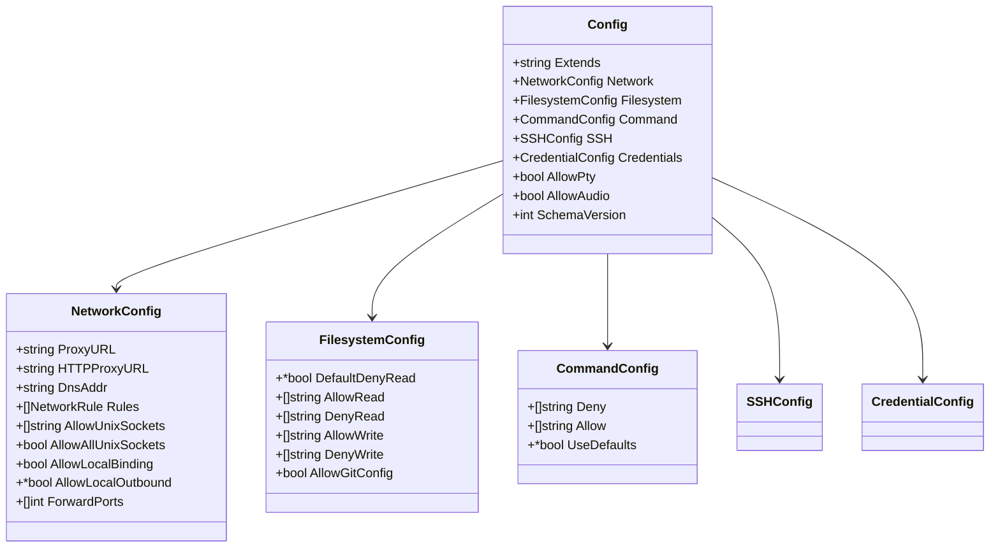

<!-- source: DeepWiki mcp.deepwiki.com · repo GreyhavenHQ/greywall · page 6.1 Configuration Files · fetched 2026-10-26 -->

# Configuration Files

Relevant source files

The following files were used as context for generating this wiki page:

- [docs/configuration.md](docs/configuration.md)
- [internal/config/config.go](internal/config/config.go)
- [internal/config/config_test.go](internal/config/config_test.go)

This page documents the structure and format of greywall configuration files. It covers file locations, the JSON schema, and all available configuration options. For information about profiles (built-in templates and learned profiles), see [Profile System](#6.2). For automatic configuration generation, see [Learning Mode](#6.3).

## File Format and Locations

Greywall configuration files use JSON or JSONC (JSON with Comments) format. The configuration system supports standard JSON comments (`//` and `/* */`) for documentation through the `github.com/tidwall/jsonc` parser [internal/config/config.go:14-15]().

**Default Configuration Paths**

| Platform | Default Path |
|----------|-------------|
| Linux | `~/.config/greywall/greywall.json` |
| macOS | `~/Library/Application Support/greywall/greywall.json` |
| Legacy (all) | `~/.greywall.json` (fallback) |

The default path is resolved by [internal/config/config.go:176-200]() in the `DefaultConfigPath` function. It prioritizes the OS-preferred config directory (XDG on Linux, Application Support on macOS) but falls back to the legacy `~/.greywall.json` if it exists [internal/config/config.go:176-186]().

**Custom Configuration Path**

Use the `--settings` / `-s` flag to specify a custom configuration file. When this flag is provided, greywall loads settings via `config.Load(path)` [internal/config/config.go:48-91]().

Sources: [internal/config/config.go:176-200](), [docs/configuration.md:1-9]()

## Configuration Loading Flow

The following diagram illustrates how the `config` package and CLI entry point resolve the final sandbox configuration.

Sources: [internal/config/config.go:48-91](), [internal/config/config.go:259-310](), [docs/configuration.md:33-91]()

## Configuration Structure

The `Config` struct in [internal/config/config.go:23-42]() defines the root configuration object.

Sources: [internal/config/config.go:23-42](), [internal/config/config.go:61-71](), [internal/config/config.go:74-81](), [internal/config/config.go:90-94](), [internal/config/config.go:98-105]()

### Extends Field

The `extends` field allows configuration inheritance. The logic treats the value as a file path if it contains path separators or starts with `.`, otherwise it is treated as a built-in template name [docs/configuration.md:77-80]().

- **Merge Logic**: Slices are appended and deduplicated; Booleans use OR logic; Integers use override-wins [docs/configuration.md:81-86]().
- **Chaining**: Supports up to 10 levels of inheritance with circular dependency detection [docs/configuration.md:88-90]().

Sources: [internal/config/config.go:24](), [docs/configuration.md:33-91]()

## Network Configuration

The `NetworkConfig` struct [internal/config/config.go:61-71]() manages connectivity. Unlike legacy versions, modern greywall uses `NetworkRule` objects for fine-grained control.

### Field Reference

| Field | Type | Description |
|-------|------|-------------|
| `proxyUrl` | `string` | SOCKS5 proxy URL (e.g. `socks5://host:1080`) |
| `httpProxyUrl` | `string` | HTTP CONNECT proxy URL |
| `dnsAddr` | `string` | DNS server address on host |
| `rules` | `[]NetworkRule` | Session-scoped rules for greyproxy |
| `forwardPorts` | `[]int` | Host ports to forward into sandbox (Linux) |
| `allowLocalOutbound`| `*bool` | Allow access to host localhost (macOS) |

### Network Rules

Rules are defined in [internal/config/config.go:53-58]():
- **Destination**: Domain/IP pattern (e.g. `api.openai.com`, `**.openai.com`, `192.168.0.0/24`).
- **Port**: Supports exact ports, ranges (`8000-9000`), or comma-separated lists.
- **Action**: `"allow"` (default) or `"deny"`.

Sources: [internal/config/config.go:53-71](), [docs/configuration.md:94-107]()

## Filesystem Configuration

The `FilesystemConfig` struct [internal/config/config.go:74-81]() controls path access.

### Deny-by-Default Read Model

If `defaultDenyRead` is `nil` or `true`, the sandbox denies all reads except for system paths, the current working directory, and paths in `allowRead` [internal/config/config.go:75-76]().

### Hard-Coded Protections

Greywall blocks specific dangerous paths regardless of configuration to prevent credential theft and shell persistence. These include:
- **Credentials**: `~/.ssh/id_*`, `~/.aws/credentials`, `~/.config/gcloud/**` [docs/configuration.md:144-150]().
- **Shell Hooks**: `~/.bashrc`, `~/.zshrc`, `.git/hooks/*` [docs/configuration.md:144-150]().

Sources: [internal/config/config.go:74-87](), [docs/configuration.md:108-120]()

## Command Configuration

The `CommandConfig` struct [internal/config/config.go:90-94]() defines which binaries or command strings are blocked.

### Default Denied Commands

When `useDefaults` is true (the default), greywall blocks a list of system-critical commands defined in `DefaultDeniedCommands` [internal/config/config.go:109-148]():
- **System Control**: `shutdown`, `reboot`, `halt`, `systemctl poweroff`.
- **Kernel**: `insmod`, `modprobe`, `kexec`.
- **Disk**: `mkfs.*`, `fdisk`, `dd if=`.
- **Escape**: `docker run --privileged`, `chroot`, `unshare`.

### Command Detection

Detection is applied to direct commands, chains (`&&`, `;`), pipelines (`|`), and shell invocations (`bash -c`) [docs/configuration.md:156-162]().

Sources: [internal/config/config.go:90-94](), [internal/config/config.go:109-148](), [docs/configuration.md:121-162]()

## SSH Configuration

The `SSHConfig` struct [internal/config/config.go:98-105]() provides an allowlist-by-default model for remote execution.

- **AllowedHosts**: Supports wildcards like `*.example.com`.
- **InheritDeny**: If `true`, the global `command.deny` rules are also applied to commands executed over SSH [internal/config/config.go:104]().

Sources: [internal/config/config.go:98-105](), [docs/configuration.md:163-221]()

## Credential Configuration

Defined in [internal/config/config.go:45-49](), this section handles sensitive data injection.

- **Secrets**: Additional environment variables to treat as credentials.
- **Inject**: Global credential labels to pull from the proxy.
- **Ignore**: Environment variables to exclude from automated credential detection.

Sources: [internal/config/config.go:45-49]()

## Merging and Defaults

The `Merge` function [internal/config/config.go:259-310]() handles the combination of base and override configurations. 

- **Default State**: `config.Default()` returns a configuration with all network blocked (empty `NetworkConfig`) and default command restrictions enabled [internal/config/config.go:151-171]().
- **Validation**: `config.Validate()` ensures proxy URLs have valid schemes (e.g., `socks5://` or `socks5h://`) and that no empty paths are provided in filesystem rules [internal/config/config_test.go:9-110]().

Sources: [internal/config/config.go:151-171](), [internal/config/config.go:259-310](), [internal/config/config_test.go:9-110]()

---

