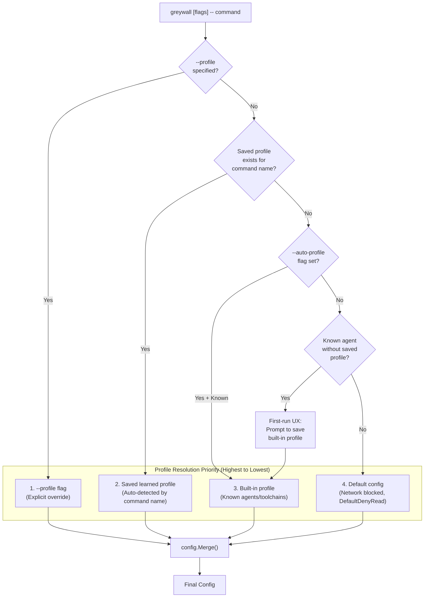
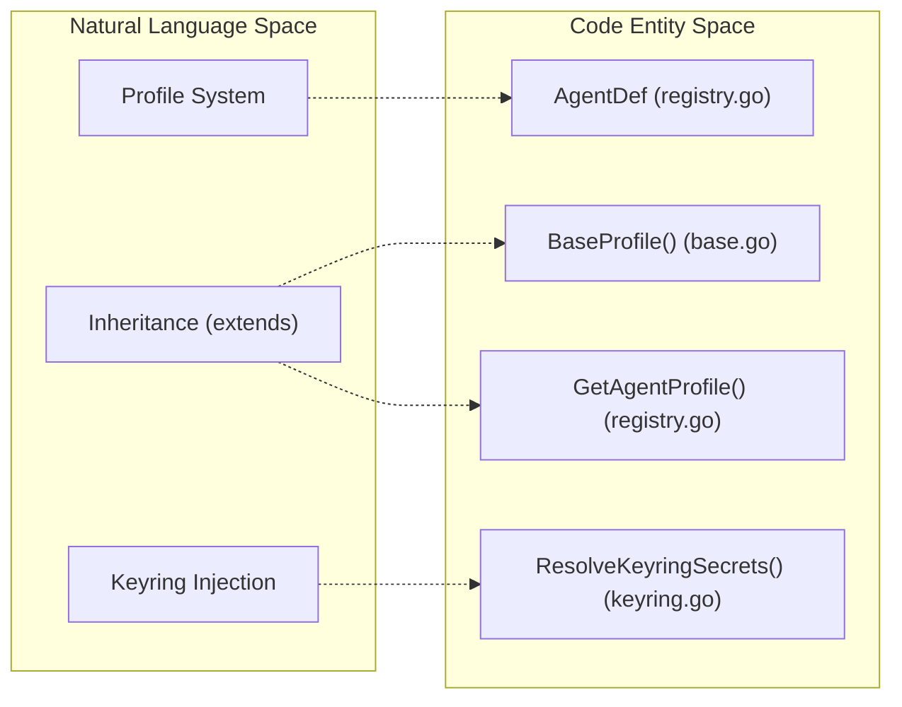
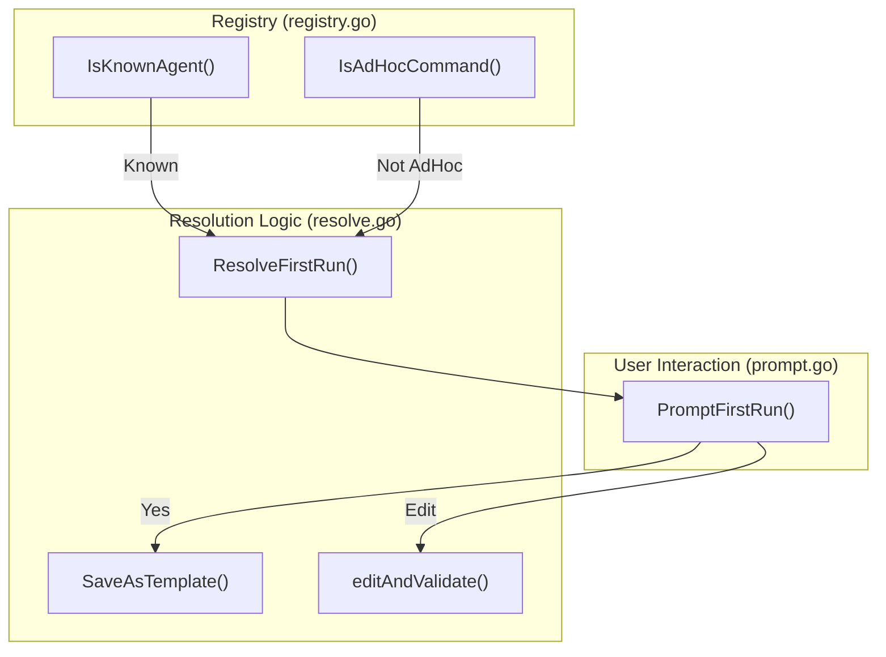

<!-- source: DeepWiki mcp.deepwiki.com · repo GreyhavenHQ/greywall · page 6.2 Profile System · fetched 2026-10-26 -->

# Profile System

<details>
<summary>Relevant source files</summary>

The following files were used as context for generating this wiki page:

- [docs/agents.md](docs/agents.md)
- [docs/cli-reference.md](docs/cli-reference.md)
- [docs/templates.md](docs/templates.md)
- [internal/profiles/base.go](internal/profiles/base.go)
- [internal/profiles/keyring.go](internal/profiles/keyring.go)
- [internal/profiles/profiles_test.go](internal/profiles/profiles_test.go)
- [internal/profiles/prompt.go](internal/profiles/prompt.go)
- [internal/profiles/registry.go](internal/profiles/registry.go)
- [internal/profiles/resolve.go](internal/profiles/resolve.go)
- [internal/profiles/toolchains/scm.go](internal/profiles/toolchains/scm.go)

</details>


The Profile System provides pre-configured security policies for common tools and workflows, eliminating the need to manually configure filesystem and network restrictions for every command. Profiles can be built-in (shipped with greywall), saved/learned automatically, or custom-defined by users.

---

## Profile Types

Greywall supports three types of profiles, each serving different use cases:

| Profile Type | Source | Storage Location | Use Case |
|--------------|--------|------------------|----------|
| **Built-in** | Shipped with greywall | `internal/profiles/agents/` and `internal/profiles/toolchains/` | Pre-configured policies for popular AI agents and development tools. |
| **Saved/Learned** | Generated via `--learning` or saved from built-in | `~/.config/greywall/learned/` (or `~/Library/Application Support/greywall/learned/` on macOS) | Custom profiles learned from actual usage or modified from defaults. |
| **Explicit** | User-defined JSON/JSONC files | Any path | Custom security policies for specific workflows. |

**Sources:** [internal/profiles/registry.go:19-43](), [internal/profiles/resolve.go:169-180]()

---

## Profile Resolution and Precedence

When greywall runs a command, it resolves profiles in a specific priority order. Higher-priority sources override lower-priority ones through configuration merging.



**Profile Resolution Flow**

The resolution logic is driven by the following components:

1. **Explicit `--profile` flag**: Resolves each comma-separated profile name. It tries saved profiles first via `sandbox.LearnedTemplatePath(name)` before falling back to built-in profiles [docs/templates.md:12-26]().
2. **Auto-detected saved profile**: If no profile is specified, greywall extracts the command name and checks `~/.config/greywall/learned/{cmdName}.json` [internal/profiles/resolve.go:180]().
3. **`--auto-profile` flag**: Silently applies a built-in profile if available for the command without triggering the interactive prompt [docs/cli-reference.md:22]().
4. **First-run UX**: For known agents without saved profiles, `profiles.ResolveFirstRun()` displays a summary and asks the user to apply, edit, or skip the profile [internal/profiles/resolve.go:17-27]().
5. **Default config**: Falls back to restrictive defaults if no other profiles apply.

**Sources:** [internal/profiles/resolve.go:17-104](), [docs/templates.md:12-26](), [docs/cli-reference.md:17-40]()

---

## Built-in Profiles and Inheritance

Built-in profiles are defined as `AgentDef` structs and registered via `init()` functions [internal/profiles/registry.go:23-43]().

### Base Profile
Most agent profiles inherit from `BaseProfile()`, which provides access to standard configuration like `.gitconfig`, SSH known hosts, and platform-specific paths like the macOS Keychain [internal/profiles/base.go:13-86]().

### Toolchains vs. Agents
- **Agents**: Merged on top of `BaseProfile()`. They represent high-level AI tools (e.g., Claude Code).
- **Toolchains**: (e.g., `npm`, `gh`, `cargo`) Do **not** inherit from `BaseProfile()` by default to maintain a smaller attack surface [internal/profiles/registry.go:28-34]().

### Keyring Secrets (Linux)
Profiles can define `KeyringSecrets` which map environment variables to system keyring lookups. On Linux, `ResolveKeyringSecrets` uses `secret-tool` to fetch these *before* sandboxing, injecting them as environment variables to avoid exposing the D-Bus session bus to the sandbox [internal/profiles/keyring.go:18-65](), [internal/profiles/toolchains/scm.go:30-32]().



**Sources:** [internal/profiles/registry.go:68-83](), [internal/profiles/base.go:13-86](), [internal/profiles/keyring.go:11-18]()

---

## Profile Management and First-Run UX

Greywall provides an interactive prompt when a known agent is run without a saved profile.

### First-Run Prompt
`PromptFirstRun()` displays a colorized summary of the profile's filesystem and network rules [internal/profiles/prompt.go:129-192]().

- **[Y] Use profile**: Saves the built-in profile to the learned directory so it auto-loads next time [internal/profiles/resolve.go:73-77]().
- **[e] Edit first**: Saves the profile and opens the user's `$EDITOR` for manual adjustment [internal/profiles/resolve.go:79-93]().
- **[s] Skip**: Runs with restrictive defaults for this session only [internal/profiles/resolve.go:101-103]().
- **[n] Don't ask again**: Suppresses future prompts for this command by updating `~/.config/greywall/preferences.json` [internal/profiles/resolve.go:95-99]().

### Ad-Hoc Commands
Basic Unix utilities (e.g., `ls`, `cat`, `grep`, `git`, `make`) are classified as "ad-hoc" and never trigger the first-run prompt, even if they lack a profile [internal/profiles/registry.go:120-152]().



**Sources:** [internal/profiles/prompt.go:129-192](), [internal/profiles/resolve.go:17-104](), [internal/profiles/registry.go:120-152]()

---

## Profile Inheritance (extends)

Profiles can extend other profiles or files using the `extends` field [docs/templates.md:32-41]().

### Merging Rules
When a profile extends another, settings are merged using specific logic:
- **Slices (paths, commands)**: Appended and deduplicated [docs/templates.md:45]().
- **Booleans**: OR logic (true if either enables the feature) [docs/templates.md:46]().
- **Integers/Ports**: The override (child) value wins [docs/templates.md:47]().

### Example: Customizing a Template
```json
{
  "extends": "code",
  "filesystem": {
    "allowWrite": [".", "/tmp"],
    "denyRead": ["~/.ssh/id_rsa"]
  }
}
```
This inherits the network rules and base filesystem protections of the `code` profile while adding custom paths [docs/templates.md:68-78]().

**Sources:** [docs/templates.md:30-64](), [internal/profiles/registry.go:72-83]()

---

## Network Rules Precedence

Profiles can declare network rules in the `network.rules` field. These are forwarded to `greyproxy` as session-scoped rules [docs/templates.md:87-89]().

### `--no-network-rules`
Users can apply a profile's filesystem and credential protections while ignoring its network allow-list by using the `--no-network-rules` flag [docs/templates.md:90-95]().
- **Effect**: Suppresses rules from the profile.
- **Exceptions**: CLI-provided `--allow` rules are still forwarded [docs/templates.md:99]().

**Sources:** [docs/templates.md:87-101](), [docs/cli-reference.md:36]()

---

