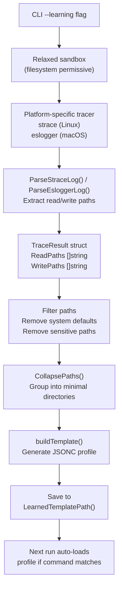
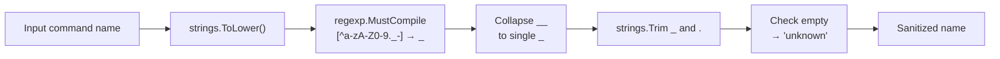
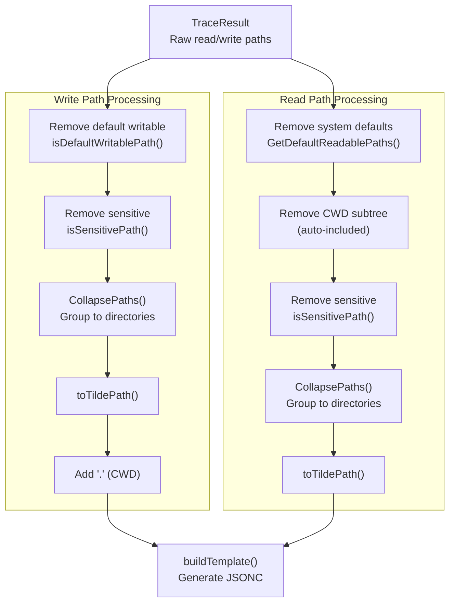

<!-- source: DeepWiki mcp.deepwiki.com · repo GreyhavenHQ/greywall · page 6.3 Learning Mode · fetched 2026-10-26 -->

# Learning Mode

<details>
<summary>Relevant source files</summary>

The following files were used as context for generating this wiki page:

- [docs/learning-mode.md](docs/learning-mode.md)
- [internal/sandbox/learning.go](internal/sandbox/learning.go)
- [internal/sandbox/learning_darwin.go](internal/sandbox/learning_darwin.go)
- [internal/sandbox/learning_darwin_test.go](internal/sandbox/learning_darwin_test.go)
- [internal/sandbox/learning_linux.go](internal/sandbox/learning_linux.go)
- [internal/sandbox/learning_linux_test.go](internal/sandbox/learning_linux_test.go)
- [internal/sandbox/learning_stub.go](internal/sandbox/learning_stub.go)
- [internal/sandbox/learning_test.go](internal/sandbox/learning_test.go)

</details>


Learning Mode is greywall's automatic profile generation system. It traces a command's filesystem access using platform-specific tools (`strace` on Linux, `eslogger` on macOS), analyzes the observed paths, and generates a configuration profile that can be reused for subsequent runs.

This page covers the implementation details of learning mode. For configuration file structure, see [Configuration Files](#6.1). For how profiles are loaded and merged, see [Profile System](#6.2).

## System Overview

Learning mode operates as an optional execution path that relaxes filesystem restrictions while capturing access patterns. The captured data flows through a series of filtering and collapsing transformations before being serialized as a JSONC configuration profile.

**Core execution flow:**



Sources: [docs/learning-mode.md:10-15](), [internal/sandbox/learning.go:73-200]()

## Core Data Structures

### TraceResult

The `TraceResult` struct holds the parsed output from the system tracer before filtering and transformation.

```go
type TraceResult struct {
	WritePaths []string
	ReadPaths  []string
}
```

**Fields:**
- `WritePaths`: All file paths accessed for writing (create, write, mkdir, etc.) [internal/sandbox/learning.go:18-18]()
- `ReadPaths`: All file paths accessed for reading (openat O_RDONLY, etc.) [internal/sandbox/learning.go:19-19]()

Sources: [internal/sandbox/learning.go:17-20]()

### LearnedTemplateInfo

The `LearnedTemplateInfo` struct represents a stored learned profile.

```go
type LearnedTemplateInfo struct {
	Name string // profile name (without .json)
	Path string // full path to the profile file
}
```

Used by `ListLearnedTemplates()` to enumerate available profiles in the learned directory. [internal/sandbox/learning.go:343-347]()

Sources: [internal/sandbox/learning.go:343-347]()

## Template Storage

### Directory Structure

Learned profiles are stored in a platform-specific configuration directory determined by `LearnedTemplateDir()` [internal/sandbox/learning.go:34-45]():

| Platform | Path |
|----------|------|
| Linux (XDG) | `$XDG_CONFIG_HOME/greywall/learned/` |
| Linux (default) | `~/.config/greywall/learned/` |
| macOS | `~/Library/Application Support/greywall/learned/` |

**Key functions:**

| Function | Purpose | Returns |
|----------|---------|---------|
| `LearnedTemplateDir()` | Get learned profile directory [internal/sandbox/learning.go:34-45]() | `string` |
| `LearnedTemplatePath(cmdName)` | Get path for specific profile [internal/sandbox/learning.go:48-50]() | `string` |
| `SanitizeTemplateName(name)` | Sanitize command name for filename [internal/sandbox/learning.go:54-71]() | `string` |

Sources: [internal/sandbox/learning.go:34-71]()

### Template Naming

Command names are sanitized for use as filenames using `SanitizeTemplateName()`. It forces lowercase to prevent case-insensitive filesystem collisions on macOS [internal/sandbox/learning.go:55-59]().



**Examples:**
- `Claude` → `claude` [internal/sandbox/learning_test.go:26-26]()
- `my app` → `my_app` [internal/sandbox/learning_test.go:20-20]()
- `/usr/bin/opencode` → `usr_bin_opencode` [internal/sandbox/learning_test.go:21-21]()

Sources: [internal/sandbox/learning.go:54-71](), [internal/sandbox/learning_test.go:11-38]()

## Path Filtering Pipeline

The `GenerateLearnedTemplate()` function processes raw trace results through multiple filtering stages [internal/sandbox/learning.go:73-200]():



Sources: [internal/sandbox/learning.go:73-138]()

### Write Path Filtering

**Step 1: Remove default writable paths**

The `isDefaultWritablePath()` function checks if a path is already writable by default in the sandbox [internal/sandbox/learning.go:271-285](). It checks against paths like `/dev/null` and `/dev/stdout` [internal/sandbox/learning_test.go:183-184]().

**Step 2: Remove sensitive paths**

The `isSensitivePath()` function filters out dangerous targets [internal/sandbox/learning.go:287-316]():

| Pattern | Reason |
|---------|--------|
| `~/.bashrc`, `~/.zshrc`, etc. | Shell startup files [internal/sandbox/learning.go:292-292]() |
| `~/.ssh/**` | SSH keys and config [internal/sandbox/learning.go:303-303]() |
| `~/.gnupg/**` | GPG keys [internal/sandbox/learning.go:305-305]() |
| `.env`, `.env.*` | Environment secrets [internal/sandbox/learning.go:310-312]() |

Sources: [internal/sandbox/learning.go:271-316]()

### Read Path Filtering

**Step 1: Remove system defaults**

Paths under `GetDefaultReadablePaths()` are excluded as they're already accessible [internal/sandbox/learning.go:106-118]().

**Step 2: Remove CWD subtree**

The current working directory and all its descendants are excluded because the sandbox auto-includes CWD [internal/sandbox/learning.go:119-122]().

**Step 3: Remove sensitive paths**

Same logic as write path filtering using `isSensitivePath()` [internal/sandbox/learning.go:124-129]().

Sources: [internal/sandbox/learning.go:103-131]()

## Path Collapsing Algorithm

The `CollapsePaths()` function minimizes the number of paths by grouping related files into their parent directories [internal/sandbox/learning.go:204-246]().

### Application Directory Detection

The algorithm uses `findApplicationDirectory()` to identify well-known application-specific directories [internal/sandbox/learning.go:248-269]().

**Well-known parents:**
```go
var wellKnownParents = []string{
	".cache",
	".config",
	".local/share",
	".local/state",
	".local/lib",
	".data",
}
```
Sources: [internal/sandbox/learning.go:24-31]()

For paths under these parents (e.g., `~/.cache/opencode/db/main.sqlite`), the function extracts the first directory below the well-known parent (`~/.cache/opencode`) [internal/sandbox/learning.go:256-261]().

### Collapsing Logic

The logic differentiates between application directories and standalone files. For app dirs, it collapses if 2+ paths share the root. For standalone files directly under home, it keeps the exact path to avoid broad access [internal/sandbox/learning.go:228-241]().

Sources: [internal/sandbox/learning.go:204-246]()

### Deduplication

The `deduplicateSubPaths()` function removes paths that are sub-paths of other paths in the result [internal/sandbox/learning.go:374-399]().

**Example:**
- Input: `["/home/user/.cache", "/home/user/.cache/opencode"]`
- Output: `["/home/user/.cache"]` [internal/sandbox/learning_test.go:234-235]()

Sources: [internal/sandbox/learning.go:374-399]()

## Template Generation

The `buildTemplate()` function creates the JSONC profile content [internal/sandbox/learning.go:423-457]().

### Generated Sections

| Section | Content | Source |
|---------|---------|--------|
| `allowRead` | Collapsed read paths | `TraceResult.ReadPaths` |
| `allowWrite` | `"."` + collapsed write paths | `TraceResult.WritePaths` |
| `denyWrite` | Shell startup files | `getDangerousFilePatterns()` |
| `denyRead` | SSH, GPG, `.env` | `getSensitiveReadPatterns()` |

Sources: [internal/sandbox/learning.go:423-457]()

## Platform-Specific Implementation

### Linux: strace

On Linux, `ParseStraceLog` extracts paths from syscalls like `openat`, `mkdirat`, `unlinkat`, and `renameat2` [internal/sandbox/learning_linux.go:16-18](). It specifically checks for write flags (O_WRONLY, O_RDWR, etc.) in `openat` calls [internal/sandbox/learning_linux.go:21-21]().

### macOS: eslogger

On macOS, greywall uses `eslogger` to stream events from the Endpoint Security framework [docs/learning-mode.md:12-12]().

**Process Tree Tracking:**
Because `eslogger` is system-wide, `ParseEsloggerLog` performs a two-pass scan. Pass 1 builds a PID tree from `fork` events starting at the `rootPID` [internal/sandbox/learning_darwin.go:135-153](). Pass 2 filters filesystem events (`open`, `create`, `write`, `unlink`, `truncate`, `rename`, `link`) against this PID set [internal/sandbox/learning_darwin.go:159-223]().

**Event Classification:**
Events are classified into `opRead` or `opWrite` [internal/sandbox/learning_darwin.go:16-20](). For example, an `open` event is `opWrite` if the `fflag` contains `fwriteFlag` (0x0002) [internal/sandbox/learning_darwin.go:23-23]().

Sources: [internal/sandbox/learning_linux.go:1-163](), [internal/sandbox/learning_darwin.go:1-235]()

## Code Entity Reference

### Functions

| Function | Location | Purpose |
|----------|----------|---------|
| `GenerateLearnedTemplate()` | [internal/sandbox/learning.go:75-200]() | Main template generation function |
| `CollapsePaths()` | [internal/sandbox/learning.go:204-246]() | Group paths into minimal directories |
| `findApplicationDirectory()` | [internal/sandbox/learning.go:248-269]() | Detect app-level directory for a path |
| `ParseStraceLog()` | [internal/sandbox/learning_linux.go:33-89]() | Parse Linux strace output |
| `ParseEsloggerLog()` | [internal/sandbox/learning_darwin.go:129-235]() | Parse macOS eslogger JSON output |
| `classifyEsloggerEvent()` | [internal/sandbox/learning_darwin.go:303-393]() | Categorize macOS ES events |
| `scanForkEvents()` | [internal/sandbox/learning_darwin.go:244-279]() | Build PID relationships for macOS |

Sources: [internal/sandbox/learning.go:1-458](), [internal/sandbox/learning_linux.go:1-245](), [internal/sandbox/learning_darwin.go:1-400]()

---

