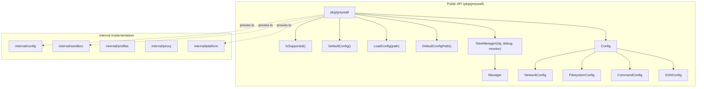
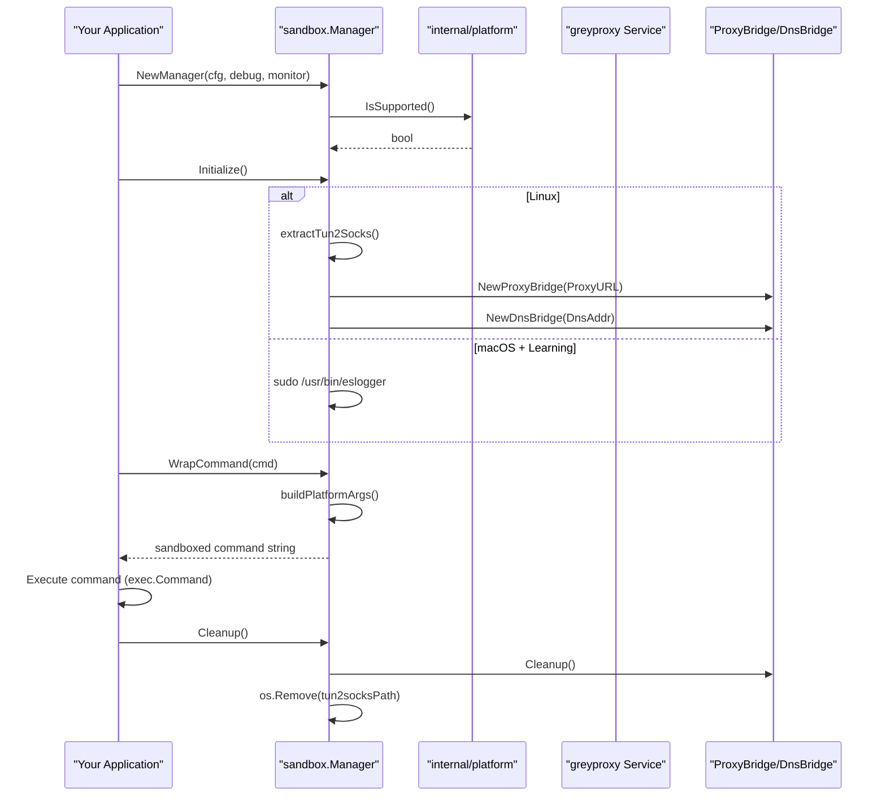
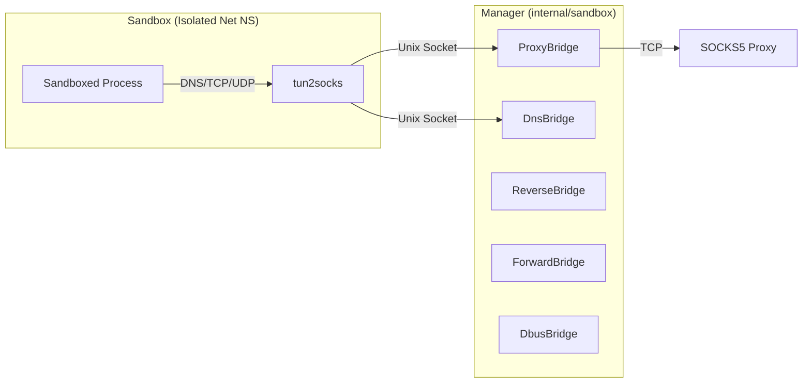

<!-- source: DeepWiki mcp.deepwiki.com · repo GreyhavenHQ/greywall · page 7 Go Library API · fetched 2026-10-26 -->

# Go Library API

<details>
<summary>Relevant source files</summary>

The following files were used as context for generating this wiki page:

- [docs/benchmarking.md](docs/benchmarking.md)
- [docs/concepts.md](docs/concepts.md)
- [docs/library.md](docs/library.md)
- [internal/sandbox/manager.go](internal/sandbox/manager.go)
- [pkg/greywall/greywall.go](pkg/greywall/greywall.go)

</details>


This document covers the programmatic API for using greywall from Go code. The Go library allows you to create and manage sandboxed command execution from your own Go applications.

For information about the CLI interface, see [CLI Reference](#2.3). For details on how the sandbox implementations work under the hood, see [Platform Implementations](#4).

## Purpose and Scope

The `pkg/greywall` package provides a public Go API for:
- Checking platform support
- Loading and creating configurations
- Creating and managing sandbox managers
- Wrapping commands with sandbox restrictions
- Controlling the sandbox lifecycle

The package wraps the internal implementation details (bubblewrap, sandbox-exec, greyproxy, etc.) behind a clean, platform-agnostic interface.

## Package Structure



**Sources:** [pkg/greywall/greywall.go:1-47](), [internal/sandbox/manager.go:14-34]()

## Installation

Add greywall as a dependency to your Go project:

```bash
go get github.com/GreyhavenHQ/greywall
```

Then import the package:

```go
import "github.com/GreyhavenHQ/greywall/pkg/greywall"
```

**Sources:** [docs/library.md:10-14]()

## Quick Start Example

This minimal example shows the basic lifecycle: check support, create config, initialize manager, wrap command, execute, and cleanup.

```go
package main

import (
    "fmt"
    "os/exec"

    "github.com/GreyhavenHQ/greywall/pkg/greywall"
)

func main() {
    // Check platform support
    if !greywall.IsSupported() {
        fmt.Println("Sandboxing not supported on this platform")
        return
    }

    // Create config
    cfg := &greywall.Config{
        Network: greywall.NetworkConfig{
            AllowedDomains: []string{"api.example.com"},
        },
    }

    // Create and initialize manager
    manager := greywall.NewManager(cfg, false, false)
    defer manager.Cleanup()

    if err := manager.Initialize(); err != nil {
        panic(err)
    }

    // Wrap the command
    wrapped, err := manager.WrapCommand("curl https://api.example.com/data")
    if err != nil {
        panic(err)
    }

    // Execute it
    cmd := exec.Command("sh", "-c", wrapped)
    output, _ := cmd.CombinedOutput()
    fmt.Println(string(output))
}
```

**Sources:** [docs/library.md:18-60]()

## Manager Lifecycle

The `Manager` type in `internal/sandbox/manager.go` orchestrates the complete sandbox lifecycle.

### Manager Lifecycle Flow



**Sources:** [internal/sandbox/manager.go:71-137](), [internal/sandbox/manager.go:140-172](), [internal/sandbox/manager.go:211-236]()

### Manager Methods

| Method | Description | File Reference |
|--------|-------------|----------------|
| `Initialize()` | Sets up bridges, extracts `tun2socks`, and starts `eslogger` (macOS) | [internal/sandbox/manager.go:71-137]() |
| `WrapCommand(command)` | Returns the platform-specific sandboxed command string | [internal/sandbox/manager.go:239-258]() |
| `SetExposedPorts(ports)` | Configures ports for inbound connections (ReverseBridge) | [internal/sandbox/manager.go:46-48]() |
| `SetLearning(enabled)` | Enables filesystem tracing mode | [internal/sandbox/manager.go:51-53]() |
| `SetCommandName(name)` | Sets command name for learning mode profile generation | [internal/sandbox/manager.go:56-58]() |
| `Cleanup()` | Stops bridges and deletes temporary binaries/logs | [internal/sandbox/manager.go:211-236]() |

**Sources:** [internal/sandbox/manager.go:14-68](), [pkg/greywall/greywall.go:25-32]()

## Core Functions and Types

### Platform Detection

#### `IsSupported() bool`

Returns `true` if the current platform supports sandboxing (Linux or macOS).

```go
if !greywall.IsSupported() {
    log.Fatal("Platform not supported")
}
```

**Sources:** [pkg/greywall/greywall.go:11-13]()

### Configuration Functions

#### `DefaultConfig() *Config`

Returns a default configuration with all network blocked and deny-by-default filesystem reads enabled.

```go
cfg := greywall.DefaultConfig()
cfg.Network.AllowedDomains = []string{"example.com"}
```

**Sources:** [pkg/greywall/greywall.go:35-37]()

#### `LoadConfig(path string) (*Config, error)`

Loads configuration from a JSON file. Supports JSONC (comments allowed).

```go
cfg, err := greywall.LoadConfig(greywall.DefaultConfigPath())
```

**Sources:** [pkg/greywall/greywall.go:40-42]()

## Configuration Types

The configuration system is defined in `internal/config` and aliased in `pkg/greywall`.

### Config

The root configuration type.

```go
type Config struct {
    Extends    string           // Template to extend (e.g., "code")
    Network    NetworkConfig
    Filesystem FilesystemConfig
    Command    CommandConfig
    SSH        SSHConfig
    AllowPty   bool             // Allow PTY allocation
}
```

**Sources:** [docs/library.md:166-174]()

### NetworkConfig

Controls network access and proxying behavior.

```go
type NetworkConfig struct {
    AllowedDomains      []string // Domains to allow (supports *.example.com)
    DeniedDomains       []string // Domains to explicitly deny
    AllowUnixSockets    []string // Specific Unix socket paths to allow
    AllowAllUnixSockets bool     // Allow all Unix socket connections
    AllowLocalBinding   bool     // Allow binding to localhost ports
    AllowLocalOutbound  *bool    // Allow outbound to localhost (defaults to AllowLocalBinding)
    HTTPProxyPort       int      // Override HTTP proxy port (0 = auto)
    SOCKSProxyPort      int      // Override SOCKS proxy port (0 = auto)
}
```

**Sources:** [docs/library.md:179-190]()

### FilesystemConfig

Controls filesystem access using a deny-by-default model.

```go
type FilesystemConfig struct {
    DefaultDenyRead *bool    // Deny reads by default (true when nil)
    AllowRead       []string // Paths to allow reading
    DenyRead        []string // Paths to deny read access
    AllowWrite      []string // Paths to allow write access
    DenyWrite       []string // Paths to explicitly deny write access
    AllowGitConfig  bool     // Allow read access to ~/.gitconfig
}
```

**Sources:** [docs/library.md:193-201]()

## Platform Differences in Library Behavior

While the Go API is unified, the `Manager` performs different initialization steps based on `platform.Detect()`.

| Feature | Linux (`Manager.Initialize`) | macOS (`Manager.Initialize`) |
|---------|-----------------------------|------------------------------|
| **Network** | Extracts `tun2socks`, starts `ProxyBridge` (socat) | Sets `HTTP_PROXY` env vars |
| **Bridges** | Creates `ReverseBridge` and `ForwardBridge` if needed | Not required (shared stack) |
| **Learning** | Prepares `straceLogPath` | Starts `sudo /usr/bin/eslogger` |
| **Cleanup** | Removes `tun2socks` binary | Stops `eslogger` subprocess |

**Sources:** [internal/sandbox/manager.go:83-137](), [internal/sandbox/manager.go:140-208](), [docs/concepts.md:45-50]()

## Implementation Details

### Bridge Management

On Linux, the `Manager` maintains several bridge components to connect the isolated network namespace to the host:



**Sources:** [internal/sandbox/manager.go:14-20](), [internal/sandbox/manager.go:150-172](), [docs/concepts.md:21-22]()

### Resource Cleanup

The `Cleanup()` method is critical for preventing resource leaks, especially on Linux where `socat` processes and temporary binaries are used.

```go
func (m *Manager) Cleanup() {
    if m.proxyBridge != nil { m.proxyBridge.Cleanup() }
    if m.dnsBridge != nil { m.dnsBridge.Cleanup() }
    if m.reverseBridge != nil { m.reverseBridge.Cleanup() }
    if m.forwardBridge != nil { m.forwardBridge.Cleanup() }
    if m.dbusBridge != nil { m.dbusBridge.Cleanup() }
    if m.tun2socksPath != "" { os.Remove(m.tun2socksPath) }
    // ... macOS eslogger cleanup
}
```

**Sources:** [internal/sandbox/manager.go:211-236]()

---

