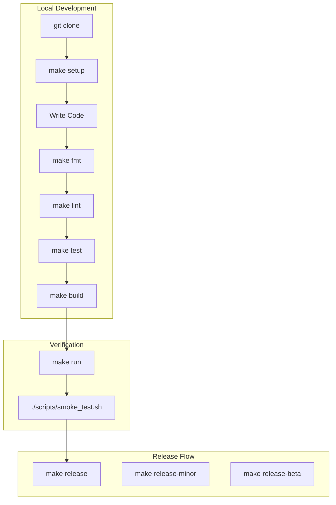
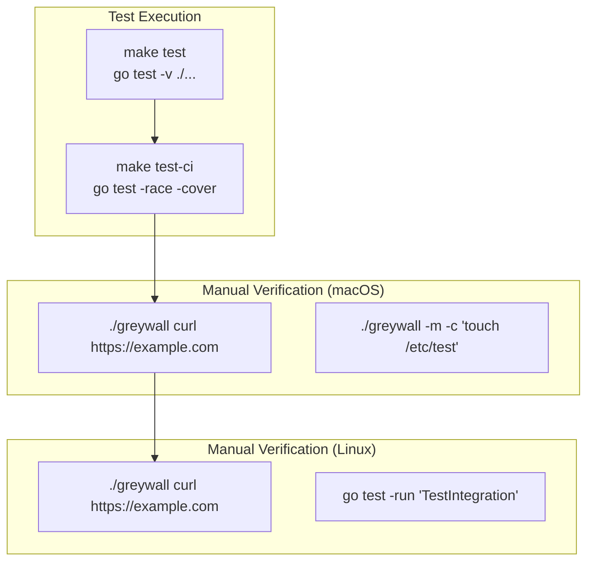

<!-- source: DeepWiki mcp.deepwiki.com · repo GreyhavenHQ/greywall · page 8 Development Guide · fetched 2026-10-26 -->

# Development Guide

<details>
<summary>Relevant source files</summary>

The following files were used as context for generating this wiki page:

- [ARCHITECTURE.md](ARCHITECTURE.md)
- [CONTRIBUTING.md](CONTRIBUTING.md)
- [Makefile](Makefile)
- [docs/architecture.md](docs/architecture.md)
- [docs/contributing.md](docs/contributing.md)
- [docs/faq.md](docs/faq.md)
- [scripts/pre-commit](scripts/pre-commit)

</details>


This document provides an overview of the greywall development process, including setting up a development environment, building from source, running tests, and understanding the release workflow. It is intended for contributors and developers who want to work on greywall itself.

For detailed build instructions and dependency management, see [Building from Source](#8.1). For information about the CI/CD infrastructure, see [CI/CD Pipeline](#8.2). For the release and distribution process, see [Release Process](#8.3).

---

## Development Environment Prerequisites

Developing greywall requires platform-specific dependencies and tooling. The development environment differs significantly between Linux and macOS due to the platform-specific sandbox implementations.

### Common Requirements

| Tool | Minimum Version | Purpose |
|------|----------------|---------|
| Go | 1.25+ | Primary language [CONTRIBUTING.md:10]() |
| Make | Any recent | Build orchestration [Makefile:1-11]() |
| Git | Any recent | Version control |

### Linux-Specific Requirements

| Dependency | Purpose | Installation |
|------------|---------|--------------|
| `bubblewrap` | Process isolation | `sudo apt install bubblewrap` [CONTRIBUTING.md:82]() |
| `socat` | Unix socket bridges | `sudo apt install socat` [CONTRIBUTING.md:82]() |
| `xdg-dbus-proxy` | D-Bus isolation | `sudo apt install xdg-dbus-proxy` [CONTRIBUTING.md:82]() |

### macOS-Specific Requirements

| Dependency | Purpose | Installation |
|------------|---------|--------------|
| `sandbox-exec` | Built-in sandboxing | System provided [ARCHITECTURE.md:7]() |

Sources: [CONTRIBUTING.md:9-12](), [CONTRIBUTING.md:76-86](), [ARCHITECTURE.md:45-46]()

---

## Development Workflow

The development lifecycle is managed through a comprehensive `Makefile`.

**Development Lifecycle Workflow**



Sources: [Makefile:11-148](), [CONTRIBUTING.md:16-38]()

---

## Build System

The greywall build system uses `make` for orchestration. A critical step in the build process is the embedding of `tun2socks` for Linux transparent proxying.

### Build Targets

| Target | Purpose | Usage |
|--------|---------|-------|
| `make setup` | Install deps, lint tools, and git hooks | Initial environment setup [Makefile:139]() |
| `make download-tun2socks` | Fetch `tun2socks` v2.5.2 binaries | Required for Linux builds [Makefile:15-32]() |
| `make build` | Standard development build | Local development [Makefile:34-36]() |
| `make build-ci` | Build with git version and build time ldflags | Used in CI pipelines [Makefile:38-43]() |
| `make build-linux` | Cross-compile for Linux (amd64) | Distribution [Makefile:66-68]() |
| `make build-darwin` | Cross-compile for macOS (arm64) | Distribution [Makefile:70-72]() |

### Code Entity Mapping: Build System

| Component | Code Entity | File Path |
|-----------|-------------|-----------|
| CLI Entry | `main.go` | [cmd/greywall/main.go:1-39]() |
| Version Info | `main.version`, `main.buildTime` | [Makefile:43]() |
| Embedded Binaries | `internal/sandbox/bin` | [Makefile:9]() |

Sources: [Makefile:1-148](), [ARCHITECTURE.md:37-38]()

---

## Testing Strategy

Greywall employs unit tests and platform-specific integration tests.

**Test Execution Architecture**



### Running Tests Locally

```bash
# Standard test run
make test

# CI-style run with race detection and coverage
make test-ci

# Linux-specific integration tests
go test -v -run 'TestIntegration|TestLinux' ./internal/sandbox/...
```

Sources: [Makefile:45-52](), [CONTRIBUTING.md:49-80]()

---

## CI/CD and Quality Gates

Greywall enforces code quality through linting and automated formatting checks.

### Quality Gates

| Gate | Tool | Command |
|------|------|---------|
| Formatting | `gofumpt` | `make fmt-check` [Makefile:99-107]() |
| Linting | `golangci-lint` | `make lint` [Makefile:109-111]() |
| Git Hooks | `scripts/pre-commit` | Automatic on commit [scripts/pre-commit:1-33]() |

The project uses `gofumpt` for strict formatting and `golangci-lint` for static analysis. These tools are installed via `make install-lint-tools`.

Sources: [Makefile:74-85](), [scripts/pre-commit:1-33]()

---

## Release Process

Releases are triggered by scripts that handle version tagging and are then processed by GitHub Actions and GoReleaser.

### Release Commands

| Command | Action |
|---------|--------|
| `make release` | Create a patch release (v0.0.X) [Makefile:113-115]() |
| `make release-minor` | Create a minor release (v0.X.0) [Makefile:117-119]() |
| `make release-beta` | Create a beta release (v0.0.X-beta.N) [Makefile:121-123]() |

The underlying `scripts/release.sh` performs preflight checks and tags the repository. Once pushed, the CI pipeline builds for:
- **Linux**: amd64, arm64
- **macOS (darwin)**: amd64, arm64

Sources: [Makefile:113-124](), [CONTRIBUTING.md:120-161]()

---

