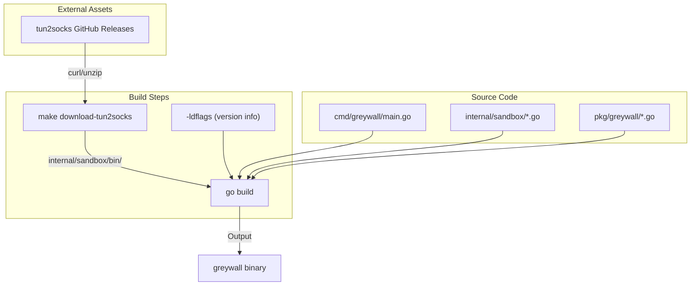
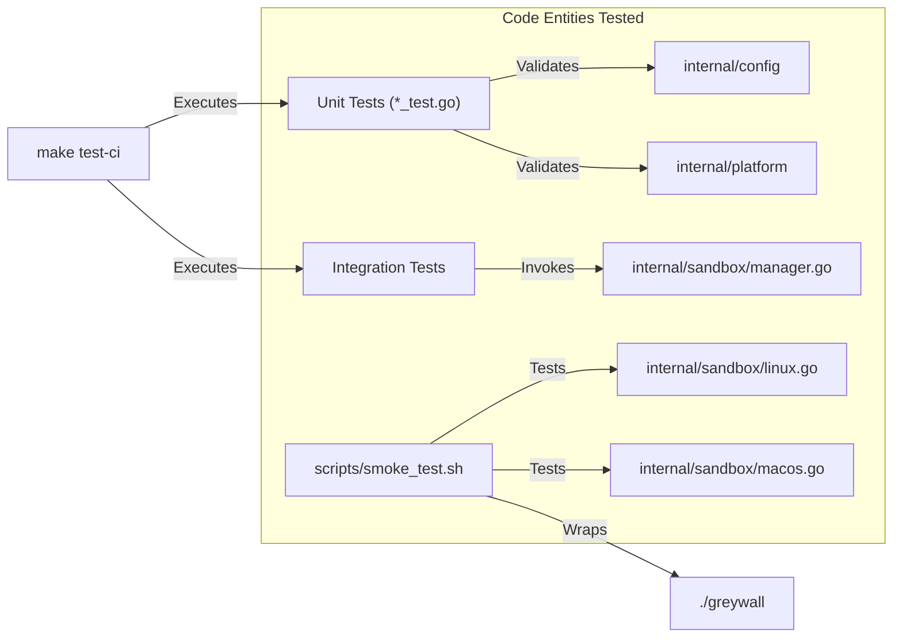

<!-- source: DeepWiki mcp.deepwiki.com · repo GreyhavenHQ/greywall · page 8.1 Building from Source · fetched 2026-10-26 -->

# Building from Source

<details>
<summary>Relevant source files</summary>

The following files were used as context for generating this wiki page:

- [.golangci.yml](.golangci.yml)
- [CLAUDE.md](CLAUDE.md)
- [Makefile](Makefile)
- [go.mod](go.mod)
- [go.sum](go.sum)
- [scripts/pre-commit](scripts/pre-commit)

</details>


This page covers how to build `greywall` from source, including development prerequisites, build commands, testing procedures, and platform-specific dependency management. `greywall` uses a `Makefile` to orchestrate complex build steps such as downloading architecture-specific binaries for embedding.

## Prerequisites

### Go Version
`greywall` requires Go 1.25 or later. The minimum version is specified in the module definition [go.mod:3-3]().

### System Dependencies
`greywall` relies on several system-level utilities to implement its security model.

**Linux Requirements:**
- `bubblewrap` (executable `bwrap`): Core process isolation and namespace management [CLAUDE.md:68-68]().
- `socat`: Used to create Unix socket bridges for proxy relay [CLAUDE.md:68-68]().
- `tun2socks` v2.5.2: Embedded binary used for transparent TCP/UDP proxying [Makefile:8-9]().
- Kernel 5.13+: Required for Landlock LSM support.
- Kernel 5.7+: Required for BPF-based features.

**macOS Requirements:**
- `sandbox-exec`: Built-in macOS tool for Seatbelt profiles [CLAUDE.md:3-3]().

**Development Tools:**
- `gofumpt`: Enforced code formatter [Makefile:76-76]().
- `golangci-lint` v2: Static analysis and linting [Makefile:77-77]().

Sources: [go.mod:3-3](), [Makefile:8-9](), [Makefile:76-77](), [CLAUDE.md:3-3](), [CLAUDE.md:68-68]()

## Build Process

The build process is managed via `make`. A critical step is the `download-tun2socks` target, which fetches architecture-specific binaries (`amd64` and `arm64`) into `internal/sandbox/bin` for embedding into the final Go binary [Makefile:15-32]().

### Development Setup
To prepare a fresh environment, run the `setup` target. This downloads Go dependencies, installs linting tools, and configures git hooks [Makefile:86-87]().

```bash
make setup
```

### Compiling the Binary
The standard `build` command automatically ensures `tun2socks` is present before compiling the CLI entry point at `cmd/greywall` [Makefile:34-36]().

```bash
make build
```

For CI environments, `make build-ci` injects version metadata (git commit, build time, and version tags) using `-ldflags` [Makefile:38-43]().

### Platform-Specific Builds
You can cross-compile for specific targets using dedicated make targets:
- **Linux (AMD64):** `make build-linux` (sets `CGO_ENABLED=0`) [Makefile:66-68]().
- **macOS (ARM64):** `make build-darwin` [Makefile:70-72]().

Sources: [Makefile:15-43](), [Makefile:66-72](), [Makefile:86-87]()

## Build Pipeline Architecture

The following diagram illustrates the flow from source code and external assets to the final `greywall` binary.



**Build Dependency and Entity Association**

Sources: [Makefile:15-43](), [CLAUDE.md:33-51]()

## Dependency Management

### Go Modules
`greywall` maintains a minimal dependency footprint with 4 direct dependencies [CLAUDE.md:66-66]():
- `github.com/spf13/cobra`: CLI framework [go.mod:7-7]().
- `github.com/bmatcuk/doublestar/v4`: Path glob matching for sandbox rules [go.mod:6-6]().
- `github.com/tidwall/jsonc`: JSON with comments support for config files [go.mod:8-8]().
- `golang.org/x/sys`: Low-level OS primitives (Landlock, Seccomp) [go.mod:9-9]().

### Linting and Formatting
The project enforces strict code quality via `golangci-lint`. The configuration in `.golangci.yml` enables linters like `errcheck`, `gosec`, `govet`, and `staticcheck` [.golangci.yml:6-15](). Code must be formatted with `gofumpt` [.golangci.yml:32-32]().

The `make lint` target runs the linter with parallel execution enabled [Makefile:109-111]().

Sources: [go.mod:5-10](), [.golangci.yml:6-32](), [Makefile:109-111](), [CLAUDE.md:66-66]()

## Testing

### Unit and Integration Tests
Standard Go tests are executed via `make test` [Makefile:45-47](). For CI, race detection and coverage reporting are enabled [Makefile:49-51]().

```bash
make test-ci
```

### Smoke Tests
A dedicated shell script `scripts/smoke_test.sh` performs end-to-end verification of the sandbox's security boundaries [CLAUDE.md:19-19](). It requires the `GREYWALL_TEST_NETWORK=1` environment variable to verify proxy functionality [CLAUDE.md:19-19]().

### Logic Flow: Test to Binary Association



**Testing Scope and Code Association**

Sources: [Makefile:45-51](), [CLAUDE.md:14-20](), [CLAUDE.md:33-45]()

## Git Hooks
To ensure quality before code reaches CI, `greywall` uses a pre-commit hook [scripts/pre-commit:1-3](). This hook runs `gofumpt` check and `golangci-lint` [scripts/pre-commit:21-30](). It can be installed using:

```bash
make install-hooks
```

Sources: [Makefile:80-84](), [scripts/pre-commit:1-32]()

---

