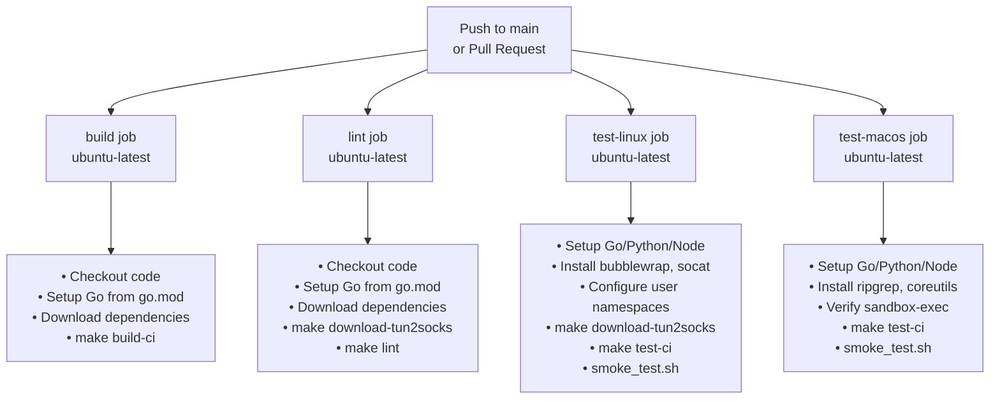
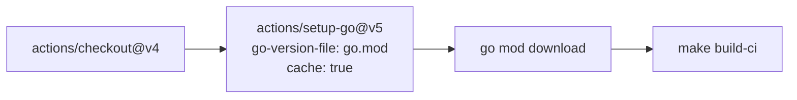
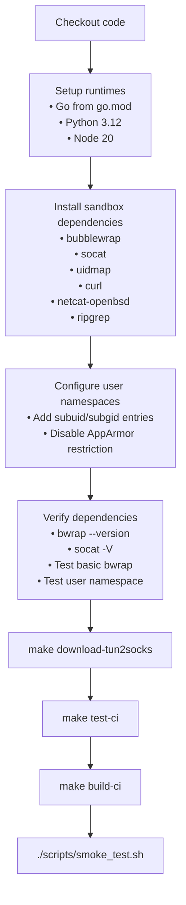
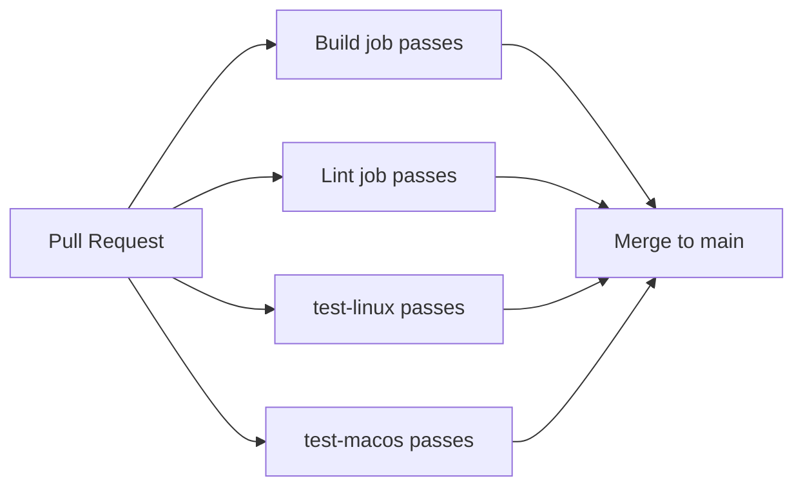

<!-- source: DeepWiki mcp.deepwiki.com · repo GreyhavenHQ/greywall · page 8.2 CI/CD Pipeline · fetched 2026-10-26 -->

# CI/CD Pipeline

<details>
<summary>Relevant source files</summary>

The following files were used as context for generating this wiki page:

- [.github/workflows/main.yml](.github/workflows/main.yml)
- [docs/testing.md](docs/testing.md)
- [docs/troubleshooting.md](docs/troubleshooting.md)
- [scripts/smoke_test.sh](scripts/smoke_test.sh)

</details>


This document describes greywall's continuous integration and deployment pipeline implemented using GitHub Actions. The pipeline ensures code quality through automated building, linting, and multi-platform testing on every push and pull request. For information about the release process and distribution, see [8.3 Release Process]().

**Sources:** [.github/workflows/main.yml:1-171]()

---

## Workflow Structure

The CI/CD pipeline is defined in `.github/workflows/main.yml` and consists of four parallel jobs that validate code quality, build correctness, and platform compatibility.

### Pipeline Jobs Overview



**Sources:** [.github/workflows/main.yml:1-133](), [.github/workflows/main.yml:134-177]()

---

## Trigger Configuration

The workflow triggers on:

| Event | Branches | Purpose |
|-------|----------|---------|
| `push` | `main` | Validate commits to main branch |
| `pull_request` | `main` | Validate PRs before merging |

The workflow runs with `contents: read` permissions for security.

**Sources:** [.github/workflows/main.yml:3-10]()

---

## Build Job

The build job verifies that the codebase compiles successfully on Linux.



### Build Steps

1. **Checkout**: Uses `actions/checkout@v4` to fetch the repository [[.github/workflows/main.yml:17-18]]().
2. **Go Setup**: Uses `actions/setup-go@v5` with Go version from `go.mod` and enabled build cache [[.github/workflows/main.yml:20-24]]().
3. **Dependencies**: Downloads Go modules with `go mod download` [[.github/workflows/main.yml:26-27]]().
4. **Build**: Executes `make build-ci` to compile the binary [[.github/workflows/main.yml:29-30]]().

The `build-ci` Make target compiles the greywall binary for the CI environment.

**Sources:** [.github/workflows/main.yml:13-31]()

---

## Lint Job

The lint job enforces code quality standards and formatting.

### Lint Steps

1. **Environment Setup**: Configures Go and downloads dependencies [[.github/workflows/main.yml:39-46]]().
2. **Asset Preparation**: Runs `make download-tun2socks` to ensure embedded assets are available for the linter [[.github/workflows/main.yml:48-49]]().
3. **Tool Installation**: Executes `make install-lint-tools` [[.github/workflows/main.yml:51-52]]().
4. **Validation**: Checks formatting via `make fmt-check` and runs the main linter via `make lint` [[.github/workflows/main.yml:54-58]]().

**Sources:** [.github/workflows/main.yml:32-59]()

---

## Test Jobs

Greywall runs comprehensive tests on both Linux and macOS to ensure cross-platform compatibility. Each platform has unique sandbox dependencies that must be installed and verified.

### Linux Test Job

The Linux test job validates greywall's primary platform with full sandbox feature support.

#### Linux Test Flow



#### Linux Dependency Installation

The test job installs Linux-specific sandbox dependencies via `apt-get` [[.github/workflows/main.yml:86-97]](). These include `bubblewrap` for namespaces, `socat` for proxy bridges, and `uidmap` for unprivileged user namespace support.

#### User Namespace Configuration

Ubuntu 24.04 requires special configuration for unprivileged user namespaces [[.github/workflows/main.yml:98-104]]():

1. **subuid/subgid setup**: Configures the runner user to allow mapping of UIDs/GIDs [[.github/workflows/main.yml:99-100]]().
2. **AppArmor restriction**: Disables the `kernel.apparmor_restrict_unprivileged_userns` restriction so `bwrap` can create namespaces without setuid [[.github/workflows/main.yml:104]](). This is critical for `greywall` to use `CAP_NET_ADMIN` for transparent proxying [[.github/workflows/main.yml:103]]().

#### Dependency Verification

The workflow includes extensive verification steps to diagnose sandbox issues [[.github/workflows/main.yml:106-120]]():
- Checks `bwrap` version and permissions.
- Verifies `socat` availability.
- Confirms kernel support for user namespaces.
- Executes basic `bwrap` commands to ensure the environment is capable of creating read-only binds and user namespaces [[.github/workflows/main.yml:116-119]]().

#### Linux Test Execution

After setup, the job runs:
1. **Unit and integration tests**: `make test-ci` [[.github/workflows/main.yml:124-125]]().
2. **Binary build**: `make build-ci` [[.github/workflows/main.yml:127-128]]().
3. **Smoke tests**: Executes `scripts/smoke_test.sh` with `GREYWALL_TEST_NETWORK=1` to verify the compiled binary end-to-end [[.github/workflows/main.yml:130-131]]().

**Sources:** [.github/workflows/main.yml:60-132](), [scripts/smoke_test.sh:1-131]()

---

### macOS Test Job

The macOS test job validates greywall's implementation using `sandbox-exec` and Seatbelt profiles.

#### macOS Dependencies

macOS has built-in `sandbox-exec`, so only utility packages like `ripgrep` and `coreutils` are installed via Homebrew [[.github/workflows/main.yml:159-161]]().

#### macOS Verification

The workflow verifies that `sandbox-exec` is functional by running a simple test profile:
```bash
sandbox-exec -p '(version 1)(allow default)' /bin/echo "sandbox-exec works"
```
**Sources:** [.github/workflows/main.yml:163-168]()

#### macOS Test Execution

Like Linux, macOS runs:
1. **Unit and integration tests**: `make test-ci` [[.github/workflows/main.yml:169-170]]().
2. **Binary build**: `make build-ci` [[.github/workflows/main.yml:172-173]]().
3. **Smoke tests**: `GREYWALL_TEST_NETWORK=1 ./scripts/smoke_test.sh ./greywall` [[.github/workflows/main.yml:175-176]]().

**Sources:** [.github/workflows/main.yml:133-177]()

---

## Smoke Test Suite

The `scripts/smoke_test.sh` script is the final quality gate, verifying the compiled binary behaves correctly in a real environment.

### Test Categories

| Category | Tests Performed | Code Entity |
|----------|-----------------|-------------|
| **Basic** | Version flag, echo, ls, pwd | `cmd/greywall` |
| **Filesystem** | Read/write restrictions, workspace isolation | `internal/sandbox` |
| **Command** | Deny-list blocking (e.g., `rm -rf`), chained commands | `internal/sandbox` |
| **Network** | Blocking by default, curl verification | `internal/proxy` |
| **Tools** | Compatibility with `python3`, `node`, `git` | Profile System |

The script uses a temporary workspace [[scripts/smoke_test.sh:46]]() and generates dynamic `greywall.json` configuration files to test specific restriction scenarios [[scripts/smoke_test.sh:124-131]]().

**Sources:** [scripts/smoke_test.sh:98-235]()

---

## Quality Gates

The pipeline enforces several quality gates before code can merge:



All four jobs must pass before a pull request can merge. This ensures:
1. **Code compiles** on standard Linux runners [[.github/workflows/main.yml:13-31]]().
2. **Code quality** meets standards (formatting and linting) [[.github/workflows/main.yml:32-59]]().
3. **Tests pass** on Linux with full namespace and capability support [[.github/workflows/main.yml:60-132]]().
4. **Tests pass** on macOS with Seatbelt sandboxing [[.github/workflows/main.yml:133-177]]().

---

## Troubleshooting CI Failures

Common CI failures and their causes:

| Failure Message | Cause | Resolution |
|-----------------|-------|------------|
| `bwrap: loopback: Failed RTM_NEWADDR: Operation not permitted` | Missing `CAP_NET_ADMIN` or AppArmor restriction | Verify `sysctl` and `subuid` setup [[docs/troubleshooting.md:22-28]]() |
| `bwrap: setting up uid map: Permission denied` | Missing `uidmap` or `/etc/subuid` config | Ensure `uidmap` package is installed [[docs/troubleshooting.md:72-78]]() |
| `Sandbox: sandbox-exec(...) deny(1) forbidden-sandbox-reinit` | Attempting nested sandboxing on macOS | Avoid running greywall inside existing macOS sandboxes [[docs/troubleshooting.md:12-18]]() |

**Sources:** [docs/troubleshooting.md:8-97]()

---

