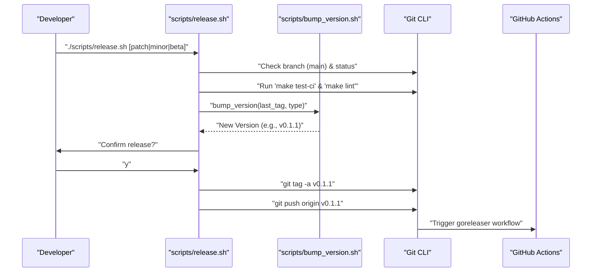

<!-- source: DeepWiki mcp.deepwiki.com · repo GreyhavenHQ/greywall · page 8.3 Release Process · fetched 2026-10-26 -->

# Release Process

<details>
<summary>Relevant source files</summary>

The following files were used as context for generating this wiki page:

- [.github/workflows/notify-docs.yml](.github/workflows/notify-docs.yml)
- [.github/workflows/release.yml](.github/workflows/release.yml)
- [.goreleaser.yaml](.goreleaser.yaml)
- [internal/proxy/brew.go](internal/proxy/brew.go)
- [scripts/bump_version.sh](scripts/bump_version.sh)
- [scripts/release.sh](scripts/release.sh)
- [scripts/release_test.bats](scripts/release_test.bats)

</details>


This page documents how greywall releases are created, built, and distributed. It covers the automated release pipeline using `goreleaser`, multi-platform binary builds, versioning logic, and distribution through GitHub Releases and Homebrew.

## Release Trigger and Automation

Releases are managed through a combination of local scripts for versioning and GitHub Actions for CI/CD. The primary automation is triggered by pushing git tags matching the pattern `v*` (e.g., `v0.1.0`).

### Release Script Logic

The `scripts/release.sh` script automates the pre-release checks and tagging process. It ensures the environment is clean and the codebase is ready for a new version.



**Sources:** [scripts/release.sh:1-132](), [scripts/bump_version.sh:1-78]()

### Preflight Checks
Before a tag is created, `scripts/release.sh` performs several mandatory checks:
- **Branch Validation**: Ensures the user is on the `main` branch [scripts/release.sh:38-42]().
- **Worktree Status**: Verifies there are no uncommitted changes [scripts/release.sh:45-47]().
- **Sync Status**: Confirms the local branch is up to date with `origin/main` [scripts/release.sh:61-65]().
- **Quality Gates**: Executes `make test-ci` and `make lint` to ensure code quality [scripts/release.sh:78-87]().

### Version Bumping Logic
The `bump_version` function in `scripts/bump_version.sh` calculates the next semantic version:
- **Patch**: Increments the third digit (e.g., `v0.1.0` -> `v0.1.1`) [scripts/bump_version.sh:70]().
- **Minor**: Increments the second digit and resets patch to zero [scripts/bump_version.sh:71]().
- **Beta**: Calculates the next beta based on the latest stable tag (e.g., `v0.1.0` -> `v0.1.1-beta.1`) [scripts/bump_version.sh:35-57]().

---

## goreleaser Pipeline

Once a tag is pushed, the `.github/workflows/release.yml` workflow invokes `goreleaser`.

### Build Configuration
The build matrix in `.goreleaser.yaml` targets Linux and macOS (Darwin) for both `amd64` and `arm64` architectures [/.goreleaser.yaml:7-15]().

- **Linker Flags**: Injects versioning metadata into the binary [/.goreleaser.yaml:16-20]().
- **Static Linking**: `CGO_ENABLED=0` ensures the binary is portable across different glibc versions [/.goreleaser.yaml:9]().
- **Compression**: Linux binaries are compressed using UPX with `lzma` and `brute` settings to minimize download size [/.goreleaser.yaml:24-30]().

### Archive and Artifacts
The pipeline produces `.tar.gz` archives containing the `greywall` binary and essential documentation [/.goreleaser.yaml:32-46](). A `checksums.txt` is generated for security verification [/.goreleaser.yaml:48-49]().

### Changelog Generation
Changelogs are automatically generated and grouped based on commit message prefixes:
- **New Features**: `feat:`
- **Security updates**: `sec:`
- **Bug fixes**: `fix:` or `refactor:`
- **Documentation**: `docs:`

**Sources:** [/.goreleaser.yaml:71-85]()

---

## Distribution and Homebrew

greywall is distributed via GitHub Releases and the official Homebrew tap.

### Homebrew Tap Integration
The release process automatically updates the `GreyhavenHQ/homebrew-tap` repository [/.goreleaser.yaml:87-91]().

| Feature | Implementation |
| :--- | :--- |
| **Dependencies** | Declares `greyproxy` as a required cask [/.goreleaser.yaml:104-105](). |
| **Quarantine** | A `post_install` hook removes the `com.apple.quarantine` attribute on macOS [/.goreleaser.yaml:98-103](). |
| **Binary Mapping** | Symlinks the `greywall` binary into the user's PATH [/.goreleaser.yaml:96-97](). |

### greyproxy Synchronization
When a new release is published, a separate workflow `Notify docs repo` triggers a repository dispatch to sync documentation and potentially update downstream dependencies [/.github/workflows/notify-docs.yml:1-21]().

### Homebrew Management Detection
The codebase includes logic to detect if the running environment is managed by Homebrew, which influences how updates are handled.

```go
func IsBrewManaged(binaryPath string) bool {
    // ...
    brewPrefix := brewPrefixPath() // Calls 'brew --prefix'
    return strings.HasPrefix(binaryPath, brewPrefix)
}
```

**Sources:** [internal/proxy/brew.go:8-21]()

---

## Post-Release Notifications
The system dispatches a `sync-docs` event to the `GreyhavenHQ/docs` repository upon release publication. This payload includes the product name and the release tag, allowing the documentation site to update its version-specific content automatically [/.github/workflows/notify-docs.yml:11-20]().

---

