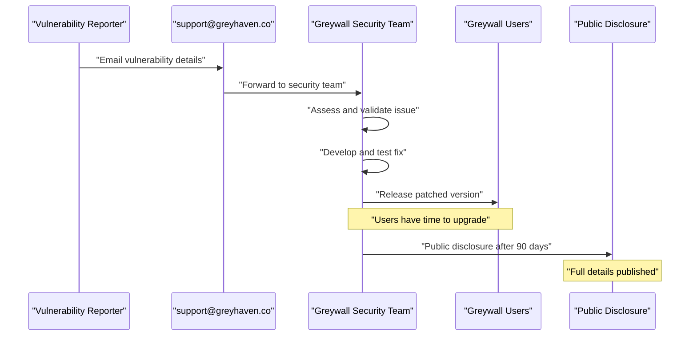
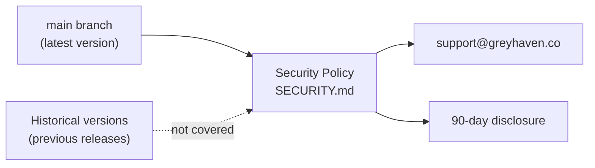
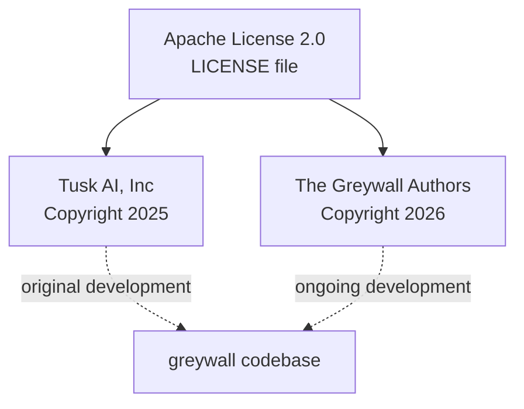
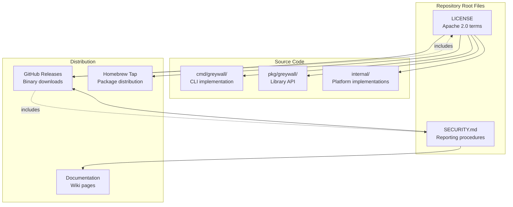

<!-- source: DeepWiki mcp.deepwiki.com · repo GreyhavenHQ/greywall · page 9 Reference · fetched 2026-10-26 -->

# Reference

<details>
<summary>Relevant source files</summary>

The following files were used as context for generating this wiki page:

- [LICENSE](LICENSE)
- [SECURITY.md](SECURITY.md)
- [docs/security-model.md](docs/security-model.md)

</details>


This section provides essential reference material for the greywall project, including licensing terms and security policies. These documents establish the legal framework for using and contributing to greywall, as well as procedures for responsibly reporting security vulnerabilities.

For technical documentation about greywall's implementation, see pages [1]() through [8](). For specific security model documentation explaining greywall's protection mechanisms, see [3.3 Security Model]().

## Overview

The reference materials consist of two primary documents:

| Document | Purpose | Location |
|----------|---------|----------|
| Security Policy | Vulnerability reporting procedures and disclosure timeline | [Security Policy](#9.1) |
| License | Apache License 2.0 terms and copyright information | [License](#9.2) |

These documents are maintained in the repository root as `SECURITY.md` and `LICENSE` respectively, ensuring they are visible to all contributors and users.

## Security Vulnerability Reporting

The greywall project follows a responsible disclosure process for security vulnerabilities. This process balances the need to fix security issues promptly with giving users time to upgrade before public disclosure.

### Security Reporting Workflow



**Sources:** [SECURITY.md:1-9]()

The security policy requires the following information when reporting vulnerabilities:

| Required Information | Purpose |
|---------------------|---------|
| Description of the issue | Understanding the vulnerability |
| Steps to reproduce | Validation and testing |
| Affected versions | Scope determination |
| Known mitigations | Immediate workarounds |

The 90-day disclosure timeline gives users sufficient time to upgrade after a patch is released, while ensuring vulnerabilities do not remain secret indefinitely.

### Policy Scope

The security policy applies specifically to the latest version on the `main` branch. This focuses security efforts on the current codebase rather than maintaining historical versions.



**Sources:** [SECURITY.md:7-8]()

## Licensing Structure

Greywall is licensed under the Apache License 2.0, a permissive open-source license that allows commercial use, modification, and distribution while providing patent protection.

### Copyright Holders

The project has multiple copyright holders representing its development history:



**Sources:** [LICENSE:189-190]()

| Copyright Holder | Year | Role |
|-----------------|------|------|
| Tusk AI, Inc | 2025 | Original development organization |
| The Greywall Authors | 2026 | Ongoing contributor collective |

This dual copyright structure reflects greywall's transition from an initial development organization to a broader contributor base.

### License Key Terms

The Apache License 2.0 provides the following key permissions and requirements:

| Aspect | Terms |
|--------|-------|
| **Permissions** | Commercial use, modification, distribution, patent use, private use |
| **Conditions** | License and copyright notice, state changes |
| **Limitations** | No trademark use, no liability, no warranty |
| **Patent Grant** | Perpetual, worldwide, royalty-free patent license |
| **Patent Termination** | License terminates if you sue for patent infringement |

**Sources:** [LICENSE:1-176]()

### License Application in Codebase

Every source file in the greywall codebase should include the Apache License boilerplate notice:

```
Copyright 2025 Tusk AI, Inc
Copyright 2026 The Greywall Authors

Licensed under the Apache License, Version 2.0 (the "License");
you may not use this file except in compliance with the License.
You may obtain a copy of the License at

    http://www.apache.org/licenses/LICENSE-2.0
```

**Sources:** [LICENSE:178-196]()

## Reference Materials Relationship to Project Structure

The reference materials integrate with greywall's development and distribution infrastructure:



**Sources:** [LICENSE:1-203](), [SECURITY.md:1-10]()

The `LICENSE` file is automatically included in:
- GitHub release archives generated by `goreleaser` (see [8.3 Release Process]())
- Homebrew cask installations
- Distribution via `install.sh` script (see [2.1 Installation]())

The `SECURITY.md` file is prominently displayed on the GitHub repository, providing immediate visibility to security researchers and users.

## Key Contacts and Resources

| Resource | Location | Purpose |
|----------|----------|---------|
| Security Contact | support@greyhaven.co | Vulnerability reporting |
| License Full Text | `LICENSE` in repository root | Legal terms reference |
| Security Policy | `SECURITY.md` in repository root | Reporting procedures |
| GitHub Repository | github.com/GreyhavenHQ/greywall | Source code and issues |

**Sources:** [SECURITY.md:5](), [LICENSE:1]()

For detailed information about each reference document, see the corresponding child pages:
- [Security Policy](#9.1) — How to report security vulnerabilities, disclosure timeline, and security contacts
- [License](#9.2) — Apache License 2.0 terms and conditions

---

