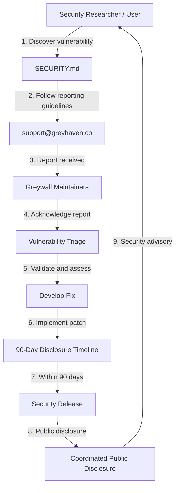
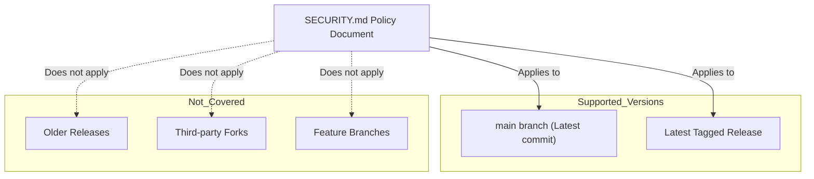

<!-- source: DeepWiki mcp.deepwiki.com · repo GreyhavenHQ/greywall · page 9.1 Security Policy · fetched 2026-10-26 -->

# Security Policy

Relevant source files

The following files were used as context for generating this wiki page:

- [LICENSE](LICENSE)
- [SECURITY.md](SECURITY.md)

This page documents greywall's security vulnerability reporting process and responsible disclosure policy. It outlines how to report security issues, the expected disclosure timeline, and which versions are covered by security support.

For information about greywall's security model and threat protection capabilities, see [Security Model](#3.3).

## Vulnerability Reporting Process

greywall follows a coordinated disclosure process for security vulnerabilities. The project maintains a formal security policy in `SECURITY.md` that defines the reporting procedures and expectations.

### Contact Information

Security issues should be reported via email to:

**Email**: support@greyhaven.co

Public disclosure (e.g., GitHub issues) should be avoided until the issue has been addressed according to the disclosure timeline.

### Required Information

When reporting a security vulnerability, include the following information in your report:

| Information Category | Description |
|---------------------|-------------|
| **Issue Description** | Clear explanation of the security vulnerability |
| **Reproduction Steps** | Detailed steps to reproduce the issue |
| **Affected Versions** | Which greywall versions are impacted |
| **Mitigations** | Known workarounds or mitigations (if any) |

Sources: [SECURITY.md:3-5]()

### Vulnerability Reporting Workflow

**Vulnerability Reporting Workflow Diagram**

This diagram shows the complete lifecycle from vulnerability discovery to public disclosure. The process begins when a security researcher discovers an issue and consults the `SECURITY.md` policy document, which directs them to report via email to `support@greyhaven.co`.

Sources: [SECURITY.md:1-10]()

## Disclosure Timeline

greywall follows a **90-day disclosure timeline** as specified in `SECURITY.md`. This means:

1. **Day 0**: Vulnerability report received.
2. **Day 1-7**: Initial triage and acknowledgment.
3. **Day 7-60**: Fix development and testing.
4. **Day 60-80**: Release preparation and validation.
5. **Day 80-90**: Coordinated disclosure and security release.
6. **Day 90+**: Public disclosure if not already released.

The 90-day timeline balances the need for timely fixes with the complexity of developing, testing, and releasing security patches across multiple platforms (Linux and macOS).

Sources: [SECURITY.md:5]()

## Security Support Scope

### Covered Versions

The security policy applies to:

- **Latest main branch**: The most recent commit on the main branch is always covered.
- **Latest release**: The most recently tagged release version.

As stated in `SECURITY.md`, "This security policy applies to the latest version of our main branch."

Sources: [SECURITY.md:7]()

### Version Support Matrix

**Security Support Scope Diagram**

This diagram illustrates which versions and branches receive security support. Only the latest main branch and the most recent release are covered by the security policy.

Sources: [SECURITY.md:7]()

## Responsible Disclosure Philosophy

The greywall project prioritizes the security of its users. The coordinated disclosure process ensures:

1. **User Protection**: Vulnerabilities are fixed before public disclosure.
2. **Researcher Recognition**: Security researchers receive acknowledgment for responsible reporting.
3. **Transparency**: Public disclosure follows fixes to inform all users.
4. **Reasonable Timeline**: 90 days balances urgency with fix quality.

As stated in `SECURITY.md`, "Thank you for helping to keep our project and our users secure!"

Sources: [SECURITY.md:9]()

## License and Legal Framework

greywall is licensed under the **Apache License 2.0**. The license includes important disclaimers regarding liability and warranty:

- **No Warranty**: The software is provided "AS IS" without warranties of any kind [LICENSE:143-151]().
- **Limitation of Liability**: Contributors are not liable for any damages arising out of the use or inability to use the Work [LICENSE:153-163]().
- **Contributions**: Any Contribution intentionally submitted for inclusion in the Work shall be under the terms and conditions of the license [LICENSE:130-136]().

For complete license terms, see [License](#9.2).

Sources: [LICENSE:1-203]()

## Related Documentation

For information about greywall's security features and threat model, see:

- [Security Model](#3.3) - Defense-in-depth approach and threat protection
- [Linux Sandboxing](#4.1) - Platform-specific security implementations
- [macOS Sandboxing](#4.2) - macOS security mechanisms
- [Network Isolation](#3.1) - Network security architecture
- [Filesystem Isolation](#3.2) - Filesystem access controls

---

