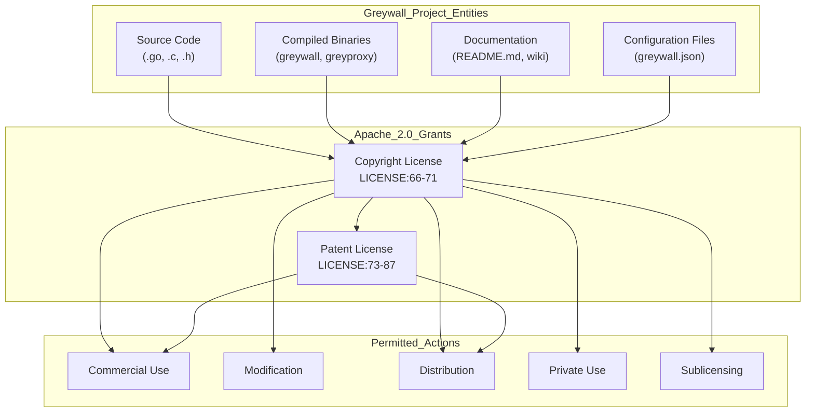
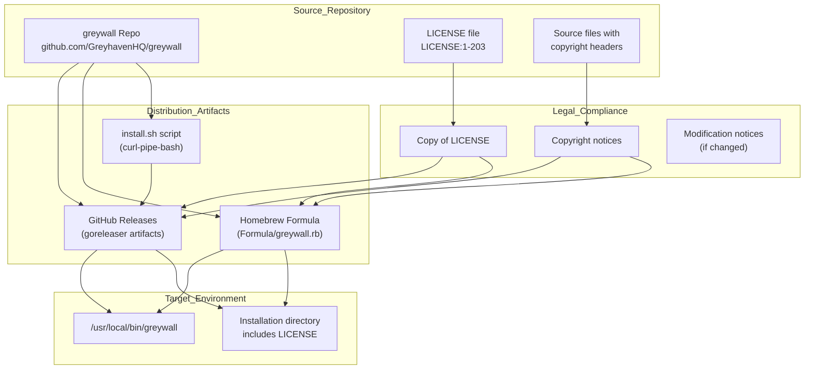

<!-- source: DeepWiki mcp.deepwiki.com · repo GreyhavenHQ/greywall · page 9.2 License · fetched 2026-10-26 -->

# License

Relevant source files

The following files were used as context for generating this wiki page:

- [LICENSE](LICENSE)
- [SECURITY.md](SECURITY.md)

This document describes the licensing terms for the greywall project, including copyright holders, permissions granted, and obligations for users and redistributors. For information about reporting security vulnerabilities, see [Security Policy](#9.1).

---

## License Overview

Greywall is released under the **Apache License, Version 2.0** (January 2004). This is a permissive open-source license that allows commercial use, modification, distribution, and private use, while requiring preservation of copyright and license notices.

The full license text is available at [LICENSE:1-203]() in the repository root.

**Sources:** [LICENSE:1-203]()

---

## Copyright Holders

The greywall project maintains the following copyright notices:

| Copyright Holder | Year | Context |
|-----------------|------|---------|
| Tusk AI, Inc | 2025 | Original copyright holder |
| The Greywall Authors | 2025 | Ongoing project copyright |

These copyright notices appear in [LICENSE:189-190]() and must be preserved in all copies and derivative works.

**Sources:** [LICENSE:189-190]()

---

## Key Permissions

### Rights Granted

The Apache License 2.0 grants users and contributors the following rights:

| Permission | Scope | Reference |
|-----------|-------|-----------|
| **Copyright License** | Reproduce, prepare derivative works, publicly display/perform, sublicense, and distribute | [LICENSE:66-71]() |
| **Patent License** | Make, use, sell, and import the work under contributor patent claims | [LICENSE:73-87]() |
| **Commercial Use** | Use in commercial products and services without fees | [LICENSE:66-71]() |
| **Modification** | Create and distribute modified versions | [LICENSE:66-71]() |
| **Private Use** | Use internally without distribution | [LICENSE:66-71]() |

### License Scope Diagram

**Sources:** [LICENSE:66-87]()

---

## Redistribution Requirements

When redistributing greywall or derivative works, you must comply with the following requirements:

### Mandatory Inclusions

| Requirement | Description | Reference |
|------------|-------------|-----------|
| **License Copy** | Include a copy of the Apache License 2.0 | [LICENSE:94-95]() |
| **Modified File Notices** | Mark modified files with prominent change notices | [LICENSE:97-98]() |
| **Copyright Notices** | Retain all copyright, patent, trademark, and attribution notices | [LICENSE:100-104]() |
| **NOTICE File** | If present, include readable copy in derivative works | [LICENSE:106-121]() |

### Redistribution Flow Diagram

**Sources:** [LICENSE:89-128]()

---

## Patent Grant and Termination

### Patent License Terms

The Apache License includes an explicit patent grant [LICENSE:73-87]():

- **Grant:** Contributors grant you a perpetual, royalty-free patent license for claims covered by their contributions.
- **Scope:** Applies to patent claims necessarily infringed by the contribution alone or in combination with the work.
- **Termination:** Patent license terminates if you initiate patent litigation alleging the work infringes your patents.

### Patent Litigation Termination Clause

If you file a lawsuit alleging that greywall or any contribution incorporated within the work constitutes direct or contributory patent infringement, then any patent licenses granted to you under this license for that work shall terminate as of the date such litigation is filed [LICENSE:82-87]().

**Sources:** [LICENSE:73-87]()

---

## Contribution Terms

### Default Contribution License

Unless explicitly stated otherwise, any contribution submitted to greywall for inclusion in the work by you to the licensor shall be under the terms and conditions of this license, without any additional terms or conditions [LICENSE:130-136]().

### Submission Channels

Contributions are typically accepted through:

- GitHub pull requests to the main branch.
- Issue reports and feature requests.
- Security vulnerability reports to [support@greyhaven.co](mailto:support@greyhaven.co) as per [SECURITY.md:5-5]().

**Sources:** [LICENSE:130-136](), [SECURITY.md:1-10]()

---

## Disclaimer and Limitation of Liability

### No Warranty

The Apache License provides software "AS IS" without warranties [LICENSE:143-151]():

| Disclaimer Type | Description |
|----------------|-------------|
| **Express Warranties** | No guarantees of fitness, merchantability, or non-infringement |
| **Implied Warranties** | No implied warranties of any kind |
| **Title** | No warranty of clear title |

### Limitation of Liability

Contributors have no liability for damages [LICENSE:153-163]():

- **No Liability:** Contributors are not liable for any damages (direct, indirect, special, incidental, consequential).
- **Types Covered:** Loss of goodwill, work stoppage, computer failure, or commercial damages.
- **Scope:** Applies even if the contributor was advised of potential damages.

**Sources:** [LICENSE:143-163]()

---

## Trademark Restrictions

The Apache License does **not** grant permission to use the trade names, trademarks, service marks, or product names of the Licensor, except as required for reasonable and customary use in describing the origin of the Work and reproducing the content of the NOTICE file [LICENSE:138-141]().

**Sources:** [LICENSE:138-141]()

---

## Full License Reference

| Section | Lines | Content |
|---------|-------|---------|
| Definitions | [LICENSE:7-64]() | Legal definitions of terms |
| Copyright Grant | [LICENSE:66-71]() | Rights to reproduce and modify |
| Patent Grant | [LICENSE:73-87]() | Patent license and termination |
| Redistribution | [LICENSE:89-128]() | Requirements for sharing the code |
| Contributions | [LICENSE:130-136]() | Terms for submitted code |
| Trademarks | [LICENSE:138-141]() | Restriction on brand usage |
| Disclaimer | [LICENSE:143-151]() | No warranty clause |
| Liability | [LICENSE:153-163]() | Limitation of liability |
| Additional Liability | [LICENSE:165-174]() | Optional support/warranty terms |

**Sources:** [LICENSE:1-203]()

---

