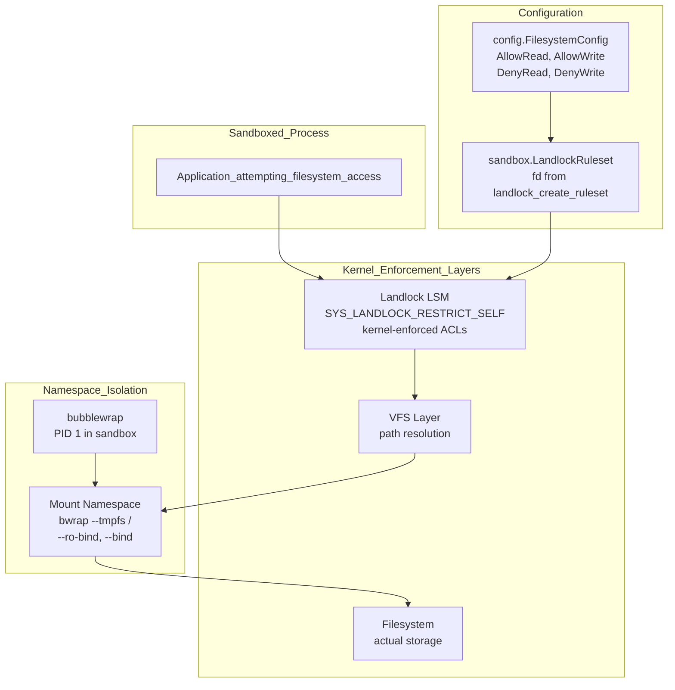
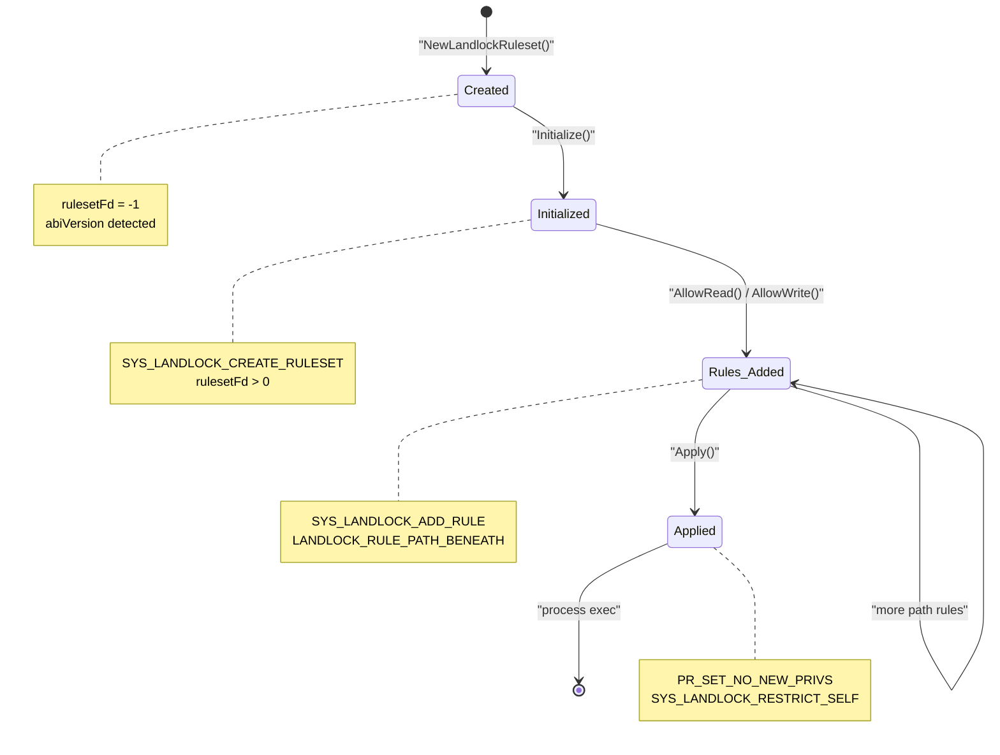
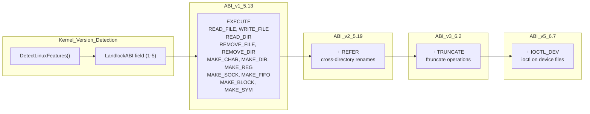

<!-- source: DeepWiki mcp.deepwiki.com · repo GreyhavenHQ/greywall · extra page Landlock Filesystem Control · fetched 2026-10-26 -->

# Landlock Filesystem Control

Relevant source files

The following files were used as context for generating this wiki page:

- [internal/sandbox/command.go](internal/sandbox/command.go)
- [internal/sandbox/command_test.go](internal/sandbox/command_test.go)
- [internal/sandbox/integration_linux_test.go](internal/sandbox/integration_linux_test.go)
- [internal/sandbox/integration_test.go](internal/sandbox/integration_test.go)
- [internal/sandbox/linux_landlock.go](internal/sandbox/linux_landlock.go)
- [internal/sandbox/linux_landlock_stub.go](internal/sandbox/linux_landlock_stub.go)

This page describes greywall's use of the Landlock LSM (Linux Security Module) for kernel-enforced filesystem access control on Linux. Landlock provides mandatory access control (MAC) at the kernel level, complementing the mount-based restrictions established by bubblewrap. For information about the overall Linux sandboxing architecture, see [Linux Sandboxing](4.1). For bubblewrap's mount namespace isolation, see [bubblewrap and Namespaces](4.1.1).

## Purpose and Scope

Landlock enforces filesystem access control policies at the kernel level, providing a second layer of defense beyond bubblewrap's mount-based isolation. While bubblewrap creates a restricted filesystem view using mount namespaces and bind mounts, Landlock enforces access rules that cannot be bypassed even if a process discovers paths outside the intended filesystem tree. This defense-in-depth approach ensures that filesystem restrictions remain effective even if mount-based isolation is circumvented.

Landlock is available on Linux kernel 5.13 and newer, with additional features added in later versions (ABI v1-v5). Greywall detects the available Landlock ABI version and gracefully falls back to mount-based isolation on older kernels.

## Landlock in the Linux Sandbox Stack

Landlock operates as a kernel-level access control layer that works alongside bubblewrap's namespace and mount isolation:

**Sources:** [internal/sandbox/linux_landlock.go:18-206](), [internal/sandbox/linux_landlock.go:21-46]()

The enforcement sequence works as follows:

1. **Configuration Phase**: The `config.FilesystemConfig` structure specifies allowed/denied paths [internal/sandbox/linux_landlock.go:156-191]().
2. **Ruleset Creation**: `LandlockRuleset` translates config into kernel rules via syscalls [internal/sandbox/linux_landlock.go:237-276]().
3. **Application Phase**: `SYS_LANDLOCK_RESTRICT_SELF` applies the ruleset to the process [internal/sandbox/linux_landlock.go:457-484]().
4. **Runtime Enforcement**: Every filesystem operation is checked by Landlock LSM before VFS access.
5. **Mount Namespace**: After passing Landlock checks, operations are constrained by bwrap's mount view.

This layered approach provides multiple independent security boundaries.

## LandlockRuleset Type and Lifecycle

The `LandlockRuleset` struct manages the lifecycle of a Landlock restriction policy:

**Sources:** [internal/sandbox/linux_landlock.go:208-235](), [internal/sandbox/linux_landlock.go:237-276](), [internal/sandbox/linux_landlock.go:457-484]()

### Key Fields and Methods

| Field/Method | Type | Purpose |
|--------------|------|---------|
| `rulesetFd` | `int` | File descriptor from `landlock_create_ruleset` syscall [internal/sandbox/linux_landlock.go:210-210]() |
| `abiVersion` | `int` | Detected Landlock ABI version (1-5) [internal/sandbox/linux_landlock.go:211-211]() |
| `initialized` | `bool` | Whether `Initialize()` has been called [internal/sandbox/linux_landlock.go:212-212]() |
| `Initialize()` | method | Creates ruleset via syscall, sets up access rights [internal/sandbox/linux_landlock.go:237-276]() |
| `AllowRead(path)` | method | Adds READ_FILE + READ_DIR + EXECUTE rights [internal/sandbox/linux_landlock.go:321-331]() |
| `AllowWrite(path)` | method | Adds WRITE_FILE + MAKE_* + REMOVE_* rights [internal/sandbox/linux_landlock.go:333-346]() |
| `Apply()` | method | Sets NO_NEW_PRIVS and restricts self [internal/sandbox/linux_landlock.go:457-484]() |

**Sources:** [internal/sandbox/linux_landlock.go:208-235](), [internal/sandbox/linux_landlock.go:321-354]()

The ruleset operates on a deny-by-default model: once applied with `Apply()`, all filesystem access is blocked except paths explicitly allowed.

## ABI Version Support and Access Rights

Landlock has evolved across kernel versions, adding new access rights in each ABI version. Greywall detects the available ABI and adjusts the `handledAccessFS` bitmask accordingly:

**Sources:** [internal/sandbox/linux_landlock.go:278-313]()

### Access Rights Mapping

The `getHandledAccessFS()` method builds the access rights bitmask based on detected ABI version [internal/sandbox/linux_landlock.go:278-313]():

| Access Right | ABI Version | Purpose |
|--------------|-------------|---------|
| `EXECUTE` | v1 | Execute files |
| `WRITE_FILE` | v1 | Modify file contents |
| `READ_FILE` | v1 | Read file contents |
| `READ_DIR` | v1 | List directory entries |
| `REFER` | v2 | Rename/link across directories |
| `TRUNCATE` | v3 | Truncate files |
| `IOCTL_DEV` | v5 | ioctl on device files |

**Sources:** [internal/sandbox/linux_landlock.go:278-313]()

## Path Rule Semantics and PATH_BENEATH

Landlock uses the `LANDLOCK_RULE_PATH_BENEATH` rule type, which grants access to a path and all its descendants [internal/sandbox/linux_landlock.go:440-440]().

### Path Resolution Process

The `addPathRule()` method performs several steps to safely add a rule:

1. **Normalize**: Convert to absolute path [internal/sandbox/linux_landlock.go:374-374]()
2. **Resolve Symlinks**: Use `filepath.EvalSymlinks()` to follow symbolic links [internal/sandbox/linux_landlock.go:377-377]()
3. **Open with O_PATH**: Get a file descriptor without opening the file [internal/sandbox/linux_landlock.go:394-394]()
4. **fstat Check**: Determine if path is directory or file [internal/sandbox/linux_landlock.go:401-401]()
5. **Filter Rights**: Remove directory-only rights for non-directory paths [internal/sandbox/linux_landlock.go:406-426]()
6. **Add Rule**: Call `SYS_LANDLOCK_ADD_RULE` with the fd [internal/sandbox/linux_landlock.go:440-440]()

**Sources:** [internal/sandbox/linux_landlock.go:356-455]()

## Configuration to Rules Translation

`ApplyLandlockFromConfig()` is the main entry point that translates greywall's configuration into Landlock rules [internal/sandbox/linux_landlock.go:21-21]().

### Default System Paths

The following paths receive read+execute access by default:
`/usr`, `/lib`, `/lib64`, `/lib32`, `/bin`, `/sbin`, `/etc`, `/proc`, `/sys`, `/run`, `/var/lib`, `/var/cache`, `/opt` [internal/sandbox/linux_landlock.go:49-63]().

### Special Path Handling

| Path Type | Access Mode | Rationale |
|-----------|-------------|-----------|
| `/dev` | read+write | Character devices like `/dev/null`, `/dev/zero` [internal/sandbox/linux_landlock.go:143-145]() |
| `/tmp` | read+write | Temporary files needed by many programs [internal/sandbox/linux_landlock.go:137-139]() |
| CWD | read+write | Project workspace [internal/sandbox/linux_landlock.go:85-89]() |
| Sockets | read+write | Communication with proxy/DNS bridges [internal/sandbox/linux_landlock.go:148-153]() |

**Sources:** [internal/sandbox/linux_landlock.go:18-206]()

### Deny-by-Default Mode

When `config.FilesystemConfig.IsDefaultDenyRead()` is true, only specific tooling paths are allowed in the home directory, such as `~/.cache`, `~/.npm`, and shell configs like `~/.bashrc` [internal/sandbox/linux_landlock.go:96-134]().

## Glob Pattern Expansion

The `ExpandGlobPatterns()` function optimizes glob pattern expansion for Landlock's PATH_BENEATH semantics [internal/sandbox/linux_landlock.go:496-644]().

| Pattern | Optimization | Rationale |
|---------|--------------|-----------|
| `dir/**` | Just `dir` | PATH_BENEATH covers descendants [internal/sandbox/linux_landlock.go:547-557]() |
| `**/pattern` | Walk CWD | Scoped search to prevent massive expansion [internal/sandbox/linux_landlock.go:561-600]() |

**Sources:** [internal/sandbox/linux_landlock.go:496-644]()

## Graceful Fallback Behavior

Greywall follows a fail-open philosophy: if Landlock is unavailable or encounters errors, the sandbox continues with bubblewrap-only restrictions [internal/sandbox/linux_landlock.go:28-28](), [internal/sandbox/linux_landlock.go:36-36]().

Debug logging provides visibility into why Landlock was skipped without failing the sandbox creation [internal/sandbox/linux_landlock.go:24-27](), [internal/sandbox/linux_landlock.go:33-35]().

**Sources:** [internal/sandbox/linux_landlock.go:21-45](), [internal/sandbox/linux_landlock.go:194-199]()

## Testing and Verification

Integration tests in `internal/sandbox/integration_linux_test.go` verify that Landlock correctly blocks unauthorized access:

- `TestLinux_LandlockBlocksWriteOutsideWorkspace`: Verifies writes outside allowed paths fail [internal/sandbox/integration_linux_test.go:49-63]().
- `TestLinux_LandlockProtectsGitHooks`: Verifies `.git/hooks` cannot be written to [internal/sandbox/integration_linux_test.go:88-104]().
- `TestLinux_LandlockProtectsBashrc`: Verifies shell configs are protected from modification [internal/sandbox/integration_linux_test.go:157-175]().

**Sources:** [internal/sandbox/integration_linux_test.go:49-175]()

---

