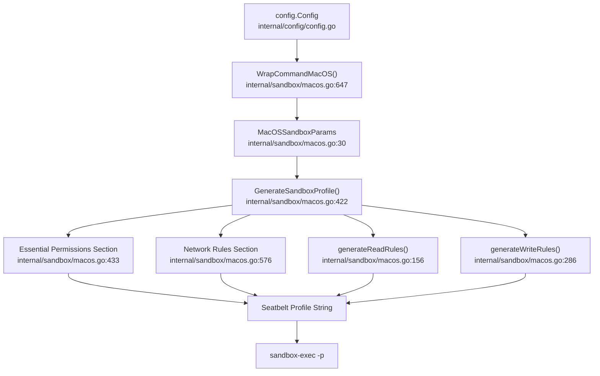
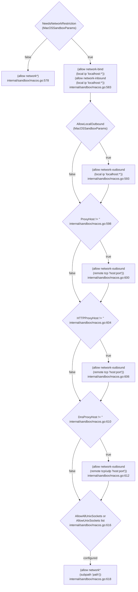

<!-- source: DeepWiki mcp.deepwiki.com · repo GreyhavenHQ/greywall · extra page Seatbelt Profile Generation · fetched 2026-10-26 -->

# Seatbelt Profile Generation

<details>
<summary>Relevant source files</summary>

The following files were used as context for generating this wiki page:

- [internal/sandbox/integration_macos_test.go](internal/sandbox/integration_macos_test.go)
- [internal/sandbox/macos.go](internal/sandbox/macos.go)
- [internal/sandbox/macos_test.go](internal/sandbox/macos_test.go)

</details>


This page documents how greywall generates Seatbelt profiles for macOS sandboxing. Seatbelt is macOS's sandbox policy language that defines what operations a process can perform. The profile generation system translates greywall's configuration into Seatbelt's S-expression-based policy format, implementing deny-by-default security, network restrictions, and filesystem access control.

For information about the broader macOS sandboxing architecture and how profiles are executed, see [macOS Sandboxing](#4.2). For details on monitoring violations in generated profiles, see [Unified Log Monitoring](#4.2.2).

## Overview

The profile generation process transforms greywall's configuration model into a Seatbelt profile that the macOS `sandbox-exec` utility can enforce. The system handles:

- **Network isolation**: Restricting outbound connections to specific proxy hosts while allowing localhost binding [internal/sandbox/macos.go:576-619]().
- **Filesystem access control**: Implementing deny-by-default reads and writes with path-based rules [internal/sandbox/macos.go:156-361]().
- **Essential permissions**: Providing minimal system access for process execution, IPC, and device I/O [internal/sandbox/macos.go:433-574]().
- **Violation tracking**: Embedding log tags for unified log monitoring [internal/sandbox/macos.go:424-431]().

The generation pipeline takes `MacOSSandboxParams` [internal/sandbox/macos.go:30-54]() as input and produces a complete Seatbelt profile string ready for execution.

**Sources**: [internal/sandbox/macos.go:422-645]()

## Profile Generation Pipeline

The following diagram maps the configuration flow from the Go `config` package through the macOS-specific sandbox parameters to the final Seatbelt profile string.



The `WrapCommandMacOS` [internal/sandbox/macos.go:647-748]() function orchestrates the generation process by extracting configuration parameters, parsing proxy URLs, and calling `GenerateSandboxProfile`. The resulting profile is passed directly to `sandbox-exec` via the `-p` flag.

**Sources**: [internal/sandbox/macos.go:647-748](), [internal/sandbox/macos.go:422-645]()

## Seatbelt Profile Structure

A generated Seatbelt profile follows this structure:

```
(version 1)
(deny default (with message "CMD64_<encoded-command>_END_<session>"))

; LogTag: CMD64_<encoded-command>_END_<session>

; Essential permissions - process, IPC, IOKit, sysctl
; Network restrictions
; File read rules
; File write rules
; PTY support (optional)
```

The profile uses S-expression syntax where each statement is a parenthesized list. The main statement types are:

| Statement Type | Purpose | Example |
|----------------|---------|---------|
| `(deny default ...)` | Sets default deny with log tag | `(deny default (with message "CMD64_..."))` [internal/sandbox/macos.go:426]() |
| `(allow operation)` | Grants blanket permission | `(allow file-read-metadata)` [internal/sandbox/macos.go:166]() |
| `(allow operation (filter))` | Conditional permission | `(allow file-read-data (subpath "/usr"))` [internal/sandbox/macos.go:173]() |
| `(deny operation (filter) (with message))` | Explicit denial with logging | `(deny file-read-data (literal "/home/user/.env"))` [internal/sandbox/macos.go:275]() |

**Sources**: [internal/sandbox/macos.go:426-431](), [internal/sandbox/macos.go:433-574]()

## Log Tag Embedding

Each profile embeds a unique log tag that identifies violations in the macOS unified log system. The tag encodes both the command being executed and a session identifier:

```
CMD64_<base64-encoded-command>_END_<session-suffix>_SBX
```

The tag generation process:

1. **Session suffix generation**: A 9-character hex string generated once per greywall process via `generateSessionSuffix` [internal/sandbox/macos.go:21-27]().
2. **Command encoding**: The command string is base64-encoded in `WrapCommandMacOS` [internal/sandbox/macos.go:653-655]() to handle special characters.
3. **Tag composition**: The components are concatenated with fixed delimiters in `GetLogTag` [internal/sandbox/sandbox.go:20-49]().

**Sources**: [internal/sandbox/macos.go:18-27](), [internal/sandbox/macos.go:424](), [internal/sandbox/sandbox.go:20-49]()

## Essential Permissions

The profile includes a comprehensive set of essential permissions required for basic process operation. These include:

### Process Permissions

```seatbelt
(allow process-exec)
(allow process-fork)
(allow process-info* (target same-sandbox))
(allow signal (target same-sandbox))
(allow mach-priv-task-port (target same-sandbox))
```

Allows process creation and signals, but only to processes within the same sandbox [internal/sandbox/macos.go:434-441]().

### Mach IPC Services

The profile allows connections to specific macOS system services via Mach IPC:

- `com.apple.logd` - logging service [internal/sandbox/macos.go:446]()
- `com.apple.system.opendirectoryd.*` - directory services [internal/sandbox/macos.go:452]()
- `com.apple.SecurityServer` - security operations [internal/sandbox/macos.go:456]()
- `com.apple.FSEvents` - filesystem event notifications [internal/sandbox/macos.go:460]()

**Sources**: [internal/sandbox/macos.go:434-465]()

### sysctl Access

Read access is granted to hardware and kernel information via `sysctl-read`:

```seatbelt
(allow sysctl-read
  (sysctl-name "hw.memsize")
  (sysctl-name "kern.version")
  (sysctl-name-prefix "machdep.cpu.")
)
```

**Sources**: [internal/sandbox/macos.go:482-542]()

### Device I/O

Terminal and random device access:

```seatbelt
(allow file-ioctl (literal "/dev/tty"))
(allow file-read-data file-write-data (regex #"^/dev/ttys"))
(allow file-read-data (literal "/dev/urandom"))
```

**Sources**: [internal/sandbox/macos.go:556-573]()

## Network Rule Generation

Network rules control outbound connections. The key insight is that **localhost binding is always allowed** to enable dev servers and OAuth callbacks, matching Linux behavior.



### Network Restriction Mode

When `NeedsNetworkRestriction` is true:

1. **Localhost binding**: Always allowed for inbound and binding operations [internal/sandbox/macos.go:583-591]().
2. **Proxy connections**: Allowed to specific proxy host:port combinations (SOCKS5, HTTP CONNECT, DNS) [internal/sandbox/macos.go:598-614]().
3. **Localhost outbound**: Optional (controlled by `AllowLocalOutbound`) [internal/sandbox/macos.go:593-596]().
4. **Unix sockets**: Either all paths or specific paths can be allowed [internal/sandbox/macos.go:616-619]().

**Sources**: [internal/sandbox/macos.go:576-619](), [internal/sandbox/macos_test.go:13-76]()

## Filesystem Read Rule Generation

The read rule generation implements deny-by-default security by distinguishing between metadata operations (which allow directory traversal and `stat` calls) and data operations (actual file content reads).

### Default Deny Read Mode

When `DefaultDenyRead` is true:

1. **Allow metadata globally**: `(allow file-read-metadata)` enables directory traversal [internal/sandbox/macos.go:166]().
2. **Allow data for root**: `(allow file-read-data (literal "/"))` enables path resolution [internal/sandbox/macos.go:167]().
3. **Allow system paths**: Paths from `GetDefaultReadablePaths()` are allowed via `subpath` rules [internal/sandbox/macos.go:170-175]().
4. **Allow CWD**: Current working directory gets full read access, plus ancestor directories for path resolution [internal/sandbox/macos.go:178-190]().
5. **Allow home caches**: Shell configs (`.bashrc`, `.zshrc`) and cache directories (`.cache`, `.npm`, `.cargo`) [internal/sandbox/macos.go:193-213]().
6. **Allow user paths**: Paths from `ReadAllowPaths` config field [internal/sandbox/macos.go:216-231]().
7. **Deny sensitive files**: `.env`, `.env.*`, and files from `SensitiveProjectFiles` are explicitly denied [internal/sandbox/macos.go:233-250]().

### Deny Rules Must Use Exact Operations

A critical implementation detail: deny rules **must use `file-read-data`**, not `file-read*`. Seatbelt ignores wildcard denies when a specific allow covers the same path. This is why the generated profile contains specific data denials [internal/sandbox/macos.go:275]().

**Sources**: [internal/sandbox/macos.go:154-282](), [internal/sandbox/macos_test.go:176-264]()

## Filesystem Write Rule Generation

Write rules are deny-by-default without needing explicit configuration. The system automatically allows:

1. **Current working directory**: Full write access to the project directory [internal/sandbox/macos.go:290-294]().
2. **TMPDIR parent**: For macOS's per-user temp directories (`/var/folders/XX/YYY/T/`) [internal/sandbox/macos.go:297-302]().
3. **User-specified paths**: From `WriteAllowPaths` config field [internal/sandbox/macos.go:305-320]().

Then applies deny rules for:

1. **Mandatory denies**: Shell startup files (`.bashrc`, `.zshrc`, etc.), git hooks, npm config [internal/sandbox/macos.go:329-336]().
2. **User denies**: Paths from `WriteDenyPaths` config field [internal/sandbox/macos.go:339-354]().

**Sources**: [internal/sandbox/macos.go:286-361](), [internal/sandbox/sandbox.go:78-127]()

## Path Handling and Normalization

Several helper functions handle path manipulation for Seatbelt profiles:

### Glob to Regex Conversion

`GlobToRegex` [internal/sandbox/macos.go:56-72]() converts shell-style glob patterns to regex patterns for Seatbelt's `(regex)` filter. It handles `**` before `*` to ensure correct precedence [internal/sandbox/macos.go:64-67]().

### Path Escaping

`escapePath` [internal/sandbox/macos.go:74-78]() uses Go's string quoting to escape paths for Seatbelt profiles, handling special characters like quotes and backslashes.

### macOS /tmp Symlink Handling

`expandMacOSTmpPaths` [internal/sandbox/macos.go:96-127]() mirrors paths between `/tmp` and `/private/tmp` because `/tmp` is a symlink to `/private/tmp` on macOS. The profile includes both variants to ensure rules match kernel-resolved paths.

**Sources**: [internal/sandbox/macos.go:96-127](), [internal/sandbox/macos_test.go:369-434]()

## Move Blocking Rules

To prevent bypassing deny rules via file moves, `generateMoveBlockingRules` [internal/sandbox/macos.go:363-420]() adds `file-write-unlink` denials for the denied path and its ancestors [internal/sandbox/macos.go:383-394](). This prevents moving a denied file or its parent directory to an allowed location.

**Sources**: [internal/sandbox/macos.go:363-420]()

## Profile Composition

The final profile assembly in `GenerateSandboxProfile` [internal/sandbox/macos.go:422-645]() builds the profile sequentially using a `strings.Builder`.

```mermaid
graph LR
    Header["Version + deny default<br/>+ log tag<br/>internal/sandbox/macos.go:423"]
    Essential["Essential permissions<br/>internal/sandbox/macos.go:433"]
    Network["Network rules<br/>internal/sandbox/macos.go:576"]
    Read["Read rules<br/>internal/sandbox/macos.go:622"]
    Write["Write rules<br/>internal/sandbox/macos.go:629"]
    PTY["PTY support (optional)<br/>internal/sandbox/macos.go:635"]
    
    Final["Complete Seatbelt Profile"]
    
    Header --> Essential
    Essential --> Network
    Network --> Read
    Read --> Write
    Write --> PTY
    PTY --> Final
```



**Sources**: [internal/sandbox/macos.go:422-645]()

## Testing

The test suite in `macos_test.go` verifies profile generation correctness, including network restrictions [internal/sandbox/macos_test.go:13-76](), default deny read logic [internal/sandbox/macos_test.go:176-264](), and path expansion [internal/sandbox/macos_test.go:369-434](). Integration tests in `integration_macos_test.go` verify that the generated profiles correctly block writes outside workspace [internal/sandbox/integration_macos_test.go:19-32]() and protect sensitive files like `.env` [internal/sandbox/integration_macos_test.go:175-195]().

**Sources**: [internal/sandbox/macos_test.go:1-434](), [internal/sandbox/integration_macos_test.go:1-210]()

---

