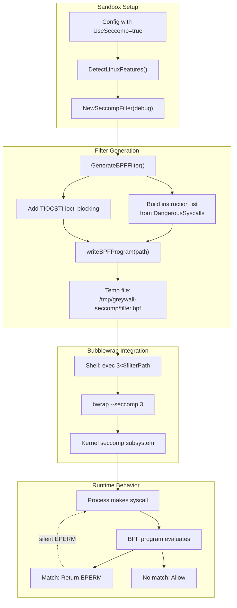
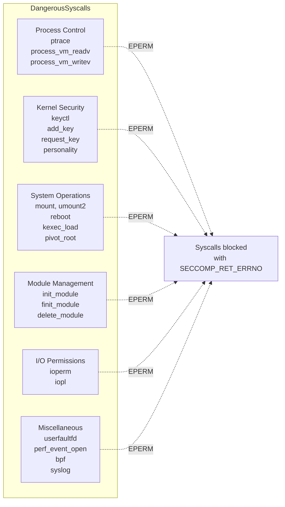
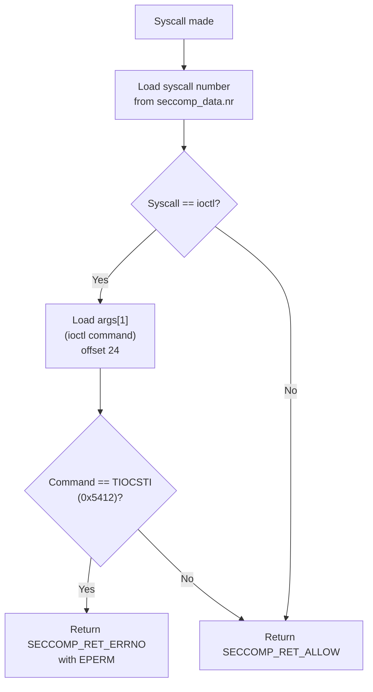
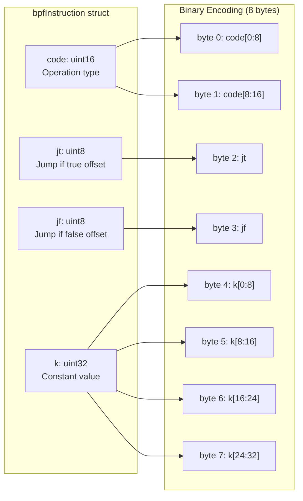
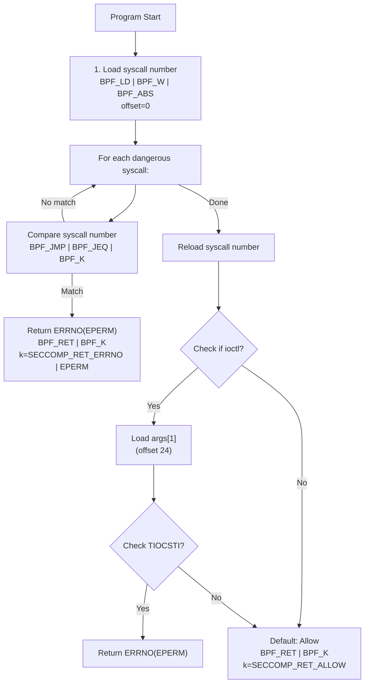
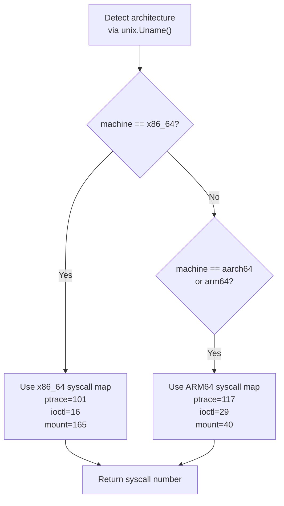

<!-- source: DeepWiki mcp.deepwiki.com · repo GreyhavenHQ/greywall · extra page Seccomp Syscall Filtering · fetched 2026-10-26 -->

# Seccomp Syscall Filtering

Relevant source files

The following files were used as context for generating this wiki page:

- [internal/sandbox/linux_ebpf.go](internal/sandbox/linux_ebpf.go)
- [internal/sandbox/linux_ebpf_stub.go](internal/sandbox/linux_ebpf_stub.go)
- [internal/sandbox/linux_seccomp.go](internal/sandbox/linux_seccomp.go)
- [internal/sandbox/linux_seccomp_stub.go](internal/sandbox/linux_seccomp_stub.go)
- [internal/sandbox/monitor.go](internal/sandbox/monitor.go)
- [internal/sandbox/shell.go](internal/sandbox/shell.go)

This page covers greywall's seccomp-bpf (Berkeley Packet Filter) implementation for Linux syscall filtering. Seccomp provides kernel-level enforcement that blocks dangerous system calls before they execute, adding a critical defense layer to the sandbox.

For information about the broader Linux sandboxing architecture, see [Linux Sandboxing](4.1). For filesystem access control, see [Landlock Filesystem Control](4.1.2). For violation monitoring, see [eBPF Violation Monitoring](4.1.4).

## Purpose and Scope

Seccomp filtering blocks dangerous syscalls at the kernel level using Berkeley Packet Filter (BPF) programs. This prevents sandboxed processes from performing operations like process injection (`ptrace`), kernel module loading, or terminal input injection (`TIOCSTI` ioctl). The filter runs in the kernel and cannot be bypassed by user-space code.

Key characteristics:
- **Kernel-enforced**: Syscalls are blocked before execution.
- **Zero overhead**: BPF programs execute with minimal performance impact.
- **Architecture-aware**: Syscall numbers differ between x86_64 and ARM64. [internal/sandbox/linux_seccomp.go:266-353]()
- **Silent blocking**: Uses `SECCOMP_RET_ERRNO` which returns `EPERM` without logging. [internal/sandbox/linux_seccomp.go:125-129]()

## Architecture Overview

The seccomp filter integrates into the Linux sandbox as one of multiple security layers. It works alongside bubblewrap, Landlock, and network isolation to provide defense-in-depth.

### Seccomp Integration Flow

**Sources**: [internal/sandbox/linux_seccomp.go:13-22](), [internal/sandbox/linux_seccomp.go:59-89](), [internal/sandbox/linux_seccomp.go:152-194]()

The filter is generated at sandbox creation time and passed to bubblewrap via file descriptor 3. The kernel attaches the BPF program to all processes in the sandbox.

## SeccompFilter Class

The `SeccompFilter` class manages BPF filter generation and lifecycle.

| Component | Type | Purpose |
|-----------|------|---------|
| `SeccompFilter` | struct | Filter generator with debug flag [internal/sandbox/linux_seccomp.go:14-16]() |
| `NewSeccompFilter(debug bool)` | constructor | Creates new filter instance [internal/sandbox/linux_seccomp.go:19-21]() |
| `GenerateBPFFilter()` | method | Generates BPF program, returns temp file path [internal/sandbox/linux_seccomp.go:61-89]() |
| `writeBPFProgram(path string)` | method | Writes BPF instructions to file [internal/sandbox/linux_seccomp.go:93-223]() |
| `CleanupFilter(path string)` | method | Removes temporary filter file [internal/sandbox/linux_seccomp_stub.go:21-21]() |

**Sources**: [internal/sandbox/linux_seccomp.go:13-22](), [internal/sandbox/linux_seccomp.go:61-89](), [internal/sandbox/linux_seccomp.go:93-223]()

## Blocked Syscalls

The `DangerousSyscalls` list defines syscalls that pose security risks to the sandbox. These are blocked regardless of process permissions.

### Syscall Categories

**Sources**: [internal/sandbox/linux_seccomp.go:28-57]()

### Complete Blocked Syscalls List

| Syscall | Category | Threat |
|---------|----------|--------|
| `ptrace` | Process control | Process debugging/injection |
| `process_vm_readv` | Process control | Memory read from other processes |
| `process_vm_writev` | Process control | Memory write to other processes |
| `keyctl`, `add_key`, `request_key` | Kernel keyring | Kernel credential access |
| `personality` | Security bypass | Change execution domain, bypass ASLR |
| `userfaultfd` | Sandbox escape | User-space page fault handling |
| `perf_event_open` | Information leak | Performance monitoring data |
| `bpf` | Kernel access | eBPF operations without CAP_BPF |
| `kexec_load`, `kexec_file_load` | System control | Load new kernel |
| `reboot` | System control | System reboot |
| `syslog` | Information leak | Kernel log access |
| `acct` | System control | Process accounting |
| `mount`, `umount2` | Filesystem | Filesystem mount/unmount |
| `pivot_root` | Filesystem | Change root filesystem |
| `swapon`, `swapoff` | System control | Swap management |
| `sethostname`, `setdomainname` | System control | Hostname/domain changes |
| `init_module`, `finit_module` | Kernel | Kernel module loading |
| `delete_module` | Kernel | Kernel module unloading |
| `ioperm`, `iopl` | I/O | I/O port access (x86_64 only) |

**Sources**: [internal/sandbox/linux_seccomp.go:28-57]()

## TIOCSTI Terminal Injection Protection

The seccomp filter includes special logic to block the `TIOCSTI` ioctl, which allows processes to inject characters into the terminal input buffer. This attack vector was traditionally mitigated by bubblewrap's `--new-session` flag, but that flag breaks `SIGWINCH` delivery to interactive applications. [internal/sandbox/linux_seccomp.go:23-26]()

### Why TIOCSTI is Dangerous

A sandboxed process could use `ioctl(fd, TIOCSTI, &ch)` to inject keystrokes into the parent terminal session, potentially executing commands outside the sandbox after the sandbox exits.

### Implementation Details

The BPF filter checks both the syscall number (ioctl) and the ioctl command argument:

**Sources**: [internal/sandbox/linux_seccomp.go:23-26](), [internal/sandbox/linux_seccomp.go:152-194]()

The `seccomp_data` structure layout is critical for accessing syscall arguments:

| Offset | Field | Size | Content |
|--------|-------|------|---------|
| 0 | `nr` | u32 | Syscall number |
| 4 | `arch` | u32 | Architecture identifier |
| 8-12 | `instruction_pointer` | u64 | Instruction pointer (split) |
| 16-20 | `args[0]` | u64 | First argument (split) |
| 24-28 | `args[1]` | u64 | Second argument (split, ioctl command) |

**Sources**: [internal/sandbox/linux_seccomp.go:154-163]()

## BPF Program Generation

The BPF filter is generated as a sequence of `bpfInstruction` structures, each encoding a single BPF operation. [internal/sandbox/linux_seccomp.go:243-249]()

### BPF Instruction Structure

**Sources**: [internal/sandbox/linux_seccomp.go:243-249](), [internal/sandbox/linux_seccomp.go:251-264]()

### Program Structure

The complete BPF program follows this pattern:

**Sources**: [internal/sandbox/linux_seccomp.go:115-216]()

### BPF Instruction Constants

| Constant | Value | Purpose |
|----------|-------|---------|
| `BPF_LD` | 0x00 | Load operation |
| `BPF_JMP` | 0x05 | Jump operation |
| `BPF_RET` | 0x06 | Return operation |
| `BPF_W` | 0x00 | Word (32-bit) |
| `BPF_ABS` | 0x20 | Absolute addressing |
| `BPF_JEQ` | 0x10 | Jump if equal |
| `BPF_K` | 0x00 | Constant source |

**Sources**: [internal/sandbox/linux_seccomp.go:225-241]()

## Architecture-Specific Syscall Numbers

Syscall numbers differ between x86_64 and ARM64 architectures. The `getSyscallNumber()` function detects the architecture and returns the correct number. [internal/sandbox/linux_seccomp.go:266-353]()

### Architecture Detection and Mapping

**Sources**: [internal/sandbox/linux_seccomp.go:266-353]()

### Example Syscall Number Differences

| Syscall | x86_64 | ARM64 | Notes |
|---------|--------|-------|-------|
| `ptrace` | 101 | 117 | Different on both architectures |
| `ioctl` | 16 | 29 | Used for TIOCSTI blocking |
| `mount` | 165 | 40 | Filesystem operations |
| `ioperm` | 173 | N/A | x86_64 only (I/O ports) |
| `iopl` | 172 | N/A | x86_64 only (I/O privilege) |

**Sources**: [internal/sandbox/linux_seccomp.go:286-349]()

Note that `ioperm` and `iopl` do not exist on ARM64 architecture, as ARM does not have the same I/O port model as x86.

## Monitoring and Logging Limitations

The seccomp filter uses `SECCOMP_RET_ERRNO` as its blocking action, which silently returns `EPERM` without generating any kernel logs. [internal/sandbox/linux_seccomp.go:128-129]()

### Detection via eBPF

Since seccomp violations are silent, greywall uses the `EBPFMonitor` to detect syscall failures (EPERM, EACCES) regardless of their source. The eBPF monitor can observe when syscalls return error codes, catching both seccomp-blocked calls and naturally-occurring permission errors. [internal/sandbox/linux_ebpf.go:179-204]()

For details on violation monitoring, see [eBPF Violation Monitoring](4.1.4).

**Sources**: [internal/sandbox/linux_ebpf.go:179-204](), [internal/sandbox/linux_seccomp.go:128-129]()

## Cleanup and Lifecycle

The seccomp filter file is temporary and cleaned up after use.

| Stage | Action | Location |
|-------|--------|----------|
| **Generation** | Create `/tmp/greywall-seccomp/filter-{pid}.bpf` | `GenerateBPFFilter()` [internal/sandbox/linux_seccomp.go:68-73]() |
| **Cleanup** | Remove filter file | `CleanupFilter(path)` [internal/sandbox/linux_seccomp_stub.go:21-21]() |

**Sources**: [internal/sandbox/linux_seccomp.go:68-73](), [internal/sandbox/linux_seccomp_stub.go:21-21]()

---

**Page Summary**: Greywall's seccomp implementation provides kernel-enforced syscall filtering using BPF programs. It blocks dangerous syscalls and includes special TIOCSTI protection to prevent terminal injection attacks. The filter is architecture-aware, generates compact BPF binary programs, and uses silent blocking (`SECCOMP_RET_ERRNO`) paired with eBPF monitoring for violation detection.

---

