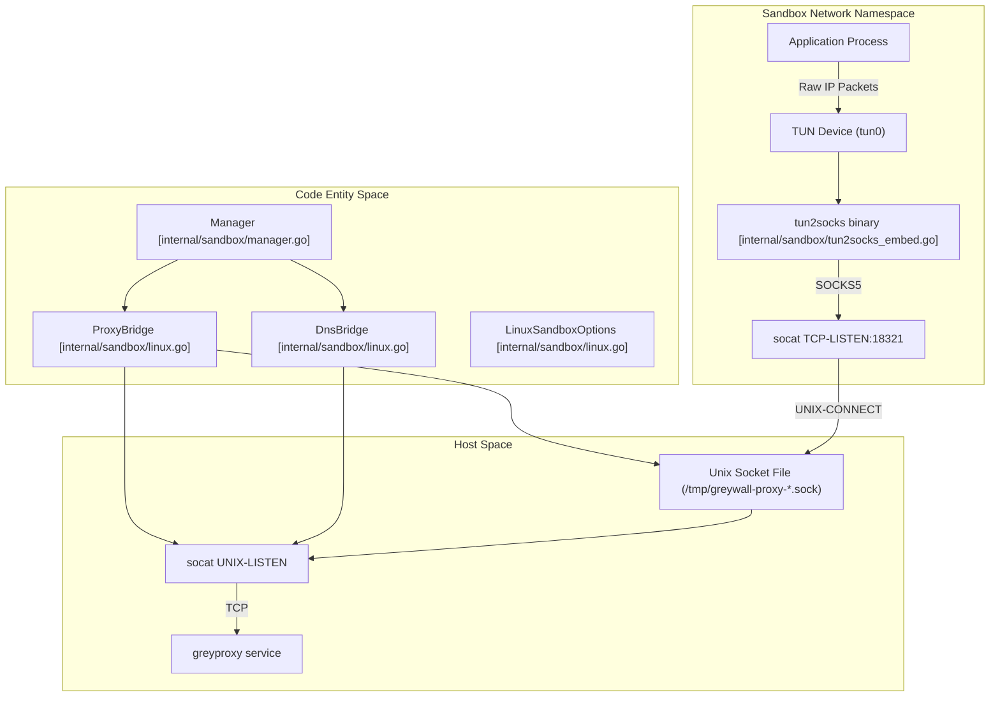
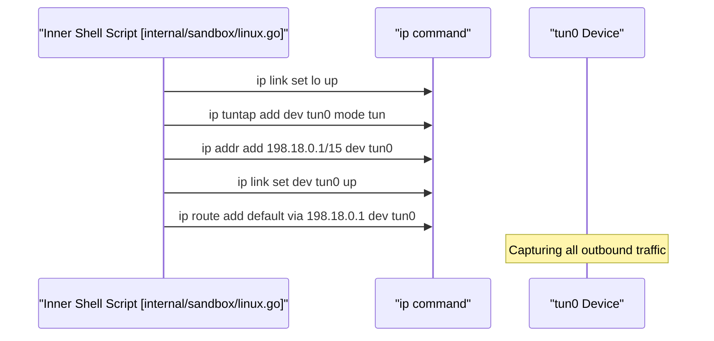
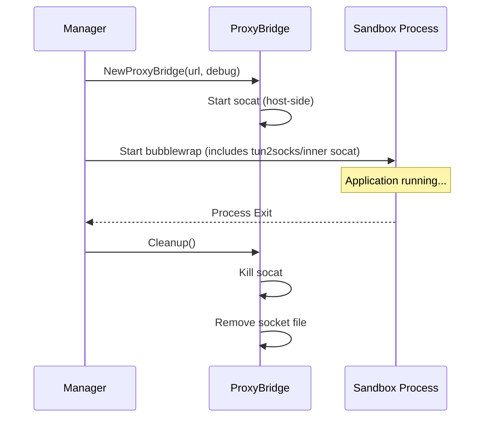

<!-- source: DeepWiki mcp.deepwiki.com · repo GreyhavenHQ/greywall · extra page Transparent Network Proxying · fetched 2026-10-26 -->

# Transparent Network Proxying

Relevant source files

The following files were used as context for generating this wiki page:

- [internal/sandbox/benchmark_test.go](internal/sandbox/benchmark_test.go)
- [internal/sandbox/linux.go](internal/sandbox/linux.go)
- [internal/sandbox/resolv_linux_test.go](internal/sandbox/resolv_linux_test.go)
- [internal/sandbox/tun2socks_embed.go](internal/sandbox/tun2socks_embed.go)

This page describes how greywall achieves transparent network proxying on Linux using TUN devices and `tun2socks`. This is a Linux-specific feature that captures all network traffic from sandboxed processes without requiring application cooperation. For information about the greyproxy service that receives this traffic, see [5.1 greyproxy Service](). For Unix socket bridging details, see [5.2 Proxy Bridges and Unix Sockets]().

## Purpose and Scope

Transparent network proxying allows greywall to intercept all TCP/UDP traffic from sandboxed applications, regardless of whether they respect proxy environment variables. This is critical for sandboxing applications that make direct network connections or use network libraries that ignore `HTTP_PROXY` settings.

On Linux, greywall implements transparent proxying by:
1. Creating an isolated network namespace with `--unshare-net` [internal/sandbox/linux.go:638-643]()
2. Setting up a TUN device as the default route [internal/sandbox/linux.go:1005-1013]()
3. Using `tun2socks` to convert raw IP packets to SOCKS5 [internal/sandbox/linux.go:994-1002]()
4. Bridging SOCKS5 connections to greyproxy via Unix sockets [internal/sandbox/linux.go:1016-1019]()

When transparent proxying is unavailable (e.g., restricted containerized environments), greywall falls back to proxy environment variables [internal/sandbox/linux.go:1039-1057]().

**Sources:** [internal/sandbox/linux.go:21-31](), [internal/sandbox/linux.go:638-643](), [internal/sandbox/linux.go:993-1024](), [internal/sandbox/linux.go:1039-1057]()

## Architecture Overview

The transparent proxy architecture creates a complete network isolation layer where all traffic flows through a controlled proxy pipeline.

### System to Code Entity Mapping

The following diagram maps high-level network components to the specific Go structs and shell commands used in the implementation.

**Network Flow Chain:**

| Stage | Component | Location | Purpose |
|-------|-----------|----------|---------|
| 1 | Application | Inside namespace | Makes normal TCP/UDP connections |
| 2 | TUN device `tun0` | Inside namespace | Captures all packets (default route) [internal/sandbox/linux.go:1012-1013]() |
| 3 | `tun2socks` | Inside namespace | Converts IP packets to SOCKS5 [internal/sandbox/linux.go:1020-1022]() |
| 4 | `socat` relay (inner) | Inside namespace | Forwards SOCKS5 to Unix socket [internal/sandbox/linux.go:1016-1019]() |
| 5 | Unix socket | Host filesystem | Crosses namespace boundary [internal/sandbox/linux.go:158-165]() |
| 6 | `socat` relay (outer) | Host system | Forwards Unix socket to TCP [internal/sandbox/linux.go:175-179]() |
| 7 | `greyproxy` | Host system | Domain filtering and routing |

**Sources:** [internal/sandbox/linux.go:21-41](), [internal/sandbox/linux.go:131-205](), [internal/sandbox/linux.go:993-1024](), [internal/sandbox/tun2socks_embed.go:1-53]()

## TUN Device Configuration

When transparent proxying is enabled, greywall configures a TUN device inside the network namespace. This setup occurs in the inner script executed by `bubblewrap`.

**Network Parameters:**
- **Device Name:** `tun0` [internal/sandbox/linux.go:1005]()
- **IP Address:** `198.18.0.1/15` [internal/sandbox/linux.go:1008]()
- **Routing:** Set as the default gateway [internal/sandbox/linux.go:1012-1013]()

**Sources:** [internal/sandbox/linux.go:1005-1013]()

## tun2socks Integration

The `tun2socks` binary implements a userspace network stack that reads raw packets from the TUN device and converts them to SOCKS5 connections. Greywall embeds `tun2socks` as a binary asset and extracts it to a temporary file for use.

### Binary Extraction
The function `extractTun2Socks` handles platform-specific binary extraction:
- It supports `amd64` and `arm64` architectures [internal/sandbox/tun2socks_embed.go:20-27]().
- It writes the embedded data to a temporary file with `0755` permissions [internal/sandbox/tun2socks_embed.go:35-50]().

### Execution in Sandbox
Inside the sandbox, `tun2socks` is executed with the following parameters:
- `-device tun0`: Points to the capture interface [internal/sandbox/linux.go:1021]().
- `-proxy socks5://...`: Points to the local `socat` listener [internal/sandbox/linux.go:1021]().
- Credentials: If the `ProxyBridge` has `HasAuth` set to true, credentials are included in the proxy URL [internal/sandbox/linux.go:1020-1022]().

**Sources:** [internal/sandbox/linux.go:1020-1022](), [internal/sandbox/tun2socks_embed.go:13-53]()

## Bridge Implementation

Greywall uses two types of bridges to handle different traffic types.

### ProxyBridge
The `ProxyBridge` struct [internal/sandbox/linux.go:22-31]() manages the host-side `socat` process that forwards traffic from a Unix socket to the external SOCKS5 proxy (usually `greyproxy`).

- **NewProxyBridge**: Initializes the bridge, generates a random socket path in `os.TempDir()`, and starts the `socat` process [internal/sandbox/linux.go:141-186]().
- **Cleanup**: Kills the `socat` process and removes the socket file [internal/sandbox/linux.go:203-213]().

### DnsBridge
The `DnsBridge` struct [internal/sandbox/linux.go:36-41]() handles DNS traffic specifically.

- **NewDnsBridge**: Starts a `socat` relay from a Unix socket to a UDP DNS server [internal/sandbox/linux.go:44-75]().
- **Sandbox Configuration**: Inside the sandbox, `socat` listens on UDP port 53 and forwards to the `DnsBridge` Unix socket [internal/sandbox/linux.go:1031-1033]().

**Sources:** [internal/sandbox/linux.go:22-103](), [internal/sandbox/linux.go:141-213](), [internal/sandbox/linux.go:1031-1033]()

## DNS Resolution Strategies

Greywall provides two ways to handle DNS inside the isolated network namespace.

| Strategy | Mechanism | resolv.conf Content |
| :--- | :--- | :--- |
| **DNS Bridge** | `socat` UDP relay to host-side DNS | `nameserver 127.0.0.1` [internal/sandbox/linux.go:946]() |
| **TCP Fallback** | `tun2socks` handles DNS over TCP | `nameserver 1.1.1.1` + `options use-vc` [internal/sandbox/linux.go:933-938]() |

The `options use-vc` flag [internal/sandbox/linux.go:938]() is critical when using the TCP fallback; it forces the resolver to use TCP (Virtual Circuit) instead of UDP, allowing `tun2socks` to proxy the requests.

**Sources:** [internal/sandbox/linux.go:932-951](), [internal/sandbox/resolv_linux_test.go:99-115]()

## Lifecycle and Cleanup

The lifecycle of the transparent proxy is tied to the `Manager` and the specific bridge instances.

**Sources:** [internal/sandbox/linux.go:88-103](), [internal/sandbox/linux.go:203-213](), [internal/sandbox/benchmark_test.go:82-96]()

---

