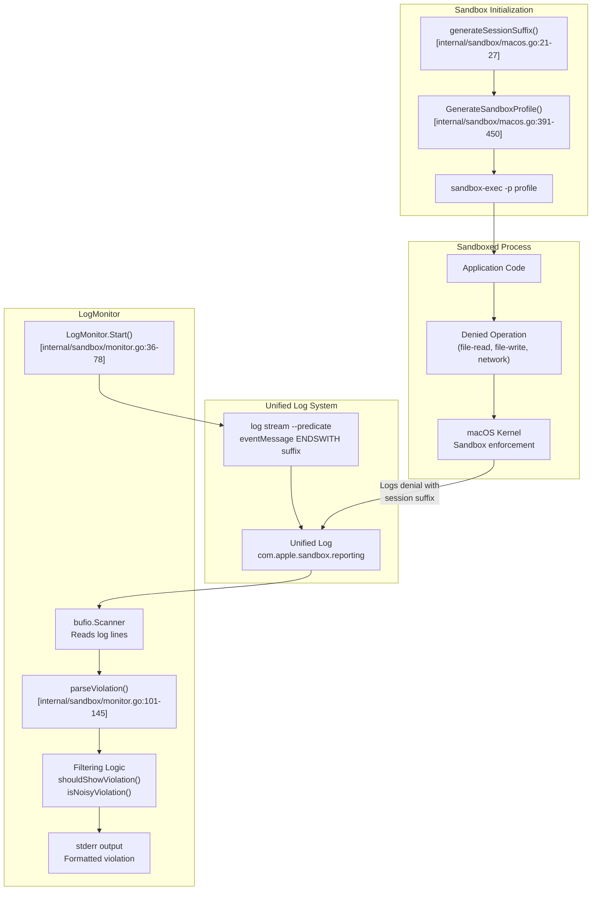

<!-- source: DeepWiki mcp.deepwiki.com · repo GreyhavenHQ/greywall · extra page Unified Log Monitoring · fetched 2026-10-26 -->

# Unified Log Monitoring

<details>
<summary>Relevant source files</summary>

The following files were used as context for generating this wiki page:

- [internal/sandbox/integration_macos_test.go](internal/sandbox/integration_macos_test.go)
- [internal/sandbox/learning_darwin.go](internal/sandbox/learning_darwin.go)
- [internal/sandbox/learning_darwin_test.go](internal/sandbox/learning_darwin_test.go)
- [internal/sandbox/macos.go](internal/sandbox/macos.go)
- [internal/sandbox/macos_test.go](internal/sandbox/macos_test.go)

</details>


This document describes macOS-specific sandbox violation monitoring through the unified logging system. Greywall on macOS uses the `log stream` command to monitor sandbox policy violations in real-time by filtering the system-wide unified log for violations tagged with a unique session identifier.

For Linux-based violation monitoring using eBPF, see [eBPF Violation Monitoring](). For details on how Seatbelt profiles are generated, see [Seatbelt Profile Generation]().

---

## Monitoring Architecture

macOS sandbox violations are reported through the unified logging subsystem whenever a sandboxed process attempts an operation denied by the Seatbelt profile. Greywall monitors these violations by:

1. Generating a unique session suffix for each sandbox invocation.
2. Embedding this suffix in all deny rules within the Seatbelt profile using the `(with message "...")` clause.
3. Streaming the unified log and filtering for messages containing the session suffix.
4. Parsing violation entries and displaying them to stderr.



**Diagram: macOS Unified Log Monitoring Flow**

Sources: [internal/sandbox/monitor.go:16-79](), [internal/sandbox/macos.go:18-27](), [internal/sandbox/macos.go:422-431]()

---

## Session Suffix Generation

Each sandbox invocation generates a unique session suffix to isolate its log entries from other concurrent greywall processes. The suffix is a 9-character hexadecimal string followed by `_SBX`.

### Generation Process

| Component | Implementation | Purpose |
|-----------|---------------|---------|
| Random bytes | `crypto/rand.Read(8 bytes)` | Cryptographic randomness |
| Encoding | `hex.EncodeToString()[:9]` | Human-readable identifier |
| Suffix format | `"_" + hex + "_SBX"` | Pattern: `_a1b2c3d4e_SBX` |

The session suffix is generated once per greywall process at package initialization:

[internal/sandbox/macos.go:18-27]()
```go
var sessionSuffix = generateSessionSuffix()

func generateSessionSuffix() string {
	bytes := make([]byte, 8)
	if _, err := rand.Read(bytes); err != nil {
		panic("failed to generate session suffix: " + err.Error())
	}
	return "_" + hex.EncodeToString(bytes)[:9] + "_SBX"
}
```

### Profile Integration

The session suffix is embedded in every deny rule within the Seatbelt profile using the `(with message "...")` clause. This tags all violations from this sandbox session:

[internal/sandbox/macos.go:422-431]()
```go
// Example of rule generation in GenerateSandboxProfile
rules = append(rules,
    "(deny file-read*",
    fmt.Sprintf("  (with message %q))", "CMD64_"+params.Command+"_END"+sessionSuffix),
)
```

Sources: [internal/sandbox/macos.go:18-27](), [internal/sandbox/macos.go:424](), [internal/sandbox/macos.go:430]()

---

## LogMonitor Implementation

The `LogMonitor` struct manages the lifecycle of the `log stream` process that monitors violations.

### Structure Definition

```mermaid
classDiagram
    class LogMonitor {
        -sessionSuffix string
        -cmd *exec.Cmd
        -cancel context.CancelFunc
        -running bool
        +NewLogMonitor(sessionSuffix) *LogMonitor
        +Start() error
        +Stop()
    }
    
    class exec_Cmd {
        Process *os.Process
        StdoutPipe io.ReadCloser
    }
    
    LogMonitor --> exec_Cmd : "manages [internal/sandbox/monitor.go:19]"
```

**Diagram: LogMonitor Class Structure**

| Field | Type | Purpose |
|-------|------|---------|
| `sessionSuffix` | `string` | Unique identifier for filtering this session's violations |
| `cmd` | `*exec.Cmd` | The running `log stream` process |
| `cancel` | `context.CancelFunc` | Context cancellation for stopping the monitor |
| `running` | `bool` | Tracks whether the monitor is active |

Sources: [internal/sandbox/monitor.go:17-22]()

### Start Method

The `Start` method spawns the `log stream` process with a predicate filter. It constructs a predicate using the `sessionSuffix` to ensure only relevant violations are captured.

[internal/sandbox/monitor.go:45-50]()
```go
predicate := fmt.Sprintf(`eventMessage ENDSWITH "%s"`, m.sessionSuffix)

m.cmd = exec.CommandContext(ctx, "log", "stream",
    "--predicate", predicate,
    "--style", "compact",
)
```

| Flag | Value | Purpose |
|------|-------|---------|
| `--predicate` | `eventMessage ENDSWITH "..."` | Filter for session violations only |
| `--style` | `compact` | Simplified output format (timestamp + message) |

Sources: [internal/sandbox/monitor.go:36-78]()

---

## Violation Parsing and Filtering

The `parseViolation` function extracts structured information from raw log entries and filters out noise.

### Parsing Pattern

[internal/sandbox/monitor.go:102]()
```go
var violationPattern = regexp.MustCompile(`Sandbox: (\w+)\((\d+)\) deny\(\d+\) (\S+)(.*)`)
```

| Capture Group | Content | Example |
|---------------|---------|---------|
| `\w+` | Process name | `python` |
| `\d+` | Process ID | `12345` |
| `\S+` | Operation type | `file-read-data` |
| `.*` | Details (path, address, etc.) | `/etc/passwd` |

Sources: [internal/sandbox/monitor.go:102-144]()

### Operation Type Filtering

The `shouldShowViolation` function determines which operation types are relevant. It specifically targets network and filesystem operations.

[internal/sandbox/monitor.go:147-159]()
```go
func shouldShowViolation(operation string) bool {
	if strings.HasPrefix(operation, "network-") {
		return true
	}
	if strings.HasPrefix(operation, "file-read") ||
		strings.HasPrefix(operation, "file-write") {
		return true
	}
	return false
}
```

Sources: [internal/sandbox/monitor.go:147-159]()

### Noise Filtering

The `isNoisyViolation` function filters system-level operations that generate excessive false positives, such as TTY access or system logging sockets.

[internal/sandbox/monitor.go:162-180]()
```go
func isNoisyViolation(details string) bool {
	if strings.HasPrefix(details, "/dev/tty") ||
		strings.HasPrefix(details, "/dev/pts") {
		return true
	}
	if strings.Contains(details, "mDNSResponder") {
		return true
	}
	if strings.HasPrefix(details, "/private/var/run/syslog") {
		return true
	}
	return false
}
```

Sources: [internal/sandbox/monitor.go:162-180]()

---

## Comparison with Learning Mode (eslogger)

While `LogMonitor` handles real-time violation reporting for security enforcement, Greywall also uses `eslogger` for its **Learning Mode** on macOS. 

| Aspect | Real-time Monitoring (`log stream`) | Learning Mode (`eslogger`) |
|--------|------------------------------------|----------------------------|
| **Primary File** | [internal/sandbox/monitor.go]() | [internal/sandbox/learning_darwin.go]() |
| **Purpose** | Security violation alerting | Profile generation via tracing |
| **Data Format** | Text-based Unified Log | JSON-based Endpoint Security events |
| **Parsing Logic** | `parseViolation` [internal/sandbox/monitor.go:101]() | `ParseEsloggerLog` [internal/sandbox/learning_darwin.go:129]() |
| **Event Types** | Sandbox denials | All successful file/fork operations |

`ParseEsloggerLog` implements a two-pass approach: 
1. **Pass 1**: Scans `fork` events to build a PID tree starting from the root process [internal/sandbox/learning_darwin.go:135-153]().
2. **Pass 2**: Filters filesystem events (open, create, write, etc.) by that PID set to generate path lists [internal/sandbox/learning_darwin.go:159-223]().

Sources: [internal/sandbox/learning_darwin.go:129-235](), [internal/sandbox/monitor.go:1-187]()

---

