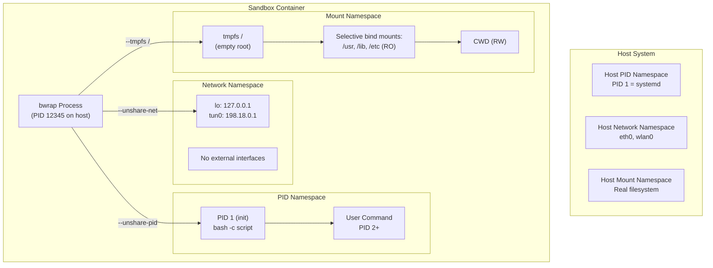
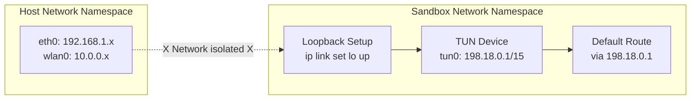
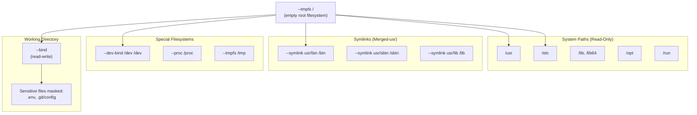
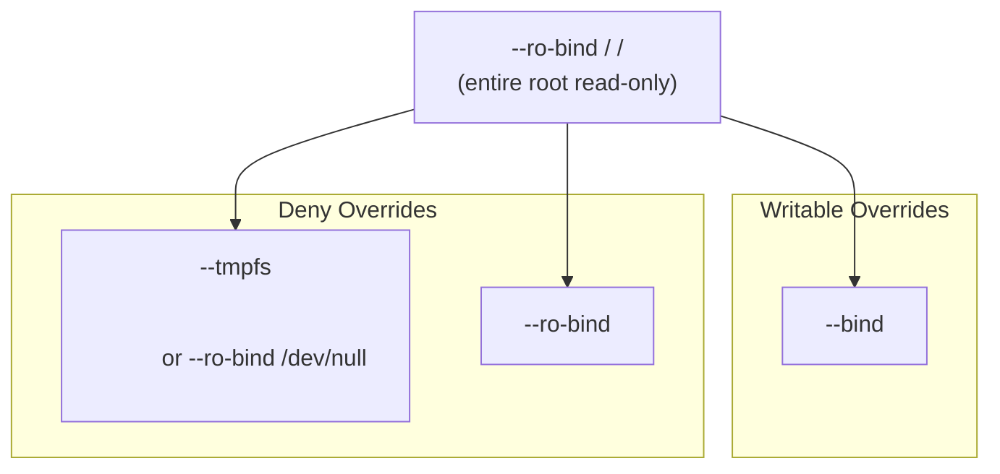
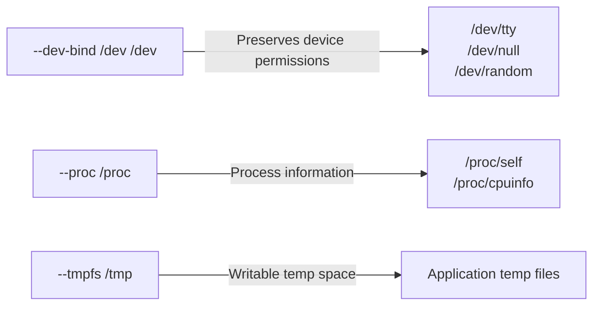
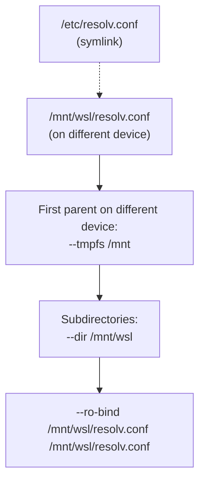
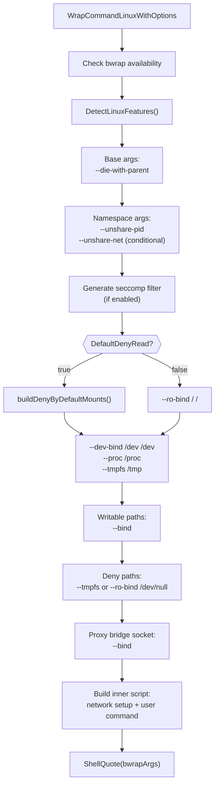
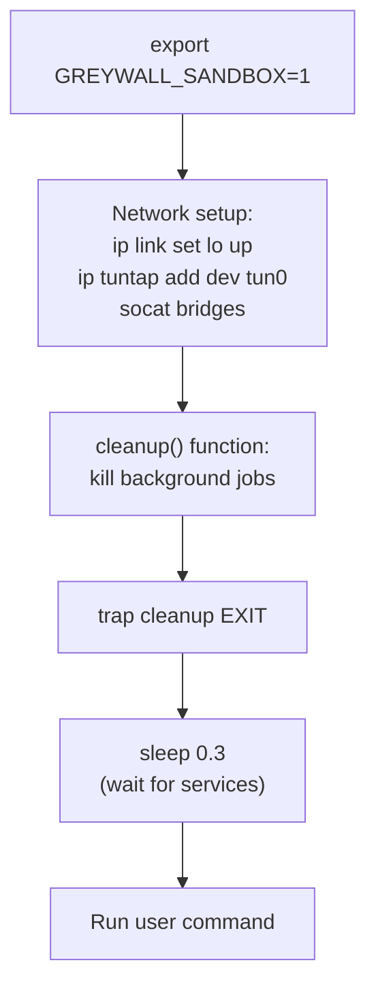
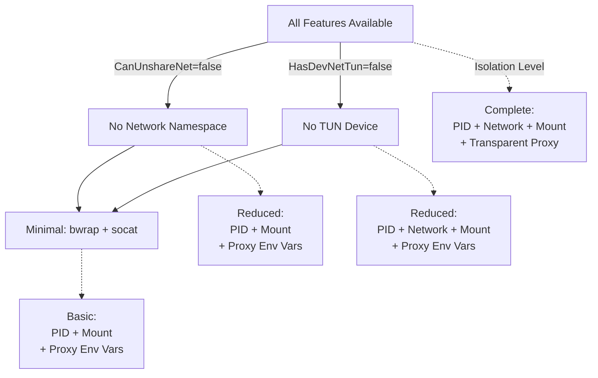

<!-- source: DeepWiki mcp.deepwiki.com · repo GreyhavenHQ/greywall · extra page bubblewrap and Namespaces · fetched 2026-10-26 -->

# bubblewrap and Namespaces

<details>
<summary>Relevant source files</summary>

The following files were used as context for generating this wiki page:

- [internal/sandbox/linux.go](internal/sandbox/linux.go)
- [internal/sandbox/linux_features.go](internal/sandbox/linux_features.go)
- [internal/sandbox/linux_stub.go](internal/sandbox/linux_stub.go)

</details>


## Purpose and Scope

This page explains how greywall uses bubblewrap (bwrap) to create isolated Linux namespaces for sandboxed processes. It covers namespace creation (PID, network, mount), the mount structure inside the sandbox, and how bwrap commands are constructed. For filesystem access control beyond mount-based restrictions, see [Landlock Filesystem Control](#4.1.2). For syscall filtering, see [Seccomp Syscall Filtering](#4.1.3). For network routing through the proxy, see [Transparent Network Proxying](#4.1.5).

## Overview of bubblewrap

Bubblewrap (bwrap) is a lightweight container runtime that creates isolated namespaces without requiring root privileges. Greywall uses bwrap as the foundation of its Linux sandbox implementation because it:

- Creates new PID, network, and mount namespaces without root
- Provides granular control over filesystem visibility through bind mounts
- Supports capability management (CAP_NET_ADMIN, CAP_NET_BIND_SERVICE)
- Works in unprivileged mode (no setuid binary required)
- Integrates cleanly with other security layers (seccomp, Landlock)

The `WrapCommandLinux` and `WrapCommandLinuxWithOptions` functions in [internal/sandbox/linux.go:595-1178]() construct bwrap commands that wrap user commands in an isolated environment.

**Sources:** [internal/sandbox/linux.go:595-610]()

## Namespace Isolation

### Namespace Types and Isolation Boundaries

Greywall creates three types of Linux namespaces to isolate sandboxed processes:



**Sources:** [internal/sandbox/linux.go:626-645]()

### PID Namespace

The PID namespace isolates process identifiers, preventing sandboxed processes from discovering or interacting with processes on the host.

| Feature | Configuration | Effect |
|---------|--------------|--------|
| Namespace flag | `--unshare-pid` | Creates new PID namespace |
| Init process | bash shell | Becomes PID 1 in namespace |
| Child visibility | Isolated | Sandboxed processes cannot see host PIDs |
| Parent visibility | One-way | Host can see sandbox PIDs (as children of bwrap) |
| Process cleanup | `--die-with-parent` | Entire namespace dies when bwrap exits |

The `--unshare-pid` flag is unconditionally applied at [internal/sandbox/linux.go:645](). Inside the new PID namespace, the bash shell that runs the inner script becomes PID 1 (the init process), and the user's command becomes PID 2 or higher.

**Important:** Greywall does NOT use `--new-session` because it breaks terminal resize signals (SIGWINCH) for interactive applications. The TIOCSTI attack vector that `--new-session` would mitigate is instead blocked by the seccomp filter (see [Seccomp Syscall Filtering](#4.1.3)).

**Sources:** [internal/sandbox/linux.go:626-645]()

### Network Namespace

The network namespace creates a completely isolated network stack with no external connectivity by default.



The network namespace is created with `--unshare-net` at [internal/sandbox/linux.go:640](). However, this feature is conditionally enabled because it can fail in containerized environments (Docker, GitHub Actions) that don't grant `CAP_NET_ADMIN`.

**Feature detection** happens in `detectNetworkNamespace()` at [internal/sandbox/linux_features.go:207-218](), which tests if `bwrap --unshare-net --ro-bind / / -- /bin/true` succeeds. The result is stored in `LinuxFeatures.CanUnshareNet`.

| Environment | CanUnshareNet | Behavior |
|-------------|---------------|----------|
| Native Linux | ✓ | Full network isolation + transparent proxy |
| Docker container | ✗ | Skips `--unshare-net`, uses proxy env vars |
| GitHub Actions | ✗ | Skips `--unshare-net`, uses proxy env vars |
| Ubuntu 24.04 (default) | ✗ | Needs `kernel.apparmor_restrict_unprivileged_userns=0` |

Inside the network namespace, the sandbox sets up:
1. Loopback interface (`ip link set lo up`)
2. TUN device for transparent proxying (when available)
3. Default route pointing to the TUN device

This configuration is built in the inner script at [internal/sandbox/linux.go:1004-1024]().

**Sources:** [internal/sandbox/linux.go:638-643](), [internal/sandbox/linux_features.go:207-218]()

### Mount Namespace

The mount namespace controls filesystem visibility inside the sandbox. Greywall supports two modes:

#### Deny-by-Default Mode (Recommended)

When `cfg.Filesystem.DefaultDenyRead` is true, the sandbox starts with an empty root and selectively mounts only necessary paths:



The `buildDenyByDefaultMounts()` function at [internal/sandbox/linux.go:401-578]() constructs this structure:

1. **Empty root:** `--tmpfs /` creates an empty tmpfs at the root
2. **System paths:** Bind mount critical directories read-only (e.g., `/usr`, `/etc`)
3. **Symlink recreation:** Detect symlinks (e.g., `/bin -> usr/bin`) and recreate them with `--symlink`
4. **CWD mount:** Bind mount the current working directory read-write
5. **Tool paths:** Bind mount user tooling paths (e.g., `~/.cargo`, `~/.npm`) read-only
6. **User allowRead:** Bind mount paths from `cfg.Filesystem.AllowRead` read-only
7. **Sensitive file masking:** Overlay sensitive files (`.env`, `.git/config`) with empty files

**Symlink handling** is critical on modern distributions (Arch, Fedora, Ubuntu 22.04+) that use merged-usr, where `/bin`, `/sbin`, `/lib`, `/lib64` are symlinks to directories under `/usr`. The code checks each system path with `isSymlink()` at [internal/sandbox/linux.go:417-426]() and uses `--symlink` for symlinks or `--ro-bind` for real directories.

**Sources:** [internal/sandbox/linux.go:401-578](), [internal/sandbox/linux.go:698-707]()

#### Legacy Mode

When `DefaultDenyRead` is false, the sandbox binds the entire root filesystem read-only:



This mode is simpler but less secure because it exposes the entire filesystem by default, then selectively hides paths. It's provided for backward compatibility and debugging.

**Sources:** [internal/sandbox/linux.go:706]()

## Mount Structure Implementation

### Intermediary Directory Creation

When mounting a path deep in the filesystem (e.g., `/home/user/.cargo/bin`), bwrap needs all parent directories to exist. The `intermediaryDirs()` function at [internal/sandbox/linux.go:342-355]() generates the chain of parent directories:

```go
intermediaryDirs("/", "/home/user/.cargo/bin")
// Returns: ["/home", "/home/user", "/home/user/.cargo", "/home/user/.cargo/bin"]
```

These directories are created with `--dir` flags before the final `--bind` mount.

**Sources:** [internal/sandbox/linux.go:342-355](), [internal/sandbox/linux.go:435-442]()

### Sensitive File Masking

In deny-by-default mode, sensitive files within the CWD are masked to prevent malicious code from exfiltrating credentials:

| File Pattern | Masking Method | Location |
|--------------|----------------|----------|
| `.env` | `--ro-bind /tmp/greywall/empty <cwd>/.env` | [internal/sandbox/linux.go:559-575]() |
| `.git/config` | Same as above | [internal/sandbox/linux.go:384]() |
| `.git/hooks` | Same as above | [internal/sandbox/linux.go:381]() |

The masking uses an empty regular file (`/tmp/greywall/empty`) instead of `/dev/null` because Landlock's `READ_FILE` permission doesn't cover character devices, causing "Permission denied" errors.

**Sources:** [internal/sandbox/linux.go:559-575](), [internal/sandbox/linux.go:359-396]()

### Special Filesystem Mounts

Three special filesystems are mounted after the basic directory structure:



**Device bind mount:** Uses `--dev-bind` instead of `--dev` (minimal devtmpfs) because the minimal devtmpfs has permission issues when bwrap is setuid. Mounted at [internal/sandbox/linux.go:712]().

**/proc mount:** Provides process information inside the PID namespace. Mounted at [internal/sandbox/linux.go:713]().

**/tmp mount:** Creates writable temporary storage. Must be mounted AFTER strace log bind-mount in learning mode. Mounted at [internal/sandbox/linux.go:716]().

**Sources:** [internal/sandbox/linux.go:710-721]()

### Resolv.conf Symlink Resolution

On some systems (e.g., WSL), `/etc/resolv.conf` is a symlink to a file on a different filesystem (e.g., `/mnt/wsl/resolv.conf`). The code detects this and creates intermediary directories to make the target reachable:



The logic at [internal/sandbox/linux.go:725-774]() handles this by:
1. Detecting if `/etc/resolv.conf` is a symlink to a different filesystem
2. Creating intermediary directories between `/` and the target
3. Using `--tmpfs` at the mount boundary, `--dir` for subdirectories
4. Binding the real file at the target path

**Sources:** [internal/sandbox/linux.go:725-774]()

## Command Construction Process

### Argument Building Flow



**Sources:** [internal/sandbox/linux.go:607-1178]()

### Inner Script Structure

The inner script runs inside the sandbox and sets up additional isolation layers:



The script is built at [internal/sandbox/linux.go:989-1133]() and includes:

1. **Environment marker:** `GREYWALL_SANDBOX=1` indicates running inside sandbox
2. **Network setup:** Configure loopback, TUN device, socat bridges (see [Transparent Network Proxying](#4.1.5))
3. **Cleanup handler:** Kill background processes (socat, tun2socks) on exit
4. **Delay:** Brief sleep to ensure network services are ready
5. **User command:** Execute the wrapped command

**Sources:** [internal/sandbox/linux.go:989-1133]()

### Final Command Assembly

The complete command structure looks like:

```bash
exec 3<$SECCOMP_FILTER_PATH; \
bwrap \
  --die-with-parent \
  --unshare-net \
  --unshare-pid \
  --seccomp 3 \
  --tmpfs / \
  --symlink usr/bin /bin \
  --ro-bind /usr /usr \
  --bind /home/user/project /home/user/project \
  --dev-bind /dev /dev \
  --proc /proc \
  --tmpfs /tmp \
  --bind /tmp/greywall-proxy-abc123.sock /tmp/greywall-proxy-abc123.sock \
  -- /bin/bash -c 'export GREYWALL_SANDBOX=1; ...'
```

The seccomp filter is passed via file descriptor 3, opened before bwrap execution. This is constructed at [internal/sandbox/linux.go:1170-1175]().

**Sources:** [internal/sandbox/linux.go:1167-1177]()

## Feature Detection and Fallbacks

### Capability Matrix

The `LinuxFeatures` struct tracks available capabilities:

| Feature | Detection Method | Fallback Behavior |
|---------|------------------|-------------------|
| `HasBwrap` | `exec.LookPath("bwrap")` | Return error (required) |
| `HasSocat` | `exec.LookPath("socat")` | Return error (required) |
| `CanUnshareNet` | Test `bwrap --unshare-net` | Skip `--unshare-net`, use proxy env vars |
| `HasSeccomp` | `prctl(PR_GET_SECCOMP)` | Skip seccomp filter |
| `HasLandlock` | `landlock_create_ruleset` syscall | Skip Landlock wrapper |
| `HasEBPF` | Check CAP_BPF or root | Skip eBPF monitoring |
| `HasIpCommand` | `exec.LookPath("ip")` | Skip transparent proxy |
| `HasDevNetTun` | `os.Stat("/dev/net/tun")` | Skip transparent proxy |

Detection happens once at [internal/sandbox/linux_features.go:55-61]() and results are cached in a global variable with `sync.Once`.

**Sources:** [internal/sandbox/linux_features.go:47-88]()

### Graceful Degradation

When features are unavailable, greywall degrades gracefully:



The degradation logic is at [internal/sandbox/linux.go:638-643]() for network namespace and [internal/sandbox/linux.go:992-1057]() for transparent proxy setup.

**Sources:** [internal/sandbox/linux.go:638-643](), [internal/sandbox/linux.go:992-1057](), [internal/sandbox/linux_features.go:221-255]()

### Ubuntu 24.04 AppArmor Issue

Ubuntu 24.04 introduced `kernel.apparmor_restrict_unprivileged_userns` which prevents network namespace creation. The `PrintDependencyStatus()` function in `internal/sandbox/linux_features.go` detects this and provides remediation steps:

```bash
sudo sysctl -w kernel.apparmor_restrict_unprivileged_userns=0
echo 'kernel.apparmor_restrict_unprivileged_userns=0' | sudo tee /etc/sysctl.d/99-greywall-userns.conf
```

**Sources:** [internal/sandbox/linux_features.go:207-218]()

---

