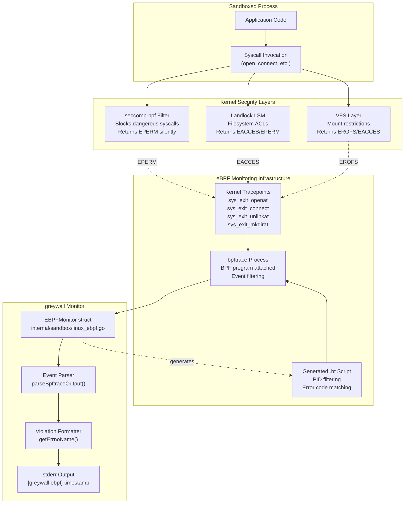
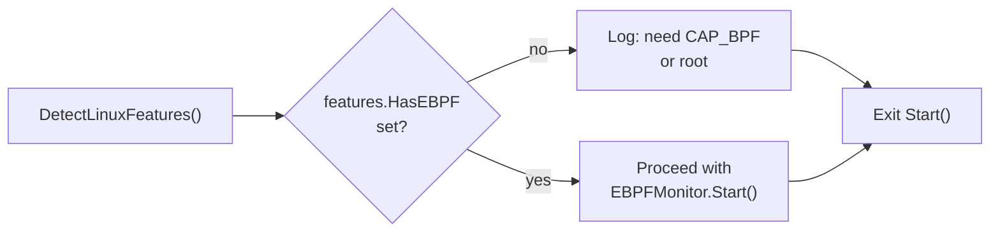
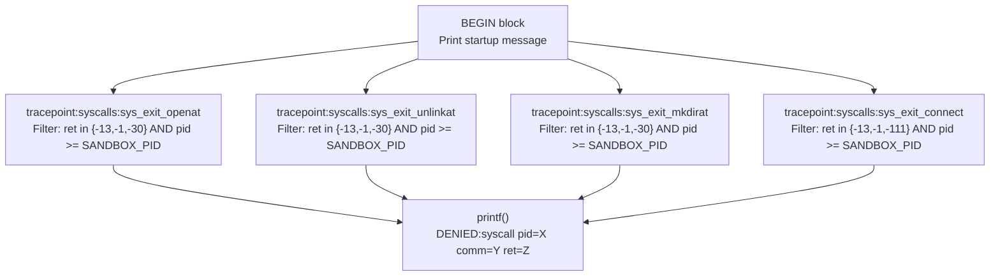
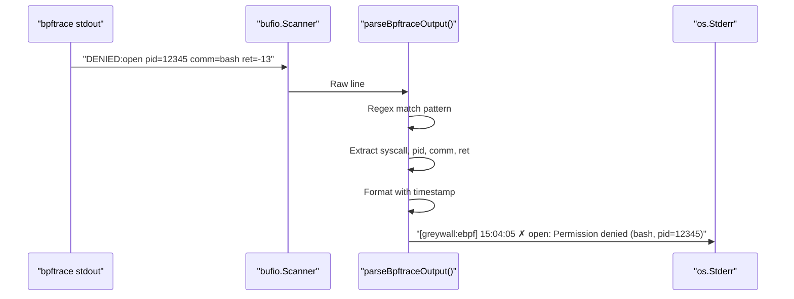

<!-- source: DeepWiki mcp.deepwiki.com · repo GreyhavenHQ/greywall · extra page eBPF Violation Monitoring · fetched 2026-10-26 -->

# eBPF Violation Monitoring

<details>
<summary>Relevant source files</summary>

The following files were used as context for generating this wiki page:

- [internal/sandbox/linux.go](internal/sandbox/linux.go)
- [internal/sandbox/linux_ebpf.go](internal/sandbox/linux_ebpf.go)
- [internal/sandbox/linux_seccomp.go](internal/sandbox/linux_seccomp.go)
- [internal/sandbox/monitor.go](internal/sandbox/monitor.go)

</details>


## Purpose and Scope

This page describes greywall's real-time violation monitoring system on Linux using eBPF (Extended Berkeley Packet Filter). The eBPF monitor tracks denied filesystem and network operations inside the sandbox, providing visibility into policy violations that would otherwise be silent.

For information about the overall Linux sandboxing architecture, see [Linux Sandboxing](). For details on seccomp syscall filtering that triggers many of these violations, see [Seccomp Syscall Filtering](). For macOS violation monitoring, which uses a different approach based on unified logging, see [Unified Log Monitoring]().

**Sources**: [internal/sandbox/linux_ebpf.go:1-27](), [internal/sandbox/linux.go:113-137]()

---

## Why eBPF Monitoring is Needed

The greywall Linux sandbox uses seccomp-bpf filters to block dangerous syscalls at the kernel level. When a seccomp filter blocks a syscall, it returns `SECCOMP_RET_ERRNO` with `EPERM`, causing the syscall to fail silently without any logging to dmesg, audit logs, or anywhere else. This is different from `SECCOMP_RET_LOG` (which logs but doesn't block) or `SECCOMP_RET_KILL` (which terminates the process).

Without eBPF monitoring, users would have no visibility into:
- Which operations the sandbox blocked [internal/sandbox/linux_ebpf.go:179-203]()
- Why an application isn't working correctly
- What permissions need to be added to the profile

The eBPF monitor solves this by tracing syscall exit points at the kernel level and detecting when operations fail with permission-related error codes (`EPERM`, `EACCES`, `EROFS`). This provides real-time feedback about sandbox violations regardless of whether they were caused by seccomp filters, Landlock LSM, or mount-based restrictions.

**Sources**: [internal/sandbox/linux_seccomp.go:128-130](), [internal/sandbox/linux_ebpf.go:179-182]()

---

## Architecture Overview



**Diagram: eBPF monitoring architecture showing how kernel tracepoints capture syscall failures from multiple security layers**

The `EBPFMonitor` struct manages the lifecycle of the bpftrace monitoring process. It generates a custom bpftrace script targeting the specific sandbox PID, attaches to kernel tracepoints for syscall exit events, filters events by error codes, and formats violations for user consumption.

**Sources**: [internal/sandbox/linux_ebpf.go:20-35](), [internal/sandbox/linux_ebpf.go:163-205]()

---

## Feature Detection and Requirements

### Capability Requirements

eBPF tracing requires elevated privileges to attach to kernel tracepoints. The system checks for the `HasEBPF` feature which typically requires `CAP_BPF` or root privileges.

| Requirement | Description |
|------------|-------------|
| `CAP_BPF` | Modern capability for BPF operations (kernel 5.8+) |
| Root (UID 0) | Traditional superuser privileges |

The check is performed during `Start()` using `DetectLinuxFeatures()`.

**Sources**: [internal/sandbox/linux_ebpf.go:38-45]()

### Detection Flow



**Diagram: Feature detection flow for eBPF capabilities**

**Sources**: [internal/sandbox/linux_ebpf.go:38-45]()

---

## EBPFMonitor Implementation

### Struct Definition and Lifecycle

```go
type EBPFMonitor struct {
    pid        int            // Sandbox PID for filtering
    debug      bool           // Enable debug output
    cancel     context.CancelFunc  // Context cancellation
    running    bool           // Monitor state
    cmd        *exec.Cmd      // bpftrace process
    scriptPath string         // Temp script path for cleanup
}
```

**Lifecycle Methods:**

| Method | Purpose | Key Actions |
|--------|---------|-------------|
| `NewEBPFMonitor(pid, debug)` | Constructor | Initialize struct with sandbox PID [internal/sandbox/linux_ebpf.go:30-35]() |
| `Start()` | Begin monitoring | Check features, generate script, start bpftrace, spawn parser goroutine [internal/sandbox/linux_ebpf.go:38-65]() |
| `Stop()` | Cleanup | Cancel context, kill bpftrace, remove temp script [internal/sandbox/linux_ebpf.go:68-91]() |

**Sources**: [internal/sandbox/linux_ebpf.go:20-91]()

### Bpftrace Integration

The monitor uses `bpftrace` to attach BPF programs to kernel tracepoints. The `tryBpftrace()` method:

1. Locates bpftrace binary with `exec.LookPath("bpftrace")` [internal/sandbox/linux_ebpf.go:95-98]()
2. Generates custom script via `generateBpftraceScript()` [internal/sandbox/linux_ebpf.go:101]()
3. Writes script to temp file [internal/sandbox/linux_ebpf.go:104-116]()
4. Executes `bpftrace` with context cancellation [internal/sandbox/linux_ebpf.go:118]()
5. Creates pipes for stdout/stderr [internal/sandbox/linux_ebpf.go:119-127]()
6. Spawns goroutine to parse output line-by-line [internal/sandbox/linux_ebpf.go:134-145]()

**Sources**: [internal/sandbox/linux_ebpf.go:94-159]()

---

## Bpftrace Script Generation

### Script Structure

The dynamically generated bpftrace script attaches to syscall exit tracepoints and filters events by PID and error codes:



**Diagram: Structure of generated bpftrace script showing tracepoint attachments**

### Error Code Filtering

The script filters syscall return values to detect permission-related failures:

| Error Code | Symbolic Name | Meaning | Typical Source |
|------------|---------------|---------|----------------|
| `-1` | `EPERM` | Operation not permitted | seccomp-bpf filter, Landlock [internal/sandbox/linux_ebpf.go:182]() |
| `-13` | `EACCES` | Permission denied | Landlock LSM, VFS permissions [internal/sandbox/linux_ebpf.go:182]() |
| `-30` | `EROFS` | Read-only file system | Mount restrictions [internal/sandbox/linux_ebpf.go:182]() |
| `-111` | `ECONNREFUSED` | Connection refused | Network isolation [internal/sandbox/linux_ebpf.go:200]() |

**Sources**: [internal/sandbox/linux_ebpf.go:163-205]()

### PID Filtering Strategy

The script uses `pid >= SANDBOX_PID` to filter events. This is a heuristic that excludes pre-existing system processes (which have lower PIDs) while capturing sandbox processes. 

**Limitation**: This approach doesn't track actual parent-child relationships via fork/clone events because bpftrace attaches after the command starts.

**Sources**: [internal/sandbox/linux_ebpf.go:163-173]()

---

## Monitored Syscalls and Operations

### Filesystem Operations

| Tracepoint | Syscall | Detects |
|------------|---------|---------|
| `sys_exit_openat` | `openat(2)` | File open failures [internal/sandbox/linux_ebpf.go:181]() |
| `sys_exit_unlinkat` | `unlinkat(2)` | File deletion failures [internal/sandbox/linux_ebpf.go:187]() |
| `sys_exit_mkdirat` | `mkdirat(2)` | Directory creation failures [internal/sandbox/linux_ebpf.go:193]() |

### Network Operations

| Tracepoint | Syscall | Detects |
|------------|---------|---------|
| `sys_exit_connect` | `connect(2)` | Connection failures [internal/sandbox/linux_ebpf.go:199]() |

**Sources**: [internal/sandbox/linux_ebpf.go:181-203]()

---

## Event Parsing and Output

### Parsing Flow



**Diagram: Event parsing and formatting pipeline**

### Output Format

The `parseBpftraceOutput()` method transforms bpftrace output into human-readable violations:

**Input (bpftrace):**
```
DENIED:open pid=12345 comm=bash ret=-13
```

**Output (formatted):**
```
[greywall:ebpf] 15:04:05 ✗ open: Permission denied (bash, pid=12345)
```

The format includes the timestamp, a cross mark (`✗`), the syscall, a mapped error name (via `getErrnoName`), the command name, and the PID.

**Sources**: [internal/sandbox/linux_ebpf.go:209-232]()

---

## Comparison with macOS Log Monitoring

While this page covers Linux eBPF monitoring, macOS uses a fundamentally different approach via the unified logging system. Key differences:

| Aspect | Linux (eBPF) | macOS (Unified Log) |
|--------|--------------|---------------------|
| Mechanism | Kernel tracepoints via bpftrace | System log stream filtering |
| Privileges | Requires CAP_BPF or root | No special privileges needed |
| Filtering | PID-based heuristic | Session suffix string matching |
| Implementation | [internal/sandbox/linux_ebpf.go]() | [internal/sandbox/monitor.go]() |

**Sources**: [internal/sandbox/linux_ebpf.go:1-27](), [internal/sandbox/monitor.go:16-33]()

---

