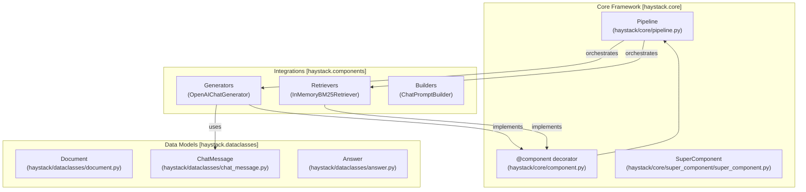
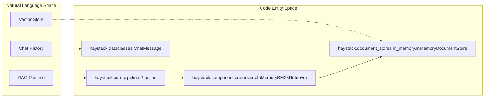

<!-- source: DeepWiki mcp.deepwiki.com · repo deepset-ai/haystack · page 1 Haystack Overview · fetched 2026-10-26 -->

# Haystack Overview

Relevant source files

The following files were used as context for generating this wiki page:

- [.gitignore](.gitignore)
- [AGENTS.md](AGENTS.md)
- [CLAUDE.md](CLAUDE.md)
- [docs-website/docs/concepts/components.mdx](docs-website/docs/concepts/components.mdx)
- [docs-website/docs/document-stores/oracledocumentstore.mdx](docs-website/docs/document-stores/oracledocumentstore.mdx)
- [docs-website/docs/document-stores/supabasedocumentstore.mdx](docs-website/docs/document-stores/supabasedocumentstore.mdx)
- [docs-website/docs/optimization/advanced-rag-techniques/hypothetical-document-embeddings-hyde.mdx](docs-website/docs/optimization/advanced-rag-techniques/hypothetical-document-embeddings-hyde.mdx)
- [docs-website/docs/overview/get-started.mdx](docs-website/docs/overview/get-started.mdx)
- [docs-website/docs/overview/migration.mdx](docs-website/docs/overview/migration.mdx)
- [docs-website/docs/pipeline-components/retrievers.mdx](docs-website/docs/pipeline-components/retrievers.mdx)
- [docs-website/docs/pipeline-components/retrievers/pgvectorembeddingretriever.mdx](docs-website/docs/pipeline-components/retrievers/pgvectorembeddingretriever.mdx)
- [docs-website/docs/pipeline-components/retrievers/sqlalchemytableretriever.mdx](docs-website/docs/pipeline-components/retrievers/sqlalchemytableretriever.mdx)
- [docs-website/docs/pipeline-components/routers/metadatarouter.mdx](docs-website/docs/pipeline-components/routers/metadatarouter.mdx)
- [docs-website/docs/pipeline-components/writers/documentwriter.mdx](docs-website/docs/pipeline-components/writers/documentwriter.mdx)
- [docs-website/sidebars.js](docs-website/sidebars.js)
- [docs-website/versioned_docs/version-2.22/overview/get-started.mdx](docs-website/versioned_docs/version-2.22/overview/get-started.mdx)
- [docs-website/versioned_docs/version-2.23/overview/get-started.mdx](docs-website/versioned_docs/version-2.23/overview/get-started.mdx)
- [docs-website/versioned_docs/version-2.30/pipeline-components/retrievers.mdx](docs-website/versioned_docs/version-2.30/pipeline-components/retrievers.mdx)
- [docs-website/versioned_docs/version-2.30/pipeline-components/retrievers/sqlalchemytableretriever.mdx](docs-website/versioned_docs/version-2.30/pipeline-components/retrievers/sqlalchemytableretriever.mdx)
- [docs-website/versioned_docs/version-2.31/pipeline-components/retrievers.mdx](docs-website/versioned_docs/version-2.31/pipeline-components/retrievers.mdx)
- [docs-website/versioned_docs/version-2.31/pipeline-components/retrievers/sqlalchemytableretriever.mdx](docs-website/versioned_docs/version-2.31/pipeline-components/retrievers/sqlalchemytableretriever.mdx)
- [docs-website/versioned_docs/version-3.0/overview/migrating-from-langgraphlangchain-to-haystack.mdx](docs-website/versioned_docs/version-3.0/overview/migrating-from-langgraphlangchain-to-haystack.mdx)
- [docs-website/versioned_docs/version-3.0/overview/migration.mdx](docs-website/versioned_docs/version-3.0/overview/migration.mdx)
- [docs-website/versioned_docs/version-3.0/pipeline-components/retrievers.mdx](docs-website/versioned_docs/version-3.0/pipeline-components/retrievers.mdx)
- [docs-website/versioned_docs/version-3.0/pipeline-components/retrievers/sqlalchemytableretriever.mdx](docs-website/versioned_docs/version-3.0/pipeline-components/retrievers/sqlalchemytableretriever.mdx)
- [docs-website/versioned_sidebars/version-2.30-sidebars.json](docs-website/versioned_sidebars/version-2.30-sidebars.json)
- [docs-website/versioned_sidebars/version-2.31-sidebars.json](docs-website/versioned_sidebars/version-2.31-sidebars.json)
- [haystack/__init__.py](haystack/__init__.py)
- [releasenotes/notes/fix-abbreviation-files-missing-6e2b42b6b49c8b25.yaml](releasenotes/notes/fix-abbreviation-files-missing-6e2b42b6b49c8b25.yaml)

## Purpose and Scope

This document provides a high-level introduction to the Haystack repository, explaining its purpose as an end-to-end LLM framework, its architectural design, core concepts, and the significant shifts introduced in the v3.0 release. Haystack is designed for building production-ready applications, focusing on "context engineering" and explicit control over data flow.

For detailed information about specific subsystems, see:
- Component and Pipeline systems: [Core Architecture](#3)
- LLM integrations: [LLM Integration](#4)
- Document processing: [Document Processing](#5)
- Advanced features (Agents, Tools): [Advanced Features](#6)

---

## What is Haystack?

Haystack is an open-source AI orchestration framework for building LLM applications in Python. It provides a modular architecture where components—such as models, vector databases, and file converters—are connected into pipelines or agentic workflows. 

**Package Name**: `haystack-ai` (published on PyPI)  
**License**: Apache 2.0  
**Python Support**: >= 3.10  

**Sources**: [haystack/version.py:1-1](), [haystack/__init__.py:1-40](), [docs-website/docs/overview/get-started.mdx:22-23]()

---

## Key Capabilities

Haystack supports a wide range of AI/LLM workflows:

| Capability | Description |
|------------|-------------|
| **Retrieval-Augmented Generation (RAG)** | Scalable systems combining vector search with LLM generation [docs-website/docs/overview/get-started.mdx:15-86](). |
| **Agentic Workflows** | Autonomous agents with iterative reasoning and tool invocation [docs-website/docs/overview/migration.mdx:89-96](). |
| **Model Agnostic** | Integrations with OpenAI, Anthropic, and Hugging Face (via core or external packages) [docs-website/docs/overview/get-started.mdx:27-210](). |
| **Modular Document Processing** | Conversion and retrieval of documents across various storage backends [docs-website/docs/pipeline-components/retrievers.mdx:10-22](). |
| **Evaluation** | Components for evaluating model outputs and retrieval quality. |

---

## High-Level Architecture

The Haystack codebase is organized into layers that separate core logic from specific integrations and data structures.

### Architectural Layers and Code Entities

**Sources**: [haystack/__init__.py:10-20](), [docs-website/docs/overview/get-started.mdx:33-39]()

---

## v3.0 Major Release Changes

Haystack v3.0 represents a significant evolution of the framework, focusing on modularity and a streamlined core.

### 1. Integration Decoupling
Many components previously in the core `haystack-ai` package have moved to dedicated integration packages in the `haystack-core-integrations` repository. This allows for independent release cycles and a leaner core.
*   **Hugging Face**: `HuggingFaceAPIChatGenerator` moved to `huggingface-api-haystack` [docs-website/docs/overview/migration.mdx:122-125]().
*   **Transformers**: Local model support moved to `transformers-haystack` [docs-website/docs/overview/migration.mdx:128-129]().

### 2. Generator Consolidation
Legacy `Generators` (e.g., `OpenAIGenerator`) have been removed in favor of `ChatGenerators`. `OpenAIChatGenerator` and others now accept both `str` and `list[ChatMessage]` as input [docs-website/docs/overview/migration.mdx:36-60]().

### 3. Agent and Tool Invocation
The `ToolInvoker` component was removed. Tool execution logic is now natively owned by the `Agent` component, which manages the loop between the LLM and tool execution [docs-website/docs/overview/migration.mdx:67-96]().

### 4. Pipeline Convergence
`AsyncPipeline` has been merged into the standard `Pipeline` class to simplify the API [docs-website/docs/overview/migration.mdx:112-112]().

**Sources**: [docs-website/docs/overview/migration.mdx:1-130]()

---

## Core Concepts

### Components
Components are the building blocks of Haystack. Any class decorated with `@component` can be added to a pipeline. They must define a `run()` method.
*   **Warm Up**: Components can implement `warm_up()` to initialize heavy resources like models.
*   **Typing**: Inputs and outputs are strictly typed for validation.

**Sources**: [haystack/__init__.py:14-14](), [docs-website/sidebars.js:45-54]()

### Pipelines
Pipelines connect components into a directed graph. The framework handles execution order and data flow between sockets.
*   **Serialization**: Pipelines can be serialized to/from dictionaries for persistence [haystack/__init__.py:17-17]().
*   **Loops**: Support for iterative execution within the graph.

**Sources**: [haystack/__init__.py:16-16](), [docs-website/sidebars.js:57-71]()

### Data Models
Haystack uses standardized dataclasses to ensure interoperability.
*   `Document`: Holds text, metadata, and embeddings [haystack/__init__.py:31-31]().
*   `ChatMessage`: Represents messages in a conversation, including system, user, assistant, and tool roles [haystack/__init__.py:28-28]().

**Sources**: [haystack/__init__.py:27-40]()

---

## Code Entity Mapping

This diagram maps natural language concepts to their specific implementations in the Haystack codebase.

**Sources**: [haystack/__init__.py:16-19](), [docs-website/docs/overview/get-started.mdx:33-41]()

---

## Development Infrastructure

Haystack uses **Hatch** for environment and dependency management. Developers should use `hatch` commands rather than raw `pip` or `python` for project tasks.

*   **Testing**: Managed via `hatch run test:unit` and `hatch run test:integration` [AGENTS.md:35-41]().
*   **Linting**: Uses Ruff for formatting [AGENTS.md:50-51]().
*   **Release Notes**: Required for every user-facing PR using `hatch run release-note` [AGENTS.md:53-59]().

**Sources**: [AGENTS.md:1-60](), [.gitignore:46-58]()

---

