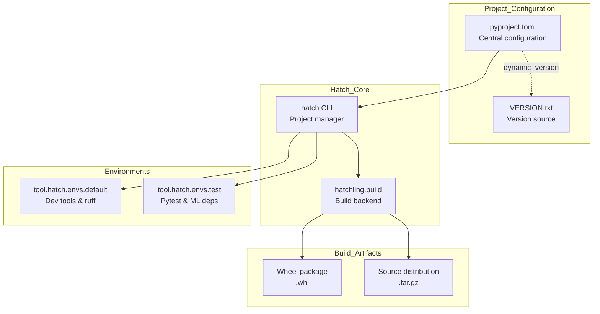
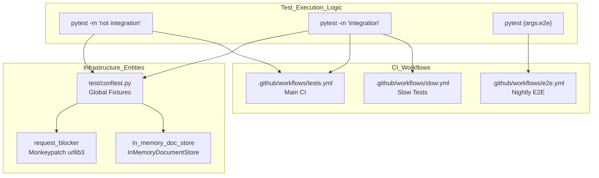

<!-- source: DeepWiki mcp.deepwiki.com · repo deepset-ai/haystack · page 2 Project Infrastructure · fetched 2026-10-26 -->

# Project Infrastructure

<details>
<summary>Relevant source files</summary>

The following files were used as context for generating this wiki page:

- [.github/dependabot.yml](.github/dependabot.yml)
- [.github/pull_request_template.md](.github/pull_request_template.md)
- [.github/workflows/codeql.yml](.github/workflows/codeql.yml)
- [.github/workflows/docker_release.yml](.github/workflows/docker_release.yml)
- [.github/workflows/docs-website-test-docs-snippets.yml](.github/workflows/docs-website-test-docs-snippets.yml)
- [.github/workflows/docstring_labeler.yml](.github/workflows/docstring_labeler.yml)
- [.github/workflows/docusaurus_sync.yml](.github/workflows/docusaurus_sync.yml)
- [.github/workflows/e2e.yml](.github/workflows/e2e.yml)
- [.github/workflows/github_release.yml](.github/workflows/github_release.yml)
- [.github/workflows/license_compliance.yml](.github/workflows/license_compliance.yml)
- [.github/workflows/nightly_testpypi_release.yml](.github/workflows/nightly_testpypi_release.yml)
- [.github/workflows/promote_unstable_docs.yml](.github/workflows/promote_unstable_docs.yml)
- [.github/workflows/push_release_notes_to_website.yml](.github/workflows/push_release_notes_to_website.yml)
- [.github/workflows/pypi_release.yml](.github/workflows/pypi_release.yml)
- [.github/workflows/release_notes.yml](.github/workflows/release_notes.yml)
- [.github/workflows/scorecard.yml](.github/workflows/scorecard.yml)
- [.github/workflows/slow.yml](.github/workflows/slow.yml)
- [.github/workflows/tests.yml](.github/workflows/tests.yml)
- [.github/workflows/workflows_linting.yml](.github/workflows/workflows_linting.yml)
- [.pre-commit-config.yaml](.pre-commit-config.yaml)
- [CONTRIBUTING.md](CONTRIBUTING.md)
- [README.md](README.md)
- [docker/Dockerfile.base](docker/Dockerfile.base)
- [docker/README.md](docker/README.md)
- [docker/docker-bake.hcl](docker/docker-bake.hcl)
- [docs-website/.gitignore](docs-website/.gitignore)
- [images/banner.png](images/banner.png)
- [pyproject.toml](pyproject.toml)
- [scripts/release_note_backticks.py](scripts/release_note_backticks.py)
- [test/conftest.py](test/conftest.py)
- [test/test_release_note_backticks.py](test/test_release_note_backticks.py)

</details>


## Purpose and Scope

This document provides an overview of the Haystack project's development infrastructure, including the build system, dependency management, testing framework, code quality tools, CI/CD pipelines, and release processes. It describes the tools and configurations that enable development, testing, and deployment of Haystack.

For detailed information on specific topics:
- Installation procedures and dependency management: see [Installation and Dependencies](#2.1)
- Testing practices and contribution workflow: see [Testing and Contribution Workflow](#2.2)
- CI/CD workflows and release automation: see [CI/CD and Release Management](#2.3)

---

## Build System and Package Management

Haystack uses **Hatch** as its primary project management tool, replacing traditional tools like setuptools and pip-tools. Hatch provides unified interfaces for environment management, building, publishing, and running development tasks.

### Project Configuration

The entire project is configured through [pyproject.toml:1-203](), which serves as the single source of truth for:

- **Build system configuration**: Uses `hatchling` as the build backend [pyproject.toml:1-3]().
- **Project metadata**: Package name (`haystack-ai`), versioning, dependencies, and supported Python versions (3.10 to 3.14) [pyproject.toml:5-43]().
- **Environment definitions**: Isolated environments for development (`default`) and testing (`test`) [pyproject.toml:65-152]().

### Version Management

Version information is maintained dynamically via Hatch, pointing to `VERSION.txt` [pyproject.toml:161-163](). This approach enables automated version bumping and ensures consistency across build artifacts.

**Build System Architecture**



Sources: [pyproject.toml:1-173]()

---

## Environment Management

Hatch creates isolated virtual environments for different development activities. Each environment has specific dependencies and scripts tailored to its purpose.

### Environment Definitions

| Environment | Purpose | Key Dependencies | Scripts |
|-------------|---------|------------------|---------|
| `default` | General development, formatting | `pre-commit`, `ruff`, `reno`, `haystack-pydoc-tools` | `release-note`, `fmt`, `fmt-check`, `docs` |
| `test` | Unit and integration testing | `pytest`, `mypy`, `transformers`, `sentence-transformers` | `unit`, `integration`, `all`, `types`, `e2e` |

### Environment Configuration

The `default` environment uses `uv` as the installer for faster dependency resolution [pyproject.toml:65-66](). The `test` environment includes a comprehensive set of optional dependencies for testing various components, such as `pandas` for converters and `rich` for Human-in-the-loop features [pyproject.toml:92-119]().

### Hatch Scripts

Each environment defines scripts that wrap common commands for consistency across developer machines and CI [pyproject.toml:79-83](), [pyproject.toml:143-152]():

```bash
# Formatting and linting
hatch run fmt                  # ruff check --fix; ruff format
hatch run fmt-check           # ruff check && ruff format --check

# Testing
hatch run test:unit           # pytest -m "not integration"
hatch run test:integration    # pytest -m "integration"
hatch run test:types          # mypy --install-types
```

Sources: [pyproject.toml:65-152](), [CONTRIBUTING.md:21-25]()

---

## Dependency Management

Dependencies are organized to ensure minimal installations for users while providing comprehensive tooling for developers.

### Core Dependencies

The project's runtime dependencies [pyproject.toml:44-63]() include:
- **LLM Integration**: `openai>=2.6.0`
- **Validation & Logic**: `pydantic`, `jsonschema`, `Jinja2`, `MarkupSafe`
- **Graph & Utilities**: `networkx`, `numpy`, `tqdm`, `tenacity`, `lazy-imports`

### Development and Test Dependencies

The `test` environment [pyproject.toml:88-141]() pulls in heavy ML frameworks and processing libraries:
- **ML Frameworks**: `transformers`, `sentence-transformers`
- **Converters**: `pypdf`, `pdfminer.six`, `trafilatura`, `python-pptx`, `python-docx`
- **Testing Tools**: `pytest`, `pytest-cov`, `pytest-asyncio`, `mypy`

### Installation Methods

Users typically install the stable package via pip [README.md:38-44]():

```bash
pip install haystack-ai
```

Sources: [pyproject.toml:44-141](), [README.md:38-52]()

---

## Testing Framework

Haystack implements a multi-tiered testing strategy with clear definitions for test categories and automated execution in CI/CD pipelines.

### Test Categories and Markers

Tests are categorized using pytest markers to manage execution time and resource requirements [pyproject.toml:179-189]():

- **Unit Tests**: Fast, isolated tests that mock external services. Run via `hatch run test:unit` [pyproject.toml:144]().
- **Integration Tests**: Tests that interact with real external resources. Run via `hatch run test:integration` [pyproject.toml:145]().
- **Slow Integration Tests**: Tests requiring special setup or model inference on CPU, marked with `slow` [pyproject.toml:188-189]().

### Test Fixtures

Common testing utilities and mocks are centralized in `test/conftest.py`, including:
- `in_memory_doc_store`: Provides a fresh `InMemoryDocumentStore` [test/conftest.py:42-47]().
- `request_blocker`: Automatically blocks unexpected HTTP requests in non-integration tests [test/conftest.py:82-97]().
- `spying_tracer`: Enables inspection of spans for tracing tests [test/conftest.py:99-109]().

**Testing Infrastructure Architecture**



Sources: [pyproject.toml:143-152](), [test/conftest.py:1-147](), [.github/workflows/tests.yml:114-147]()

---

## Code Quality and CI/CD

The project enforces high code standards through automated linting, type checking, and license verification.

### Code Quality Tools
- **Ruff**: Handles both linting and formatting [pyproject.toml:81-82]().
- **Mypy**: Enforces static typing across the core and selected test directories [pyproject.toml:152]().
- **Hawkeye**: Checks for the presence of license headers in all files [.github/workflows/tests.yml:91-92]().

### CI/CD Pipeline
The primary CI workflow, `tests.yml`, orchestrates several stages:
1. **Check if changed**: Determines if relevant code files were modified [.github/workflows/tests.yml:39-65]().
2. **Format & Lint**: Runs `ruff` and license checks [.github/workflows/tests.yml:66-93]().
3. **Unit Tests**: Runs across Ubuntu, Windows, and macOS [.github/workflows/tests.yml:114-148]().
4. **Mypy**: Performs type checking on changed files [.github/workflows/tests.yml:175-212]().

### Release Automation
- **PyPI Release**: Triggered by version tags (e.g., `v3.x.x`), builds and publishes the package [.github/workflows/pypi_release.yml:1-39]().
- **Docker Release**: Builds and pushes base images to DockerHub on main branch updates or tags [.github/workflows/docker_release.yml:1-69]().
- **Release Notes**: Enforced via `reno`. PRs must include a release note unless maintenance-only [CONTRIBUTING.md:25]().

Sources: [.github/workflows/tests.yml:1-212](), [.github/workflows/pypi_release.yml:1-39](), [.github/workflows/docker_release.yml:1-89](), [CONTRIBUTING.md:20-28]()

---

