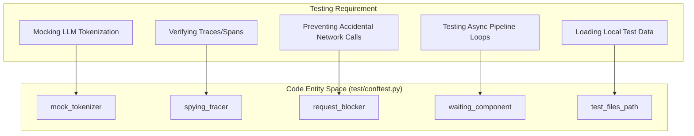
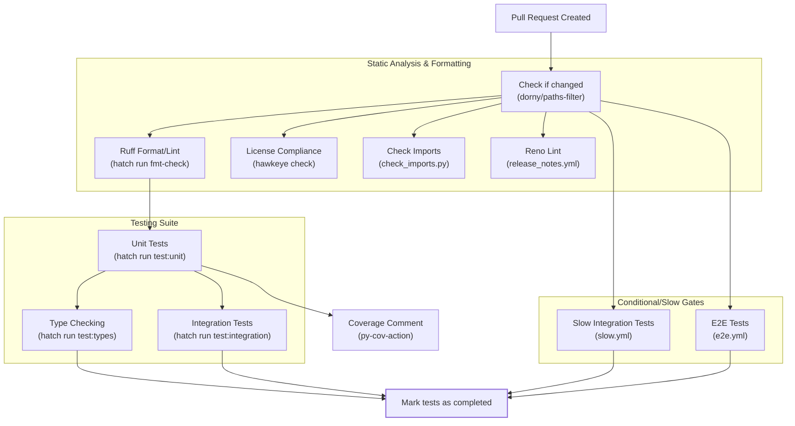

<!-- source: DeepWiki mcp.deepwiki.com · repo deepset-ai/haystack · page 2.2 Testing and Contribution Workflow · fetched 2026-10-26 -->

# Testing and Contribution Workflow

<details>
<summary>Relevant source files</summary>

The following files were used as context for generating this wiki page:

- [.clusterfuzzlite/Dockerfile](.clusterfuzzlite/Dockerfile)
- [.clusterfuzzlite/build.sh](.clusterfuzzlite/build.sh)
- [.clusterfuzzlite/project.yaml](.clusterfuzzlite/project.yaml)
- [.github/labeler.yml](.github/labeler.yml)
- [.github/pull_request_template.md](.github/pull_request_template.md)
- [.github/workflows/cflite_pr.yml](.github/workflows/cflite_pr.yml)
- [.github/workflows/docs-website-test-docs-snippets.yml](.github/workflows/docs-website-test-docs-snippets.yml)
- [.github/workflows/docstring_labeler.yml](.github/workflows/docstring_labeler.yml)
- [.github/workflows/docusaurus_sync.yml](.github/workflows/docusaurus_sync.yml)
- [.github/workflows/e2e.yml](.github/workflows/e2e.yml)
- [.github/workflows/labeler.yml](.github/workflows/labeler.yml)
- [.github/workflows/license_compliance.yml](.github/workflows/license_compliance.yml)
- [.github/workflows/nightly_testpypi_release.yml](.github/workflows/nightly_testpypi_release.yml)
- [.github/workflows/project.yml](.github/workflows/project.yml)
- [.github/workflows/promote_unstable_docs.yml](.github/workflows/promote_unstable_docs.yml)
- [.github/workflows/push_release_notes_to_website.yml](.github/workflows/push_release_notes_to_website.yml)
- [.github/workflows/pypi_release.yml](.github/workflows/pypi_release.yml)
- [.github/workflows/release_notes.yml](.github/workflows/release_notes.yml)
- [.github/workflows/slow.yml](.github/workflows/slow.yml)
- [.github/workflows/stale.yml](.github/workflows/stale.yml)
- [.github/workflows/tests.yml](.github/workflows/tests.yml)
- [.pre-commit-config.yaml](.pre-commit-config.yaml)
- [CONTRIBUTING.md](CONTRIBUTING.md)
- [README.md](README.md)
- [docs-website/.gitignore](docs-website/.gitignore)
- [docs-website/scripts/setup-dev.sh](docs-website/scripts/setup-dev.sh)
- [docs-website/scripts/test_python_snippets.py](docs-website/scripts/test_python_snippets.py)
- [docs-website/src/components/ClickableImage/index.tsx](docs-website/src/components/ClickableImage/index.tsx)
- [docs-website/src/components/ClickableImage/styles.module.css](docs-website/src/components/ClickableImage/styles.module.css)
- [docs-website/src/components/ProductOnly/index.tsx](docs-website/src/components/ProductOnly/index.tsx)
- [docs-website/src/pages/index.js](docs-website/src/pages/index.js)
- [images/banner.png](images/banner.png)
- [licenserc.toml](licenserc.toml)
- [pyproject.toml](pyproject.toml)
- [scripts/release_note_backticks.py](scripts/release_note_backticks.py)
- [test/conftest.py](test/conftest.py)
- [test/fuzz/README.md](test/fuzz/README.md)
- [test/fuzz/corpus/fuzz_document_from_dict/flattened_meta.json](test/fuzz/corpus/fuzz_document_from_dict/flattened_meta.json)
- [test/fuzz/corpus/fuzz_document_from_dict/minimal.json](test/fuzz/corpus/fuzz_document_from_dict/minimal.json)
- [test/fuzz/corpus/fuzz_document_from_dict/with_meta.json](test/fuzz/corpus/fuzz_document_from_dict/with_meta.json)
- [test/fuzz/corpus/fuzz_document_from_dict/with_score_embedding.json](test/fuzz/corpus/fuzz_document_from_dict/with_score_embedding.json)
- [test/test_release_note_backticks.py](test/test_release_note_backticks.py)

</details>


This document describes the testing infrastructure, contribution workflow, and code quality standards for the Haystack repository. It covers how to set up a development environment, run tests locally, write different types of tests, and submit contributions that meet project quality standards.

For information about CI/CD pipelines and release automation, see [CI/CD and Release Management](2.3). For general installation and dependency management, see [Installation and Dependencies](2.1).

---

## Purpose and Scope

This page explains:
- How to configure a local development environment using Hatch.
- The testing infrastructure built on `pytest` with custom fixtures and markers.
- How to run different test categories (unit, integration, e2e, slow).
- Code quality tools (Ruff, Mypy) and their configurations.
- The workflow for contributing code, including pre-commit hooks and release notes.
- Fuzz testing setup for robustness against malformed data.

---

## Development Environment Setup

### Installing Hatch

Haystack uses [Hatch](https://hatch.pypa.io/) as its primary project manager for virtual environments, building, and test execution [[pyproject.toml:1-3](). The Hatch version used in CI is `1.16.5` [[.github/workflows/tests.yml:33-33](), [.github/workflows/e2e.yml:19-19]()].

Verify installation:
```bash
hatch --version
```

**Sources:** [pyproject.toml:1-3](), [.github/workflows/tests.yml:33-33](), [.github/workflows/e2e.yml:19-19]()

### Cloning and Environment Setup

Fork the repository on GitHub, then clone your fork:

```bash
git clone https://github.com/YOUR-USERNAME/haystack
cd haystack
```

Install pre-commit hooks and create a branch:
```bash
pre-commit install
git checkout -b your-feature-branch
```

**Sources:** [CONTRIBUTING.md:21-21](), [CONTRIBUTING.md:49-50]()

### Pre-commit Hooks

Pre-commit hooks enforce code quality before commits. The configuration in [.pre-commit-config.yaml]() includes:
- **Standard hooks**: AST validation, JSON/YAML/TOML syntax checking, and trailing whitespace removal [[.pre-commit-config.yaml:4-17]()].
- **Ruff**: Runs `ruff-check` with `--fix` and `ruff-format` [[.pre-commit-config.yaml:19-24]()].
- **Codespell**: Checks for common misspellings using configurations in `pyproject.toml` [[.pre-commit-config.yaml:36-43](), [pyproject.toml:174-178]()].
- **Actionlint**: Validates GitHub Actions workflow syntax [[.pre-commit-config.yaml:44-49]()].

**Sources:** [.pre-commit-config.yaml:1-52](), [pyproject.toml:174-178](), [CONTRIBUTING.md:21-21]()

---

## Test Infrastructure

### Hatch Test Environments

Haystack defines several Hatch environments in [pyproject.toml]() to manage dependencies and test execution:

| Environment | Purpose | Key Dependencies |
|-------------|---------|------------------|
| `default` | Linting and release notes | `pre-commit`, `ruff`, `reno`, `haystack-pydoc-tools` [[pyproject.toml:65-77]()] |
| `test` | Main testing suite | `pytest`, `transformers`, `pandas`, `openai`, `mypy`, `numpy>=2` [[pyproject.toml:85-141]()] |

**Sources:** [pyproject.toml:65-141]()

### Hatch Scripts for Testing

Test execution is standardized through Hatch scripts [[pyproject.toml:143-152]()]:

```toml
[tool.hatch.envs.test.scripts]
unit = 'pytest --cov="haystack" -m "not integration" {args:test}'
integration = 'pytest --maxfail=5 -m "integration" {args:test}'
integration-only-fast = 'pytest --maxfail=5 -m "integration and not slow" {args:test}'
integration-only-slow = 'pytest --maxfail=5 -m "integration and slow" {args:test}'
all = 'pytest {args:test}'
e2e = 'pytest {args:e2e}'
types = "mypy --install-types --non-interactive --cache-dir=.mypy_cache/ {args:haystack test/core/ ...}"
```

**Sources:** [pyproject.toml:143-152]()

### Pytest Configuration and Fixtures

#### conftest.py Fixtures

The [test/conftest.py]() file provides shared fixtures used across the suite:

| Fixture | Description |
|---------|-------------|
| `in_memory_doc_store` | Provides a fresh `InMemoryDocumentStore` and shuts it down after use [[test/conftest.py:42-47]()]. |
| `waiting_component` | Returns a `Waiter` component class with `run` and `run_async` methods for testing concurrency [[test/conftest.py:49-63]()]. |
| `mock_tokenizer` | A mock object that tokenizes by splitting on spaces [[test/conftest.py:66-74]()]. |
| `request_blocker` | **Autouse fixture** that blocks HTTP requests in non-integration tests using monkeypatching [[test/conftest.py:82-97]()]. |
| `spying_tracer` | Enables and provides a `SpyingTracer` for verifying observability data [[test/conftest.py:99-109]()]. |
| `del_hf_env_vars` | Deletes Hugging Face tokens to prevent API failures in fork-based PRs [[test/conftest.py:134-147]()]. |

**Sources:** [test/conftest.py:42-147]()

#### Natural Language to Code Entity Space: Testing Fixtures

The following diagram maps common testing requirements to specific code entities defined in the testing infrastructure.



**Sources:** [test/conftest.py:49-63](), [test/conftest.py:66-74](), [test/conftest.py:77-80](), [test/conftest.py:82-97](), [test/conftest.py:99-109]()

---

## Running Tests Locally

### Unit and Integration Tests

- **Unit Tests**: Run with `hatch run test:unit`. These exclude any tests marked as `integration` [[pyproject.toml:144-144]()].
- **Integration Tests**: Run with `hatch run test:integration`. These include tests that interact with external services or complex local models [[pyproject.toml:145-145]()].
- **Type Checking**: Run with `hatch run test:types`. This executes `mypy` on the core library and selected test directories [[pyproject.toml:152-152]()].

**Sources:** [pyproject.toml:144-152](), [CONTRIBUTING.md:22-23]()

### Slow Integration Tests

Tests marked with `@pytest.mark.slow` are handled by a dedicated workflow. These typically involve heavy model inference or unstable external services [[pyproject.toml:186-189]()].

Run slow tests locally:
```bash
hatch run test:integration-only-slow
```

**Sources:** [pyproject.toml:147-147](), [.github/workflows/slow.yml:67-102]()

---

## Fuzz Testing

Haystack uses **ClusterFuzzLite** and **Atheris** for fuzz testing to identify edge-case crashes and security vulnerabilities [[.clusterfuzzlite/Dockerfile:5-9]()].

- **Docker Setup**: The build environment is based on `gcr.io/oss-fuzz-base/base-builder-python` [[.clusterfuzzlite/Dockerfile:9-9]()].
- **Corpus**: Initial seeds for fuzzing are stored in `test/fuzz/corpus/`, including JSON structures for `Document` serialization [[test/fuzz/corpus/fuzz_document_from_dict/minimal.json:1-1]()].
- **Build Script**: The `.clusterfuzzlite/build.sh` script (referenced in [[.clusterfuzzlite/Dockerfile:13-13]()]) compiles the targets.

**Sources:** [.clusterfuzzlite/Dockerfile:1-14](), [test/fuzz/README.md]()

---

## Code Quality Standards

### Ruff (Formatting and Linting)

Haystack uses Ruff for both linting and formatting. The configuration is managed in `pyproject.toml` [[pyproject.toml:291-376]()].
- **Line Length**: 120 characters [[pyproject.toml:292-292]()].
- **Lint Rules**: Includes `ASYNC`, `PERF`, `PYI`, `RUF`, and `PL` (Pylint) categories [[pyproject.toml:296-330]()].

**Commands**:
- `hatch run fmt`: Fixes lint errors and formats code [[pyproject.toml:81-81]()].
- `hatch run fmt-check`: Verifies compliance without modifying files [[pyproject.toml:82-82]()].

**Sources:** [pyproject.toml:81-82](), [pyproject.toml:291-376]()

### Mypy (Type Checking)

Mypy configuration enforces typing standards across the core library [[pyproject.toml:194-201]()].
- `check_untyped_defs = true` [[pyproject.toml:196-196]()]
- `disallow_incomplete_defs = true` [[pyproject.toml:197-197]()]

**Sources:** [pyproject.toml:194-201]()

---

## Contribution Workflow

### Pull Request Requirements

1. **Pick an Issue**: Look for `good first issue` or `contributions wanted` labels [[CONTRIBUTING.md:20-20]()].
2. **Release Notes**: Every PR (except documentation or CI-only changes) requires a release note created via `reno` [[CONTRIBUTING.md:25-25]()].
   - Command: `hatch run release-note your-change-name` [[pyproject.toml:80-80]()].
3. **Conventional Commits**: Use titles like `feat:`, `fix:`, or `docs:` [[CONTRIBUTING.md:26-26]()].
4. **CLA**: Sign the Contributor License Agreement when prompted [[CONTRIBUTING.md:27-27]()].

**Sources:** [CONTRIBUTING.md:20-27](), [pyproject.toml:80-80]()

### Release Note Validation

The `Check Release Notes` workflow ensures that YAML files in `releasenotes/notes/` follow formatting rules [[.github/workflows/release_notes.yml:1-22]()].
- **Check for missing notes**: Fails if code changes exist without a corresponding YAML in `releasenotes/notes/`, unless the `ignore-for-release-notes` label is present [[.github/workflows/release_notes.yml:45-53]()].
- **Formatting**: Reno requires reStructuredText. The CI checks for Markdown-style triple backticks or single backticks and fails if found [[.github/workflows/release_notes.yml:72-89]()].

**Sources:** [.github/workflows/release_notes.yml:45-89]()

---

## CI/CD Pipeline Architecture

The following diagram illustrates the flow from a code contribution (Pull Request) through the automated quality gates.



**Sources:** [.github/workflows/tests.yml:39-175](), [.github/workflows/slow.yml:39-110](), [.github/workflows/e2e.yml:25-44](), [.github/workflows/release_notes.yml:22-63]()

---

