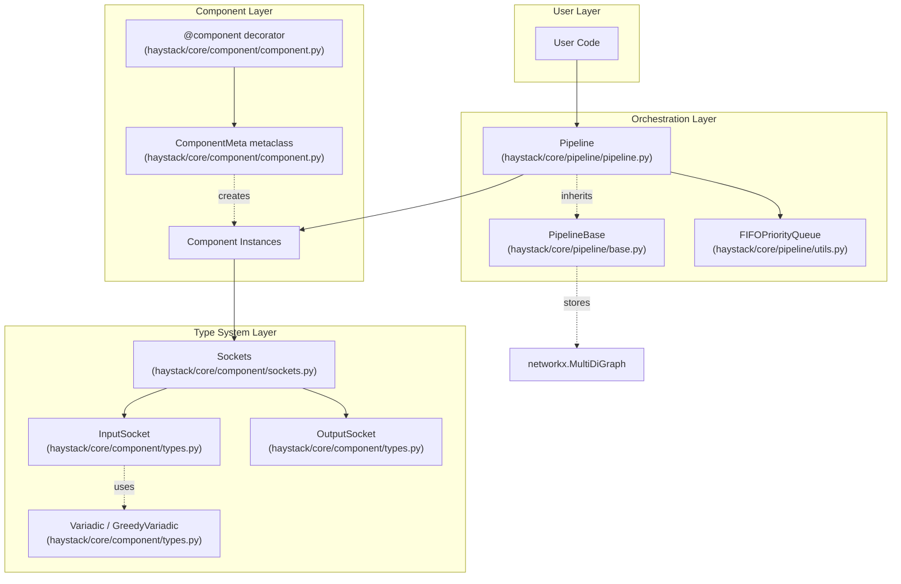
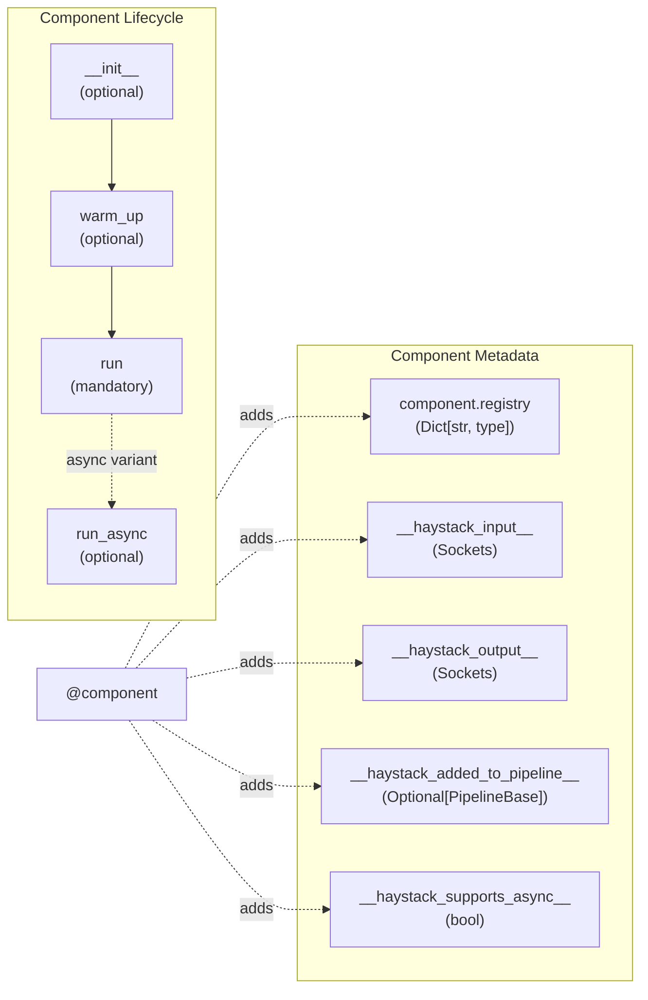
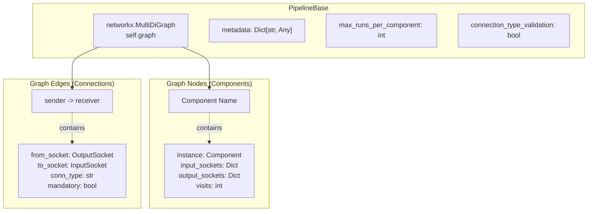
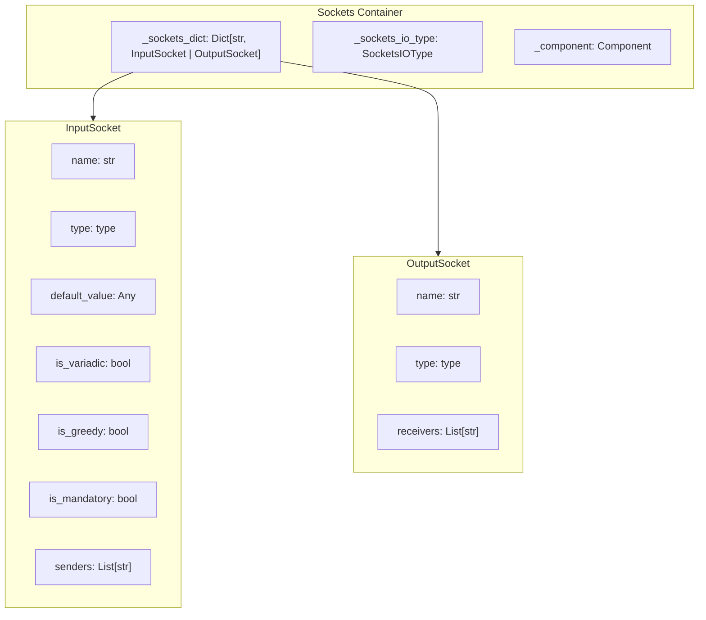
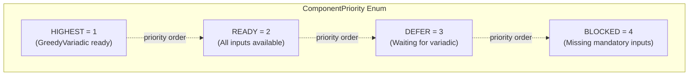
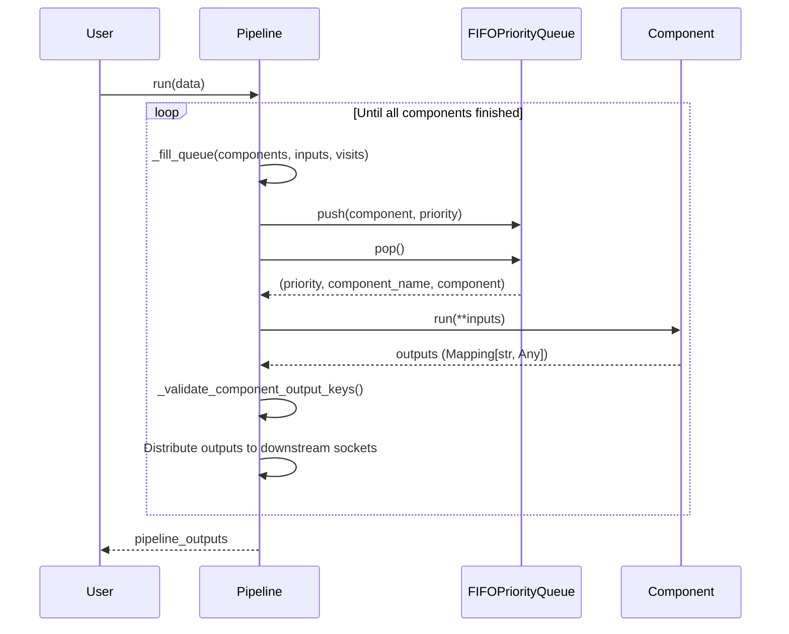
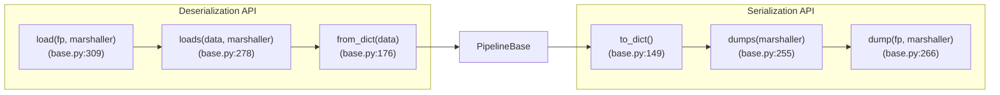

<!-- source: DeepWiki mcp.deepwiki.com · repo deepset-ai/haystack · page 3 Core Architecture · fetched 2026-10-26 -->

# Core Architecture

<details>
<summary>Relevant source files</summary>

The following files were used as context for generating this wiki page:

- [haystack/core/component/component.py](haystack/core/component/component.py)
- [haystack/core/component/sockets.py](haystack/core/component/sockets.py)
- [haystack/core/component/types.py](haystack/core/component/types.py)
- [haystack/core/errors.py](haystack/core/errors.py)
- [haystack/core/pipeline/base.py](haystack/core/pipeline/base.py)
- [haystack/core/pipeline/breakpoint.py](haystack/core/pipeline/breakpoint.py)
- [haystack/core/pipeline/component_checks.py](haystack/core/pipeline/component_checks.py)
- [haystack/core/pipeline/descriptions.py](haystack/core/pipeline/descriptions.py)
- [haystack/core/pipeline/pipeline.py](haystack/core/pipeline/pipeline.py)
- [haystack/core/pipeline/utils.py](haystack/core/pipeline/utils.py)
- [haystack/dataclasses/breakpoints.py](haystack/dataclasses/breakpoints.py)
- [releasenotes/notes/allow-break-point-with-pipeline-snapshot-686cbbecc7ca0ae3.yaml](releasenotes/notes/allow-break-point-with-pipeline-snapshot-686cbbecc7ca0ae3.yaml)
- [releasenotes/notes/async-component-support-machinery-6ea4496241aeb3b2.yaml](releasenotes/notes/async-component-support-machinery-6ea4496241aeb3b2.yaml)
- [releasenotes/notes/cancel-in-flight-tasks-on-error-8b9623a305717328.yaml](releasenotes/notes/cancel-in-flight-tasks-on-error-8b9623a305717328.yaml)
- [releasenotes/notes/fix-asyncpipeline-run-error-e82ede5c4f37f485.yaml](releasenotes/notes/fix-asyncpipeline-run-error-e82ede5c4f37f485.yaml)
- [releasenotes/notes/fix-deepcopy-namedtuple-c7aa157bc9aef85b.yaml](releasenotes/notes/fix-deepcopy-namedtuple-c7aa157bc9aef85b.yaml)
- [releasenotes/notes/fix-pipeline-mandatory-inputs-b2f63cfbb3cb20ff.yaml](releasenotes/notes/fix-pipeline-mandatory-inputs-b2f63cfbb3cb20ff.yaml)
- [releasenotes/notes/fix-pipeline-snapshot-resume-in-loops-0ab593c343026abb.yaml](releasenotes/notes/fix-pipeline-snapshot-resume-in-loops-0ab593c343026abb.yaml)
- [releasenotes/notes/fix-set-output-types-async-check-2e5d578a3ccdcc59.yaml](releasenotes/notes/fix-set-output-types-async-check-2e5d578a3ccdcc59.yaml)
- [releasenotes/notes/fix-variadic-unsubscripted-indexerror-32788f5484bd3b5c.yaml](releasenotes/notes/fix-variadic-unsubscripted-indexerror-32788f5484bd3b5c.yaml)
- [releasenotes/notes/pipeline-draw-deprecation-3ba4b047de73d031.yaml](releasenotes/notes/pipeline-draw-deprecation-3ba4b047de73d031.yaml)
- [releasenotes/notes/pipeline-io-connected-sockets-db862d045944f788.yaml](releasenotes/notes/pipeline-io-connected-sockets-db862d045944f788.yaml)
- [releasenotes/notes/remove-deprecated-param-from-pipeline-6b05ce1ff1f7fdec.yaml](releasenotes/notes/remove-deprecated-param-from-pipeline-6b05ce1ff1f7fdec.yaml)
- [test/core/component/test_component.py](test/core/component/test_component.py)
- [test/core/component/test_sockets.py](test/core/component/test_sockets.py)
- [test/core/component/test_types.py](test/core/component/test_types.py)
- [test/core/pipeline/features/README.md](test/core/pipeline/features/README.md)
- [test/core/pipeline/features/conftest.py](test/core/pipeline/features/conftest.py)
- [test/core/pipeline/features/pipeline_run.feature](test/core/pipeline/features/pipeline_run.feature)
- [test/core/pipeline/features/test_run.py](test/core/pipeline/features/test_run.py)
- [test/core/pipeline/test_async_pipeline.py](test/core/pipeline/test_async_pipeline.py)
- [test/core/pipeline/test_breakpoint.py](test/core/pipeline/test_breakpoint.py)
- [test/core/pipeline/test_component_checks.py](test/core/pipeline/test_component_checks.py)
- [test/core/pipeline/test_pipeline.py](test/core/pipeline/test_pipeline.py)
- [test/core/pipeline/test_pipeline_base.py](test/core/pipeline/test_pipeline_base.py)
- [test/core/pipeline/test_utils.py](test/core/pipeline/test_utils.py)

</details>


## Purpose and Scope

This document describes the foundational architecture of Haystack, focusing on the core abstractions that enable building composable AI pipelines: **Components** and **Pipelines**. It explains how these systems work together to orchestrate component execution, manage data flow, and handle concurrency.

For detailed information about specific systems:
- Component implementation details: see [Component System](#3.1)
- Pipeline execution mechanics: see [Pipeline System](#3.2)
- Document and Answer data structures: see [Core Module and Data Structures](#3.3)
- Observability and Tracing: see [Observability and Tracing](#3.4)

---

## Architecture Overview

Haystack's core architecture consists of three primary layers that work together to execute AI workflows:



**Sources:** [haystack/core/pipeline/base.py:82-114](), [haystack/core/pipeline/pipeline.py:117-123](), [haystack/core/component/component.py:187-212](), [haystack/core/pipeline/base.py:111-111]()

The architecture enforces a clear separation of concerns:

| Layer | Responsibility | Key Classes |
|-------|---------------|-------------|
| **User Layer** | Define pipeline structure and component connections | User-defined components, Pipeline construction |
| **Orchestration Layer** | Execute components in correct order, manage data flow | `Pipeline`, `PipelineBase`, `FIFOPriorityQueue` |
| **Component Layer** | Define component contract, validate structure | `@component`, `ComponentMeta`, `Component` protocol |
| **Type System Layer** | Define input/output contracts, enable type checking | `InputSocket`, `OutputSocket`, `Sockets`, `Variadic` |

---

## Component Abstraction

Components are the fundamental building blocks in Haystack. The `@component` decorator transforms regular Python classes into pipeline-compatible components by enforcing a contract and adding metadata.

### Component Contract



**Sources:** [haystack/core/component/component.py:20-74](), [haystack/core/component/component.py:279-316]()

The `ComponentMeta` metaclass is invoked when a component is instantiated and performs the following operations:

1. **Parse Input Sockets**: Extract parameters from the `run()` method signature [haystack/core/component/component.py:229-278]()
2. **Parse Output Sockets**: Extract types from `@component.output_types` decorator or `component.set_output_types()` [haystack/core/component/component.py:205-227]()
3. **Validate Async Support**: Ensure `run_async` is a coroutine if present [haystack/core/component/component.py:302-304]()
4. **Register Component**: Add to global registry for serialization [haystack/core/component/component.py:586-597]()

### Component Instance Attributes

Every component instance has these special attributes added by `ComponentMeta`:

| Attribute | Type | Purpose |
|-----------|------|---------|
| `__haystack_input__` | `Sockets` | Container of `InputSocket` objects defining inputs |
| `__haystack_output__` | `Sockets` | Container of `OutputSocket` objects defining outputs |
| `__haystack_added_to_pipeline__` | `Optional[PipelineBase]` | Reference to owning pipeline (prevents reuse) |
| `__haystack_supports_async__` | `bool` | Whether component implements `run_async` |
| `__component_name__` | `str` | Name assigned when added to pipeline |

**Sources:** [haystack/core/component/component.py:279-316](), [haystack/core/pipeline/base.py:357-376]()

---

## Pipeline Orchestration

Pipelines orchestrate component execution by building a directed graph of components and their connections, then executing them in the correct order based on data dependencies.

### Pipeline Graph Structure



**Sources:** [haystack/core/pipeline/base.py:90-114](), [haystack/core/pipeline/base.py:368-376]()

### Adding Components and Connections

Components are added to the pipeline and stored in the graph:

```python
# From haystack/core/pipeline/base.py:322-376
def add_component(self, name: str, instance: Component) -> None:
    # Validation checks
    # - Name uniqueness
    # - Instance is a Component
    # - Not already added to another pipeline
    
    # Set pipeline reference
    setattr(instance, "__haystack_added_to_pipeline__", self)
    
    # Add to graph with metadata
    self.graph.add_node(
        name,
        instance=instance,
        input_sockets=instance.__haystack_input__._sockets_dict,
        output_sockets=instance.__haystack_output__._sockets_dict,
        visits=0,
    )
```

**Sources:** [haystack/core/pipeline/base.py:322-376]()

Connections are validated for type compatibility and stored as edges:

```python
# From haystack/core/pipeline/base.py:420-601
def connect(self, sender: str, receiver: str) -> "PipelineBase":
    # Parse connection strings (e.g., "comp1.output" -> ("comp1", "output"))
    # Find matching sockets by name and type
    # Validate variadic rules (only variadic sockets accept multiple senders)
    # Create edge in graph
    self.graph.add_edge(
        sender_component_name,
        receiver_component_name,
        key=f"{sender_socket.name}/{receiver_socket.name}",
        conn_type=_type_name(sender_socket.type),
        from_socket=sender_socket,
        to_socket=receiver_socket,
        mandatory=receiver_socket.is_mandatory,
    )
```

**Sources:** [haystack/core/pipeline/base.py:420-601]()

### Pipeline Variants

Haystack provides two primary pipeline execution paths within the `Pipeline` class:

| Method | Execution Model | Use Case |
|-------|----------------|----------|
| `run()` | Synchronous, sequential | Simple workflows, debugging [haystack/core/pipeline/pipeline.py:177]() |
| `run_async()` | Asynchronous, concurrent | High-throughput, I/O-bound tasks, concurrent execution [haystack/core/pipeline/pipeline.py:330]() |

Both use the same graph structure defined in `PipelineBase`, but differ in execution strategy.

**Sources:** [haystack/core/pipeline/pipeline.py:117-123](), [haystack/core/pipeline/base.py:82-87]()

---

## Socket-Based I/O System

Sockets define the input and output contracts for components, enabling type checking and automatic data routing during pipeline execution.

### Socket Types



**Sources:** [haystack/core/component/types.py:36-123](), [haystack/core/component/sockets.py:15-146]()

### Variadic Inputs

Haystack supports two types of variadic inputs for components that accept multiple inputs:

| Type | Annotation | Behavior |
|------|-----------|----------|
| **Variadic** | `Variadic[T]` | Waits for all connected inputs before running [haystack/core/component/types.py:58-75]() |
| **GreedyVariadic** | `GreedyVariadic[T]` | Runs immediately upon receiving any input [haystack/core/component/types.py:78-96]() |

**Sources:** [haystack/core/component/types.py:58-96]()

---

## Execution Model

Pipeline execution is governed by a priority-based scheduling system that determines which components can run at any given time.

### Component Priorities



**Sources:** [haystack/core/pipeline/base.py:75-80]()

### Execution Flow (Synchronous Pipeline)



**Sources:** [haystack/core/pipeline/pipeline.py:177-220](), [haystack/core/pipeline/pipeline.py:126-175]()

### Async Execution Flow

The `run_async` method utilizes `asyncio` to execute independent components concurrently. It supports components that implement `run_async` directly, while offloading standard `run` methods to a thread pool executor to maintain non-blocking behavior.

**Sources:** [haystack/core/pipeline/pipeline.py:330-360](), [haystack/utils/async_utils.py:13-35]()

---

## Error Handling and Recovery

Haystack provides comprehensive error handling with pipeline snapshots for debugging and recovery.

### Runtime Error Handling

When a component fails during execution, the pipeline captures a snapshot of the state:

```python
# From haystack/core/pipeline/pipeline.py:165-171
try:
    component_output = instance.run(**inputs_copy)
except BreakpointException as error:
    raise error
except Exception as error:
    raise PipelineRuntimeError(
        f"Component {component_name} failed: {error}",
        # ... additional context
    ) from error
```

**Sources:** [haystack/core/pipeline/pipeline.py:165-171](), [haystack/core/errors.py:73-88]()

### Breakpoints and Snapshots

Pipelines can be configured with `Breakpoint` objects to pause execution. A `PipelineSnapshot` is generated, allowing the pipeline to be resumed from the exact state of the breakpoint.

**Sources:** [haystack/core/pipeline/breakpoint.py:55-98](), [haystack/dataclasses/breakpoints.py:65-95]()

---

## Serialization and Persistence

Pipelines and components can be serialized to dictionaries or YAML for persistence and reloading.

### Serialization API



**Sources:** [haystack/core/pipeline/base.py:149-319]()

### Component Registry

All decorated components are registered in a global registry for deserialization:

```python
# From haystack/core/component/component.py:586-597
class_path = f"{new_cls.__module__}.{new_cls.__name__}"
self.registry[class_path] = new_cls
```

**Sources:** [haystack/core/component/component.py:586-597]()

---

