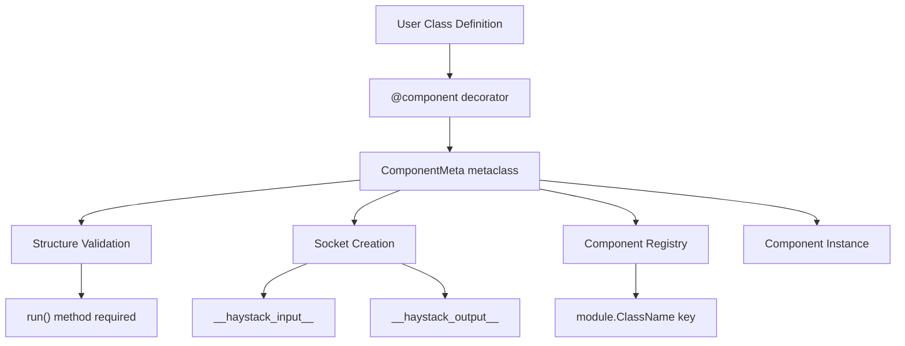
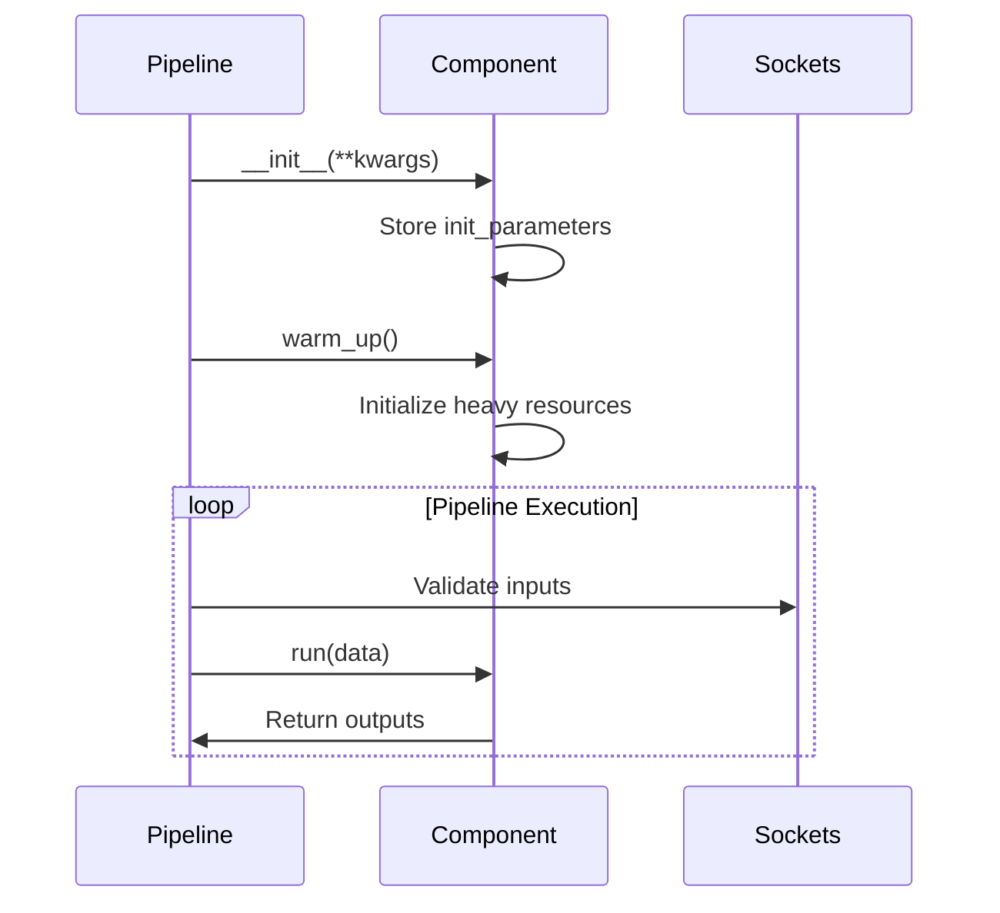
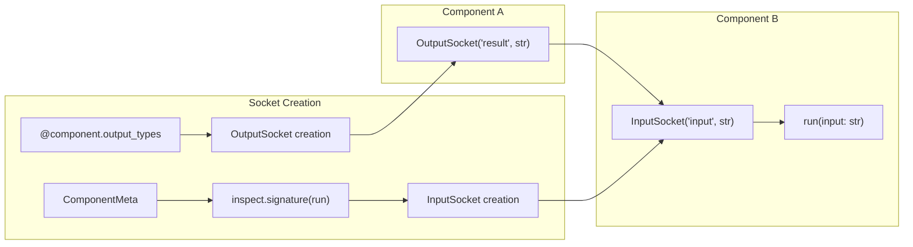
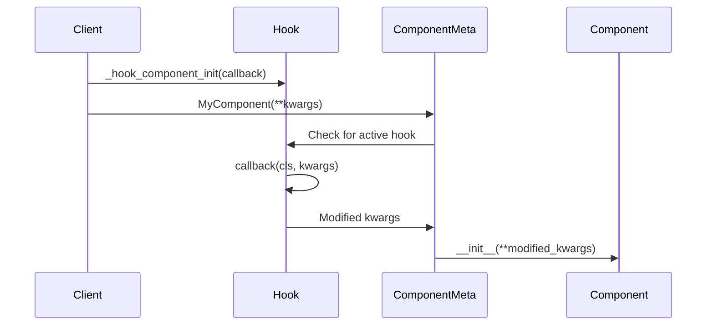

<!-- source: DeepWiki mcp.deepwiki.com · repo deepset-ai/haystack · page 3.1 Component System · fetched 2026-10-26 -->

# Component System

Relevant source files

The following files were used as context for generating this wiki page:

- [haystack/core/__init__.py](haystack/core/__init__.py)
- [haystack/core/component/component.py](haystack/core/component/component.py)
- [haystack/core/component/sockets.py](haystack/core/component/sockets.py)
- [haystack/core/component/types.py](haystack/core/component/types.py)
- [haystack/core/pipeline/descriptions.py](haystack/core/pipeline/descriptions.py)
- [haystack/core/super_component/__init__.py](haystack/core/super_component/__init__.py)
- [haystack/core/super_component/super_component.py](haystack/core/super_component/super_component.py)
- [haystack/core/super_component/utils.py](haystack/core/super_component/utils.py)
- [haystack/tools/pipeline_tool.py](haystack/tools/pipeline_tool.py)
- [releasenotes/notes/add-pipeline-viz-to-supercomponent-80165756cc777056.yaml](releasenotes/notes/add-pipeline-viz-to-supercomponent-80165756cc777056.yaml)
- [releasenotes/notes/allow-non-leaf-outputs-in-supercomponents-outputs-adf29d68636c23ba.yaml](releasenotes/notes/allow-non-leaf-outputs-in-supercomponents-outputs-adf29d68636c23ba.yaml)
- [releasenotes/notes/async-component-support-machinery-6ea4496241aeb3b2.yaml](releasenotes/notes/async-component-support-machinery-6ea4496241aeb3b2.yaml)
- [releasenotes/notes/fix-pipeline-mandatory-inputs-b2f63cfbb3cb20ff.yaml](releasenotes/notes/fix-pipeline-mandatory-inputs-b2f63cfbb3cb20ff.yaml)
- [releasenotes/notes/fix-set-output-types-async-check-2e5d578a3ccdcc59.yaml](releasenotes/notes/fix-set-output-types-async-check-2e5d578a3ccdcc59.yaml)
- [releasenotes/notes/fix-super-component-delegate-default-identity-937ee58b7e3fcb44.yaml](releasenotes/notes/fix-super-component-delegate-default-identity-937ee58b7e3fcb44.yaml)
- [releasenotes/notes/fix-type-discovery-super-component-7b80a5f5aae30e84.yaml](releasenotes/notes/fix-type-discovery-super-component-7b80a5f5aae30e84.yaml)
- [releasenotes/notes/fix-variadic-unsubscripted-indexerror-32788f5484bd3b5c.yaml](releasenotes/notes/fix-variadic-unsubscripted-indexerror-32788f5484bd3b5c.yaml)
- [releasenotes/notes/move-super-component-66cfeff486ecccb1.yaml](releasenotes/notes/move-super-component-66cfeff486ecccb1.yaml)
- [releasenotes/notes/pipeline-io-connected-sockets-db862d045944f788.yaml](releasenotes/notes/pipeline-io-connected-sockets-db862d045944f788.yaml)
- [releasenotes/notes/super-component-decorator-e699782b6500cd1c.yaml](releasenotes/notes/super-component-decorator-e699782b6500cd1c.yaml)
- [releasenotes/notes/supercomponent-class-async-serde-4bfc357570b252db.yaml](releasenotes/notes/supercomponent-class-async-serde-4bfc357570b252db.yaml)
- [test/core/component/test_component.py](test/core/component/test_component.py)
- [test/core/component/test_sockets.py](test/core/component/test_sockets.py)
- [test/core/super_component/test_super_component.py](test/core/super_component/test_super_component.py)
- [test/core/super_component/test_utils.py](test/core/super_component/test_utils.py)

The Component System is the foundational building block of the Haystack framework that enables the creation of reusable, composable units of functionality. It provides the `@component` decorator, input/output socket management, serialization mechanisms, and component lifecycle management. Components created with this system can be assembled into pipelines for LLM orchestration workflows.

For information about how components are orchestrated together, see [Pipeline System](#3.2). For details about the data structures that flow between components, see [Core Module and Data Structures](#3.3).

## Component Declaration

Components are created by decorating Python classes with the `@component` decorator. The decorator validates the class structure, creates input/output sockets, and registers the component for serialization.

Title: Component Declaration Flow

The `@component` decorator transforms regular Python classes into Haystack components through several steps:

1.  **Structure Validation**: Ensures the class has a required `run()` method [haystack/core/component/component.py:560-564]().
2.  **Metaclass Application**: Applies `ComponentMeta` to handle component creation [haystack/core/component/component.py:187-188]().
3.  **Socket Generation**: Creates input and output sockets based on method signatures [haystack/core/component/component.py:228-278]().
4.  **Registry Registration**: Stores the component class for later deserialization in `component.registry` [haystack/core/component/component.py:585-597]().

**Sources:** [haystack/core/component/component.py:187-316](), [haystack/core/component/component.py:558-606]()

### Required Methods

Every component must implement a `run()` method that defines the component's main functionality:

| Method | Required | Purpose |
| :--- | :--- | :--- |
| `run()` | Yes | Main execution logic, called by `Pipeline.run()` [haystack/core/component/component.py:58-74]() |
| `__init__()` | No | Initialization parameters (must be JSON-serializable) [haystack/core/component/component.py:20-41]() |
| `warm_up()` | No | Heavy initialization (models, backends, etc.) [haystack/core/component/component.py:49-54]() |
| `run_async()` | No | Asynchronous execution (must match `run()` signature) [haystack/core/component/component.py:219-227]() |

**Sources:** [haystack/core/component/component.py:20-74](), [test/core/component/test_component.py:16-35]()

## Component Lifecycle

Components follow a specific lifecycle managed by the Pipeline system:

Title: Component Lifecycle Sequence

### Initialization Phase

During `__init__()`, components should:
*   Store initialization parameters in `self.init_parameters` for serialization [haystack/core/component/component.py:26-31]().
*   Perform lightweight setup only; `__init__` must be extremely lightweight [haystack/core/component/component.py:43-45]().
*   Accept only JSON-serializable parameters [haystack/core/component/component.py:33-35]().

### Warm-up Phase

The `warm_up()` method is called once before pipeline execution for:
*   Loading models or establishing connections [haystack/core/component/component.py:43-45]().
*   Heavy resource initialization [haystack/core/component/component.py:43-45]().
*   Avoiding repeated initialization; Pipeline does not track which components it called `warm_up()` on [haystack/core/component/component.py:53-54]().

**Sources:** [haystack/core/component/component.py:20-54]()

## Input/Output Socket System

The socket system defines component interfaces through type-safe input and output specifications.

Title: Socket System Architecture

### Input Socket Creation

Input sockets are automatically created by inspecting the `run()` method signature [haystack/core/component/component.py:234-245]():

*   **Automatic**: Parameters become `InputSocket` objects with their type annotations [haystack/core/component/component.py:234-245]().
*   **Manual**: Use `component.set_input_types()` or `component.set_input_type()` for `**kwargs` parameters [haystack/core/component/component.py:520-542]().
*   **Default Values**: Parameters with defaults become optional inputs [haystack/core/component/component.py:68-69]().
*   **Variadic Inputs**: Using `Variadic[T]` or `GreedyVariadic[T]` annotations marks sockets as capable of accepting multiple incoming connections [haystack/core/component/types.py:23-31](). `GreedyVariadic` inputs trigger component execution as soon as the first input arrives [haystack/core/component/types.py:28-30]().

### Output Socket Creation

Output sockets are defined using the `@component.output_types()` decorator or `component.set_output_types()` [haystack/core/component/component.py:544-556](). `run()` must return a single instance of the dataclass declared via these methods [haystack/core/component/component.py:71-72]().

**Sources:** [haystack/core/component/component.py:228-278](), [haystack/core/component/component.py:520-556](), [haystack/core/component/sockets.py:15-146](), [haystack/core/component/types.py:23-31]()

### Socket Management

The `Sockets` class manages collections of input or output sockets [haystack/core/component/sockets.py:15-17]():

| Socket Type | Purpose | Key Attributes |
| :--- | :--- | :--- |
| `InputSocket` | Defines component inputs | `name`, `type`, `default_value`, `is_mandatory` [haystack/core/component/types.py:37-56]() |
| `OutputSocket` | Defines component outputs | `name`, `type`, `receivers` [haystack/core/component/types.py:124-139]() |

**Sources:** [haystack/core/component/types.py:36-139](), [haystack/core/component/sockets.py:15-146]()

## SuperComponent Wrapper

`SuperComponent` (implemented via the `_SuperComponent` class) is a special wrapper that encapsulates an entire `Pipeline` and exposes it as a single `Component` [haystack/core/super_component/super_component.py:34-41]().

Title: SuperComponent Architecture

*   **Input Mapping**: Maps SuperComponent input names to specific internal pipeline socket paths (e.g., `{"query": ["retriever.query", "prompt_builder.query"]}`) [haystack/core/super_component/super_component.py:50-53]().
*   **Output Mapping**: Maps internal pipeline output paths to SuperComponent output names [haystack/core/super_component/super_component.py:58-62]().
*   **Type Compatibility**: Automatically validates that mapped sockets have compatible types using the `_is_compatible` utility [haystack/core/super_component/utils.py:16-31]().
*   **Async Support**: Forwards `run_async` calls to the underlying pipeline's `run_async` method [haystack/core/super_component/super_component.py:147-164]().

**Sources:** [haystack/core/super_component/super_component.py:34-164](), [haystack/core/super_component/utils.py:16-192]()

## Advanced Features

### Asynchronous Component Support

Components can provide asynchronous execution through a `run_async()` method:

*   Must be a proper coroutine [haystack/core/component/component.py:221-222]().
*   Must have identical parameters and order to the `run()` method [haystack/core/component/component.py:223-224]().
*   Must have identical output types to the `run()` method [haystack/core/component/component.py:225-226]().
*   The `__haystack_supports_async__` attribute is set to `True` if a valid `run_async` is present [haystack/core/component/component.py:391-391]().

**Sources:** [haystack/core/component/component.py:219-227](), [test/core/component/test_component.py:37-60](), [releasenotes/notes/async-component-support-machinery-6ea4496241aeb3b2.yaml:4-7]()

### Component Pre-initialization Hooks

The system supports hooks that execute before component initialization [haystack/core/component/component.py:119-128](). This is managed via the `_COMPONENT_PRE_INIT_HOOK` `ContextVar` [haystack/core/component/component.py:115]().

Title: Pre-initialization Hook Sequence

**Sources:** [haystack/core/component/component.py:115-134](), [haystack/core/component/component.py:284-298]()

### Error Handling and Validation

The component system enforces its contract via `ComponentError`:

| Error Condition | Source Code Reference |
| :--- | :--- |
| Missing `run()` method | [haystack/core/component/component.py:560-564]() |
| `run_async` is not a coroutine | [haystack/core/component/component.py:341-345]() |
| Parameter mismatch between `run` and `run_async` | [haystack/core/component/component.py:347-386]() |
| Variadic input without type argument | [haystack/core/component/types.py:107-111]() |

**Sources:** [haystack/core/component/component.py:341-386](), [haystack/core/component/types.py:107-111](), [haystack/core/errors.py]()

---

