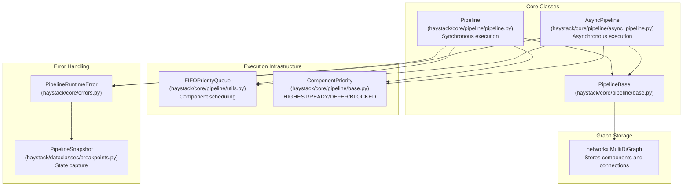
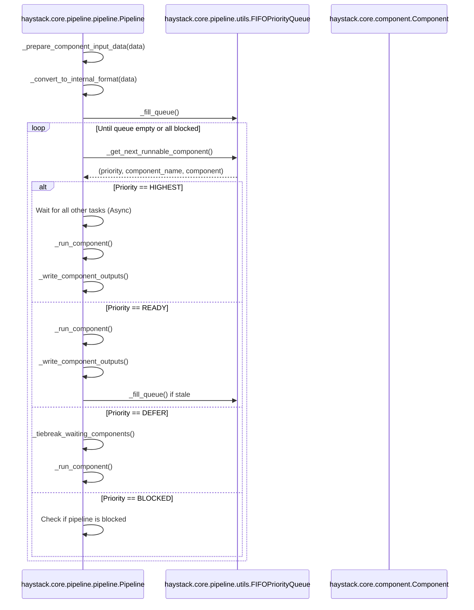

<!-- source: DeepWiki mcp.deepwiki.com · repo deepset-ai/haystack · page 3.2 Pipeline System · fetched 2026-10-26 -->

# Pipeline System

<details>
<summary>Relevant source files</summary>

The following files were used as context for generating this wiki page:

- [haystack/components/retrievers/multi_query_embedding_retriever.py](haystack/components/retrievers/multi_query_embedding_retriever.py)
- [haystack/components/retrievers/multi_query_text_retriever.py](haystack/components/retrievers/multi_query_text_retriever.py)
- [haystack/components/retrievers/multi_retriever.py](haystack/components/retrievers/multi_retriever.py)
- [haystack/components/retrievers/text_embedding_retriever.py](haystack/components/retrievers/text_embedding_retriever.py)
- [haystack/core/errors.py](haystack/core/errors.py)
- [haystack/core/pipeline/base.py](haystack/core/pipeline/base.py)
- [haystack/core/pipeline/breakpoint.py](haystack/core/pipeline/breakpoint.py)
- [haystack/core/pipeline/component_checks.py](haystack/core/pipeline/component_checks.py)
- [haystack/core/pipeline/draw.py](haystack/core/pipeline/draw.py)
- [haystack/core/pipeline/pipeline.py](haystack/core/pipeline/pipeline.py)
- [haystack/core/pipeline/utils.py](haystack/core/pipeline/utils.py)
- [haystack/core/serialization.py](haystack/core/serialization.py)
- [haystack/dataclasses/breakpoints.py](haystack/dataclasses/breakpoints.py)
- [haystack/utils/async_utils.py](haystack/utils/async_utils.py)
- [releasenotes/notes/add-run-async-to-retrievers-a265779e909abc2c.yaml](releasenotes/notes/add-run-async-to-retrievers-a265779e909abc2c.yaml)
- [releasenotes/notes/allow-break-point-with-pipeline-snapshot-686cbbecc7ca0ae3.yaml](releasenotes/notes/allow-break-point-with-pipeline-snapshot-686cbbecc7ca0ae3.yaml)
- [releasenotes/notes/cancel-in-flight-tasks-on-error-8b9623a305717328.yaml](releasenotes/notes/cancel-in-flight-tasks-on-error-8b9623a305717328.yaml)
- [releasenotes/notes/cancel-retriever-sibling-tasks-2d76cfc76a9b3ced.yaml](releasenotes/notes/cancel-retriever-sibling-tasks-2d76cfc76a9b3ced.yaml)
- [releasenotes/notes/consolidate-duplicated-class-import-logic-e60ccec6da98eee4.yaml](releasenotes/notes/consolidate-duplicated-class-import-logic-e60ccec6da98eee4.yaml)
- [releasenotes/notes/custom-mermaid-server-and-params-b88ca837375c3e0f.yaml](releasenotes/notes/custom-mermaid-server-and-params-b88ca837375c3e0f.yaml)
- [releasenotes/notes/default-serde-component-device-889de2e1f885240e.yaml](releasenotes/notes/default-serde-component-device-889de2e1f885240e.yaml)
- [releasenotes/notes/default-serde-document-store-f73db759638338f8.yaml](releasenotes/notes/default-serde-document-store-f73db759638338f8.yaml)
- [releasenotes/notes/default-serialization-b42d8fdfe37b9677.yaml](releasenotes/notes/default-serialization-b42d8fdfe37b9677.yaml)
- [releasenotes/notes/fix-asyncpipeline-run-error-e82ede5c4f37f485.yaml](releasenotes/notes/fix-asyncpipeline-run-error-e82ede5c4f37f485.yaml)
- [releasenotes/notes/fix-check-dict-nested-non-string-key-99cf9ac9341463c2.yaml](releasenotes/notes/fix-check-dict-nested-non-string-key-99cf9ac9341463c2.yaml)
- [releasenotes/notes/fix-deepcopy-namedtuple-c7aa157bc9aef85b.yaml](releasenotes/notes/fix-deepcopy-namedtuple-c7aa157bc9aef85b.yaml)
- [releasenotes/notes/fix-default-from-dict-input-mutation-e26045ee8d31e24d.yaml](releasenotes/notes/fix-default-from-dict-input-mutation-e26045ee8d31e24d.yaml)
- [releasenotes/notes/fix-multiretriever-params-c893b8d7e41afde4.yaml](releasenotes/notes/fix-multiretriever-params-c893b8d7e41afde4.yaml)
- [releasenotes/notes/fix-pipeline-snapshot-resume-in-loops-0ab593c343026abb.yaml](releasenotes/notes/fix-pipeline-snapshot-resume-in-loops-0ab593c343026abb.yaml)
- [releasenotes/notes/mermaid-timeout-d0bd83dfa90f8544.yaml](releasenotes/notes/mermaid-timeout-d0bd83dfa90f8544.yaml)
- [releasenotes/notes/pipeline-draw-deprecation-3ba4b047de73d031.yaml](releasenotes/notes/pipeline-draw-deprecation-3ba4b047de73d031.yaml)
- [releasenotes/notes/remove-deprecated-param-from-pipeline-6b05ce1ff1f7fdec.yaml](releasenotes/notes/remove-deprecated-param-from-pipeline-6b05ce1ff1f7fdec.yaml)
- [releasenotes/notes/validate-mermaid-response-b1d5c1059544cefd.yaml](releasenotes/notes/validate-mermaid-response-b1d5c1059544cefd.yaml)
- [test/components/retrievers/test_multi_query_embedding_retriever_async.py](test/components/retrievers/test_multi_query_embedding_retriever_async.py)
- [test/components/retrievers/test_multi_query_text_retriever_async.py](test/components/retrievers/test_multi_query_text_retriever_async.py)
- [test/components/retrievers/test_text_embedding_retriever_async.py](test/components/retrievers/test_text_embedding_retriever_async.py)
- [test/core/component/test_types.py](test/core/component/test_types.py)
- [test/core/pipeline/breakpoints/conftest.py](test/core/pipeline/breakpoints/conftest.py)
- [test/core/pipeline/breakpoints/test_pipeline_breakpoints_rag_hybrid.py](test/core/pipeline/breakpoints/test_pipeline_breakpoints_rag_hybrid.py)
- [test/core/pipeline/features/README.md](test/core/pipeline/features/README.md)
- [test/core/pipeline/features/conftest.py](test/core/pipeline/features/conftest.py)
- [test/core/pipeline/features/pipeline_run.feature](test/core/pipeline/features/pipeline_run.feature)
- [test/core/pipeline/features/test_run.py](test/core/pipeline/features/test_run.py)
- [test/core/pipeline/test_async_pipeline.py](test/core/pipeline/test_async_pipeline.py)
- [test/core/pipeline/test_breakpoint.py](test/core/pipeline/test_breakpoint.py)
- [test/core/pipeline/test_component_checks.py](test/core/pipeline/test_component_checks.py)
- [test/core/pipeline/test_draw.py](test/core/pipeline/test_draw.py)
- [test/core/pipeline/test_pipeline.py](test/core/pipeline/test_pipeline.py)
- [test/core/pipeline/test_pipeline_base.py](test/core/pipeline/test_pipeline_base.py)
- [test/core/pipeline/test_pipeline_crash_regular_pipeline_snapshot_is_raised.py](test/core/pipeline/test_pipeline_crash_regular_pipeline_snapshot_is_raised.py)
- [test/core/pipeline/test_utils.py](test/core/pipeline/test_utils.py)
- [test/core/test_serialization.py](test/core/test_serialization.py)
- [test/utils/test_async_utils.py](test/utils/test_async_utils.py)

</details>


## Purpose and Scope

This document describes the pipeline orchestration system in Haystack, which manages the execution of components in a directed graph. The Pipeline system is responsible for scheduling component execution, managing data flow between components, handling errors, and supporting debugging through breakpoints.

For information about creating and configuring individual components, see [Component System](3.1). For core data structures like `Document` and serialization utilities, see [Core Module and Data Structures](3.3).

---

## Pipeline Architecture Overview

The Pipeline system is built on three main classes that share common functionality through `PipelineBase`.

### Core Class Hierarchy



**Sources:** [haystack/core/pipeline/base.py:83-114](), [haystack/core/pipeline/pipeline.py:117-123](), [haystack/core/pipeline/async_pipeline.py:28-34]()

---

## Core Classes

### PipelineBase

`PipelineBase` provides common functionality for both synchronous and asynchronous pipelines. It manages the component graph, connections, serialization, and validation using `networkx.MultiDiGraph` [haystack/core/pipeline/base.py:111-111]().

| Method | Purpose |
|--------|---------|
| `add_component(name, instance)` | Adds a component to the pipeline graph [haystack/core/pipeline/base.py:322-377]() |
| `remove_component(name)` | Removes a component and its connections [haystack/core/pipeline/base.py:378-418]() |
| `connect(sender, receiver)` | Creates edges between component sockets [haystack/core/pipeline/base.py:420-601]() |
| `get_component(name)` | Retrieves a component instance by name [haystack/core/pipeline/base.py:614-623]() |
| `to_dict()` / `from_dict()` | Serializes/deserializes pipeline structure [haystack/core/pipeline/base.py:149-241]() |
| `dumps()` / `loads()` | String-based serialization using marshallers [haystack/core/pipeline/base.py:243-280]() |
| `warm_up()` | Initializes all components that implement warm-up [haystack/core/pipeline/base.py:782-812]() |
| `inputs()` / `outputs()` | Returns pipeline input/output specifications [haystack/core/pipeline/base.py:634-679]() |

**Sources:** [haystack/core/pipeline/base.py:82-812]()

### Pipeline (Synchronous)

The `Pipeline` class executes components sequentially in a single thread. Components run one at a time in priority order determined by the scheduler [haystack/core/pipeline/pipeline.py:117-123]().

**Key Method:** `run(data, include_outputs_from=None, break_point=None, pipeline_snapshot=None)` [haystack/core/pipeline/pipeline.py:208-256]()

**Sources:** [haystack/core/pipeline/pipeline.py:117-449]()

### AsyncPipeline (Asynchronous)

The `AsyncPipeline` class enables concurrent component execution when the graph structure permits [haystack/core/pipeline/async_pipeline.py:28-34]().

**Key Methods:**
- `run_async(data, include_outputs_from=None, concurrency_limit=4)` - Full async execution [haystack/core/pipeline/async_pipeline.py:208-256]()
- `run_async_generator(data, include_outputs_from=None, concurrency_limit=4)` - Streaming results [haystack/core/pipeline/async_pipeline.py:106-180]()

**Sources:** [haystack/core/pipeline/async_pipeline.py:28-581]()

---

## Execution Model

### Component Priority System

The pipeline scheduler assigns priorities via the `ComponentPriority` enum to determine execution order [haystack/core/pipeline/base.py:75-80]():

| Priority | Level | Description |
|----------|-------|-------------|
| `HIGHEST` | 1 | Components that must run in isolation (e.g., greedy variadic) [haystack/core/pipeline/base.py:76-76]() |
| `READY` | 2 | All required inputs available; can run immediately [haystack/core/pipeline/base.py:77-77]() |
| `DEFER` | 3 | Waiting for non-greedy variadic inputs; can wait for more data [haystack/core/pipeline/base.py:78-78]() |
| `BLOCKED` | 4 | Missing required inputs; cannot run [haystack/core/pipeline/base.py:79-79]() |

**Sources:** [haystack/core/pipeline/base.py:75-80]()

### Scheduling Algorithm

The pipeline uses a `FIFOPriorityQueue` [haystack/core/pipeline/utils.py:72-170]() to schedule component execution.



**Sources:** [haystack/core/pipeline/pipeline.py:208-449](), [haystack/core/pipeline/base.py:1036-1161]()

---

## Component Execution Flow

### Synchronous Pipeline Execution

The `Pipeline.run` method initializes the execution state, including `component_visits` and the `inputs_state` [haystack/core/pipeline/pipeline.py:208-230](). It then enters a loop calling `_get_next_runnable_component` until the graph is exhausted or blocked [haystack/core/pipeline/pipeline.py:270-344]().

**Sources:** [haystack/core/pipeline/pipeline.py:117-449]()

### AsyncPipeline Concurrent Execution

The `AsyncPipeline` uses `asyncio.Semaphore` to limit concurrent execution based on the `concurrency_limit` parameter [haystack/core/pipeline/async_pipeline.py:210-210](). Components that support async execution (marked with `__haystack_supports_async__`) are awaited directly [haystack/utils/async_utils.py:21-41](), while synchronous components are offloaded to `loop.run_in_executor` [haystack/utils/async_utils.py:21-41]().

**Sources:** [haystack/core/pipeline/async_pipeline.py:28-464](), [haystack/utils/async_utils.py:21-41]()

---

## Component State and Data Flow

### Input State Management

The pipeline maintains component inputs in an internal format: `dict[component_name][socket_name] = list[dict[str, Any]]` [haystack/core/pipeline/base.py:72-72]().

**Key Methods:**
- `_prepare_component_input_data(data)`: Normalizes user input format [haystack/core/pipeline/base.py:814-838]().
- `_convert_to_internal_format(data)`: Converts to internal tracking format [haystack/core/pipeline/base.py:840-862]().
- `_consume_component_inputs(component_name, component, inputs)`: Extracts inputs for a component [haystack/core/pipeline/base.py:1228-1317]().
- `_write_component_outputs(component_name, outputs, inputs, receivers)`: Distributes outputs to downstream components [haystack/core/pipeline/base.py:1319-1431]().

**Sources:** [haystack/core/pipeline/base.py:814-1431]()

### Component Visit Tracking

Each component maintains a visit count to detect infinite loops. This is checked against `_max_runs_per_component` [haystack/core/pipeline/base.py:112-112]().

**Sources:** [haystack/core/pipeline/base.py:1163-1188]()

---

## Error Handling

### PipelineRuntimeError

All component execution errors are wrapped in `PipelineRuntimeError` [haystack/core/errors.py:14-53]().

**Factory Methods:**
- `from_exception(component_name, component_type, error)`: Wraps component exceptions [haystack/core/errors.py:24-34]().
- `from_invalid_output(component_name, component_type, output)`: Handles invalid output types [haystack/core/errors.py:36-44]().

**Sources:** [haystack/core/errors.py:14-53]()

### Error Propagation and Snapshots

When a component fails, the pipeline creates a `PipelineSnapshot` [haystack/dataclasses/breakpoints.py:65-71](). This snapshot is attached to the `PipelineRuntimeError` [haystack/core/pipeline/pipeline.py:401-404]().

**Sources:** [haystack/core/pipeline/pipeline.py:384-424](), [haystack/core/pipeline/breakpoint.py:166-224]()

---

## Breakpoints and Debugging

### Breakpoint Types

Haystack supports two types of breakpoints defined in `haystack/dataclasses/breakpoints.py`:

1.  **Breakpoint**: Stops at a specific component based on name and visit count [haystack/dataclasses/breakpoints.py:21-25]().
2.  **AgentBreakpoint**: Stops within Agent component execution, often wrapping a `ToolBreakpoint` [haystack/dataclasses/breakpoints.py:53-57]().

**Sources:** [haystack/dataclasses/breakpoints.py:21-57]()

### PipelineSnapshot Structure

A `PipelineSnapshot` captures complete execution state:

```python
# Defined in haystack/dataclasses/breakpoints.py
@dataclass
class PipelineSnapshot:
    break_point: Union[Breakpoint, AgentBreakpoint]
    ordered_component_names: list[str]
    original_input_data: dict[str, Any]
    pipeline_state: PipelineState
    agent_snapshot: Optional[AgentSnapshot] = None
```

**Sources:** [haystack/dataclasses/breakpoints.py:65-71]()

### Resuming from Snapshot

To resume a pipeline from a snapshot, the `run` method accepts a `pipeline_snapshot` argument [haystack/core/pipeline/pipeline.py:208-256](). The pipeline validates the snapshot against the current graph using `_validate_pipeline_snapshot_against_pipeline` [haystack/core/pipeline/breakpoint.py:55-100]() before restoring state.

**Sources:** [haystack/core/pipeline/pipeline.py:208-256](), [haystack/core/pipeline/breakpoint.py:55-100]()

---

## Pipeline Construction

### Adding Components

Components are added using `add_component(name, instance)` [haystack/core/pipeline/base.py:322-377]().

**Validation Rules:**
- Component names must be unique [haystack/core/pipeline/base.py:344-345]().
- Names cannot contain "." [haystack/core/pipeline/base.py:341-342]().
- Name "_debug" is reserved [haystack/core/pipeline/base.py:347-348]().

**Sources:** [haystack/core/pipeline/base.py:322-377]()

### Connecting Components

Connections are created via `connect(sender, receiver)` [haystack/core/pipeline/base.py:420-601]().

**Connection Syntax:**
- Simple: `pipeline.connect("comp1", "comp2")` - Auto-match by type [haystack/core/pipeline/base.py:441-443]().
- Explicit: `pipeline.connect("comp1.output", "comp2.input")` - Specify sockets [haystack/core/pipeline/base.py:441-443]().

**Sources:** [haystack/core/pipeline/base.py:420-601]()

---

## Serialization

### Dictionary Format

Pipelines are serialized to a dictionary via `to_dict()` [haystack/core/pipeline/base.py:149-173]().

**Methods:**
- `to_dict()`: Serialize to dictionary [haystack/core/pipeline/base.py:149-173]().
- `from_dict(data, callbacks=None)`: Deserialize from dictionary [haystack/core/pipeline/base.py:176-241]().
- `dumps(marshaller=YamlMarshaller())`: Serialize to string [haystack/core/pipeline/base.py:243-255]().
- `loads(data, marshaller=YamlMarshaller())`: Deserialize from string [haystack/core/pipeline/base.py:257-280]().

**Sources:** [haystack/core/pipeline/base.py:149-320]()

### Deserialization Callbacks

`DeserializationCallbacks` [haystack/core/serialization.py:24-40]() allow customization of component instantiation, such as modifying `init_params` before a component is initialized [haystack/core/serialization.py:29-37]().

**Sources:** [haystack/core/serialization.py:24-40]()

---

