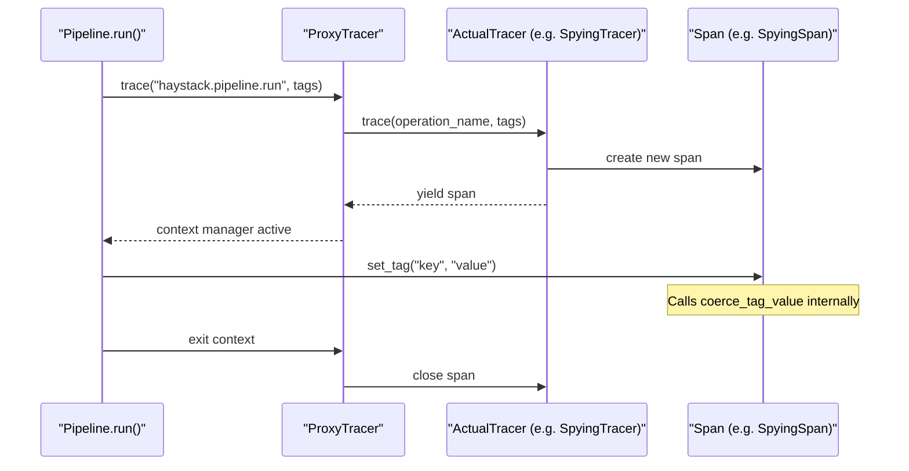
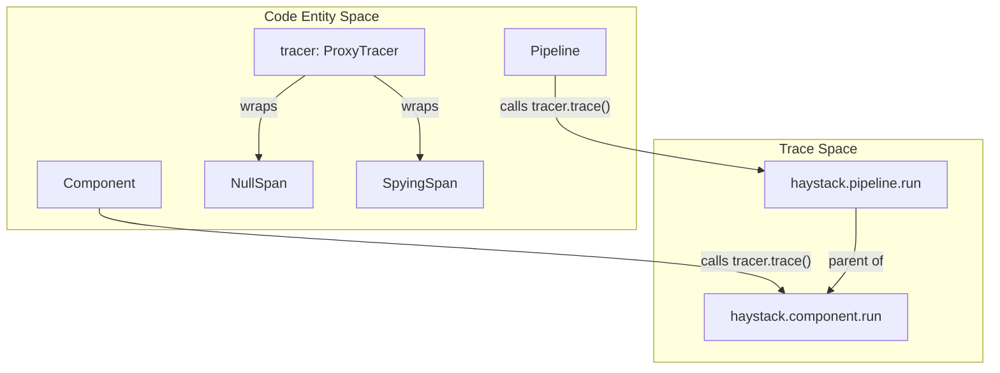

<!-- source: DeepWiki mcp.deepwiki.com · repo deepset-ai/haystack · page 3.4 Observability and Tracing · fetched 2026-10-26 -->

# Observability and Tracing

Relevant source files

The following files were used as context for generating this wiki page:

- [haystack/logging.py](haystack/logging.py)
- [haystack/tracing/__init__.py](haystack/tracing/__init__.py)
- [haystack/tracing/tracer.py](haystack/tracing/tracer.py)
- [haystack/tracing/utils.py](haystack/tracing/utils.py)
- [releasenotes/notes/fix-auto-tracing-51ed3a590000d6c8.yaml](releasenotes/notes/fix-auto-tracing-51ed3a590000d6c8.yaml)
- [releasenotes/notes/fix-logging-index-error-c58691db633542c5.yaml](releasenotes/notes/fix-logging-index-error-c58691db633542c5.yaml)
- [releasenotes/notes/fix-logs-containing-json-1393a00b4904f996.yaml](releasenotes/notes/fix-logs-containing-json-1393a00b4904f996.yaml)
- [releasenotes/notes/fix-pipeline-output-data-trace-tag-6f9e2c1a4b8d3e70.yaml](releasenotes/notes/fix-pipeline-output-data-trace-tag-6f9e2c1a4b8d3e70.yaml)
- [releasenotes/notes/logging-tty-detection-8136769cb4d1da67.yaml](releasenotes/notes/logging-tty-detection-8136769cb4d1da67.yaml)
- [releasenotes/notes/opentelemetry-tracer-33d44eb125a3145b.yaml](releasenotes/notes/opentelemetry-tracer-33d44eb125a3145b.yaml)
- [releasenotes/notes/remove-opentelemetry-tracer-9d3e1f7a4c6b8052.yaml](releasenotes/notes/remove-opentelemetry-tracer-9d3e1f7a4c6b8052.yaml)
- [releasenotes/notes/scope-logging-configuration-4a38bf0c8ea89fc9.yaml](releasenotes/notes/scope-logging-configuration-4a38bf0c8ea89fc9.yaml)
- [releasenotes/notes/structlog-contextvars-c13bb3c59a6a92c7.yaml](releasenotes/notes/structlog-contextvars-c13bb3c59a6a92c7.yaml)
- [test/core/pipeline/test_tracing.py](test/core/pipeline/test_tracing.py)
- [test/test_logging.py](test/test_logging.py)
- [test/tracing/test_tracer.py](test/tracing/test_tracer.py)
- [test/tracing/test_utils.py](test/tracing/test_utils.py)
- [test/tracing/utils.py](test/tracing/utils.py)

The observability subsystem in Haystack provides deep insights into the execution of Pipelines and Components. It consists of a multi-backend tracing infrastructure and a structured logging system. This allows developers to monitor performance, debug complex data flows, and correlate logs with distributed traces in production environments.

## Tracing Infrastructure

Haystack uses a provider-agnostic tracing architecture based on a proxy pattern. The global `tracer` instance is a `ProxyTracer` that delegates calls to an underlying implementation [haystack/tracing/tracer.py:106-123]().

### Core Abstractions

The system is built around two primary interfaces:
- **`Tracer`**: Responsible for starting new spans and accessing the current execution context [haystack/tracing/tracer.py:77-104]().
- **`Span`**: Represents a single unit of work. It supports setting tags and "content tags" (sensitive data like LLM prompts) [haystack/tracing/tracer.py:14-75]().

### Tracing Lifecycle

The following diagram illustrates how the `ProxyTracer` manages the lifecycle of a trace and interacts with specific backends.

**Trace Execution Flow**

Sources: [haystack/tracing/tracer.py:120-131](), [test/tracing/utils.py:38-56](), [haystack/tracing/utils.py:15-40]()

### Configuration and Management

Tracing is enabled or disabled globally using the following functions:
- `enable_tracing(provided_tracer)`: Sets the `actual_tracer` within the proxy [haystack/tracing/tracer.py:165-167]().
- `disable_tracing()`: Reverts the system to a `NullTracer` [haystack/tracing/tracer.py:170-172]().
- `is_tracing_enabled()`: Checks if the current tracer is not a `NullTracer` [haystack/tracing/tracer.py:175-177]().

Sources: [haystack/tracing/tracer.py:133-177]()

## Pipeline Instrumentation

When a `Pipeline` runs, it automatically instruments the execution by creating nested spans. 

1. **Root Span**: Named `haystack.pipeline.run`. It captures pipeline metadata, input data, and final output data [test/core/pipeline/test_tracing.py:44-57]().
2. **Component Spans**: Named `haystack.component.run`. These are children of the pipeline span and capture:
    - `haystack.component.name`: The string identifier in the pipeline [test/core/pipeline/test_tracing.py:61]().
    - `haystack.component.type`: The class name [test/core/pipeline/test_tracing.py:62]().
    - `haystack.component.input`: The specific inputs passed to `run()` [test/core/pipeline/test_tracing.py:66]().
    - `haystack.component.output`: The results returned by the component [test/core/pipeline/test_tracing.py:68]().

### Content Tracing
By default, sensitive data (inputs/outputs) is not traced. To enable it, the environment variable `HAYSTACK_CONTENT_TRACING_ENABLED` must be set to `true` [haystack/tracing/tracer.py:11-118](). This controls the behavior of `Span.set_content_tag` [haystack/tracing/tracer.py:49-66]().

**Tracing Entity Map**

Sources: [test/core/pipeline/test_tracing.py:38-92](), [haystack/tracing/tracer.py:106-123](), [haystack/tracing/tracer.py:133-156]()

## Structured Logging

Haystack features a structured logging system that supports both standard console output and JSON formatting.

### Configuration
Logging is configured via `haystack.logging.configure_logging()`. 

- **JSON Logging**: Enabled by setting `HAYSTACK_LOGGING_USE_JSON=true` [haystack/logging.py:19]().
- **Bypassing Structlog**: Setting `HAYSTACK_LOGGING_IGNORE_STRUCTLOG=true` prevents Haystack from configuring `structlog` [haystack/logging.py:20]().
- **Keyword Argument Patching**: Haystack patches the standard `logging` module to support keyword arguments as structured data via decorators like `patch_log_method_to_kwargs_only` [haystack/logging.py:151-169]().

### Trace-Log Correlation
Spans provide a method `get_correlation_data_for_logs()` which returns a dictionary with correlation data [haystack/tracing/tracer.py:68-74](). Implementation backends use this to inject IDs (like `trace_id` and `span_id`) into log records to allow jumping from a log entry to the corresponding trace [test/tracing/utils.py:28-29]().

Sources: [haystack/logging.py:1-201](), [test/test_logging.py:94-110]()

## Data Flow and Serialization

Because tracing backends often only support primitive types, Haystack includes a coercion layer in `haystack.tracing.utils.coerce_tag_value` [haystack/tracing/utils.py:15-40]().

1. **Primitives**: `bool`, `str`, `int`, `float` are passed through [haystack/tracing/utils.py:25-26]().
2. **Complex Objects**: The system attempts to call `_to_trace_dict()` or `to_dict()` on objects before serializing them to a JSON string [haystack/tracing/utils.py:63-67]().
3. **Large Objects**: The `_serializable_value` function can use placeholders for large objects like `ByteStream` or `ImageContent` to avoid bloating trace payloads [haystack/tracing/utils.py:42-56]().

Sources: [haystack/tracing/utils.py:1-70](), [test/tracing/test_utils.py:40-87]()

---

