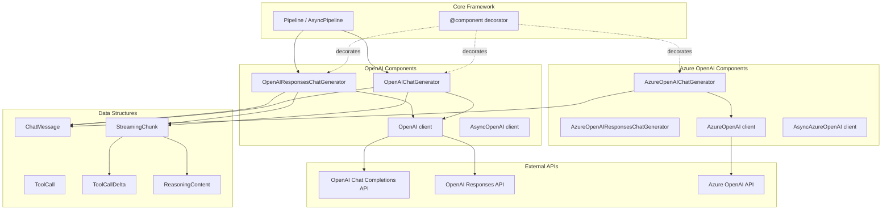
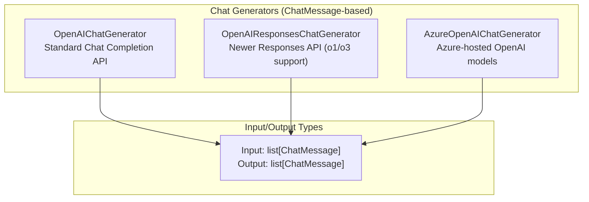
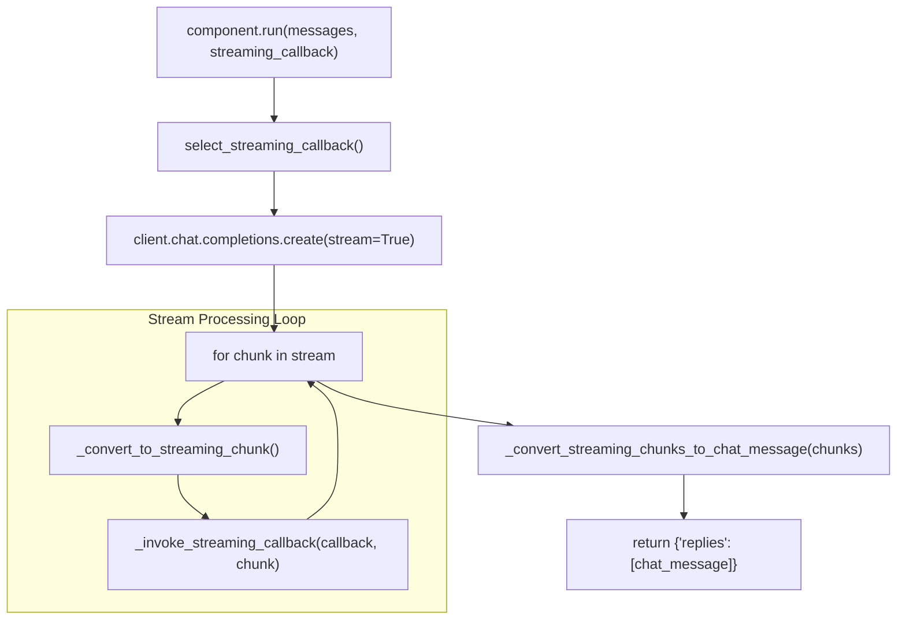

<!-- source: DeepWiki mcp.deepwiki.com · repo deepset-ai/haystack · page 4 LLM Integration · fetched 2026-10-26 -->

# LLM Integration

Relevant source files

The following files were used as context for generating this wiki page:

- [docs-website/docs/pipeline-components/embedders.mdx](docs-website/docs/pipeline-components/embedders.mdx)
- [docs-website/docs/pipeline-components/embedders/edenaidocumentembedder.mdx](docs-website/docs/pipeline-components/embedders/edenaidocumentembedder.mdx)
- [docs-website/docs/pipeline-components/embedders/edenaitextembedder.mdx](docs-website/docs/pipeline-components/embedders/edenaitextembedder.mdx)
- [docs-website/docs/pipeline-components/embedders/mockdocumentembedder.mdx](docs-website/docs/pipeline-components/embedders/mockdocumentembedder.mdx)
- [docs-website/docs/pipeline-components/embedders/mocktextembedder.mdx](docs-website/docs/pipeline-components/embedders/mocktextembedder.mdx)
- [docs-website/docs/pipeline-components/generators.mdx](docs-website/docs/pipeline-components/generators.mdx)
- [docs-website/docs/pipeline-components/generators/edenaichatgenerator.mdx](docs-website/docs/pipeline-components/generators/edenaichatgenerator.mdx)
- [docs-website/docs/pipeline-components/generators/litellmchatgenerator.mdx](docs-website/docs/pipeline-components/generators/litellmchatgenerator.mdx)
- [docs-website/docs/pipeline-components/generators/mockchatgenerator.mdx](docs-website/docs/pipeline-components/generators/mockchatgenerator.mdx)
- [docs-website/docs/pipeline-components/generators/vllmchatgenerator.mdx](docs-website/docs/pipeline-components/generators/vllmchatgenerator.mdx)
- [docs-website/versioned_docs/version-3.0/pipeline-components/embedders.mdx](docs-website/versioned_docs/version-3.0/pipeline-components/embedders.mdx)
- [docs-website/versioned_docs/version-3.0/pipeline-components/embedders/edenaidocumentembedder.mdx](docs-website/versioned_docs/version-3.0/pipeline-components/embedders/edenaidocumentembedder.mdx)
- [docs-website/versioned_docs/version-3.0/pipeline-components/embedders/edenaitextembedder.mdx](docs-website/versioned_docs/version-3.0/pipeline-components/embedders/edenaitextembedder.mdx)
- [docs-website/versioned_docs/version-3.0/pipeline-components/generators.mdx](docs-website/versioned_docs/version-3.0/pipeline-components/generators.mdx)
- [docs-website/versioned_docs/version-3.0/pipeline-components/generators/edenaichatgenerator.mdx](docs-website/versioned_docs/version-3.0/pipeline-components/generators/edenaichatgenerator.mdx)
- [haystack/components/generators/chat/azure.py](haystack/components/generators/chat/azure.py)
- [haystack/components/generators/chat/azure_responses.py](haystack/components/generators/chat/azure_responses.py)
- [haystack/components/generators/chat/fallback.py](haystack/components/generators/chat/fallback.py)
- [haystack/components/generators/chat/llm.py](haystack/components/generators/chat/llm.py)
- [haystack/components/generators/chat/openai.py](haystack/components/generators/chat/openai.py)
- [haystack/components/generators/chat/openai_responses.py](haystack/components/generators/chat/openai_responses.py)
- [haystack/components/generators/utils.py](haystack/components/generators/utils.py)
- [haystack/dataclasses/__init__.py](haystack/dataclasses/__init__.py)
- [haystack/dataclasses/streaming_chunk.py](haystack/dataclasses/streaming_chunk.py)
- [releasenotes/notes/add-reasoning-mode-openai-responses-8f1c2a6b7d3e4f5a.yaml](releasenotes/notes/add-reasoning-mode-openai-responses-8f1c2a6b7d3e4f5a.yaml)
- [releasenotes/notes/add-run-async-for-CacheChecker-a42fa8062c33466b.yaml](releasenotes/notes/add-run-async-for-CacheChecker-a42fa8062c33466b.yaml)
- [releasenotes/notes/azureopenairesponseschatgenerator-list-models-91bfe7fd2fa13ff0.yaml](releasenotes/notes/azureopenairesponseschatgenerator-list-models-91bfe7fd2fa13ff0.yaml)
- [releasenotes/notes/expose-agent-run-metadata-8f2942aba14b4f0c.yaml](releasenotes/notes/expose-agent-run-metadata-8f2942aba14b4f0c.yaml)
- [releasenotes/notes/fix-llm-comp-dynamic-inputs-1edfd14d341b8a8b.yaml](releasenotes/notes/fix-llm-comp-dynamic-inputs-1edfd14d341b8a8b.yaml)
- [releasenotes/notes/fix-openai-responses-streaming-encrypted-content-dropped.yaml](releasenotes/notes/fix-openai-responses-streaming-encrypted-content-dropped.yaml)
- [releasenotes/notes/fix-openai-responses-tool-schema-mutation-e500ad2c85715f8c.yaml](releasenotes/notes/fix-openai-responses-tool-schema-mutation-e500ad2c85715f8c.yaml)
- [releasenotes/notes/fix_fallback_chat_generator_serialization-9498ee2bbe2971be.yaml](releasenotes/notes/fix_fallback_chat_generator_serialization-9498ee2bbe2971be.yaml)
- [releasenotes/notes/llm-require-user-prompt-variables-46c69997acf72e05.yaml](releasenotes/notes/llm-require-user-prompt-variables-46c69997acf72e05.yaml)
- [releasenotes/notes/revert-agent-messages-e44f5005e48d371e.yaml](releasenotes/notes/revert-agent-messages-e44f5005e48d371e.yaml)
- [releasenotes/notes/revert-optional-agent-messages-8bfcb31386c43fb4.yaml](releasenotes/notes/revert-optional-agent-messages-8bfcb31386c43fb4.yaml)
- [test/components/generators/chat/test_azure.py](test/components/generators/chat/test_azure.py)
- [test/components/generators/chat/test_azure_responses.py](test/components/generators/chat/test_azure_responses.py)
- [test/components/generators/chat/test_fallback.py](test/components/generators/chat/test_fallback.py)
- [test/components/generators/chat/test_llm.py](test/components/generators/chat/test_llm.py)
- [test/components/generators/chat/test_mock.py](test/components/generators/chat/test_mock.py)
- [test/components/generators/chat/test_openai.py](test/components/generators/chat/test_openai.py)
- [test/components/generators/chat/test_openai_async.py](test/components/generators/chat/test_openai_async.py)
- [test/components/generators/chat/test_openai_responses.py](test/components/generators/chat/test_openai_responses.py)
- [test/components/generators/chat/test_openai_responses_conversion.py](test/components/generators/chat/test_openai_responses_conversion.py)
- [test/components/generators/conftest.py](test/components/generators/conftest.py)
- [test/components/generators/test_openai_image_generator.py](test/components/generators/test_openai_image_generator.py)
- [test/components/generators/test_utils.py](test/components/generators/test_utils.py)
- [test/dataclasses/test_streaming_chunk.py](test/dataclasses/test_streaming_chunk.py)

This document covers Haystack's Large Language Model (LLM) integration system, which provides a unified framework for connecting to various LLM services. The system supports both text generation and chat completion workflows, with features including streaming responses, tool calling, structured outputs, and asynchronous execution.

Haystack provides components for multiple LLM providers:
- **OpenAI and Azure Integration** — Document `OpenAIChatGenerator`, `OpenAIGenerator`, `OpenAIResponsesChatGenerator`, and their Azure variants, including streaming, tool calling, structured outputs, and the Responses API. For details, see [OpenAI and Azure Integration](#4.1).
- **Hugging Face API Integration** — Explain `HuggingFaceAPIChatGenerator` (now in the `huggingface-api-haystack` package), API types (Serverless, TGI, TEI), embedders, and API configuration. For details, see [Hugging Face API Integration](#4.2).
- **Hugging Face Local Integration** — Document local model execution with `HuggingFaceLocalChatGenerator` (now in the `transformers-haystack` package), transformers pipeline, and related components like rankers and embedders. For details, see [Hugging Face Local Integration](#4.3).
- **Chat Messages and Prompt Building** — Explain the `ChatMessage` dataclass, content types (text, image, tool calls, reasoning), `ChatPromptBuilder`, `PromptBuilder`, and Jinja2 templating. For details, see [Chat Messages and Prompt Building](#4.4).

## Architecture Overview

Haystack's LLM integration follows a component-based architecture where provider-specific implementations conform to common interfaces and data structures. This design allows users to switch between different LLM providers without changing pipeline logic.

**Complete LLM Integration Architecture**

Sources: [haystack/components/generators/chat/openai.py:58-98](), [haystack/components/generators/chat/openai_responses.py:47-75](), [haystack/components/generators/chat/azure.py:28-71](), [haystack/components/generators/utils.py:10-13]()

## Generator Component Types

Haystack provides specialized generator components tailored for specific interaction patterns and APIs:

**Generator Component Hierarchy**

### Chat Generators
These components work with `ChatMessage` objects and support:
- **Multi-turn conversations**: Maintaining context across messages.
- **System prompts and roles**: Defining behavior via `ChatRole.SYSTEM` [haystack/dataclasses/chat_message.py:14]().
- **Tool calling**: Integration with `Tool` and `Toolset` [haystack/tools/toolset.py:52]().
- **Reasoning**: Support for reasoning tokens in models like OpenAI o1 via `ReasoningContent` [haystack/components/generators/chat/openai_responses.py:22]().
- **Structured outputs**: Support for Pydantic models via `text_format` or strict JSON schemas [haystack/components/generators/chat/openai_responses.py:146-158]().

Sources: [haystack/components/generators/chat/openai.py:58-98](), [haystack/components/generators/chat/openai_responses.py:47-75](), [haystack/components/generators/chat/azure.py:28-71]()

## Core Data Structures

The LLM integration system centers around several key data structures that standardize communication between components and providers.

**LLM Data Flow with OpenAI Responses API Example**

```mermaid
graph LR
    subgraph InputCreation["Input Creation"]
        ChatMessageFromUser["ChatMessage.from_user()"]
        ChatMessageFromSystem["ChatMessage.from_system()"]
    end
    
    subgraph ComponentExecution["Component Execution"]
        OpenAIResponsesChatGeneratorRun["OpenAIResponsesChatGenerator.run()"]
        ToResponsesFormat["_convert_chat_message_to_responses_api_format()"]
        ClientCreate["client.responses.create()"]
    end
    
    subgraph ResponseHandling["Response Handling"]
        ResponseChunk["ResponseStreamEvent (OpenAI SDK)"]
        ConvertChunk["_convert_response_chunk_to_streaming_chunk()"]
        StreamingChunk["StreamingChunk (Haystack)"]
        ConvertChunks["_convert_streaming_chunks_to_chat_message()"]
        FinalMessage["ChatMessage"]
    end
    
    ChatMessageFromUser --> OpenAIResponsesChatGeneratorRun
    ChatMessageFromSystem --> OpenAIResponsesChatGeneratorRun
    
    OpenAIResponsesChatGeneratorRun --> ToResponsesFormat
    ToResponsesFormat --> ClientCreate
    
    ClientCreate --> ResponseChunk
    
    ResponseChunk --> ConvertChunk
    ConvertChunk --> StreamingChunk
    StreamingChunk --> ConvertChunks
    ConvertChunks --> FinalMessage
```

### ChatMessage
The `ChatMessage` class represents conversational messages with support for different roles, rich content types (text, images, files), and tool calling metadata. For details, see [Chat Messages and Prompt Building](#4.4).

### StreamingChunk
The `StreamingChunk` class encapsulates streaming response data. It is the primary vehicle for real-time interaction [haystack/dataclasses/streaming_chunk.py:98-181]().

| Field | Type | Description |
|-------|------|-------------|
| `content` | `str` | Text content of the chunk. |
| `meta` | `dict[str, Any]` | Provider-specific metadata (usage, model, etc.). |
| `tool_calls` | `Optional[list[ToolCallDelta]]` | Tool call deltas for streaming tool invocation [haystack/dataclasses/streaming_chunk.py:112](). |
| `reasoning` | `Optional[ReasoningContent]` | Captured reasoning text for specialized models [haystack/dataclasses/streaming_chunk.py:113](). |

Sources: [haystack/dataclasses/streaming_chunk.py:98-181](), [haystack/components/generators/utils.py:52-116]()

## Execution Patterns

### Synchronous and Asynchronous Generation
All modern chat generators support both `run()` and `run_async()`. The async implementation uses separate async clients like `AsyncOpenAI` [haystack/components/generators/chat/openai.py:11]() or `AsyncAzureOpenAI` [haystack/components/generators/chat/azure.py:9]().

### Streaming Generation
Real-time response processing is achieved via the `streaming_callback`. The utility function `print_streaming_chunk` processes `StreamingChunk` objects to handle text, reasoning, and tool call display [haystack/components/generators/utils.py:52-116]().

**Streaming Processing Flow**

Sources: [haystack/components/generators/chat/openai.py:121-134](), [haystack/components/generators/utils.py:117-160](), [haystack/dataclasses/streaming_chunk.py:223-239]()

## Tool Calling Support

Generators support tool calling capabilities by accepting a `tools` parameter during initialization or at runtime. Tools are automatically converted to the provider's specific format (e.g., JSON schema for OpenAI) [haystack/components/generators/chat/openai.py:207-220]().

### Key Tool Components
- **`Tool`**: A wrapper for functions that includes a name, description, and JSON schema for parameters [haystack/tools/toolset.py:176-181]().
- **`ComponentTool`**: Allows using a Haystack `@component` as a tool [haystack/test/components/generators/chat/test_openai.py:183-187]().
- **`Toolset`**: A collection of tools that can be managed and passed to generators together [haystack/tools/toolset.py:52]().

Sources: [haystack/components/generators/chat/openai.py:33-52](), [haystack/components/generators/chat/openai_responses.py:32-41](), [haystack/test/components/generators/chat/test_openai.py:175-189]()

---

