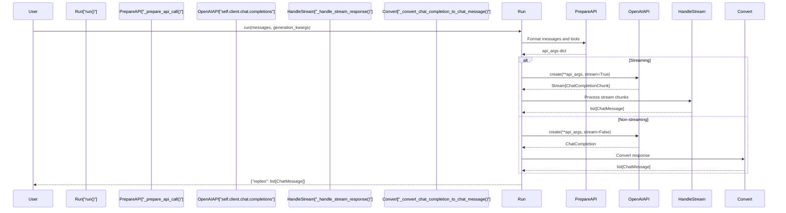
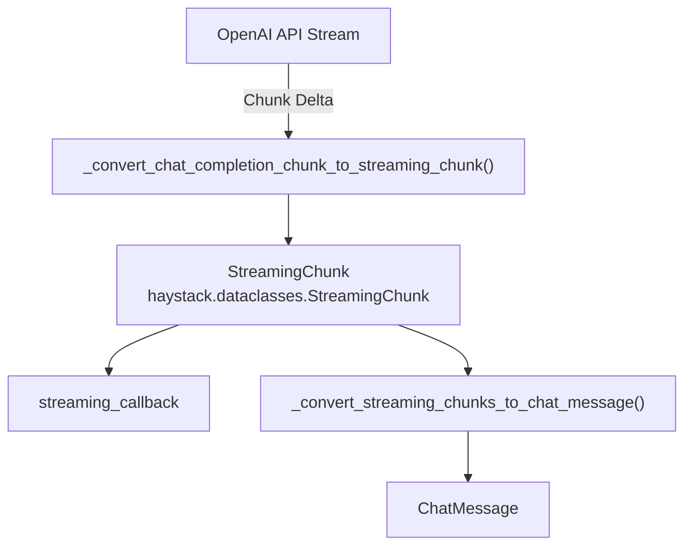

<!-- source: DeepWiki mcp.deepwiki.com · repo deepset-ai/haystack · page 4.1 OpenAI and Azure Integration · fetched 2026-10-26 -->

# OpenAI and Azure Integration

<details>
<summary>Relevant source files</summary>

The following files were used as context for generating this wiki page:

- [docs-website/docs/pipeline-components/connectors/jinareaderconnector.mdx](docs-website/docs/pipeline-components/connectors/jinareaderconnector.mdx)
- [docs-website/docs/pipeline-components/embedders/nvidiadocumentembedder.mdx](docs-website/docs/pipeline-components/embedders/nvidiadocumentembedder.mdx)
- [docs-website/docs/pipeline-components/embedders/nvidiatextembedder.mdx](docs-website/docs/pipeline-components/embedders/nvidiatextembedder.mdx)
- [docs-website/docs/pipeline-components/generators/amazonbedrockchatgenerator.mdx](docs-website/docs/pipeline-components/generators/amazonbedrockchatgenerator.mdx)
- [docs-website/docs/pipeline-components/generators/amazonbedrockgenerator.mdx](docs-website/docs/pipeline-components/generators/amazonbedrockgenerator.mdx)
- [docs-website/docs/pipeline-components/generators/anthropicchatgenerator.mdx](docs-website/docs/pipeline-components/generators/anthropicchatgenerator.mdx)
- [docs-website/docs/pipeline-components/generators/anthropicgenerator.mdx](docs-website/docs/pipeline-components/generators/anthropicgenerator.mdx)
- [docs-website/docs/pipeline-components/generators/anthropicvertexchatgenerator.mdx](docs-website/docs/pipeline-components/generators/anthropicvertexchatgenerator.mdx)
- [docs-website/docs/pipeline-components/generators/azureopenaichatgenerator.mdx](docs-website/docs/pipeline-components/generators/azureopenaichatgenerator.mdx)
- [docs-website/docs/pipeline-components/generators/azureopenairesponseschatgenerator.mdx](docs-website/docs/pipeline-components/generators/azureopenairesponseschatgenerator.mdx)
- [docs-website/docs/pipeline-components/generators/coherechatgenerator.mdx](docs-website/docs/pipeline-components/generators/coherechatgenerator.mdx)
- [docs-website/docs/pipeline-components/generators/coheregenerator.mdx](docs-website/docs/pipeline-components/generators/coheregenerator.mdx)
- [docs-website/docs/pipeline-components/generators/googlegenaichatgenerator.mdx](docs-website/docs/pipeline-components/generators/googlegenaichatgenerator.mdx)
- [docs-website/docs/pipeline-components/generators/huggingfaceapichatgenerator.mdx](docs-website/docs/pipeline-components/generators/huggingfaceapichatgenerator.mdx)
- [docs-website/docs/pipeline-components/generators/llamacppchatgenerator.mdx](docs-website/docs/pipeline-components/generators/llamacppchatgenerator.mdx)
- [docs-website/docs/pipeline-components/generators/llamacppgenerator.mdx](docs-website/docs/pipeline-components/generators/llamacppgenerator.mdx)
- [docs-website/docs/pipeline-components/generators/mistralchatgenerator.mdx](docs-website/docs/pipeline-components/generators/mistralchatgenerator.mdx)
- [docs-website/docs/pipeline-components/generators/nvidiachatgenerator.mdx](docs-website/docs/pipeline-components/generators/nvidiachatgenerator.mdx)
- [docs-website/docs/pipeline-components/generators/nvidiagenerator.mdx](docs-website/docs/pipeline-components/generators/nvidiagenerator.mdx)
- [docs-website/docs/pipeline-components/generators/ollamachatgenerator.mdx](docs-website/docs/pipeline-components/generators/ollamachatgenerator.mdx)
- [docs-website/docs/pipeline-components/generators/openaichatgenerator.mdx](docs-website/docs/pipeline-components/generators/openaichatgenerator.mdx)
- [docs-website/docs/pipeline-components/generators/openairesponseschatgenerator.mdx](docs-website/docs/pipeline-components/generators/openairesponseschatgenerator.mdx)
- [docs-website/docs/pipeline-components/generators/openrouterchatgenerator.mdx](docs-website/docs/pipeline-components/generators/openrouterchatgenerator.mdx)
- [docs-website/docs/pipeline-components/generators/sagemakergenerator.mdx](docs-website/docs/pipeline-components/generators/sagemakergenerator.mdx)
- [docs-website/docs/pipeline-components/generators/stackitchatgenerator.mdx](docs-website/docs/pipeline-components/generators/stackitchatgenerator.mdx)
- [docs-website/docs/pipeline-components/generators/watsonxchatgenerator.mdx](docs-website/docs/pipeline-components/generators/watsonxchatgenerator.mdx)
- [docs-website/docs/pipeline-components/rankers/nvidiaranker.mdx](docs-website/docs/pipeline-components/rankers/nvidiaranker.mdx)
- [docs-website/docs/pipeline-components/retrievers/elasticsearchhybridretriever.mdx](docs-website/docs/pipeline-components/retrievers/elasticsearchhybridretriever.mdx)
- [docs-website/docs/tools/ready-made-tools/githubfileeditortool.mdx](docs-website/docs/tools/ready-made-tools/githubfileeditortool.mdx)
- [docs-website/docs/tools/ready-made-tools/githubissuecommentertool.mdx](docs-website/docs/tools/ready-made-tools/githubissuecommentertool.mdx)
- [docs-website/docs/tools/ready-made-tools/githubissueviewertool.mdx](docs-website/docs/tools/ready-made-tools/githubissueviewertool.mdx)
- [docs-website/docs/tools/ready-made-tools/githubprcreatortool.mdx](docs-website/docs/tools/ready-made-tools/githubprcreatortool.mdx)
- [docs-website/docs/tools/ready-made-tools/githubrepoviewertool.mdx](docs-website/docs/tools/ready-made-tools/githubrepoviewertool.mdx)
- [docs-website/versioned_docs/version-3.0/pipeline-components/generators/openaichatgenerator.mdx](docs-website/versioned_docs/version-3.0/pipeline-components/generators/openaichatgenerator.mdx)
- [haystack/components/generators/__init__.py](haystack/components/generators/__init__.py)
- [haystack/components/generators/chat/__init__.py](haystack/components/generators/chat/__init__.py)
- [haystack/components/generators/chat/azure.py](haystack/components/generators/chat/azure.py)
- [haystack/components/generators/chat/azure_responses.py](haystack/components/generators/chat/azure_responses.py)
- [haystack/components/generators/chat/fallback.py](haystack/components/generators/chat/fallback.py)
- [haystack/components/generators/chat/llm.py](haystack/components/generators/chat/llm.py)
- [haystack/components/generators/chat/mock.py](haystack/components/generators/chat/mock.py)
- [haystack/components/generators/chat/openai.py](haystack/components/generators/chat/openai.py)
- [haystack/components/generators/chat/openai_responses.py](haystack/components/generators/chat/openai_responses.py)
- [haystack/components/generators/utils.py](haystack/components/generators/utils.py)
- [haystack/dataclasses/__init__.py](haystack/dataclasses/__init__.py)
- [haystack/dataclasses/streaming_chunk.py](haystack/dataclasses/streaming_chunk.py)
- [pydoc/generators_api.yml](pydoc/generators_api.yml)
- [releasenotes/notes/add-llm-chat-generator-component-e50c6f7659a31253.yaml](releasenotes/notes/add-llm-chat-generator-component-e50c6f7659a31253.yaml)
- [releasenotes/notes/add-mock-chat-generator-718176608c1cd73f.yaml](releasenotes/notes/add-mock-chat-generator-718176608c1cd73f.yaml)
- [releasenotes/notes/add-reasoning-mode-openai-responses-8f1c2a6b7d3e4f5a.yaml](releasenotes/notes/add-reasoning-mode-openai-responses-8f1c2a6b7d3e4f5a.yaml)
- [releasenotes/notes/add-run-async-for-CacheChecker-a42fa8062c33466b.yaml](releasenotes/notes/add-run-async-for-CacheChecker-a42fa8062c33466b.yaml)
- [releasenotes/notes/azureopenairesponseschatgenerator-list-models-91bfe7fd2fa13ff0.yaml](releasenotes/notes/azureopenairesponseschatgenerator-list-models-91bfe7fd2fa13ff0.yaml)
- [releasenotes/notes/expose-agent-run-metadata-8f2942aba14b4f0c.yaml](releasenotes/notes/expose-agent-run-metadata-8f2942aba14b4f0c.yaml)
- [releasenotes/notes/fix-llm-comp-dynamic-inputs-1edfd14d341b8a8b.yaml](releasenotes/notes/fix-llm-comp-dynamic-inputs-1edfd14d341b8a8b.yaml)
- [releasenotes/notes/fix-openai-responses-streaming-encrypted-content-dropped.yaml](releasenotes/notes/fix-openai-responses-streaming-encrypted-content-dropped.yaml)
- [releasenotes/notes/fix-openai-responses-tool-schema-mutation-e500ad2c85715f8c.yaml](releasenotes/notes/fix-openai-responses-tool-schema-mutation-e500ad2c85715f8c.yaml)
- [releasenotes/notes/fix_fallback_chat_generator_serialization-9498ee2bbe2971be.yaml](releasenotes/notes/fix_fallback_chat_generator_serialization-9498ee2bbe2971be.yaml)
- [releasenotes/notes/llm-require-user-prompt-variables-46c69997acf72e05.yaml](releasenotes/notes/llm-require-user-prompt-variables-46c69997acf72e05.yaml)
- [releasenotes/notes/revert-agent-messages-e44f5005e48d371e.yaml](releasenotes/notes/revert-agent-messages-e44f5005e48d371e.yaml)
- [releasenotes/notes/revert-optional-agent-messages-8bfcb31386c43fb4.yaml](releasenotes/notes/revert-optional-agent-messages-8bfcb31386c43fb4.yaml)
- [test/components/generators/chat/test_azure.py](test/components/generators/chat/test_azure.py)
- [test/components/generators/chat/test_azure_responses.py](test/components/generators/chat/test_azure_responses.py)
- [test/components/generators/chat/test_fallback.py](test/components/generators/chat/test_fallback.py)
- [test/components/generators/chat/test_llm.py](test/components/generators/chat/test_llm.py)
- [test/components/generators/chat/test_mock.py](test/components/generators/chat/test_mock.py)
- [test/components/generators/chat/test_openai.py](test/components/generators/chat/test_openai.py)
- [test/components/generators/chat/test_openai_async.py](test/components/generators/chat/test_openai_async.py)
- [test/components/generators/chat/test_openai_responses.py](test/components/generators/chat/test_openai_responses.py)
- [test/components/generators/chat/test_openai_responses_conversion.py](test/components/generators/chat/test_openai_responses_conversion.py)
- [test/components/generators/conftest.py](test/components/generators/conftest.py)
- [test/components/generators/test_openai_image_generator.py](test/components/generators/test_openai_image_generator.py)
- [test/components/generators/test_utils.py](test/components/generators/test_utils.py)
- [test/dataclasses/test_streaming_chunk.py](test/dataclasses/test_streaming_chunk.py)

</details>


This document covers Haystack's integration with OpenAI's API and Azure OpenAI Service. It describes the generator components that enable text generation using OpenAI's language models (GPT-4, GPT-5, o-series) both directly through OpenAI's API and through Azure's managed service, including the high-performance Responses API.

For information about Hugging Face integrations, see [4.2]() and [4.3](). For chat message formatting and prompt building, see [4.4]().

## Component Architecture

Haystack provides specialized generator components for OpenAI and Azure integration, organized by input/output format and provider:

| Component | Input | Output | Provider | File Path |
|-----------|-------|--------|----------|-----------|
| `OpenAIChatGenerator` | `list[ChatMessage]` | `list[ChatMessage]` | OpenAI | [haystack/components/generators/chat/openai.py:58]() |
| `OpenAIGenerator` | `str` | `list[str]` | OpenAI | [haystack/components/generators/openai.py:31]() |
| `OpenAIResponsesChatGenerator` | `list[ChatMessage]` | `list[ChatMessage]` | OpenAI | [haystack/components/generators/chat/openai_responses.py:47]() |
| `AzureOpenAIChatGenerator` | `list[ChatMessage]` | `list[ChatMessage]` | Azure OpenAI | [haystack/components/generators/chat/azure.py:28]() |
| `AzureOpenAIGenerator` | `str` | `list[str]` | Azure OpenAI | [haystack/components/generators/azure.py:27]() |
| `AzureOpenAIResponsesChatGenerator` | `list[ChatMessage]` | `list[ChatMessage]` | Azure OpenAI | [haystack/components/generators/chat/azure_responses.py:28]() |

**Component Inheritance Diagram**

```mermaid
graph TB
    Component["@component decorator<br/>Component System"]
    
    OpenAIChatGenerator["OpenAIChatGenerator<br/>haystack.components.generators.chat.openai"]
    OpenAIGenerator["OpenAIGenerator<br/>haystack.components.generators.openai"]
    OpenAIResponsesChatGenerator["OpenAIResponsesChatGenerator<br/>haystack.components.generators.chat.openai_responses"]
    
    AzureOpenAIChatGenerator["AzureOpenAIChatGenerator<br/>haystack.components.generators.chat.azure"]
    AzureOpenAIGenerator["AzureOpenAIGenerator<br/>haystack.components.generators.azure"]
    AzureOpenAIResponsesChatGenerator["AzureOpenAIResponsesChatGenerator<br/>haystack.components.generators.chat.azure_responses"]
    
    OpenAIClient["openai.OpenAI<br/>Official Python SDK"]
    AzureOpenAIClient["openai.lib.azure.AzureOpenAI<br/>Azure Client"]
    
    Component -.implements.-> OpenAIChatGenerator
    Component -.implements.-> OpenAIGenerator
    Component -.implements.-> OpenAIResponsesChatGenerator
    
    OpenAIChatGenerator <-.extends.- AzureOpenAIChatGenerator
    OpenAIGenerator <-.extends.- AzureOpenAIGenerator
    OpenAIResponsesChatGenerator <-.extends.- AzureOpenAIResponsesChatGenerator
    
    OpenAIChatGenerator --> OpenAIClient
    OpenAIResponsesChatGenerator --> OpenAIClient
    AzureOpenAIChatGenerator --> AzureOpenAIClient
```

Sources: [haystack/components/generators/chat/openai.py:58-98](), [haystack/components/generators/chat/azure.py:28-71](), [haystack/components/generators/chat/openai_responses.py:47-75](), [haystack/components/generators/chat/azure_responses.py:28-71]()

## OpenAIChatGenerator

`OpenAIChatGenerator` is the primary component for conversational AI using OpenAI models. It accepts `ChatMessage` objects and returns `ChatMessage` responses, supporting multi-turn conversations, tool calling, and streaming.

### Initialization

```python
from haystack.components.generators.chat import OpenAIChatGenerator
from haystack.utils import Secret

generator = OpenAIChatGenerator(
    api_key=Secret.from_env_var("OPENAI_API_KEY"),
    model="gpt-5-mini",
    generation_kwargs={
        "max_completion_tokens": 500,
        "temperature": 0.7
    }
)
```

**Key Parameters**

| Parameter | Type | Default | Description |
|-----------|------|---------|-------------|
| `api_key` | `Secret` | `Secret.from_env_var("OPENAI_API_KEY")` | OpenAI API authentication key [haystack/components/generators/chat/openai.py:123]() |
| `model` | `str` | `"gpt-5-mini"` | Model name (gpt-4, gpt-5 series) [haystack/components/generators/chat/openai.py:124]() |
| `streaming_callback` | `Optional[StreamingCallbackT]` | `None` | Callback for token-by-token streaming [haystack/components/generators/chat/openai.py:125]() |
| `generation_kwargs` | `Optional[dict[str, Any]]` | `None` | Parameters like `temperature`, `top_p`, `n`, `stop` [haystack/components/generators/chat/openai.py:128]() |
| `tools` | `Optional[ToolsType]` | `None` | Tools for function calling [haystack/components/generators/chat/openai.py:131]() |
| `tools_strict` | `bool` | `False` | Enable strict schema adherence for tools [haystack/components/generators/chat/openai.py:132]() |

Sources: [haystack/components/generators/chat/openai.py:121-183]()

### Execution Flow

The component initializes both synchronous and asynchronous OpenAI clients during `__init__` or `warm_up` using `init_http_client` [haystack/components/generators/chat/openai.py:192-203]().

**Run Method Execution Flow**



Sources: [haystack/components/generators/chat/openai.py:268-339]()

### Structured Outputs and Tools

The component transforms Haystack `Tool` objects into OpenAI tool definitions [haystack/components/generators/chat/openai.py:420-457](). If `tools_strict` is enabled, it adds `strict: True` to the tool definition and ensures `additionalProperties: False` in the JSON schema using `_make_schema_strict` [haystack/components/generators/chat/openai.py:448-454]().

For structured outputs, if `response_format` is a Pydantic `BaseModel`, it uses `to_strict_json_schema` and calls the `.parse()` endpoint instead of `.create()` [haystack/components/generators/chat/openai.py:467-482]().

## OpenAIResponsesChatGenerator

The `OpenAIResponsesChatGenerator` uses the newer OpenAI Responses API, designed for high-performance and structured interactions. It supports advanced features like model reasoning tokens and explicit response formats.

### Key Features
- **Reasoning Support**: Explicitly handles `reasoning_content` in both streaming and non-streaming modes. In streaming, it captures `reasoning_text` from chunks [haystack/components/generators/chat/openai_responses.py:22-24]().
- **Streaming Logic**: Uses `self.client.responses.create(stream=True)` which returns `ResponseStreamEvent` structures [haystack/components/generators/chat/openai_responses.py:12]().
- **Output Types**: Returns `replies` as `ChatMessage` objects that can contain `ReasoningContent` [haystack/components/generators/chat/openai_responses.py:22]().

Sources: [haystack/components/generators/chat/openai_responses.py:47-75](), [haystack/components/generators/chat/openai_responses.py:134-165]()

## Azure OpenAI Variants

Azure variants like `AzureOpenAIChatGenerator` and `AzureOpenAIResponsesChatGenerator` inherit from their OpenAI counterparts but override initialization to use `AzureOpenAI` and `AsyncAzureOpenAI` clients [haystack/components/generators/chat/azure.py:9]().

### Azure Configuration

| Parameter | Purpose | Source |
|-----------|---------|--------|
| `azure_endpoint` | Resource URL | [haystack/components/generators/chat/azure.py:114]() |
| `azure_deployment` | Deployment name (usually model name) | [haystack/components/generators/chat/azure.py:116]() |
| `api_version` | API Version (e.g., 2024-12-01-preview) | [haystack/components/generators/chat/azure.py:115]() |
| `azure_ad_token` | Entra ID token for auth | [haystack/components/generators/chat/azure.py:118]() |
| `azure_ad_token_provider` | Callback for AD tokens | [haystack/components/generators/chat/azure.py:128]() |

Sources: [haystack/components/generators/chat/azure.py:112-130](), [haystack/components/generators/chat/azure_responses.py:73-90]()

## Streaming Implementation

Streaming is handled by a callback system. The `print_streaming_chunk` utility provides a standard way to display tokens, reasoning, and tool calls as they arrive [haystack/components/generators/utils.py:52]().

### Streaming Data Flow



Sources: [haystack/components/generators/chat/openai.py:484-508](), [haystack/components/generators/utils.py:117-159]()

### StreamingChunk Contents
A `StreamingChunk` can contain:
- `content`: Textual tokens [haystack/components/generators/utils.py:125]().
- `tool_calls`: `ToolCallDelta` objects for incremental tool call construction [haystack/components/generators/utils.py:130]().
- `reasoning`: `ReasoningContent` for models like o1/o3 [haystack/components/generators/utils.py:133]().
- `meta`: Metadata including `usage` and `finish_reason` [haystack/components/generators/utils.py:128]().

Sources: [haystack/components/generators/utils.py:97-114](), [haystack/components/generators/utils.py:117-160]()

## Error Handling and Metadata

### Finish Reasons
The components monitor the `finish_reason` returned by the API. If a completion is truncated due to `length` or `content_filter`, a warning is logged via `_check_finish_reason` [haystack/components/generators/chat/openai.py:511-524]().

### Usage Statistics
Usage metadata is serialized and returned in the `meta` field of the output. This includes `prompt_tokens`, `completion_tokens`, and specific details like `reasoning_tokens` or `cached_tokens` if provided by the OpenAI `CompletionUsage` object [haystack/components/generators/chat/openai.py:674-686]().

Sources: [haystack/components/generators/chat/openai.py:511-524](), [haystack/components/generators/chat/openai.py:674-686](), [test/components/generators/chat/test_openai.py:30]()

---

