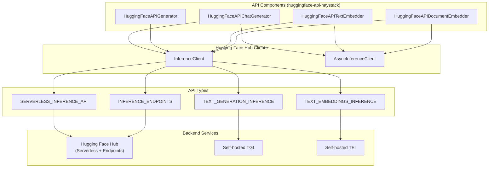
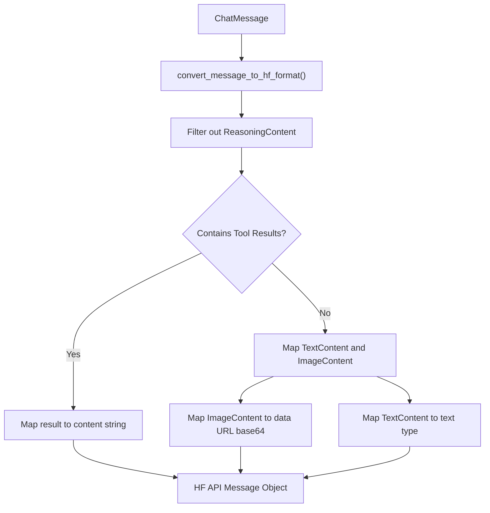
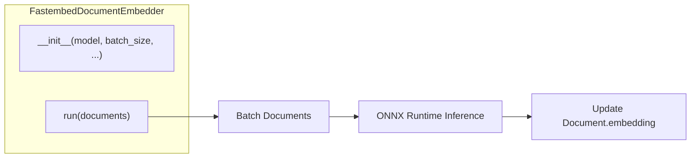

<!-- source: DeepWiki mcp.deepwiki.com · repo deepset-ai/haystack · page 4.2 Hugging Face API Integration · fetched 2026-10-26 -->

# Hugging Face API Integration

<details>
<summary>Relevant source files</summary>

The following files were used as context for generating this wiki page:

- [docs-website/reference/integrations-api/fastembed.md](docs-website/reference/integrations-api/fastembed.md)
- [docs-website/reference_versioned_docs/version-2.18/integrations-api/fastembed.md](docs-website/reference_versioned_docs/version-2.18/integrations-api/fastembed.md)
- [docs-website/reference_versioned_docs/version-2.19/integrations-api/fastembed.md](docs-website/reference_versioned_docs/version-2.19/integrations-api/fastembed.md)
- [docs-website/reference_versioned_docs/version-2.20/integrations-api/fastembed.md](docs-website/reference_versioned_docs/version-2.20/integrations-api/fastembed.md)
- [docs-website/reference_versioned_docs/version-2.21/integrations-api/fastembed.md](docs-website/reference_versioned_docs/version-2.21/integrations-api/fastembed.md)
- [docs-website/reference_versioned_docs/version-2.22/integrations-api/fastembed.md](docs-website/reference_versioned_docs/version-2.22/integrations-api/fastembed.md)
- [docs-website/reference_versioned_docs/version-2.23/integrations-api/fastembed.md](docs-website/reference_versioned_docs/version-2.23/integrations-api/fastembed.md)
- [docs-website/reference_versioned_docs/version-2.24/integrations-api/fastembed.md](docs-website/reference_versioned_docs/version-2.24/integrations-api/fastembed.md)
- [docs-website/reference_versioned_docs/version-2.25/integrations-api/fastembed.md](docs-website/reference_versioned_docs/version-2.25/integrations-api/fastembed.md)
- [docs-website/reference_versioned_docs/version-2.26/integrations-api/fastembed.md](docs-website/reference_versioned_docs/version-2.26/integrations-api/fastembed.md)
- [docs-website/reference_versioned_docs/version-2.27/integrations-api/fastembed.md](docs-website/reference_versioned_docs/version-2.27/integrations-api/fastembed.md)
- [haystack/utils/hf.py](haystack/utils/hf.py)

</details>


This document covers Haystack's integration with Hugging Face API services for chat generation, text generation, and text embedding. As of Haystack v3.0, these components have been migrated to the external `huggingface-api-haystack` package to allow for independent versioning and faster updates.

For local model execution with Hugging Face using the `transformers` library, see [Hugging Face Local Integration](4.3). For general LLM integration patterns, see [Chat Messages and Prompt Building](4.4).

## Overview

Haystack's Hugging Face API integration provides access to models through multiple API deployment options, using `InferenceClient` and `AsyncInferenceClient` from the `huggingface_hub` library. All API-based components support both synchronous and asynchronous execution.

### API Components Architecture



Sources: [haystack/utils/hf.py:54-118]()

## API Types and Configuration

The Hugging Face API integration supports multiple deployment types, each with specific configuration requirements.

### API Type Enumerations

| Enum Class | Values | Used By |
|------------|--------|---------|
| `HFGenerationAPIType` | `SERVERLESS_INFERENCE_API`, `INFERENCE_ENDPOINTS`, `TEXT_GENERATION_INFERENCE` | Chat/text generators |
| `HFEmbeddingAPIType` | `SERVERLESS_INFERENCE_API`, `INFERENCE_ENDPOINTS`, `TEXT_EMBEDDINGS_INFERENCE` | Embedders |

### Configuration and Validation

The integration performs specific validation based on the `api_type` selected during component initialization.

| API Type | Required Parameters | Token Required | Validation Logic |
|----------|-------------------|----------------|------------------|
| `SERVERLESS_INFERENCE_API` | `model` (model ID) | Yes | Validates model existence via HF Hub |
| `INFERENCE_ENDPOINTS` | `url` (endpoint URL) | Yes | URL format validation |
| `TEXT_GENERATION_INFERENCE` | `url` (service URL) | No | URL format validation |
| `TEXT_EMBEDDINGS_INFERENCE` | `url` (service URL) | No | URL format validation |

Sources: [haystack/utils/hf.py:17-33](), [haystack/utils/hf.py:34-53]()

## Chat Generation with HuggingFaceAPIChatGenerator

The `HuggingFaceAPIChatGenerator` component provides chat completion functionality using Hugging Face API services via the `chat_completion` endpoint.

### Component Features

| Feature | Support | Notes |
|---------|---------|-------|
| API Types | Serverless, Inference Endpoints, TGI | All three deployment options |
| Streaming | ✓ | Via `streaming_callback` parameter |
| Tool Calling | ✓ | Uses OpenAI-compatible tool format |
| Multimodal Input | ✓ | Text + images via `ImageContent` |
| Reasoning Extraction| ✓ | Extracts `ReasoningContent` from supporting models |

### Multimodal and Reasoning Data Flow

When converting Haystack `ChatMessage` objects to the Hugging Face format, the integration handles specific content types differently.



**Reasoning Content Note**: `ReasoningContent` is skipped during conversion to the HF API format because the Hugging Face Inference API (following the OpenAI-compatible chat completion format) does not support reasoning in input messages. Reasoning is captured from model outputs for transparency but is not sent back to the API in multi-turn conversations [haystack/utils/hf.py:58-61]().

Sources: [haystack/utils/hf.py:54-75](), [haystack/utils/hf.py:85-91](), [haystack/utils/hf.py:94-108]()

## Text Embedding Integration

Haystack provides API-based embedders for both single strings and document collections.

### HuggingFaceAPITextEmbedder & HuggingFaceAPIDocumentEmbedder

These components use the `feature_extraction` endpoint of the Hugging Face Inference API.

#### Batch Processing and Metadata

For `HuggingFaceAPIDocumentEmbedder`, multiple documents are processed in batches to optimize network overhead. Users can also specify which metadata fields should be concatenated with the document content before embedding.

| Feature | Description |
|---------|-------------|
| `batch_size` | Number of documents to send in a single API request |
| `meta_fields_to_embed` | List of metadata keys to include in the embedding input |
| `embedding_separator` | String used to join metadata values and content |

### FastEmbed Integration

While primarily used locally, `FastEmbed` is a popular alternative for generating embeddings that can be used alongside Hugging Face models.



Sources: [docs-website/reference/integrations-api/fastembed.md:9-29](), [docs-website/reference/integrations-api/fastembed.md:123-141]()

## Serialization of HF Arguments

To support Haystack's pipeline serialization, specific Hugging Face and PyTorch types (like `torch.dtype`) must be converted to JSON-serializable formats.

### Kwargs Serialization Logic

| Function | Role | Action |
|----------|------|--------|
| `serialize_hf_model_kwargs` | Serialization | Converts `torch.dtype` to its string representation (e.g., `"torch.float16"`) [haystack/utils/hf.py:17-32](). |
| `deserialize_hf_model_kwargs` | Deserialization | Parses strings starting with `"torch."` and retrieves the attribute from the `torch` module [haystack/utils/hf.py:34-52](). |

Sources: [haystack/utils/hf.py:17-33](), [haystack/utils/hf.py:34-53]()

## Migration to v3.0

In Haystack v3.0, Hugging Face API components were moved from the core `haystack` package to the `huggingface-api-haystack` integration package.

### Package Mapping

| Old Core Class (v2.x) | New Integration Class (v3.0) | Package |
|-----------------------|------------------------------|---------|
| `HuggingFaceAPIChatGenerator` | `HuggingFaceAPIChatGenerator` | `huggingface-api-haystack` |
| `HuggingFaceAPITextEmbedder` | `HuggingFaceAPITextEmbedder` | `huggingface-api-haystack` |
| `HuggingFaceAPIDocumentEmbedder` | `HuggingFaceAPIDocumentEmbedder` | `huggingface-api-haystack` |

To use these components in v3.0, install the integration:
```bash
pip install huggingface-api-haystack
```

Sources: [haystack/utils/hf.py:1-14]()

---

