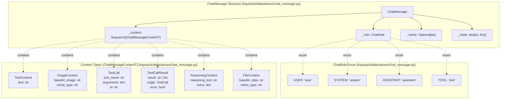
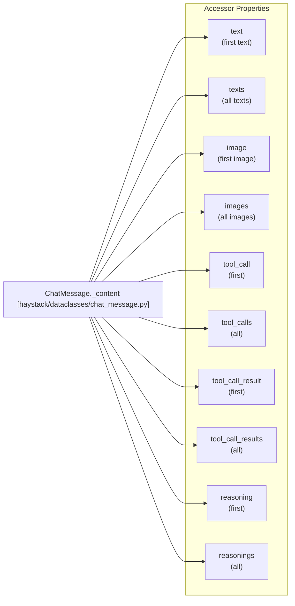
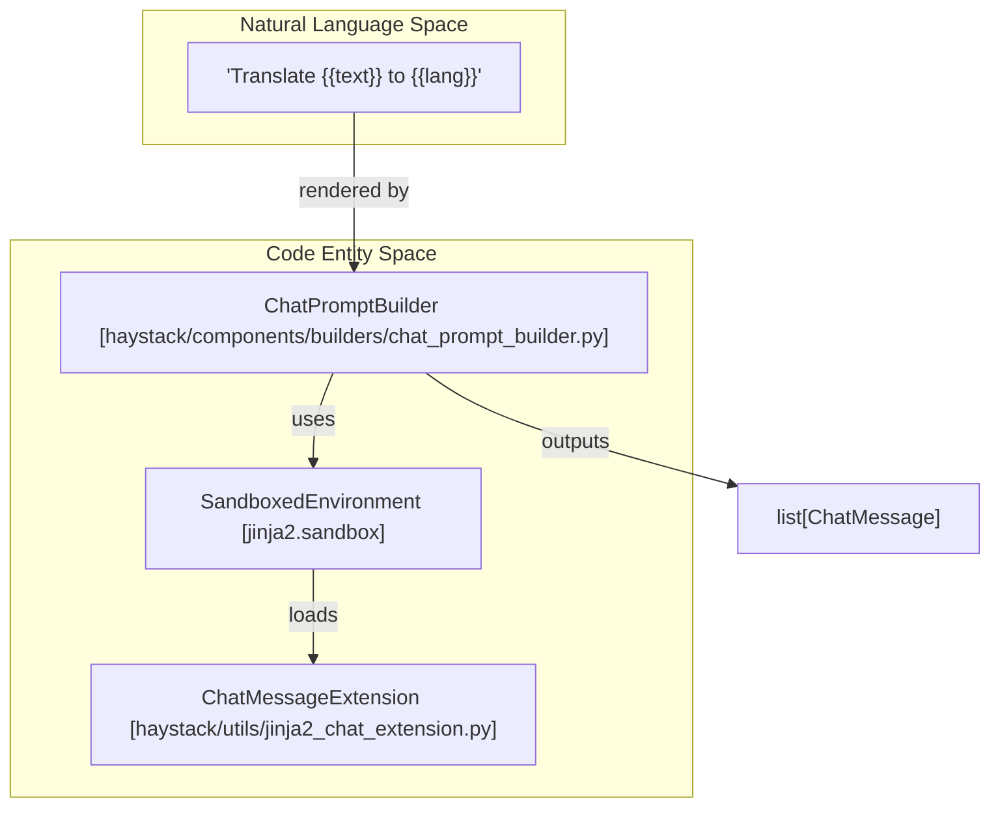
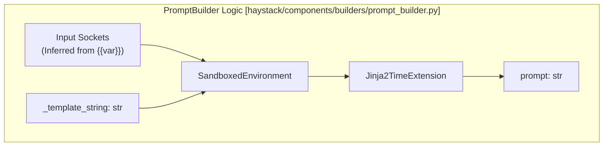

<!-- source: DeepWiki mcp.deepwiki.com · repo deepset-ai/haystack · page 4.4 Chat Messages and Prompt Building · fetched 2026-10-26 -->

# Chat Messages and Prompt Building

<details>
<summary>Relevant source files</summary>

The following files were used as context for generating this wiki page:

- [docs-website/docs/concepts/data-classes.mdx](docs-website/docs/concepts/data-classes.mdx)
- [docs-website/docs/concepts/data-classes/chatmessage.mdx](docs-website/docs/concepts/data-classes/chatmessage.mdx)
- [docs-website/docs/concepts/data-classes/filecontent.mdx](docs-website/docs/concepts/data-classes/filecontent.mdx)
- [docs-website/docs/concepts/data-classes/imagecontent.mdx](docs-website/docs/concepts/data-classes/imagecontent.mdx)
- [docs-website/docs/concepts/device-management.mdx](docs-website/docs/concepts/device-management.mdx)
- [docs-website/docs/concepts/pipelines.mdx](docs-website/docs/concepts/pipelines.mdx)
- [docs-website/docs/concepts/pipelines/pipeline-loops.mdx](docs-website/docs/concepts/pipelines/pipeline-loops.mdx)
- [docs-website/docs/concepts/pipelines/smart-pipeline-connections.mdx](docs-website/docs/concepts/pipelines/smart-pipeline-connections.mdx)
- [docs-website/docs/development/enabling-gpu-acceleration.mdx](docs-website/docs/development/enabling-gpu-acceleration.mdx)
- [docs-website/docs/pipeline-components/builders/chatpromptbuilder.mdx](docs-website/docs/pipeline-components/builders/chatpromptbuilder.mdx)
- [docs-website/docs/pipeline-components/builders/promptbuilder.mdx](docs-website/docs/pipeline-components/builders/promptbuilder.mdx)
- [docs-website/docs/pipeline-components/extractors.mdx](docs-website/docs/pipeline-components/extractors.mdx)
- [docs-website/docs/pipeline-components/routers/documentlengthrouter.mdx](docs-website/docs/pipeline-components/routers/documentlengthrouter.mdx)
- [docs-website/reference_versioned_docs/version-2.24/haystack-api/data_classes_api.md](docs-website/reference_versioned_docs/version-2.24/haystack-api/data_classes_api.md)
- [docs-website/static/img/pipeline-illustration-auto-joiner.png](docs-website/static/img/pipeline-illustration-auto-joiner.png)
- [docs-website/versioned_docs/version-2.19/concepts/data-classes/chatmessage.mdx](docs-website/versioned_docs/version-2.19/concepts/data-classes/chatmessage.mdx)
- [docs-website/versioned_docs/version-2.20/concepts/data-classes.mdx](docs-website/versioned_docs/version-2.20/concepts/data-classes.mdx)
- [docs-website/versioned_docs/version-2.20/concepts/data-classes/chatmessage.mdx](docs-website/versioned_docs/version-2.20/concepts/data-classes/chatmessage.mdx)
- [docs-website/versioned_docs/version-2.21/pipeline-components/builders/chatpromptbuilder.mdx](docs-website/versioned_docs/version-2.21/pipeline-components/builders/chatpromptbuilder.mdx)
- [docs-website/versioned_docs/version-2.21/pipeline-components/builders/promptbuilder.mdx](docs-website/versioned_docs/version-2.21/pipeline-components/builders/promptbuilder.mdx)
- [docs-website/versioned_docs/version-2.23/pipeline-components/builders/chatpromptbuilder.mdx](docs-website/versioned_docs/version-2.23/pipeline-components/builders/chatpromptbuilder.mdx)
- [docs-website/versioned_docs/version-2.23/pipeline-components/generators/amazonbedrockchatgenerator.mdx](docs-website/versioned_docs/version-2.23/pipeline-components/generators/amazonbedrockchatgenerator.mdx)
- [docs-website/versioned_docs/version-2.24/concepts/data-classes/chatmessage.mdx](docs-website/versioned_docs/version-2.24/concepts/data-classes/chatmessage.mdx)
- [docs-website/versioned_docs/version-2.29/concepts/data-classes.mdx](docs-website/versioned_docs/version-2.29/concepts/data-classes.mdx)
- [docs-website/versioned_docs/version-2.29/concepts/data-classes/filecontent.mdx](docs-website/versioned_docs/version-2.29/concepts/data-classes/filecontent.mdx)
- [docs-website/versioned_docs/version-2.30/concepts/data-classes.mdx](docs-website/versioned_docs/version-2.30/concepts/data-classes.mdx)
- [docs-website/versioned_docs/version-2.30/concepts/data-classes/filecontent.mdx](docs-website/versioned_docs/version-2.30/concepts/data-classes/filecontent.mdx)
- [docs-website/versioned_docs/version-2.30/concepts/data-classes/imagecontent.mdx](docs-website/versioned_docs/version-2.30/concepts/data-classes/imagecontent.mdx)
- [docs-website/versioned_docs/version-2.30/pipeline-components/builders/chatpromptbuilder.mdx](docs-website/versioned_docs/version-2.30/pipeline-components/builders/chatpromptbuilder.mdx)
- [haystack/components/builders/chat_prompt_builder.py](haystack/components/builders/chat_prompt_builder.py)
- [haystack/components/builders/prompt_builder.py](haystack/components/builders/prompt_builder.py)
- [haystack/dataclasses/chat_message.py](haystack/dataclasses/chat_message.py)
- [haystack/utils/jinja2_chat_extension.py](haystack/utils/jinja2_chat_extension.py)
- [haystack/utils/jinja2_extensions.py](haystack/utils/jinja2_extensions.py)
- [releasenotes/notes/add-messages-jinja-tag-483cca5bda6884f2.yaml](releasenotes/notes/add-messages-jinja-tag-483cca5bda6884f2.yaml)
- [releasenotes/notes/add-required-flag-for-prompt-builder-inputs-f5d3ffb3cb7df8d0.yaml](releasenotes/notes/add-required-flag-for-prompt-builder-inputs-f5d3ffb3cb7df8d0.yaml)
- [releasenotes/notes/chat-prompt-builder-sanitization-d0905ac8a5a25aa0.yaml](releasenotes/notes/chat-prompt-builder-sanitization-d0905ac8a5a25aa0.yaml)
- [releasenotes/notes/chatmessage-from-dict-pydantic-dump-5b12e4b1d4985ec1.yaml](releasenotes/notes/chatmessage-from-dict-pydantic-dump-5b12e4b1d4985ec1.yaml)
- [releasenotes/notes/extend-promptbuilder-0322790d82248039.yaml](releasenotes/notes/extend-promptbuilder-0322790d82248039.yaml)
- [releasenotes/notes/feat-expand-auto-variadic-support-b5c0ec52ec7b497f.yaml](releasenotes/notes/feat-expand-auto-variadic-support-b5c0ec52ec7b497f.yaml)
- [releasenotes/notes/fix-jinja2-variable-extraction-57f34c6bd249e214.yaml](releasenotes/notes/fix-jinja2-variable-extraction-57f34c6bd249e214.yaml)
- [releasenotes/notes/fix-openai-toolcall-empty-arguments-53c5621622bc1866.yaml](releasenotes/notes/fix-openai-toolcall-empty-arguments-53c5621622bc1866.yaml)
- [releasenotes/notes/improve-jinja2-chat-sec-27333c393c032b75.yaml](releasenotes/notes/improve-jinja2-chat-sec-27333c393c032b75.yaml)
- [test/components/builders/test_chat_prompt_builder.py](test/components/builders/test_chat_prompt_builder.py)
- [test/components/builders/test_prompt_builder.py](test/components/builders/test_prompt_builder.py)
- [test/dataclasses/test_chat_message.py](test/dataclasses/test_chat_message.py)
- [test/tools/test_parameters_schema_utils.py](test/tools/test_parameters_schema_utils.py)
- [test/utils/test_jinja2_chat_extension.py](test/utils/test_jinja2_chat_extension.py)
- [test/utils/test_jinja2_extensions.py](test/utils/test_jinja2_extensions.py)

</details>


This document describes the `ChatMessage` dataclass and the `ChatPromptBuilder` component, which together provide a standardized way to represent conversational messages and construct prompts for chat-based LLM interactions in Haystack.

The `ChatMessage` dataclass supports multi-modal content (text, images, tool calls, reasoning, and files) and provides serialization methods for various formats. The `ChatPromptBuilder` component uses Jinja2 templating to dynamically generate prompts from static or runtime-provided templates.

---

## ChatMessage Data Structure

The `ChatMessage` dataclass represents a single message in a chat conversation. Each message has a role (user, system, assistant, or tool) and contains one or more content parts.

### Architecture Overview



**Sources**: [haystack/dataclasses/chat_message.py:19-213](), [haystack/dataclasses/chat_message.py:247-316]()

### Factory Methods

The `ChatMessage` class uses factory methods instead of direct initialization to enforce role-specific content constraints and simplify creation:

| Factory Method | Role | Allowed Content | Example Use Case |
|----------------|------|-----------------|------------------|
| `from_user()` | USER | TextContent, ImageContent, FileContent | User queries, multi-modal input |
| `from_system()` | SYSTEM | TextContent only | System instructions, context |
| `from_assistant()` | ASSISTANT | TextContent, ToolCall, ReasoningContent | LLM responses, tool requests |
| `from_tool()` | TOOL | ToolCallResult only | Tool execution results |

**Sources**: [haystack/dataclasses/chat_message.py:409-516]()

### Content Properties

The `ChatMessage` class provides convenience properties to access specific types of content parts from the internal `_content` sequence:



**Sources**: [haystack/dataclasses/chat_message.py:318-396]()

---

## Content Part Types

### TextContent
The standard textual part of a message.
**Sources**: [haystack/dataclasses/chat_message.py:51-71]()

### ImageContent
Represents images as base64-encoded strings with MIME type information. It includes a `validation` flag (default `True`) to verify base64 integrity and MIME types.
**Sources**: [haystack/dataclasses/image_content.py:59-245]()

### FileContent
Represents binary files as base64-encoded data. Similar to `ImageContent`, it supports validation and provider-specific metadata.
**Sources**: [haystack/dataclasses/file_content.py:18-120]()

### ToolCall and ToolCallResult
Used for tool orchestration. `ToolCall` contains the `tool_name` and `arguments` requested by the LLM [haystack/dataclasses/chat_message.py:76-110](). `ToolCallResult` stores the output, linked back to the `origin` call [haystack/dataclasses/chat_message.py:118-164]().

### ReasoningContent
Captures the internal chain-of-thought produced by models like OpenAI's `o1` or DeepSeek-R1.
**Sources**: [haystack/dataclasses/chat_message.py:169-199]()

---

## ChatPromptBuilder Component

`ChatPromptBuilder` is a core component used to render chat prompts using Jinja2 syntax. It supports building prompts from a list of `ChatMessage` objects or a raw string using custom tags.

### Component Logic and Data Flow



**Sources**: [haystack/components/builders/chat_prompt_builder.py:33-137](), [haystack/utils/jinja2_chat_extension.py:66-112]()

### Template Formats

#### 1. List-Based Template
Templates can be provided as a list of `ChatMessage` objects. Variables within the `text` field of these messages are automatically inferred as component inputs.

```python
template = [ChatMessage.from_user("Hello {{ name }}!")]
builder = ChatPromptBuilder(template=template)
# Component will have an input socket named 'name'
```
**Sources**: [haystack/components/builders/chat_prompt_builder.py:47-53](), [haystack/components/builders/chat_prompt_builder.py:189-207]()

#### 2. String-Based Template (`` tag)
For complex multi-modal prompts, a string template with custom tags is used. This allows mixing text and structured content like images via the `templatize_part` filter.

```jinja2

Describe this: {{ image | templatize_part }}

```
**Sources**: [haystack/utils/jinja2_chat_extension.py:66-112](), [haystack/components/builders/chat_prompt_builder.py:114-136]()

#### 3. The `` Tag
String templates support the `` tag to interleave runtime `ChatMessage` objects (or lists) with literal message blocks.

```jinja2
You are a helpful assistant.

{{ query }}
```
**Sources**: [haystack/utils/jinja2_chat_extension.py:89-102](), [haystack/utils/jinja2_chat_extension.py:140-167]()

### Variable Handling and Security
`ChatPromptBuilder` automatically sanitizes template variables to prevent sentinel tag injection via the `_finalize` callback. This ensures user-provided strings containing tags like `<haystack_content_part>` are escaped and not interpreted as structured content [haystack/utils/jinja2_chat_extension.py:46-60]().

Input variables can be:
- **Inferred**: Automatically detected from the template [haystack/components/builders/chat_prompt_builder.py:178-187]().
- **Required**: Enforced via `required_variables` parameter (defaults to `"*"`, meaning all inferred variables) [haystack/components/builders/chat_prompt_builder.py:153-158]().
- **Dynamic**: Provided via `template_variables` dict at runtime [haystack/components/builders/chat_prompt_builder.py:228-232]().

---

## PromptBuilder Component

While `ChatPromptBuilder` outputs a list of `ChatMessage` objects, the standard `PromptBuilder` outputs a single rendered string. It is primarily used with non-chat Generators (e.g., `OpenAIGenerator`).

### PromptBuilder Implementation



**Sources**: [haystack/components/builders/prompt_builder.py:17-140](), [haystack/utils/jinja2_extensions.py:16-95]()

### Jinja2TimeExtension
Both builders support the `` tag provided by `Jinja2TimeExtension`. This allows inserting dynamic timestamps into prompts with support for offsets (e.g., ``).
**Sources**: [haystack/utils/jinja2_extensions.py:16-95](), [test/utils/test_jinja2_extensions.py:41-46]()

---

## Serialization and OpenAI Format

Haystack provides built-in utilities to convert `ChatMessage` objects to the dictionary format expected by the OpenAI API.

| Method | Role | Logic |
|--------|------|-------|
| `to_openai_dict_format()` | All | Converts content parts to OpenAI `content` (string or list), `tool_calls`, or `tool_call_id`. |
| `from_openai_dict_format()` | All | Parses OpenAI response dicts into Haystack `ChatMessage` objects, handling `refusal` and `tool_calls`. |

**Sources**: [haystack/dataclasses/chat_message.py:581-748]()

---

