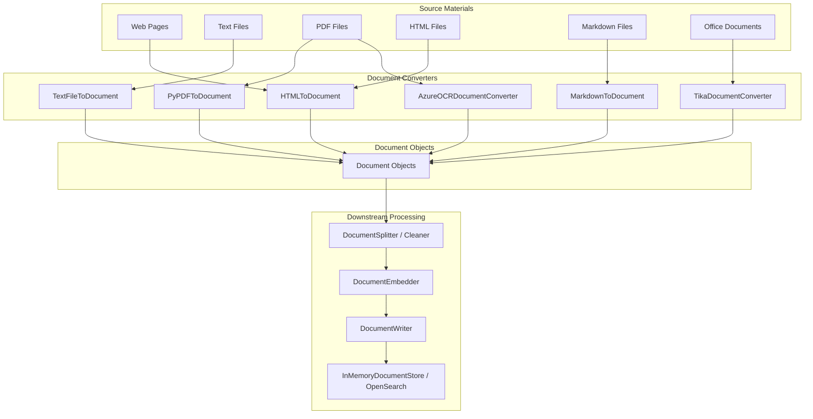
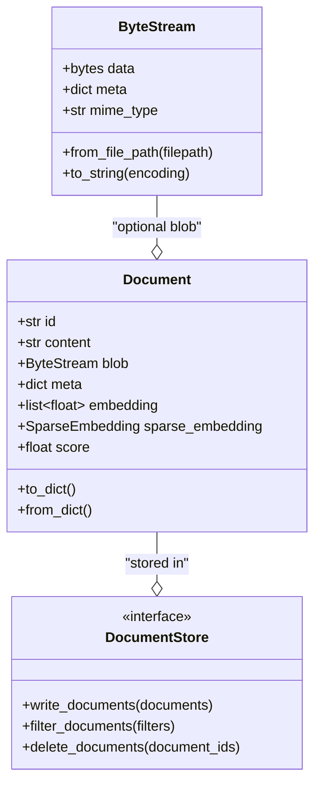

<!-- source: DeepWiki mcp.deepwiki.com · repo deepset-ai/haystack · page 5 Document Processing · fetched 2026-10-26 -->

# Document Processing

Relevant source files

The following files were used as context for generating this wiki page:

- [docs-website/docs/pipeline-components/converters/markdowntodocument.mdx](docs-website/docs/pipeline-components/converters/markdowntodocument.mdx)
- [haystack/components/converters/html.py](haystack/components/converters/html.py)
- [haystack/components/converters/markdown.py](haystack/components/converters/markdown.py)
- [haystack/components/converters/pypdf.py](haystack/components/converters/pypdf.py)
- [haystack/components/converters/txt.py](haystack/components/converters/txt.py)
- [haystack/components/converters/xlsx.py](haystack/components/converters/xlsx.py)
- [haystack/components/routers/metadata_router.py](haystack/components/routers/metadata_router.py)
- [haystack/document_stores/in_memory/document_store.py](haystack/document_stores/in_memory/document_store.py)
- [haystack/testing/document_store.py](haystack/testing/document_store.py)
- [haystack/testing/document_store_async.py](haystack/testing/document_store_async.py)
- [haystack/utils/filters.py](haystack/utils/filters.py)
- [releasenotes/notes/add-getmetadata-async-methods-and-tests-3ff2601b692697cb.yaml](releasenotes/notes/add-getmetadata-async-methods-and-tests-3ff2601b692697cb.yaml)
- [releasenotes/notes/add-hyperlink-extraction-pptx-xlsx-a3b9f1c2d4e5f6a7.yaml](releasenotes/notes/add-hyperlink-extraction-pptx-xlsx-a3b9f1c2d4e5f6a7.yaml)
- [releasenotes/notes/add-store-full-path-xlsx-convter-535bcb48433f7717.yaml](releasenotes/notes/add-store-full-path-xlsx-convter-535bcb48433f7717.yaml)
- [releasenotes/notes/consistent-datetime-filter-comparisons-1384566f567b151f.yaml](releasenotes/notes/consistent-datetime-filter-comparisons-1384566f567b151f.yaml)
- [releasenotes/notes/enhanced-htmltodocument-content-extraction-229d63e7c7119807.yaml](releasenotes/notes/enhanced-htmltodocument-content-extraction-229d63e7c7119807.yaml)
- [releasenotes/notes/fix-count-unique-metadata-mixin-test-5415d442cdb70c15.yaml](releasenotes/notes/fix-count-unique-metadata-mixin-test-5415d442cdb70c15.yaml)
- [releasenotes/notes/fix-html-empty-bytestream-logs-75830aa240c6ea44.yaml](releasenotes/notes/fix-html-empty-bytestream-logs-75830aa240c6ea44.yaml)
- [releasenotes/notes/htmlconverter-allow-extractor-customizability-730ae129db17327a.yaml](releasenotes/notes/htmlconverter-allow-extractor-customizability-730ae129db17327a.yaml)
- [releasenotes/notes/in-memory-add-filters-to-unique-values-9caf93d474ac922d.yaml](releasenotes/notes/in-memory-add-filters-to-unique-values-9caf93d474ac922d.yaml)
- [releasenotes/notes/inmemory-unique-metadata-values-pagination-a3f6c9d21b7e4081.yaml](releasenotes/notes/inmemory-unique-metadata-values-pagination-a3f6c9d21b7e4081.yaml)
- [releasenotes/notes/markdown-frontmatter-metadata-52ad49f535c44311.yaml](releasenotes/notes/markdown-frontmatter-metadata-52ad49f535c44311.yaml)
- [releasenotes/notes/pypdf-docid-293dac08ea5f8491.yaml](releasenotes/notes/pypdf-docid-293dac08ea5f8491.yaml)
- [releasenotes/notes/single-meta-in-htm2document-199ea44a4ae5c02b.yaml](releasenotes/notes/single-meta-in-htm2document-199ea44a4ae5c02b.yaml)
- [releasenotes/notes/trafilatura-html-conversion-e9b9044d31fec794.yaml](releasenotes/notes/trafilatura-html-conversion-e9b9044d31fec794.yaml)
- [test/components/converters/test_html_to_document.py](test/components/converters/test_html_to_document.py)
- [test/components/converters/test_markdown_to_document.py](test/components/converters/test_markdown_to_document.py)
- [test/components/converters/test_pypdf_to_document.py](test/components/converters/test_pypdf_to_document.py)
- [test/components/converters/test_textfile_to_document.py](test/components/converters/test_textfile_to_document.py)
- [test/components/converters/test_xlsx_to_document.py](test/components/converters/test_xlsx_to_document.py)
- [test/components/retrievers/test_multi_query_embedding_retriever.py](test/components/retrievers/test_multi_query_embedding_retriever.py)
- [test/components/retrievers/test_multi_query_text_retriever.py](test/components/retrievers/test_multi_query_text_retriever.py)
- [test/components/retrievers/test_multi_retriever.py](test/components/retrievers/test_multi_retriever.py)
- [test/components/retrievers/test_text_embedding_retriever.py](test/components/retrievers/test_text_embedding_retriever.py)
- [test/components/routers/test_metadata_router.py](test/components/routers/test_metadata_router.py)
- [test/document_stores/test_in_memory.py](test/document_stores/test_in_memory.py)
- [test/test_files/html/paul_graham_superlinear.html](test/test_files/html/paul_graham_superlinear.html)
- [test/test_files/pptx/sample_pptx_with_link.pptx](test/test_files/pptx/sample_pptx_with_link.pptx)
- [test/test_files/xlsx/spreadsheet_with_links.xlsx](test/test_files/xlsx/spreadsheet_with_links.xlsx)
- [test/tools/test_pipeline_tool.py](test/tools/test_pipeline_tool.py)
- [test/utils/test_filters.py](test/utils/test_filters.py)

Document Processing in Haystack refers to the systems and components responsible for converting various file formats (PDF, HTML, text, Markdown, etc.) into structured `Document` objects. These objects serve as the standard data carrier for storage, retrieval, and generation within Haystack pipelines.

For details on storage, see [Document Stores](#5.1). For file conversion details, see [Document Converters](#5.2). For vectorization and ranking, see [Embedders and Rankers](#5.3). For cleaning and retrieval strategies, see [Document Preprocessing and Retrieval](#5.4).

## Overview of Document Processing in Haystack

The document processing workflow typically begins with raw data (files or byte streams) and ends with indexed `Document` objects in a `DocumentStore`.

### Document Processing Flow

Sources: [haystack/components/converters/pypdf.py:51-53](), [haystack/components/converters/html.py:21-23](), [haystack/components/converters/txt.py:16-18](), [haystack/components/converters/markdown.py:17-19]()

## Core Data Structures

The processing pipeline relies on two primary data structures defined in the core library: `Document` and `ByteStream`.

### Document Entity Mapping

The following diagram bridges the conceptual "Document" with the internal code representation used across the processing lifecycle.

Sources: [haystack/dataclasses/document.py:47-70](), [haystack/dataclasses/byte_stream.py:15-26](), [haystack/document_stores/types.py:11-12]()

| Class | Purpose | Key File |
| :--- | :--- | :--- |
| `ByteStream` | Holds raw binary data and its MIME type before or during conversion. | [haystack/dataclasses/byte_stream.py:15]() |
| `Document` | The central dataclass containing text, metadata, and optional embeddings. | [haystack/dataclasses/document.py:47]() |
| `InMemoryDocumentStore` | A synchronous, ephemeral storage for testing and small-scale prototypes. | [haystack/document_stores/in_memory/document_store.py:60]() |

## Document Converters

Converters transform raw data into `Document` objects. Most converters implement a `run` method that accepts a list of `sources` (paths or `ByteStream`) and returns a dictionary containing a list of `Document` objects.

- **PyPDFToDocument**: Uses the `pypdf` library to extract text. It supports `PLAIN` and `LAYOUT` modes [haystack/components/converters/pypdf.py:23-51]().
- **HTMLToDocument**: Uses `trafilatura` to extract main content from HTML files, allowing customization via `extraction_kwargs` [haystack/components/converters/html.py:16-46]().
- **MarkdownToDocument**: Converts Markdown files to Documents, preserving structure where applicable [haystack/components/converters/markdown.py:17-21]().
- **XLSXToDocument**: Extracts text and optionally hyperlinks from Excel spreadsheets [haystack/components/converters/xlsx.py:21-25]().

For a full list of supported formats and usage, see [Document Converters](#5.2).

## Storage and Retrieval

Once documents are converted and optionally preprocessed (cleaned or split), they are written to a `DocumentStore`.

### InMemoryDocumentStore
The `InMemoryDocumentStore` is a reference implementation that stores documents in process-global or instance-local dictionaries [haystack/document_stores/in_memory/document_store.py:52-60](). It supports:
- **BM25 Retrieval**: Keyword search using algorithms like `BM25L`, `BM25Okapi`, or `BM25Plus` [haystack/document_stores/in_memory/document_store.py:68]().
- **Embedding Retrieval**: Vector similarity search using `dot_product` or `cosine` similarity [haystack/document_stores/in_memory/document_store.py:70]().
- **Metadata Filtering**: Advanced filtering via `document_matches_filter`, supporting logical operators (AND, OR, NOT) and strict datetime comparisons [haystack/utils/filters.py:15-57](), [haystack/document_stores/in_memory/document_store.py:99-102]().

For details on production-grade stores like OpenSearch, see [Document Stores](#5.1).

## Routing and Utilities

Haystack provides utilities to manage complex document flows:
- **MetadataRouter**: Routes `Document` or `ByteStream` objects to different pipeline branches based on metadata rules [haystack/components/routers/metadata_router.py:14-32]().
- **normalize_metadata**: A utility used by converters to ensure metadata is correctly distributed across multiple sources [haystack/components/converters/html.py:113]().
- **document_matches_filter**: The core logic for evaluating Haystack filter syntax against document attributes [haystack/utils/filters.py:15-32]().

Sources: [haystack/components/routers/metadata_router.py:14-32](), [haystack/utils/filters.py:15-57](), [haystack/document_stores/in_memory/document_store.py:60-138]()

---

