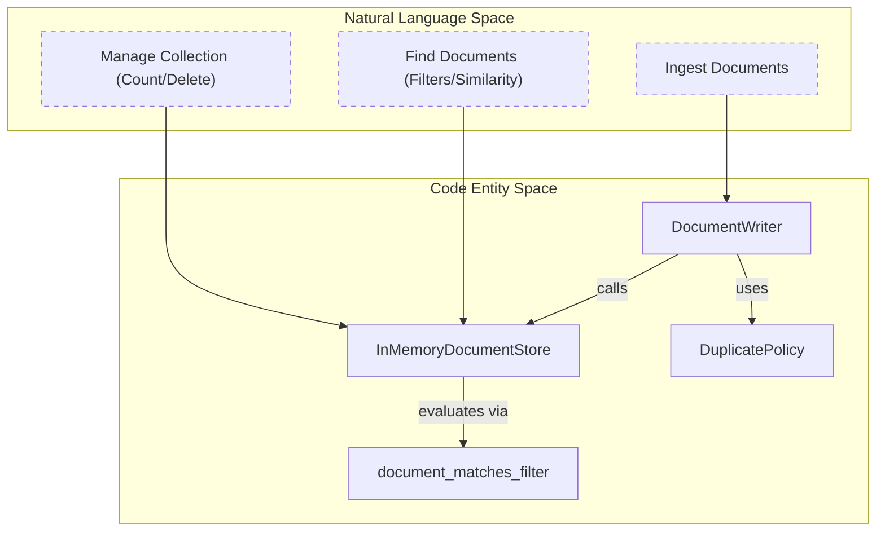
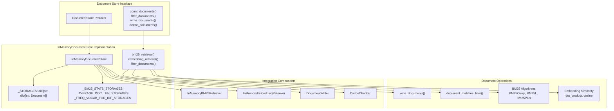
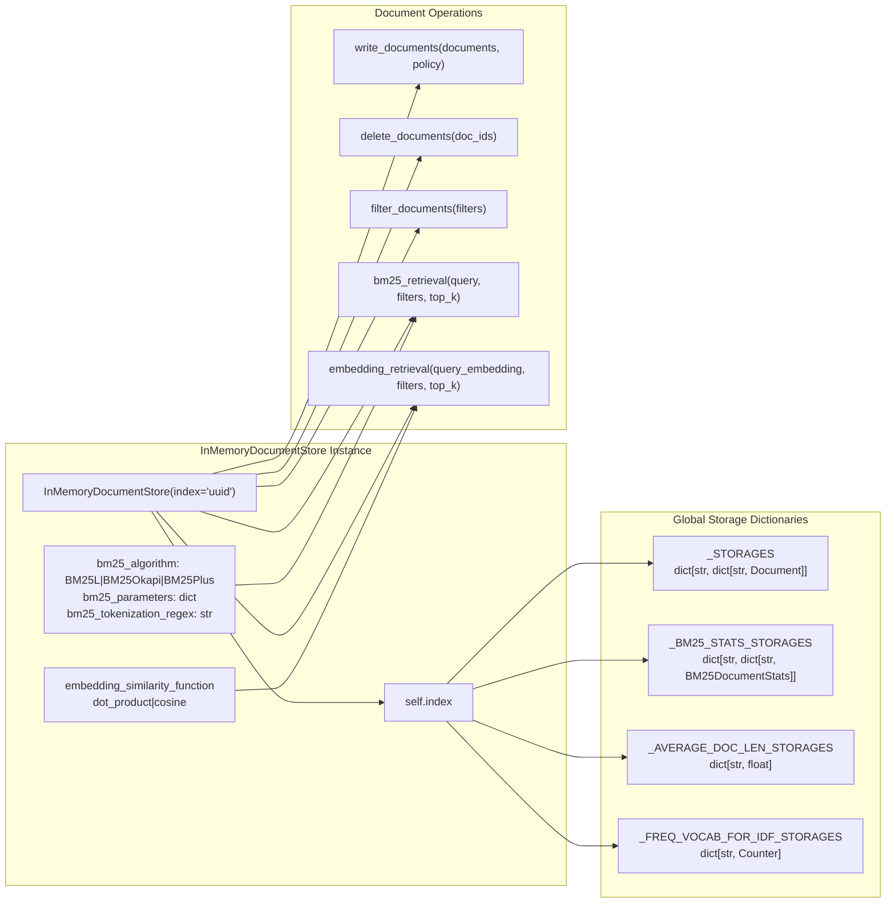

<!-- source: DeepWiki mcp.deepwiki.com · repo deepset-ai/haystack · page 5.1 Document Stores · fetched 2026-10-26 -->

# Document Stores

Relevant source files

The following files were used as context for generating this wiki page:

- [docs-website/reference/integrations-api/elasticsearch.md](docs-website/reference/integrations-api/elasticsearch.md)
- [docs-website/reference/integrations-api/opensearch.md](docs-website/reference/integrations-api/opensearch.md)
- [docs-website/reference_versioned_docs/version-2.18/integrations-api/elasticsearch.md](docs-website/reference_versioned_docs/version-2.18/integrations-api/elasticsearch.md)
- [docs-website/reference_versioned_docs/version-2.18/integrations-api/opensearch.md](docs-website/reference_versioned_docs/version-2.18/integrations-api/opensearch.md)
- [docs-website/reference_versioned_docs/version-2.19/integrations-api/elasticsearch.md](docs-website/reference_versioned_docs/version-2.19/integrations-api/elasticsearch.md)
- [docs-website/reference_versioned_docs/version-2.19/integrations-api/opensearch.md](docs-website/reference_versioned_docs/version-2.19/integrations-api/opensearch.md)
- [docs-website/reference_versioned_docs/version-2.20/integrations-api/elasticsearch.md](docs-website/reference_versioned_docs/version-2.20/integrations-api/elasticsearch.md)
- [docs-website/reference_versioned_docs/version-2.20/integrations-api/opensearch.md](docs-website/reference_versioned_docs/version-2.20/integrations-api/opensearch.md)
- [docs-website/reference_versioned_docs/version-2.21/integrations-api/elasticsearch.md](docs-website/reference_versioned_docs/version-2.21/integrations-api/elasticsearch.md)
- [docs-website/reference_versioned_docs/version-2.21/integrations-api/opensearch.md](docs-website/reference_versioned_docs/version-2.21/integrations-api/opensearch.md)
- [docs-website/reference_versioned_docs/version-2.22/integrations-api/elasticsearch.md](docs-website/reference_versioned_docs/version-2.22/integrations-api/elasticsearch.md)
- [docs-website/reference_versioned_docs/version-2.22/integrations-api/opensearch.md](docs-website/reference_versioned_docs/version-2.22/integrations-api/opensearch.md)
- [docs-website/reference_versioned_docs/version-2.23/integrations-api/elasticsearch.md](docs-website/reference_versioned_docs/version-2.23/integrations-api/elasticsearch.md)
- [docs-website/reference_versioned_docs/version-2.23/integrations-api/opensearch.md](docs-website/reference_versioned_docs/version-2.23/integrations-api/opensearch.md)
- [docs-website/reference_versioned_docs/version-2.24/integrations-api/elasticsearch.md](docs-website/reference_versioned_docs/version-2.24/integrations-api/elasticsearch.md)
- [docs-website/reference_versioned_docs/version-2.24/integrations-api/opensearch.md](docs-website/reference_versioned_docs/version-2.24/integrations-api/opensearch.md)
- [docs-website/reference_versioned_docs/version-2.25/integrations-api/elasticsearch.md](docs-website/reference_versioned_docs/version-2.25/integrations-api/elasticsearch.md)
- [docs-website/reference_versioned_docs/version-2.25/integrations-api/opensearch.md](docs-website/reference_versioned_docs/version-2.25/integrations-api/opensearch.md)
- [docs-website/reference_versioned_docs/version-2.26/integrations-api/elasticsearch.md](docs-website/reference_versioned_docs/version-2.26/integrations-api/elasticsearch.md)
- [docs-website/reference_versioned_docs/version-2.26/integrations-api/opensearch.md](docs-website/reference_versioned_docs/version-2.26/integrations-api/opensearch.md)
- [docs-website/reference_versioned_docs/version-2.27/integrations-api/elasticsearch.md](docs-website/reference_versioned_docs/version-2.27/integrations-api/elasticsearch.md)
- [docs-website/reference_versioned_docs/version-2.27/integrations-api/opensearch.md](docs-website/reference_versioned_docs/version-2.27/integrations-api/opensearch.md)
- [haystack/components/caching/cache_checker.py](haystack/components/caching/cache_checker.py)
- [haystack/components/retrievers/auto_merging_retriever.py](haystack/components/retrievers/auto_merging_retriever.py)
- [haystack/components/retrievers/filter_retriever.py](haystack/components/retrievers/filter_retriever.py)
- [haystack/components/retrievers/sentence_window_retriever.py](haystack/components/retrievers/sentence_window_retriever.py)
- [haystack/components/routers/metadata_router.py](haystack/components/routers/metadata_router.py)
- [haystack/components/writers/document_writer.py](haystack/components/writers/document_writer.py)
- [haystack/document_stores/__init__.py](haystack/document_stores/__init__.py)
- [haystack/document_stores/in_memory/document_store.py](haystack/document_stores/in_memory/document_store.py)
- [haystack/testing/document_store.py](haystack/testing/document_store.py)
- [haystack/testing/document_store_async.py](haystack/testing/document_store_async.py)
- [haystack/utils/filters.py](haystack/utils/filters.py)
- [releasenotes/notes/add-getmetadata-async-methods-and-tests-3ff2601b692697cb.yaml](releasenotes/notes/add-getmetadata-async-methods-and-tests-3ff2601b692697cb.yaml)
- [releasenotes/notes/closing-methods-for-ds-holding-comps-e2dcfc4e5afddd0f.yaml](releasenotes/notes/closing-methods-for-ds-holding-comps-e2dcfc4e5afddd0f.yaml)
- [releasenotes/notes/consistent-datetime-filter-comparisons-1384566f567b151f.yaml](releasenotes/notes/consistent-datetime-filter-comparisons-1384566f567b151f.yaml)
- [releasenotes/notes/fix-count-unique-metadata-mixin-test-5415d442cdb70c15.yaml](releasenotes/notes/fix-count-unique-metadata-mixin-test-5415d442cdb70c15.yaml)
- [releasenotes/notes/fix-sentence-window-runtime-window-size-zero-774d768cefcde325.yaml](releasenotes/notes/fix-sentence-window-runtime-window-size-zero-774d768cefcde325.yaml)
- [releasenotes/notes/in-memory-add-filters-to-unique-values-9caf93d474ac922d.yaml](releasenotes/notes/in-memory-add-filters-to-unique-values-9caf93d474ac922d.yaml)
- [releasenotes/notes/inmemory-unique-metadata-values-pagination-a3f6c9d21b7e4081.yaml](releasenotes/notes/inmemory-unique-metadata-values-pagination-a3f6c9d21b7e4081.yaml)
- [test/components/caching/test_cache_checker.py](test/components/caching/test_cache_checker.py)
- [test/components/caching/test_cache_checker_async.py](test/components/caching/test_cache_checker_async.py)
- [test/components/retrievers/test_auto_merging_retriever.py](test/components/retrievers/test_auto_merging_retriever.py)
- [test/components/retrievers/test_auto_merging_retriever_async.py](test/components/retrievers/test_auto_merging_retriever_async.py)
- [test/components/retrievers/test_filter_retriever.py](test/components/retrievers/test_filter_retriever.py)
- [test/components/retrievers/test_filter_retriever_async.py](test/components/retrievers/test_filter_retriever_async.py)
- [test/components/retrievers/test_multi_query_embedding_retriever.py](test/components/retrievers/test_multi_query_embedding_retriever.py)
- [test/components/retrievers/test_multi_query_text_retriever.py](test/components/retrievers/test_multi_query_text_retriever.py)
- [test/components/retrievers/test_multi_retriever.py](test/components/retrievers/test_multi_retriever.py)
- [test/components/retrievers/test_sentence_window_retriever.py](test/components/retrievers/test_sentence_window_retriever.py)
- [test/components/retrievers/test_sentence_window_retriever_async.py](test/components/retrievers/test_sentence_window_retriever_async.py)
- [test/components/retrievers/test_text_embedding_retriever.py](test/components/retrievers/test_text_embedding_retriever.py)
- [test/components/routers/test_metadata_router.py](test/components/routers/test_metadata_router.py)
- [test/components/writers/test_document_writer.py](test/components/writers/test_document_writer.py)
- [test/document_stores/test_in_memory.py](test/document_stores/test_in_memory.py)
- [test/tools/test_pipeline_tool.py](test/tools/test_pipeline_tool.py)
- [test/utils/test_filters.py](test/utils/test_filters.py)

Document stores provide the persistence and retrieval layer for documents in the Haystack framework. They serve as the storage backend for the document processing pipeline, handling document ingestion, storage, filtering, and retrieval operations. Document stores integrate with retrievers, embedders, and other pipeline components to enable search and question-answering workflows.

For information about document conversion and ingestion, see [Document Converters](#5.2). For retrieval and ranking components that operate on document stores, see [Embedders and Rankers](#5.3).

## Document Store Architecture

The document store system provides a standardized interface for different storage backends, with the in-memory implementation serving as the reference implementation.

### Natural Language to Code Entity Space: Retrieval & Writing
This diagram maps the high-level concepts of document management to the specific classes and methods responsible for execution.

Sources: [haystack/document_stores/in_memory/document_store.py:60-77](), [haystack/components/writers/document_writer.py:12-28](), [haystack/utils/filters.py:15-27]()

### Interface and Implementation Flow
The document store system provides a standardized interface for different storage backends:

Sources: [haystack/document_stores/in_memory/document_store.py:59-767](), [haystack/document_stores/types.py:11-22](), [haystack/components/writers/document_writer.py:12-28](), [haystack/components/caching/cache_checker.py:12-38]()

## InMemoryDocumentStore Implementation

The `InMemoryDocumentStore` class provides an ephemeral, in-memory storage backend that maintains documents in Python dictionaries with global storage indexed by store instances.

Sources: [haystack/document_stores/in_memory/document_store.py:53-56](), [haystack/document_stores/in_memory/document_store.py:64-124]()

The implementation uses global dictionaries `_STORAGES`, `_BM25_STATS_STORAGES`, `_AVERAGE_DOC_LEN_STORAGES`, and `_FREQ_VOCAB_FOR_IDF_STORAGES` to enable document sharing across multiple store instances with the same index [haystack/document_stores/in_memory/document_store.py:53-56](). Each store instance is identified by an `index` parameter, defaulting to a random UUID [haystack/document_stores/in_memory/document_store.py:89-111]().

| Configuration Parameter | Default Value | Purpose |
|------------------------|---------------|---------|
| `bm25_tokenization_regex` | `r"(?u)\b\w+\b"` | Regex pattern for BM25 tokenization [haystack/document_stores/in_memory/document_store.py:67]() |
| `bm25_algorithm` | `"BM25L"` | BM25 variant (BM25Okapi, BM25L, BM25Plus) [haystack/document_stores/in_memory/document_store.py:68]() |
| `bm25_parameters` | `{}` | Algorithm-specific parameters [haystack/document_stores/in_memory/document_store.py:69]() |
| `embedding_similarity_function` | `"dot_product"` | Similarity function (dot_product, cosine) [haystack/document_stores/in_memory/document_store.py:70]() |
| `return_embedding` | `True` | Whether to return embeddings in results [haystack/document_stores/in_memory/document_store.py:74]() |
| `shared` | `True` | Whether storage is process-global or instance-local [haystack/document_stores/in_memory/document_store.py:72]() |

Sources: [haystack/document_stores/in_memory/document_store.py:65-103]()

## Document Store Integration: OpenSearch and Elasticsearch

Haystack provides specialized integrations for industrial-grade search engines like OpenSearch and Elasticsearch. These integrations support keyword-based retrieval (BM25) and allow for complex custom queries and dynamic filtering.

### Custom Queries and Placeholders
Retrievers for these stores (e.g., `OpenSearchBM25Retriever`) support a `custom_query` parameter [docs-website/reference/integrations-api/opensearch.md:65-67](). This allows users to define native DSL queries using placeholders:
- `$query`: The mandatory placeholder for the user's input string [docs-website/reference/integrations-api/opensearch.md:74]().
- `$filters`: The optional placeholder for Haystack's dynamic filter dictionary [docs-website/reference/integrations-api/opensearch.md:77]().

### Filter Policies
Dynamic filters can be managed using `FilterPolicy`:
- `replace`: Runtime filters replace initialization filters [docs-website/reference/integrations-api/opensearch.md:60]().
- `merge`: Runtime filters are combined with initialization filters [docs-website/reference/integrations-api/opensearch.md:63]().

Sources: [docs-website/reference/integrations-api/opensearch.md:28-63](), [docs-website/reference/integrations-api/opensearch.md:169-182]()

## DocumentWriter Component

The `DocumentWriter` is the primary component for ingesting documents into any `DocumentStore` within a pipeline [haystack/components/writers/document_writer.py:12-28]().

### Core Functionality
- **Policy Enforcement**: It applies a `DuplicatePolicy` (NONE, SKIP, OVERWRITE, FAIL) when a document with an existing ID is encountered [haystack/components/writers/document_writer.py:37-41]().
- **Async Support**: It provides a `run_async` method that utilizes the underlying document store's `write_documents_async` if available [haystack/components/writers/document_writer.py:101-127]().

Sources: [haystack/components/writers/document_writer.py:30-43](), [haystack/components/writers/document_writer.py:80-98]()

## Document Storage and Retrieval Operations

### Document Writing and Duplicate Policies
The `write_documents` method handles document ingestion with configurable policies defined in `DuplicatePolicy` [haystack/document_stores/types.py:12]():

| DuplicatePolicy | Behavior |
|----------------|----------|
| `FAIL` | Raises `DuplicateDocumentError` on duplicate IDs [haystack/document_stores/in_memory/document_store.py:456]() |
| `SKIP` | Skips documents with existing IDs [haystack/document_stores/in_memory/document_store.py:461]() |
| `OVERWRITE` | Replaces existing documents with same ID [haystack/document_stores/in_memory/document_store.py:465]() |
| `NONE` | Default policy, behavior depends on store implementation [haystack/document_stores/types.py:12]() |

Sources: [haystack/document_stores/in_memory/document_store.py:443-484](), [haystack/document_stores/types.py:12]()

### Document Filtering and Dynamic Filters
The filtering system supports complex nested conditions. The `InMemoryDocumentStore` utilizes `document_matches_filter` to evaluate whether a `Document` meets the criteria [haystack/document_stores/in_memory/document_store.py:418-441]().

Key features of the filtering utility:
- **Logical Operators**: Supports `AND`, `OR`, and `NOT` [haystack/utils/filters.py:57]().
- **Comparison Operators**: Includes `==`, `!=`, `>`, `>=`, `<`, `<=`, `in`, `nin` [haystack/utils/filters.py:157-300]().
- **DateTime Comparison**: Handles ISO 8601 strings and `datetime` objects. The `strict_datetime_comparison` flag determines if timezone-naive and timezone-aware datetimes are allowed to match [haystack/utils/filters.py:24-27]().

Sources: [haystack/utils/filters.py:15-57](), [haystack/utils/filters.py:60-154]()

## BM25 Retrieval System

The `InMemoryDocumentStore` implements three BM25 variants with configurable parameters and scoring mechanisms [haystack/document_stores/in_memory/document_store.py:170]().

### BM25 Algorithm Variants

| Algorithm | Method | Key Parameters |
|-----------|--------|----------------|
| **BM25Okapi** | `_score_bm25okapi` | `k1`, `b`, `epsilon` [haystack/document_stores/in_memory/document_store.py:192-237]() |
| **BM25L** | `_score_bm25l` | `k1`, `b`, `delta` [haystack/document_stores/in_memory/document_store.py:239-295]() |
| **BM25Plus** | `_score_bm25plus` | `k1`, `b`, `delta` [haystack/document_stores/in_memory/document_store.py:297-345]() |

### Scoring and Scaling
Raw BM25 scores are scaled to a range between 0 and 1 using the `expit` function if `scale_score` is enabled [haystack/document_stores/in_memory/document_store.py:551-552](). The `BM25_SCALING_FACTOR` (default 8) controls the sensitivity of the scaling [haystack/document_stores/in_memory/document_store.py:35]().

Sources: [haystack/document_stores/in_memory/document_store.py:170-345](), [haystack/document_stores/in_memory/document_store.py:551-552]()

## Embedding-based Retrieval

The document store supports vector similarity search using `embedding_retrieval` [haystack/document_stores/in_memory/document_store.py:566]().

### Similarity Computation
It supports two main similarity functions [haystack/document_stores/in_memory/document_store.py:70]():
1. **Dot Product**: Calculated as `np.dot(query_embedding, document_embeddings)` [haystack/document_stores/in_memory/document_store.py:650]().
2. **Cosine Similarity**: Calculated by normalizing vectors and then performing a dot product [haystack/document_stores/in_memory/document_store.py:643-647]().

Sources: [haystack/document_stores/in_memory/document_store.py:566-678]()

## Contextual Retrieval: SentenceWindowRetriever

The `SentenceWindowRetriever` enhances retrieved documents by fetching adjacent chunks to provide more context [haystack/components/retrievers/sentence_window_retriever.py:14-37]().

- **Requirements**: Documents must have `source_id` (to group chunks) and `split_id` (to determine order) in metadata [haystack/components/retrievers/sentence_window_retriever.py:22-24]().
- **Windowing**: The `window_size` parameter determines how many documents before and after are retrieved [haystack/components/retrievers/sentence_window_retriever.py:97-98]().
- **Merging**: It provides `merge_documents_text` to concatenate overlapping or adjacent document content into a single string [haystack/components/retrievers/sentence_window_retriever.py:120-131]().

Sources: [haystack/components/retrievers/sentence_window_retriever.py:14-131]()

## Async Operations

Haystack document stores provide async variants of main operations. `InMemoryDocumentStore` uses a `ThreadPoolExecutor` to handle these calls asynchronously [haystack/document_stores/in_memory/document_store.py:131-136]().

| Sync Method | Async Method | Implementation |
|------------|--------------|----------------|
| `count_documents()` | `count_documents_async()` | `run_in_executor` [haystack/document_stores/in_memory/document_store.py:680-689]() |
| `filter_documents()` | `filter_documents_async()` | `run_in_executor` [haystack/document_stores/in_memory/document_store.py:691-703]() |
| `write_documents()` | `write_documents_async()` | `run_in_executor` [haystack/document_stores/in_memory/document_store.py:705-722]() |
| `delete_documents()` | `delete_documents_async()` | `run_in_executor` [haystack/document_stores/in_memory/document_store.py:724-736]() |

Sources: [haystack/document_stores/in_memory/document_store.py:680-766](), [haystack/testing/document_store_async.py:16-42]()

## Testing Infrastructure

The testing framework provides standardized base classes to ensure consistent behavior across different document store implementations [haystack/testing/document_store.py:44-173]().

### Key Test Classes
- `DocumentStoreBaseTests`: Aggregates standard tests for count, write, delete, and filter [test/document_stores/test_in_memory.py:46]().
- `FilterableDocsFixtureMixin`: Provides a standard set of documents with complex metadata for testing filtering logic [haystack/testing/document_store.py:13]().
- `AsyncDocumentStore`: A protocol defining the expected async interface for testing [haystack/testing/document_store_async.py:16-42]().

Sources: [haystack/testing/document_store.py:44-173](), [haystack/testing/document_store_async.py:16-42](), [test/document_stores/test_in_memory.py:45-64]()

---

