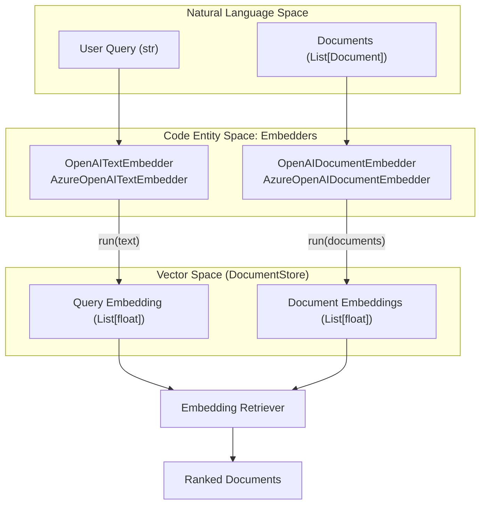
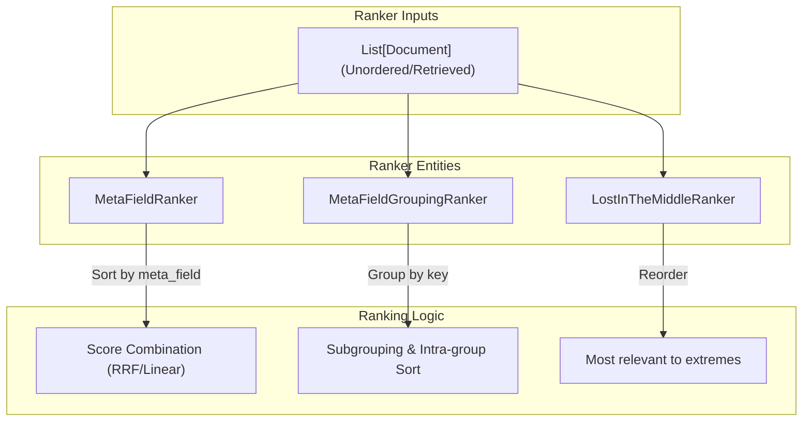

<!-- source: DeepWiki mcp.deepwiki.com · repo deepset-ai/haystack · page 5.3 Embedders and Rankers · fetched 2026-10-26 -->

# Embedders and Rankers

Relevant source files

The following files were used as context for generating this wiki page:

- [haystack/components/embedders/azure_document_embedder.py](haystack/components/embedders/azure_document_embedder.py)
- [haystack/components/embedders/azure_text_embedder.py](haystack/components/embedders/azure_text_embedder.py)
- [haystack/components/embedders/openai_document_embedder.py](haystack/components/embedders/openai_document_embedder.py)
- [haystack/components/embedders/openai_text_embedder.py](haystack/components/embedders/openai_text_embedder.py)
- [haystack/components/embedders/types/__init__.py](haystack/components/embedders/types/__init__.py)
- [haystack/components/embedders/types/protocol.py](haystack/components/embedders/types/protocol.py)
- [haystack/components/preprocessors/embedding_based_document_splitter.py](haystack/components/preprocessors/embedding_based_document_splitter.py)
- [haystack/components/rankers/__init__.py](haystack/components/rankers/__init__.py)
- [haystack/components/rankers/lost_in_the_middle.py](haystack/components/rankers/lost_in_the_middle.py)
- [haystack/components/rankers/meta_field.py](haystack/components/rankers/meta_field.py)
- [haystack/components/rankers/meta_field_grouping_ranker.py](haystack/components/rankers/meta_field_grouping_ranker.py)
- [haystack/components/samplers/top_p.py](haystack/components/samplers/top_p.py)
- [haystack/testing/factory.py](haystack/testing/factory.py)
- [pydoc/rankers_api.yml](pydoc/rankers_api.yml)
- [releasenotes/notes/add-diversity-ranker-6ecee21134eda673.yaml](releasenotes/notes/add-diversity-ranker-6ecee21134eda673.yaml)
- [releasenotes/notes/add-llm-ranker-d68d1cd607ed7b39.yaml](releasenotes/notes/add-llm-ranker-d68d1cd607ed7b39.yaml)
- [releasenotes/notes/add-lost-in-the-middle-ranker-976f2e9bf83c3c68.yaml](releasenotes/notes/add-lost-in-the-middle-ranker-976f2e9bf83c3c68.yaml)
- [releasenotes/notes/add-min-top-k-top-p-sampler-dc65f97d420e70b0.yaml](releasenotes/notes/add-min-top-k-top-p-sampler-dc65f97d420e70b0.yaml)
- [releasenotes/notes/adding-EmbeddingBasedDocumentSplitter-b41baca209a91996.yaml](releasenotes/notes/adding-EmbeddingBasedDocumentSplitter-b41baca209a91996.yaml)
- [releasenotes/notes/adding-TextEmbedder-Protocol-948b31b005d798b9.yaml](releasenotes/notes/adding-TextEmbedder-Protocol-948b31b005d798b9.yaml)
- [releasenotes/notes/document-validate-fields-in-post-init-6b2e9f4a1c8d375e.yaml](releasenotes/notes/document-validate-fields-in-post-init-6b2e9f4a1c8d375e.yaml)
- [releasenotes/notes/fix-embedding-splitter-missing-split-idx-start-8727a44789f5256a.yaml](releasenotes/notes/fix-embedding-splitter-missing-split-idx-start-8727a44789f5256a.yaml)
- [releasenotes/notes/fix-metafieldgroupingranker-bc33f5c886067e00.yaml](releasenotes/notes/fix-metafieldgroupingranker-bc33f5c886067e00.yaml)
- [releasenotes/notes/fix-metafieldgroupingranker-non-numeric-sort-a3595a30603c12ba.yaml](releasenotes/notes/fix-metafieldgroupingranker-non-numeric-sort-a3595a30603c12ba.yaml)
- [releasenotes/notes/fix-metafieldranker-weight-in-run-66ce13191e596214.yaml](releasenotes/notes/fix-metafieldranker-weight-in-run-66ce13191e596214.yaml)
- [releasenotes/notes/fix-top-p-sampler-int-scores-and-zero-override-dd3b0e65d9c0603f.yaml](releasenotes/notes/fix-top-p-sampler-int-scores-and-zero-override-dd3b0e65d9c0603f.yaml)
- [releasenotes/notes/meta-field-grouping-ranker-mixed-type-sort-161c30a3ec07c5ac.yaml](releasenotes/notes/meta-field-grouping-ranker-mixed-type-sort-161c30a3ec07c5ac.yaml)
- [releasenotes/notes/metafield-ranker-runtime-top-k-zero-905467e2c1a7e891.yaml](releasenotes/notes/metafield-ranker-runtime-top-k-zero-905467e2c1a7e891.yaml)
- [releasenotes/notes/metafieldranker-meta-value-type-365ff1bdb412257b.yaml](releasenotes/notes/metafieldranker-meta-value-type-365ff1bdb412257b.yaml)
- [releasenotes/notes/metaranker-missing-meta-options-1a969008d632a523.yaml](releasenotes/notes/metaranker-missing-meta-options-1a969008d632a523.yaml)
- [releasenotes/notes/multi-query-de-dup-by-id-9e8c431c2a06efac.yaml](releasenotes/notes/multi-query-de-dup-by-id-9e8c431c2a06efac.yaml)
- [releasenotes/notes/run-async-embeddingbaseddocumentsplitter-d72bdd099d310e70.yaml](releasenotes/notes/run-async-embeddingbaseddocumentsplitter-d72bdd099d310e70.yaml)
- [releasenotes/notes/updated-ranking-mode-in-meta-field-ranker-d1f1304cc422b202.yaml](releasenotes/notes/updated-ranking-mode-in-meta-field-ranker-d1f1304cc422b202.yaml)
- [test/components/embedders/test_azure_document_embedder.py](test/components/embedders/test_azure_document_embedder.py)
- [test/components/embedders/test_azure_text_embedder.py](test/components/embedders/test_azure_text_embedder.py)
- [test/components/embedders/test_openai_document_embedder.py](test/components/embedders/test_openai_document_embedder.py)
- [test/components/embedders/test_openai_text_embedder.py](test/components/embedders/test_openai_text_embedder.py)
- [test/components/preprocessors/test_embedding_based_document_splitter.py](test/components/preprocessors/test_embedding_based_document_splitter.py)
- [test/components/rankers/test_lost_in_the_middle.py](test/components/rankers/test_lost_in_the_middle.py)
- [test/components/rankers/test_meta_field_grouping_ranker.py](test/components/rankers/test_meta_field_grouping_ranker.py)
- [test/components/rankers/test_metafield.py](test/components/rankers/test_metafield.py)
- [test/components/samplers/test_top_p.py](test/components/samplers/test_top_p.py)
- [test/testing/test_factory.py](test/testing/test_factory.py)

This page documents the embedding and ranking components in Haystack. Embedders transform text, documents, and images into numerical vectors (embeddings) for semantic search, while Rankers reorder retrieved documents based on similarity or diversity to improve the quality of final results.

## Overview

Haystack provides a variety of embedders for different providers and local models, alongside specialized rankers for multi-stage retrieval pipelines.

1.  **Text Embedders**: Transform single strings (queries) into vectors.
2.  **Document Embedders**: Process lists of `Document` objects, storing vectors in the `embedding` field.
3.  **Sparse Embedders**: Generate sparse vectors (e.g., for SPLADE) for keyword-aware semantic search.
4.  **Rankers**: Reorder documents using Cross-Encoders (Similarity), metadata, or algorithms that optimize context for LLMs.

**Data Flow: From Natural Language to Vector Space**

Sources:
- [haystack/components/embedders/openai_text_embedder.py:17-37]()
- [haystack/components/embedders/openai_document_embedder.py:22-40]()

---

## OpenAI and Azure Embedders

Haystack supports OpenAI's embedding models (e.g., `text-embedding-3-small`, `text-embedding-ada-002`) via both the standard OpenAI API and Azure OpenAI Service.

### Implementation Details
The `OpenAIDocumentEmbedder` and `OpenAITextEmbedder` use the `openai` Python client. They support features like:
- **Dimensions**: Customizing vector size for models that support Matryoshka Representation Learning [haystack/components/embedders/openai_text_embedder.py:43]().
- **Batching**: Document embedders use `more_itertools.batched` to send documents in chunks defined by `batch_size` [haystack/components/embedders/openai_document_embedder.py:88-89]().
- **Metadata Embedding**: Document embedders can concatenate metadata fields to the text content before embedding using `meta_fields_to_embed` and `embedding_separator` [haystack/components/embedders/openai_document_embedder.py:92-95]().

### Azure Variants
`AzureOpenAIDocumentEmbedder` and `AzureOpenAITextEmbedder` inherit from their OpenAI counterparts but initialize the `AzureOpenAI` client [haystack/components/embedders/azure_document_embedder.py:19-152](). They require an `azure_endpoint` and support authentication via `api_key` or `azure_ad_token` [haystack/components/embedders/azure_document_embedder.py:123-127]().

| Component | Input Type | Output Type |
| :--- | :--- | :--- |
| `OpenAITextEmbedder` | `text: str` | `embedding: List[float]` |
| `OpenAIDocumentEmbedder` | `documents: List[Document]` | `documents: List[Document]` (with embeddings) |

Sources:
- [haystack/components/embedders/openai_text_embedder.py:17-116]()
- [haystack/components/embedders/openai_document_embedder.py:22-141]()
- [haystack/components/embedders/azure_text_embedder.py:17-147]()
- [haystack/components/embedders/azure_document_embedder.py:19-152]()

---

## Specialized Document Processing

### Embedding-Based Splitting
The `EmbeddingBasedDocumentSplitter` splits documents based on cosine distances between sequential sentence groups. It uses a `DocumentEmbedder` to calculate semantic similarities and identifies break points where the distance exceeds a specified `percentile` [haystack/components/preprocessors/embedding_based_document_splitter.py:24-60]().

**Splitting Logic**
1. Splits text into sentences using `SentenceSplitter` [haystack/components/preprocessors/embedding_based_document_splitter.py:126-132]().
2. Groups sentences (default `sentences_per_group=3`) [haystack/components/preprocessors/embedding_based_document_splitter.py:75]().
3. Embeds groups and calculates cosine distances.
4. Creates new documents at semantic shifts [haystack/components/preprocessors/embedding_based_document_splitter.py:28-32]().

Sources:
- [haystack/components/preprocessors/embedding_based_document_splitter.py:24-120]()

---

## Rankers

Rankers are used after retrieval to refine the order of documents. They are critical in RAG (Retrieval-Augmented Generation) pipelines to ensure the most relevant context is provided to the LLM.

### Meta Field Ranker
The `MetaFieldRanker` reorders documents based on a specific metadata field (e.g., "rating" or "date") [haystack/components/rankers/meta_field.py:19-42]().
- **Ranking Modes**: Supports `reciprocal_rank_fusion` (default) and `linear_score` [haystack/components/rankers/meta_field.py:49]().
- **Sorting**: Configurable `sort_order` ("ascending" or "descending") and handling of missing metadata via `missing_meta` ("drop", "top", "bottom") [haystack/components/rankers/meta_field.py:50-51]().
- **Type Parsing**: Can parse strings into `float`, `int`, or `date` before sorting via `meta_value_type` [haystack/components/rankers/meta_field.py:82-91]().

### Meta Field Grouping Ranker
The `MetaFieldGroupingRanker` reorders documents by grouping them based on primary (`group_by`) and optional secondary (`subgroup_by`) metadata keys [haystack/components/rankers/meta_field_grouping_ranker.py:14-23](). It can further sort documents within these groups using `sort_docs_by` [haystack/components/rankers/meta_field_grouping_ranker.py:67-69]().

### Lost In The Middle Ranker
The `LostInTheMiddleRanker` reorders documents so that the most relevant ones are at the beginning and end of the list, while less relevant ones are in the middle [haystack/components/rankers/lost_in_the_middle.py:11-20](). This addresses the "lost in the middle" phenomenon where LLMs struggle to utilize context placed in the center of a long prompt.

**Ranking Logic Diagram**

| Ranker Class | Primary Purpose | Key Parameter |
| :--- | :--- | :--- |
| `MetaFieldRanker` | Metadata-based Ordering | `meta_field`, `weight` |
| `MetaFieldGroupingRanker` | Structural Reordering | `group_by`, `subgroup_by` |
| `LostInTheMiddleRanker` | Context Optimization | `word_count_threshold` |

Sources:
- [haystack/components/rankers/meta_field.py:19-108]()
- [haystack/components/rankers/meta_field_grouping_ranker.py:14-75]()
- [haystack/components/rankers/lost_in_the_middle.py:11-30]()
- [haystack/components/samplers/top_p.py:11-25]()

---

