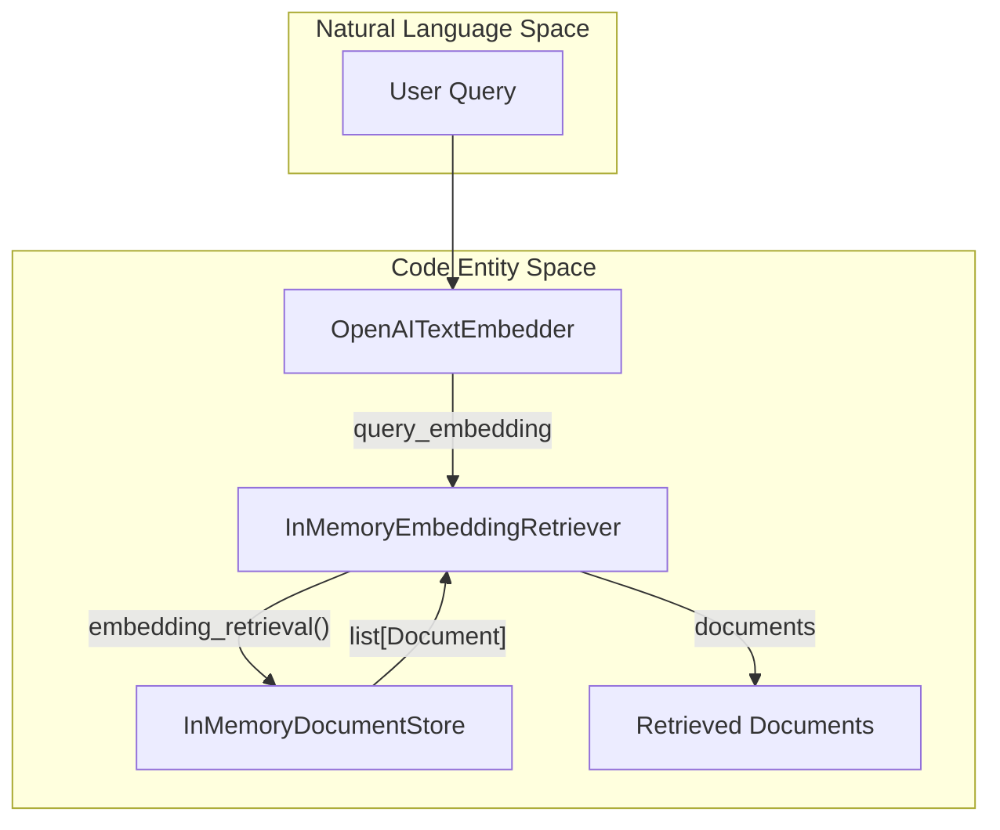
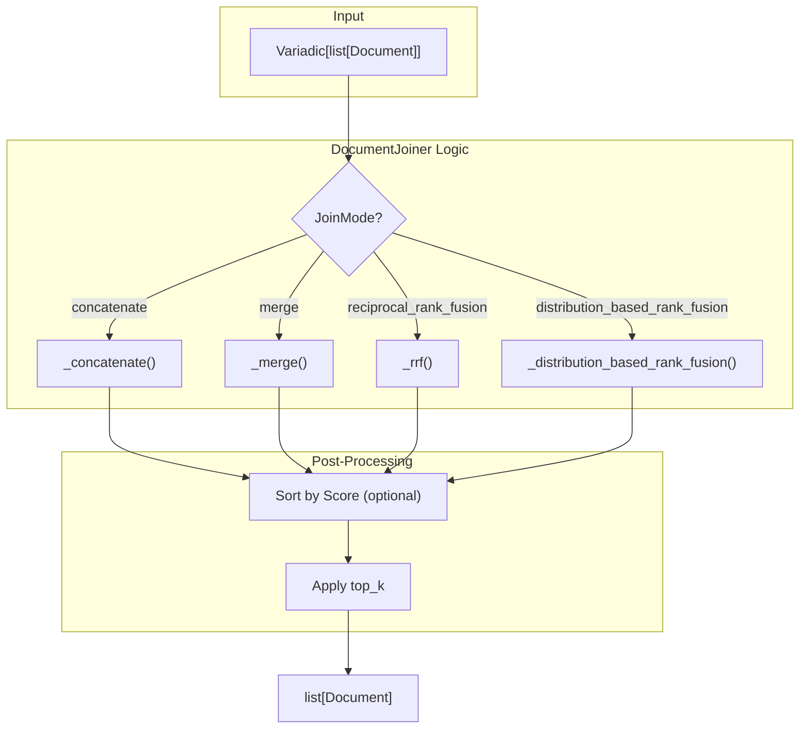

<!-- source: DeepWiki mcp.deepwiki.com · repo deepset-ai/haystack · page 5.4 Document Preprocessing and Retrieval · fetched 2026-10-26 -->

# Document Preprocessing and Retrieval

Relevant source files

The following files were used as context for generating this wiki page:

- [e2e/pipelines/test_evaluation_pipeline.py](e2e/pipelines/test_evaluation_pipeline.py)
- [e2e/pipelines/test_pdf_content_extraction_pipeline.py](e2e/pipelines/test_pdf_content_extraction_pipeline.py)
- [haystack/components/converters/multi_file_converter.py](haystack/components/converters/multi_file_converter.py)
- [haystack/components/joiners/__init__.py](haystack/components/joiners/__init__.py)
- [haystack/components/joiners/answer_joiner.py](haystack/components/joiners/answer_joiner.py)
- [haystack/components/joiners/document_joiner.py](haystack/components/joiners/document_joiner.py)
- [haystack/components/joiners/list_joiner.py](haystack/components/joiners/list_joiner.py)
- [haystack/components/preprocessors/__init__.py](haystack/components/preprocessors/__init__.py)
- [haystack/components/preprocessors/csv_document_splitter.py](haystack/components/preprocessors/csv_document_splitter.py)
- [haystack/components/preprocessors/document_cleaner.py](haystack/components/preprocessors/document_cleaner.py)
- [haystack/components/preprocessors/document_preprocessor.py](haystack/components/preprocessors/document_preprocessor.py)
- [haystack/components/preprocessors/document_splitter.py](haystack/components/preprocessors/document_splitter.py)
- [haystack/components/preprocessors/hierarchical_document_splitter.py](haystack/components/preprocessors/hierarchical_document_splitter.py)
- [haystack/components/preprocessors/markdown_header_splitter.py](haystack/components/preprocessors/markdown_header_splitter.py)
- [haystack/components/preprocessors/python_code_splitter.py](haystack/components/preprocessors/python_code_splitter.py)
- [haystack/components/preprocessors/recursive_splitter.py](haystack/components/preprocessors/recursive_splitter.py)
- [haystack/components/preprocessors/text_cleaner.py](haystack/components/preprocessors/text_cleaner.py)
- [haystack/components/retrievers/in_memory/bm25_retriever.py](haystack/components/retrievers/in_memory/bm25_retriever.py)
- [haystack/components/retrievers/in_memory/embedding_retriever.py](haystack/components/retrievers/in_memory/embedding_retriever.py)
- [haystack/components/routers/__init__.py](haystack/components/routers/__init__.py)
- [haystack/py.typed](haystack/py.typed)
- [pydoc/routers_api.yml](pydoc/routers_api.yml)
- [releasenotes/notes/add-keep-id-to-document-cleaner-2a9854b5f195bb78.yaml](releasenotes/notes/add-keep-id-to-document-cleaner-2a9854b5f195bb78.yaml)
- [releasenotes/notes/add-list-joiner-4f0ea84e195fa461.yaml](releasenotes/notes/add-list-joiner-4f0ea84e195fa461.yaml)
- [releasenotes/notes/add-python-code-splitter-b6fab0603ba596a5.yaml](releasenotes/notes/add-python-code-splitter-b6fab0603ba596a5.yaml)
- [releasenotes/notes/add-split-by-row-csv-splitter-e810b96b0db287b3.yaml](releasenotes/notes/add-split-by-row-csv-splitter-e810b96b0db287b3.yaml)
- [releasenotes/notes/add-string-joiner-a7754e6bff9332ea.yaml](releasenotes/notes/add-string-joiner-a7754e6bff9332ea.yaml)
- [releasenotes/notes/add-unicode-normalization-and-ascii-mode-to-document-cleaner-ba536b46e499663c.yaml](releasenotes/notes/add-unicode-normalization-and-ascii-mode-to-document-cleaner-ba536b46e499663c.yaml)
- [releasenotes/notes/csv-document-splitter-426dcc0392c08f62.yaml](releasenotes/notes/csv-document-splitter-426dcc0392c08f62.yaml)
- [releasenotes/notes/doc-splitter-skip-empty-docs-a031fa7c5ddf8c93.yaml](releasenotes/notes/doc-splitter-skip-empty-docs-a031fa7c5ddf8c93.yaml)
- [releasenotes/notes/document-cleaner-expansion-d7f301767ecd40a5.yaml](releasenotes/notes/document-cleaner-expansion-d7f301767ecd40a5.yaml)
- [releasenotes/notes/document-joiner-zero-sum-weights-263b18a84420f1cb.yaml](releasenotes/notes/document-joiner-zero-sum-weights-263b18a84420f1cb.yaml)
- [releasenotes/notes/feat-documentsplitter-add-split-by-function-77501f439b63bb49.yaml](releasenotes/notes/feat-documentsplitter-add-split-by-function-77501f439b63bb49.yaml)
- [releasenotes/notes/feat-split-by-line-splitter-aa804cb2346c6ed9.yaml](releasenotes/notes/feat-split-by-line-splitter-aa804cb2346c6ed9.yaml)
- [releasenotes/notes/filter-policy-merge-in-memory-retrievers-f49dfcb2a1332e8b.yaml](releasenotes/notes/filter-policy-merge-in-memory-retrievers-f49dfcb2a1332e8b.yaml)
- [releasenotes/notes/fix-answerjoiner-sort-by-score-none-30d33e2bc93fd668.yaml](releasenotes/notes/fix-answerjoiner-sort-by-score-none-30d33e2bc93fd668.yaml)
- [releasenotes/notes/fix-dbsf-joiner-none-score-715d7d8c5f06c222.yaml](releasenotes/notes/fix-dbsf-joiner-none-score-715d7d8c5f06c222.yaml)
- [releasenotes/notes/fix-document-cleaner-3-page-wipe-1c2d3e4f5a6b7089.yaml](releasenotes/notes/fix-document-cleaner-3-page-wipe-1c2d3e4f5a6b7089.yaml)
- [releasenotes/notes/fix-document-cleaner-4e18a63fd7dc2bd9.yaml](releasenotes/notes/fix-document-cleaner-4e18a63fd7dc2bd9.yaml)
- [releasenotes/notes/fix-document-cleaner-log-format-672f771360990180.yaml](releasenotes/notes/fix-document-cleaner-log-format-672f771360990180.yaml)
- [releasenotes/notes/fix-document-cleaner-page-tag-15c66d6433b82b0a.yaml](releasenotes/notes/fix-document-cleaner-page-tag-15c66d6433b82b0a.yaml)
- [releasenotes/notes/fix-document-joiner-division-by-zero-b24f95d37b007264.yaml](releasenotes/notes/fix-document-joiner-division-by-zero-b24f95d37b007264.yaml)
- [releasenotes/notes/fix-document-joiner-zero-score-dedup-e79458b9865b0867.yaml](releasenotes/notes/fix-document-joiner-zero-score-dedup-e79458b9865b0867.yaml)
- [releasenotes/notes/fix-document-splitter-overlap-validation-92ea8234c2c322cc.yaml](releasenotes/notes/fix-document-splitter-overlap-validation-92ea8234c2c322cc.yaml)
- [releasenotes/notes/fix-filetype-router-inconsistencies-b22a3af00059f953.yaml](releasenotes/notes/fix-filetype-router-inconsistencies-b22a3af00059f953.yaml)
- [releasenotes/notes/fix-hierarchical-splitter-input-mutation-0a10d4b60f5cac79.yaml](releasenotes/notes/fix-hierarchical-splitter-input-mutation-0a10d4b60f5cac79.yaml)
- [releasenotes/notes/fix-markdown-splitter-content-loss-3e4f5a6b7c8d9012.yaml](releasenotes/notes/fix-markdown-splitter-content-loss-3e4f5a6b7c8d9012.yaml)
- [releasenotes/notes/fix-markdown-splitter-trailing-header-9c1a2b3d4e5f6a7b.yaml](releasenotes/notes/fix-markdown-splitter-trailing-header-9c1a2b3d4e5f6a7b.yaml)
- [releasenotes/notes/fix-missing-parent-header-error-MarkdownHeaderSplitter-b5db96e19011b6b9.yaml](releasenotes/notes/fix-missing-parent-header-error-MarkdownHeaderSplitter-b5db96e19011b6b9.yaml)
- [releasenotes/notes/fix-recursive-splitter-fallback-overlap-8171ab24e89e6bb4.yaml](releasenotes/notes/fix-recursive-splitter-fallback-overlap-8171ab24e89e6bb4.yaml)
- [releasenotes/notes/fix-recursive-splitter-split-idx-start-word-overlap-8c46249a7c69284f.yaml](releasenotes/notes/fix-recursive-splitter-split-idx-start-word-overlap-8c46249a7c69284f.yaml)
- [releasenotes/notes/fix-recursive-splitter-trailing-whitespace-chunk-d04e66f19a7a49d6.yaml](releasenotes/notes/fix-recursive-splitter-trailing-whitespace-chunk-d04e66f19a7a49d6.yaml)
- [releasenotes/notes/fix-recursive-splitter-unique-ids-5ae9901b81131302.yaml](releasenotes/notes/fix-recursive-splitter-unique-ids-5ae9901b81131302.yaml)
- [releasenotes/notes/fix-recursive-splitter-word-token-overlap-metadata-9f3c1a7be0d24856.yaml](releasenotes/notes/fix-recursive-splitter-word-token-overlap-metadata-9f3c1a7be0d24856.yaml)
- [releasenotes/notes/fixing-bug-recursive-splitter-88d5714529f84e4e.yaml](releasenotes/notes/fixing-bug-recursive-splitter-88d5714529f84e4e.yaml)
- [releasenotes/notes/hierarchical-splitter-validation-68ae54e878c47abf.yaml](releasenotes/notes/hierarchical-splitter-validation-68ae54e878c47abf.yaml)
- [releasenotes/notes/introduce-answer-joiner-component-885dd7846776f5cb.yaml](releasenotes/notes/introduce-answer-joiner-component-885dd7846776f5cb.yaml)
- [releasenotes/notes/joiners-top-k-validation-feb0e2c38da8703e.yaml](releasenotes/notes/joiners-top-k-validation-feb0e2c38da8703e.yaml)
- [releasenotes/notes/markdown-header-splitter-improvements-79c3c6660c62754f.yaml](releasenotes/notes/markdown-header-splitter-improvements-79c3c6660c62754f.yaml)
- [releasenotes/notes/move-over-supercomponents-24907133d0d90ed6.yaml](releasenotes/notes/move-over-supercomponents-24907133d0d90ed6.yaml)
- [releasenotes/notes/py-typed-724eea7222640e6d.yaml](releasenotes/notes/py-typed-724eea7222640e6d.yaml)
- [releasenotes/notes/python-code-splitter-secondary-split-context-8449dc47dcce0928.yaml](releasenotes/notes/python-code-splitter-secondary-split-context-8449dc47dcce0928.yaml)
- [releasenotes/notes/recursive-splitter-source-id-4efff9b9344f57e4.yaml](releasenotes/notes/recursive-splitter-source-id-4efff9b9344f57e4.yaml)
- [releasenotes/notes/recursive-splitter-token-df56428887ac45bd.yaml](releasenotes/notes/recursive-splitter-token-df56428887ac45bd.yaml)
- [releasenotes/notes/refactor-documentjoiner-992e662bee8ca219.yaml](releasenotes/notes/refactor-documentjoiner-992e662bee8ca219.yaml)
- [releasenotes/notes/remove-langdetect-components-b18af414c497a70c.yaml](releasenotes/notes/remove-langdetect-components-b18af414c497a70c.yaml)
- [releasenotes/notes/split-by-function-62ce32fac70d8f8c.yaml](releasenotes/notes/split-by-function-62ce32fac70d8f8c.yaml)
- [releasenotes/notes/splitters-deepcopy-nested-meta-38d0c72160c7b445.yaml](releasenotes/notes/splitters-deepcopy-nested-meta-38d0c72160c7b445.yaml)
- [releasenotes/notes/text-cleaner-eee0eecbdec21427.yaml](releasenotes/notes/text-cleaner-eee0eecbdec21427.yaml)
- [releasenotes/notes/update-list-joiner-0a068cfb058f3c35.yaml](releasenotes/notes/update-list-joiner-0a068cfb058f3c35.yaml)
- [releasenotes/notes/updated-documentsplitter-762c4409cbc296e6.yaml](releasenotes/notes/updated-documentsplitter-762c4409cbc296e6.yaml)
- [test/components/converters/test_multi_file_converter.py](test/components/converters/test_multi_file_converter.py)
- [test/components/joiners/test_answer_joiner.py](test/components/joiners/test_answer_joiner.py)
- [test/components/joiners/test_document_joiner.py](test/components/joiners/test_document_joiner.py)
- [test/components/joiners/test_list_joiner.py](test/components/joiners/test_list_joiner.py)
- [test/components/joiners/test_string_joiner.py](test/components/joiners/test_string_joiner.py)
- [test/components/preprocessors/test_csv_document_splitter.py](test/components/preprocessors/test_csv_document_splitter.py)
- [test/components/preprocessors/test_document_cleaner.py](test/components/preprocessors/test_document_cleaner.py)
- [test/components/preprocessors/test_document_preprocessor.py](test/components/preprocessors/test_document_preprocessor.py)
- [test/components/preprocessors/test_document_splitter.py](test/components/preprocessors/test_document_splitter.py)
- [test/components/preprocessors/test_hierarchical_doc_splitter.py](test/components/preprocessors/test_hierarchical_doc_splitter.py)
- [test/components/preprocessors/test_markdown_header_splitter.py](test/components/preprocessors/test_markdown_header_splitter.py)
- [test/components/preprocessors/test_python_code_splitter.py](test/components/preprocessors/test_python_code_splitter.py)
- [test/components/preprocessors/test_recursive_splitter.py](test/components/preprocessors/test_recursive_splitter.py)
- [test/components/preprocessors/test_text_cleaner.py](test/components/preprocessors/test_text_cleaner.py)
- [test/components/retrievers/test_in_memory_bm25_retriever.py](test/components/retrievers/test_in_memory_bm25_retriever.py)
- [test/components/retrievers/test_in_memory_embedding_retriever.py](test/components/retrievers/test_in_memory_embedding_retriever.py)
- [test/test_files/json/json_conversion_testfile.json](test/test_files/json/json_conversion_testfile.json)
- [test/test_files/txt/doc_4](test/test_files/txt/doc_4)

This page documents the components responsible for preparing `Document` objects for indexing and the sophisticated retrieval strategies used to fetch them from `DocumentStore` instances. These components form the bridge between raw data ingestion and the generation phase of a RAG (Retrieval-Augmented Generation) pipeline.

## Document Preprocessors

Preprocessors transform raw `Document` content into a format optimized for vectorization and LLM context windows. This includes cleaning noise and splitting large texts into manageable chunks.

### Document Cleaning
The `DocumentCleaner` class handles standard text normalization tasks. It processes documents sequentially, applying transformations in a fixed order to ensure consistency.

| Feature | Description | Implementation |
| :--- | :--- | :--- |
| **Normalization** | Supports NFC, NFKC, NFD, NFKD forms | `_normalize_unicode` [haystack/components/preprocessors/document_cleaner.py:162-170]() |
| **ASCII Conversion** | Removes accents and non-ASCII characters | `_ascii_only` [haystack/components/preprocessors/document_cleaner.py:133]() |
| **Whitespace** | Removes extra spaces or leading/trailing chars | `_remove_extra_whitespaces` [haystack/components/preprocessors/document_cleaner.py:134-135]() |
| **Regex Support** | Pattern-based removal or replacement | `_replace_regexes` [haystack/components/preprocessors/document_cleaner.py:142-143]() |
| **Header/Footer** | Removes repeated substrings across pages | `_remove_repeated_substrings` [haystack/components/preprocessors/document_cleaner.py:144-145]() |

**Sources:** [haystack/components/preprocessors/document_cleaner.py:19-160]()

### Document Splitting
`DocumentSplitter` is the primary component for chunking. It supports various granularities (`word`, `sentence`, `page`, `passage`, `period`, `line`) and maintains metadata like `split_id` and `split_idx_start` to allow for reconstruction [haystack/components/preprocessors/document_splitter.py:72-78]().

*   **Sentence Splitting**: Uses NLTK via `SentenceSplitter` [haystack/components/preprocessors/sentence_tokenizer.py:12-13]().
*   **Overlap Management**: Chunks can overlap by a specified `split_overlap` to preserve semantic context at boundaries [haystack/components/preprocessors/document_splitter.py:100]().
*   **Thresholding**: Small terminal chunks can be merged into the previous chunk if they fall below `split_threshold` [haystack/components/preprocessors/document_splitter.py:101]().

**Specialized Splitters:**
*   **RecursiveDocumentSplitter**: Recursively applies a list of separators (default: `["\n\n", "sentence", "\n", " "]`) until chunks fit the `split_length`. Supports `word`, `char`, or `token` (via `tiktoken`) units [haystack/components/preprocessors/recursive_splitter.py:19-110]().
*   **MarkdownHeaderSplitter**: Splits at ATX-style Markdown headers (#), preserving hierarchy in `parent_headers` metadata. It can optionally perform a `secondary_split` using a standard `DocumentSplitter` [haystack/components/preprocessors/markdown_header_splitter.py:16-111]().
*   **CSVDocumentSplitter**: Splits CSV files by row groups [haystack/components/preprocessors/__init__.py:12]().
*   **HierarchicalDocumentSplitter**: Creates a tree structure of parent and child documents [haystack/components/preprocessors/__init__.py:17]().
*   **EmbeddingBasedDocumentSplitter**: Uses embeddings to determine optimal split points based on semantic shifts [haystack/components/preprocessors/__init__.py:16]().

**Sources:** [haystack/components/preprocessors/document_splitter.py:23-116](), [haystack/components/preprocessors/recursive_splitter.py:19-110](), [haystack/components/preprocessors/markdown_header_splitter.py:16-111](), [haystack/components/preprocessors/__init__.py:10-22]()

## Retrieval Strategies

Retrievers fetch relevant `Document` objects from a `DocumentStore`. While basic retrievers (BM25, Embedding) are common, Haystack provides specialized implementations for different data stores.

### InMemory Retrievers
*   **InMemoryEmbeddingRetriever**: Performs vector similarity search using a `query_embedding` against the `InMemoryDocumentStore`. It supports `FilterPolicy` (REPLACE or MERGE) to handle runtime filters [haystack/components/retrievers/in_memory/embedding_retriever.py:13-96]().
*   **InMemoryBM25Retriever**: Performs keyword-based search using the BM25 algorithm [haystack/components/retrievers/in_memory/bm25_retriever.py:1]().

**Data Flow: Retrieval to Context Expansion**

**Sources:** [haystack/components/retrievers/in_memory/embedding_retriever.py:13-180](), [haystack/components/retrievers/in_memory/bm25_retriever.py:1]()

## Document Joining

When multiple retrieval paths are used (e.g., Hybrid Search), results must be merged and deduplicated.

### DocumentJoiner
The `DocumentJoiner` merges multiple lists of `Document` objects. It supports several `JoinMode` algorithms:
*   **CONCATENATE**: Keeps the highest-scored document in case of duplicates [haystack/components/joiners/document_joiner.py:51]().
*   **MERGE**: Calculates a weighted sum of scores for duplicates [haystack/components/joiners/document_joiner.py:52]().
*   **RECIPROCAL_RANK_FUSION (RRF)**: Merges and assigns scores based on reciprocal rank across different retrievers [haystack/components/joiners/document_joiner.py:53]().
*   **DISTRIBUTION_BASED_RANK_FUSION**: Normalizes scores based on the distribution within each retriever's result set [haystack/components/joiners/document_joiner.py:54]().

**Joiner Configuration Logic**

**Sources:** [haystack/components/joiners/document_joiner.py:19-161](), [haystack/components/joiners/document_joiner.py:163-178]()

## Summary Table of Components

| Component | Role | Key Function/Class |
| :--- | :--- | :--- |
| **Cleaning** | Text noise removal | `DocumentCleaner` [haystack/components/preprocessors/document_cleaner.py:19]() |
| **Splitting** | Chunking large texts | `DocumentSplitter` [haystack/components/preprocessors/document_splitter.py:23]() |
| **Recursive Splitting** | Multi-separator chunking | `RecursiveDocumentSplitter` [haystack/components/preprocessors/recursive_splitter.py:19]() |
| **MD Splitting** | Structure-aware splitting | `MarkdownHeaderSplitter` [haystack/components/preprocessors/markdown_header_splitter.py:16]() |
| **Joining** | Merging retrieval results | `DocumentJoiner` [haystack/components/joiners/document_joiner.py:46]() |
| **Embedding Retrieval** | Vector-based search | `InMemoryEmbeddingRetriever` [haystack/components/retrievers/in_memory/embedding_retriever.py:13]() |

**Sources:** [haystack/components/preprocessors/__init__.py:10-22](), [haystack/components/joiners/document_joiner.py:45-55]()

---

