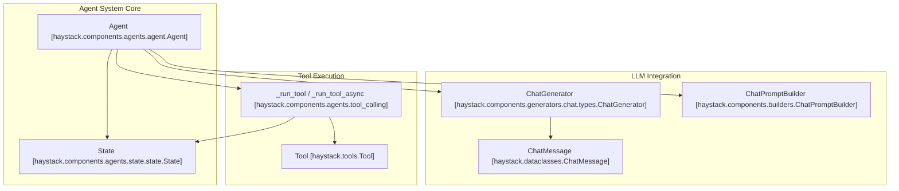
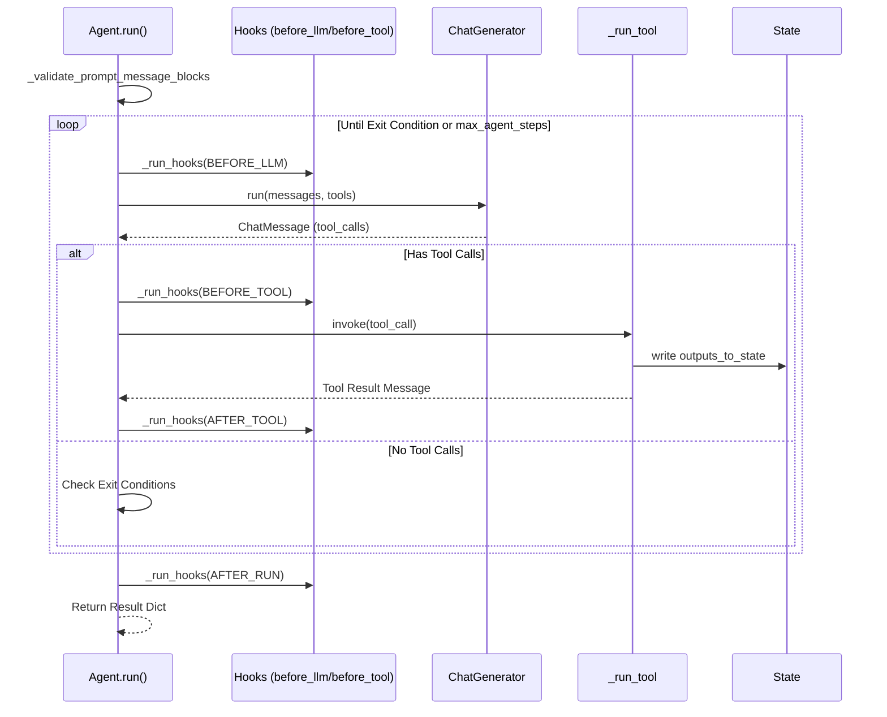
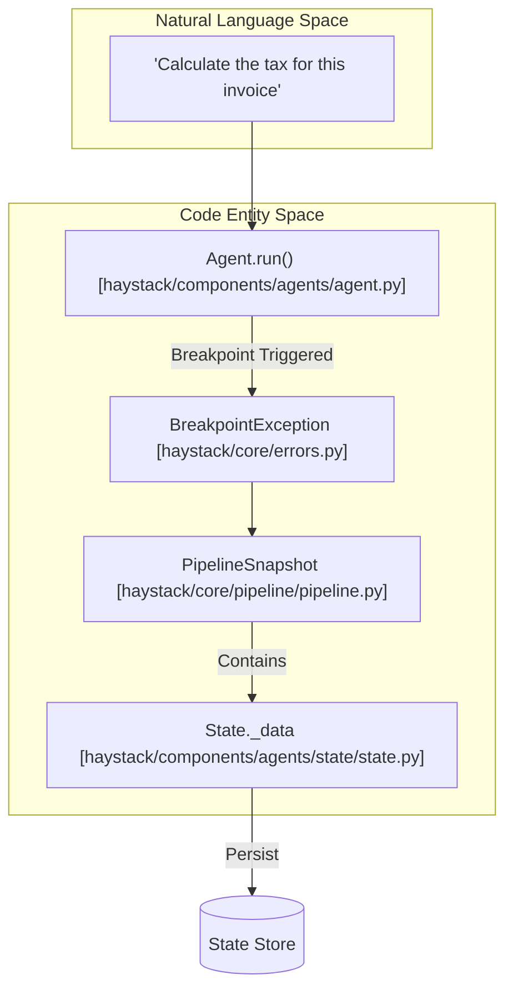

<!-- source: DeepWiki mcp.deepwiki.com · repo deepset-ai/haystack · page 6.1 Agent System · fetched 2026-10-26 -->

# Agent System

Relevant source files

The following files were used as context for generating this wiki page:

- [MIGRATION.md](MIGRATION.md)
- [docs-website/docs/concepts/agents.mdx](docs-website/docs/concepts/agents.mdx)
- [docs-website/docs/concepts/agents/multi-agent-systems.mdx](docs-website/docs/concepts/agents/multi-agent-systems.mdx)
- [docs-website/docs/concepts/concepts-overview.mdx](docs-website/docs/concepts/concepts-overview.mdx)
- [docs-website/docs/overview/migrating-from-langgraphlangchain-to-haystack.mdx](docs-website/docs/overview/migrating-from-langgraphlangchain-to-haystack.mdx)
- [docs-website/docs/pipeline-components/agents-1/agent.mdx](docs-website/docs/pipeline-components/agents-1/agent.mdx)
- [docs-website/docs/pipeline-components/agents-1/state.mdx](docs-website/docs/pipeline-components/agents-1/state.mdx)
- [docs-website/docs/tools/agenttool.mdx](docs-website/docs/tools/agenttool.mdx)
- [docs-website/docs/tools/componenttool.mdx](docs-website/docs/tools/componenttool.mdx)
- [docs-website/docs/tools/pipelinetool.mdx](docs-website/docs/tools/pipelinetool.mdx)
- [docs-website/docs/tools/tool.mdx](docs-website/docs/tools/tool.mdx)
- [docs-website/docs/tools/toolset.mdx](docs-website/docs/tools/toolset.mdx)
- [docs-website/versioned_docs/version-2.28/concepts/agents.mdx](docs-website/versioned_docs/version-2.28/concepts/agents.mdx)
- [docs-website/versioned_docs/version-2.28/concepts/agents/multi-agent-systems.mdx](docs-website/versioned_docs/version-2.28/concepts/agents/multi-agent-systems.mdx)
- [docs-website/versioned_docs/version-2.28/development/hayhooks.mdx](docs-website/versioned_docs/version-2.28/development/hayhooks.mdx)
- [docs-website/versioned_docs/version-2.28/pipeline-components/agents-1/agent.mdx](docs-website/versioned_docs/version-2.28/pipeline-components/agents-1/agent.mdx)
- [docs-website/versioned_docs/version-2.28/tools/componenttool.mdx](docs-website/versioned_docs/version-2.28/tools/componenttool.mdx)
- [docs-website/versioned_docs/version-2.28/tools/pipelinetool.mdx](docs-website/versioned_docs/version-2.28/tools/pipelinetool.mdx)
- [docs-website/versioned_sidebars/version-2.28-sidebars.json](docs-website/versioned_sidebars/version-2.28-sidebars.json)
- [haystack/components/agents/agent.py](haystack/components/agents/agent.py)
- [haystack/components/agents/state/state.py](haystack/components/agents/state/state.py)
- [haystack/components/agents/state/state_utils.py](haystack/components/agents/state/state_utils.py)
- [haystack/components/agents/utils.py](haystack/components/agents/utils.py)
- [haystack/hooks/__init__.py](haystack/hooks/__init__.py)
- [haystack/hooks/invocation.py](haystack/hooks/invocation.py)
- [haystack/hooks/protocol.py](haystack/hooks/protocol.py)
- [haystack/hooks/utils.py](haystack/hooks/utils.py)
- [releasenotes/notes/add-after-tool-hook-d8d0779aaf65ce66.yaml](releasenotes/notes/add-after-tool-hook-d8d0779aaf65ce66.yaml)
- [releasenotes/notes/add-agent-context-tokens-831273f057452c71.yaml](releasenotes/notes/add-agent-context-tokens-831273f057452c71.yaml)
- [releasenotes/notes/add-agent-hooks-4584408a3a2a2ad4.yaml](releasenotes/notes/add-agent-hooks-4584408a3a2a2ad4.yaml)
- [releasenotes/notes/add-before-run-after-run-hook-points-79609e8eda11fb6e.yaml](releasenotes/notes/add-before-run-after-run-hook-points-79609e8eda11fb6e.yaml)
- [releasenotes/notes/fix-serialization-passthrough-9f1c2a4b7e6d3f08.yaml](releasenotes/notes/fix-serialization-passthrough-9f1c2a4b7e6d3f08.yaml)
- [releasenotes/notes/fix-state-validate-schema-5ae41ce9c82de61a.yaml](releasenotes/notes/fix-state-validate-schema-5ae41ce9c82de61a.yaml)
- [releasenotes/notes/schema-validation-support-chatmessage-subclass-995fcdd860786cb3.yaml](releasenotes/notes/schema-validation-support-chatmessage-subclass-995fcdd860786cb3.yaml)
- [releasenotes/notes/sync-agent-step-count-after-before-run-hooks-39cb6a98cfa5f4f4.yaml](releasenotes/notes/sync-agent-step-count-after-before-run-hooks-39cb6a98cfa5f4f4.yaml)
- [test/components/agents/__init__.py](test/components/agents/__init__.py)
- [test/components/agents/test_agent.py](test/components/agents/test_agent.py)
- [test/components/agents/test_agent_hitl.py](test/components/agents/test_agent_hitl.py)
- [test/components/agents/test_agent_hooks.py](test/components/agents/test_agent_hooks.py)
- [test/components/agents/test_state_class.py](test/components/agents/test_state_class.py)
- [test/components/agents/test_utils.py](test/components/agents/test_utils.py)
- [test/hooks/test_invocation.py](test/hooks/test_invocation.py)

The Agent System provides autonomous, tool-using LLM orchestration capabilities within Haystack. It enables Large Language Models to iteratively execute tools, maintain state across interactions, and make decisions about when to stop processing based on configurable exit conditions.

## Core Architecture

The Agent System consists of several key components that work together to provide autonomous LLM behavior:

**Agent System Architecture**

The `Agent` class is the central orchestrator [haystack/components/agents/agent.py:198](). Unlike Haystack v2.x, the v3.0 `Agent` directly manages tool execution via internal utilities like `_run_tool` [haystack/components/agents/agent.py:18]() and `_run_tool_async` [haystack/components/agents/agent.py:18](), removing the need for a separate `ToolInvoker` component. The `State` object [haystack/components/agents/state/state.py:83]() provides a schema-validated container for data shared between the Agent and its Tools.

Sources: [haystack/components/agents/agent.py:198-217](), [haystack/components/agents/state/state.py:83-114](), [haystack/components/agents/tool_calling.py:18]()

## State Management

`State` is a specialized container that ensures data consistency using a schema [haystack/components/agents/state/state.py:116-131](). It automatically includes a `messages` field of type `list[ChatMessage]` [haystack/components/agents/state/state.py:129-130]().

### Schema and Handlers
Each field in the `State` is governed by a handler that determines how new values are merged with existing ones:
*   **List types**: Default to `merge_lists` [haystack/components/agents/state/state_utils.py:15](), which concatenates the new values.
*   **Other types**: Default to `replace_values` [haystack/components/agents/state/state_utils.py:15](), which overwrites the existing value.

The Agent also populates **Run Metadata** automatically, which are reserved keys in the state:
*   `step_count`: Number of iterations [haystack/components/agents/agent.py:77]().
*   `token_usage`: Aggregated usage across LLM calls [haystack/components/agents/agent.py:78]().
*   `tool_call_counts`: Map of tool names to invocation counts [haystack/components/agents/agent.py:79]().
*   `exit_reason`: Why the agent stopped (e.g., `"text"`, `"max_agent_steps"`) [haystack/components/agents/agent.py:80]().

Sources: [haystack/components/agents/state/state.py:57-82](), [haystack/components/agents/state/state.py:133-143](), [haystack/components/agents/agent.py:76-81]()

## Agent Execution Lifecycle

The agent execution loop manages the transition between the LLM generating tool calls and the execution of those tools.

**Agent Execution Flow**

The loop is implemented in `Agent.run()` [haystack/components/agents/agent.py:465]() and `Agent.run_async()` [haystack/components/agents/agent.py:601](). It uses `_check_exit_conditions()` [haystack/components/agents/agent.py:756]() to determine if the iteration should stop based on the presence of text or specific tool completions.

Sources: [haystack/components/agents/agent.py:465-599](), [haystack/components/agents/agent.py:601-754](), [haystack/components/agents/agent.py:756-784]()

## Hooks and Human-in-the-Loop

Agents support a robust hook system for intercepting execution at specific points: `before_run`, `before_llm`, `before_tool`, `after_tool`, `on_exit`, and `after_run` [haystack/hooks/protocol.py:41]().

A primary use case is **Human-in-the-Loop (HITL)**, where a `ConfirmationHook` is registered at the `before_tool` point [test/components/agents/test_agent_hitl.py:64]().

### Confirmation Strategies
*   **`BlockingConfirmationStrategy`**: Pauses execution to wait for user input via a `ConfirmationUI` [test/components/agents/test_agent_hitl.py:51]().
*   **Policies**: `AlwaysAskPolicy` or `NeverAskPolicy` determine when the UI is triggered [test/components/agents/test_agent_hitl.py:15-19]().

Sources: [haystack/hooks/protocol.py:34-44](), [test/components/agents/test_agent_hitl.py:51-64]()

## Breakpoints and Snapshots

The Agent System integrates with Haystack's pipeline-level breakpoints. This allows an Agent to pause (e.g., for complex human review or external approval) and resume.

Sources: [haystack/components/agents/agent.py:343-389](), [haystack/components/agents/state/state.py:175-194]()

## Configuration Parameters

| Parameter | Type | Description |
| :--- | :--- | :--- |
| `chat_generator` | `ChatGenerator` | The LLM component used for decision making [haystack/components/agents/agent.py:202](). |
| `tools` | `ToolsType` | List of `Tool` objects, `Toolset`, or `MCPToolset` [haystack/components/agents/agent.py:203](). |
| `system_prompt` | `str` | Template for the system message [haystack/components/agents/agent.py:204](). |
| `exit_conditions` | `list[str]` | Conditions to stop the loop (default `["text"]`) [haystack/components/agents/agent.py:208](). |
| `max_agent_steps` | `int` | Safety limit to prevent infinite loops (default 100) [haystack/components/agents/agent.py:211](). |
| `hooks` | `dict[HookPoint, list[Hook]]` | Hooks to run at specific lifecycle points [haystack/components/agents/agent.py:215](). |

Sources: [haystack/components/agents/agent.py:198-217]()

---

