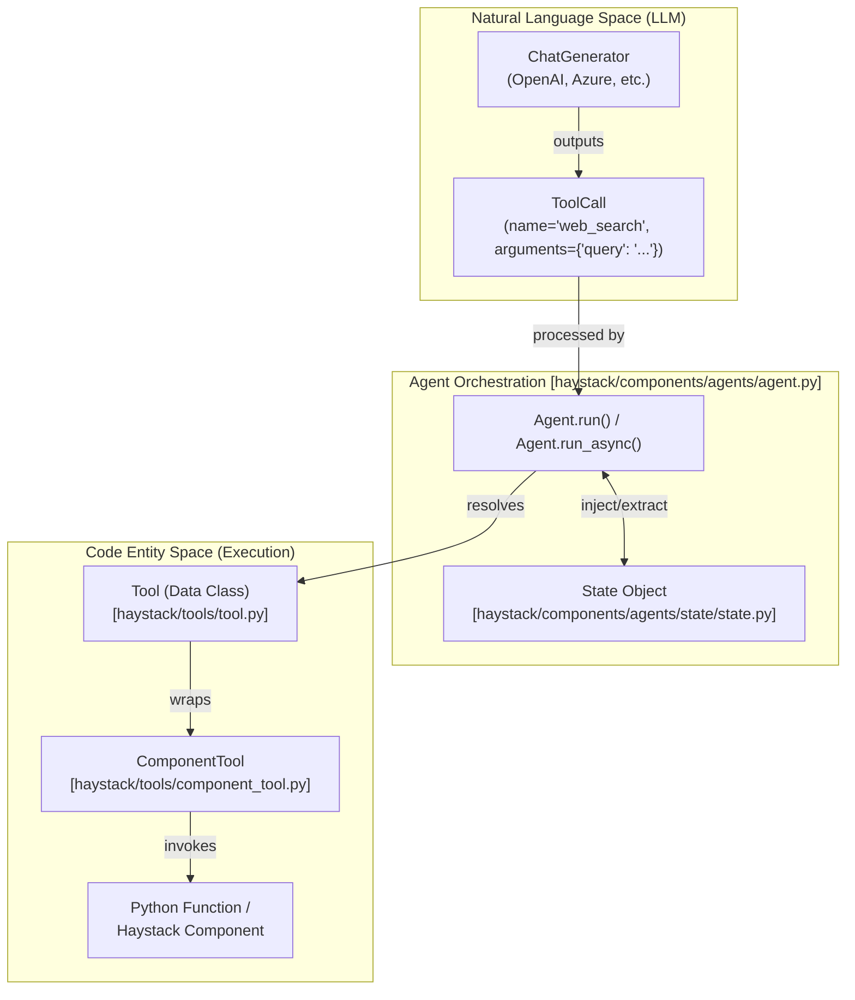
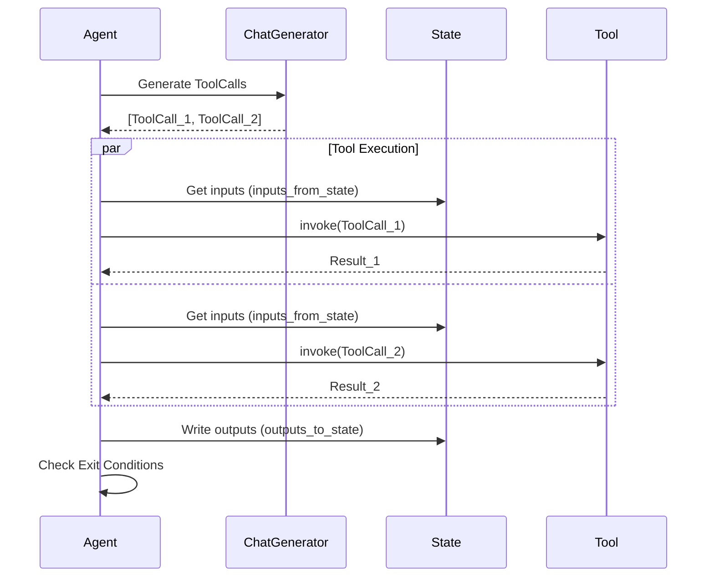

<!-- source: DeepWiki mcp.deepwiki.com · repo deepset-ai/haystack · page 6.2 Tool Invocation · fetched 2026-10-26 -->

# Tool Invocation

Relevant source files

The following files were used as context for generating this wiki page:

- [docs-website/docs/concepts/agents.mdx](docs-website/docs/concepts/agents.mdx)
- [docs-website/docs/concepts/agents/multi-agent-systems.mdx](docs-website/docs/concepts/agents/multi-agent-systems.mdx)
- [docs-website/docs/concepts/concepts-overview.mdx](docs-website/docs/concepts/concepts-overview.mdx)
- [docs-website/docs/overview/migrating-from-langgraphlangchain-to-haystack.mdx](docs-website/docs/overview/migrating-from-langgraphlangchain-to-haystack.mdx)
- [docs-website/docs/pipeline-components/agents-1/agent.mdx](docs-website/docs/pipeline-components/agents-1/agent.mdx)
- [docs-website/docs/tools/agenttool.mdx](docs-website/docs/tools/agenttool.mdx)
- [docs-website/docs/tools/componenttool.mdx](docs-website/docs/tools/componenttool.mdx)
- [docs-website/docs/tools/pipelinetool.mdx](docs-website/docs/tools/pipelinetool.mdx)
- [docs-website/docs/tools/searchabletoolset.mdx](docs-website/docs/tools/searchabletoolset.mdx)
- [docs-website/docs/tools/tool.mdx](docs-website/docs/tools/tool.mdx)
- [docs-website/docs/tools/toolset.mdx](docs-website/docs/tools/toolset.mdx)
- [docs-website/versioned_docs/version-2.28/concepts/agents.mdx](docs-website/versioned_docs/version-2.28/concepts/agents.mdx)
- [docs-website/versioned_docs/version-2.28/concepts/agents/multi-agent-systems.mdx](docs-website/versioned_docs/version-2.28/concepts/agents/multi-agent-systems.mdx)
- [docs-website/versioned_docs/version-2.28/development/hayhooks.mdx](docs-website/versioned_docs/version-2.28/development/hayhooks.mdx)
- [docs-website/versioned_docs/version-2.28/pipeline-components/agents-1/agent.mdx](docs-website/versioned_docs/version-2.28/pipeline-components/agents-1/agent.mdx)
- [docs-website/versioned_docs/version-2.28/tools/componenttool.mdx](docs-website/versioned_docs/version-2.28/tools/componenttool.mdx)
- [docs-website/versioned_docs/version-2.28/tools/pipelinetool.mdx](docs-website/versioned_docs/version-2.28/tools/pipelinetool.mdx)
- [docs-website/versioned_docs/version-2.28/tools/searchabletoolset.mdx](docs-website/versioned_docs/version-2.28/tools/searchabletoolset.mdx)
- [docs-website/versioned_docs/version-2.28/tools/toolset.mdx](docs-website/versioned_docs/version-2.28/tools/toolset.mdx)
- [docs-website/versioned_sidebars/version-2.28-sidebars.json](docs-website/versioned_sidebars/version-2.28-sidebars.json)
- [haystack/tools/__init__.py](haystack/tools/__init__.py)
- [haystack/tools/component_tool.py](haystack/tools/component_tool.py)
- [haystack/tools/from_function.py](haystack/tools/from_function.py)
- [haystack/tools/parameters_schema_utils.py](haystack/tools/parameters_schema_utils.py)
- [haystack/tools/searchable_toolset.py](haystack/tools/searchable_toolset.py)
- [haystack/tools/serde_utils.py](haystack/tools/serde_utils.py)
- [haystack/tools/tool.py](haystack/tools/tool.py)
- [haystack/tools/toolset.py](haystack/tools/toolset.py)
- [haystack/tools/utils.py](haystack/tools/utils.py)
- [releasenotes/notes/configurable-search-tool-13ff552d660ed1b9.yaml](releasenotes/notes/configurable-search-tool-13ff552d660ed1b9.yaml)
- [releasenotes/notes/fix-tool-schema-parameter-named-properties-9c8689341280f5b2.yaml](releasenotes/notes/fix-tool-schema-parameter-named-properties-9c8689341280f5b2.yaml)
- [releasenotes/notes/fix-tool-schema-title-name-keyed-and-data-keywords-3f5c1a27bd94e0b8.yaml](releasenotes/notes/fix-tool-schema-title-name-keyed-and-data-keywords-3f5c1a27bd94e0b8.yaml)
- [releasenotes/notes/fix-toolset-warm-up-3e985e6a5e95a55d.yaml](releasenotes/notes/fix-toolset-warm-up-3e985e6a5e95a55d.yaml)
- [releasenotes/notes/fix-toolset-wrapper-negative-index-e96e9d5e25c3e743.yaml](releasenotes/notes/fix-toolset-wrapper-negative-index-e96e9d5e25c3e743.yaml)
- [releasenotes/notes/rename-deserialize_tools_inplace-f10d72127be54bed.yaml](releasenotes/notes/rename-deserialize_tools_inplace-f10d72127be54bed.yaml)
- [releasenotes/notes/searchable-toolset-fixes-c1aa8c0f0d242b20.yaml](releasenotes/notes/searchable-toolset-fixes-c1aa8c0f0d242b20.yaml)
- [releasenotes/notes/tools-warm-up-support-e16cc043fed3653f.yaml](releasenotes/notes/tools-warm-up-support-e16cc043fed3653f.yaml)
- [releasenotes/notes/toolset-name-selection-e94fbf226507ec54.yaml](releasenotes/notes/toolset-name-selection-e94fbf226507ec54.yaml)
- [releasenotes/notes/toolset-warm-up-idempotency-91f3c9dc54788d32.yaml](releasenotes/notes/toolset-warm-up-idempotency-91f3c9dc54788d32.yaml)
- [test/tools/test_component_tool.py](test/tools/test_component_tool.py)
- [test/tools/test_from_function.py](test/tools/test_from_function.py)
- [test/tools/test_searchable_toolset.py](test/tools/test_searchable_toolset.py)
- [test/tools/test_serde_utils.py](test/tools/test_serde_utils.py)
- [test/tools/test_tool.py](test/tools/test_tool.py)
- [test/tools/test_tools_utils.py](test/tools/test_tools_utils.py)
- [test/tools/test_toolset.py](test/tools/test_toolset.py)
- [test/tools/test_toolset_wrapper.py](test/tools/test_toolset_wrapper.py)

This page documents the Tool Invocation system in Haystack, which allows Large Language Models (LLMs) to interact with external logic. While Haystack v3.0 has integrated the tool invocation logic directly into the `Agent` component for streamlined execution, the underlying abstractions—`Tool`, `ComponentTool`, `PipelineTool`, `AgentTool`, and `Toolset`—remain the core entities for defining and managing these capabilities.

## Purpose and Scope

The Tool Invocation system provides a unified way to execute logic requested by LLMs. When an LLM generates a tool call, the system identifies the corresponding tool, prepares its arguments (merging LLM outputs with system state), executes the logic (supporting both sync and async execution), and formats the results back into `ChatMessage` objects for the LLM to process.

## Architecture Overview

The tool system acts as a bridge between the "Natural Language Space" (where LLMs operate) and the "Code Entity Space" (where Python functions and Haystack components reside).

### Bridging Natural Language to Code

**Sources:** [haystack/tools/tool.py:19-101](), [haystack/tools/component_tool.py:35-91](), [docs-website/docs/pipeline-components/agents-1/agent.mdx:8-46]()

## Tool Abstractions

### The Tool Class
The `Tool` class is the base dataclass representing an executable unit. It requires a `name`, `description`, and a JSON `parameters` schema. It supports both synchronous `function` and `async_function` definitions. [haystack/tools/tool.py:19-110]()

*   **Warm up:** Tools can implement `warm_up()` for resource-intensive operations like loading models or establishing connections. [haystack/tools/tool.py:27-30]()
*   **Invocation:** The `invoke` and `invoke_async` methods handle the actual execution, including schema validation and error wrapping. [haystack/tools/tool.py:142-160]()

### Specialized Tool Types

| Class | Description | Source |
| :--- | :--- | :--- |
| `ComponentTool` | Wraps a Haystack `Component`. Automatically generates schema from input sockets. | [haystack/tools/component_tool.py:35-91]() |
| `PipelineTool` | Wraps a Haystack `Pipeline`, allowing an LLM to trigger a full workflow. | [haystack/tools/__init__.py:31]() |
| `AgentTool` | A specialization of `ComponentTool` tailored for Agents, enabling multi-agent hierarchies. | [haystack/tools/component_tool.py:37-38](), [docs-website/docs/tools/componenttool.mdx:37-38]() |
| `SkillToolset` | Groups multiple tools into a reusable "Skill". | [haystack/tools/__init__.py:29]() |

### ComponentTool Features
`ComponentTool` is highly automated:
- **Schema Generation:** It derives the JSON schema from the component's `run` method signature and type hints. [haystack/tools/component_tool.py:43-52]()
- **Type Support:** Handles basic types, dataclasses, and lists of dataclasses (e.g., `list[Document]`). [haystack/tools/component_tool.py:46-50]()
- **Async Support:** If the wrapped component has a `run_async` method, it is automatically wired to `Tool.async_function`. [docs-website/docs/tools/componenttool.mdx:35-36]()

**Sources:** [haystack/tools/tool.py:19-110](), [haystack/tools/component_tool.py:35-91](), [haystack/tools/from_function.py:18-132]()

## Toolsets and Dynamic Discovery

For applications with many tools, Haystack provides grouping mechanisms:

1.  **Toolset:** A basic collection of tools. [haystack/tools/toolset.py:14-16]()
2.  **SearchableToolset:** Designed for "Many-Tools" scenarios. It allows the Agent to dynamically retrieve only relevant tool definitions based on the query, preventing prompt token overflow. [haystack/tools/searchable_toolset.py:18-25]()

**Sources:** [haystack/tools/toolset.py:14-16](), [haystack/tools/searchable_toolset.py:18-25]()

## Execution Model

The `Agent` component orchestrates tool execution. It supports parallel execution and state management.

### Parallel Execution sequence

**Sources:** [docs-website/docs/pipeline-components/agents-1/agent.mdx:26-46](), [haystack/tools/tool.py:75-93]()

### State Injection and Extraction
Tools can interact with the `State` object via two configurations:
*   **`inputs_from_state`**: Maps `State` keys to tool parameters. The Agent injects these values at runtime. [haystack/tools/tool.py:75-78]()
*   **`outputs_to_state`**: Defines how tool results map back to `State` keys, including optional handler functions for transformation. [haystack/tools/tool.py:79-93]()

### Output Formatting (`outputs_to_string`)
This configuration controls how tool results are presented to the LLM. It supports extracting specific keys (`source`), custom formatting (`handler`), and `raw_result` mode for returning non-text content like `ImageContent`. [haystack/tools/tool.py:45-74]()

## Error Handling

Tool execution within the Agent handles several failure modes:
1.  **Validation Errors:** Parameters provided by the LLM do not match the tool's JSON schema. [haystack/tools/tool.py:132-135]()
2.  **Invocation Errors:** The tool's function raises an exception. If `raise_on_tool_invocation_failure` is `False` (default), the error is passed back to the LLM as a message so it can attempt recovery. [docs-website/docs/pipeline-components/agents-1/agent.mdx:98-98](), [haystack/tools/errors.py:15-16]()
3.  **Schema Generation Errors:** Occurs if a function signature cannot be converted to a valid JSON schema (e.g., missing type hints). [haystack/tools/from_function.py:130-131]()

**Sources:** [haystack/tools/tool.py:132-135](), [haystack/tools/errors.py:15-16](), [docs-website/docs/pipeline-components/agents-1/agent.mdx:98-98]()

## Serialization

Tools and Toolsets are fully serializable, allowing them to be part of Pipeline YAML definitions.
- `Tool.to_dict()` and `Tool.from_dict()` handle the serialization of the function path and metadata. [haystack/tools/tool.py:162-180]()
- `ComponentTool` serializes the underlying component using Haystack's standard `component_to_dict` utility. [haystack/tools/component_tool.py:173-180]()

**Sources:** [haystack/tools/tool.py:162-180](), [haystack/tools/component_tool.py:173-180](), [haystack/tools/serde_utils.py:33]()

---

